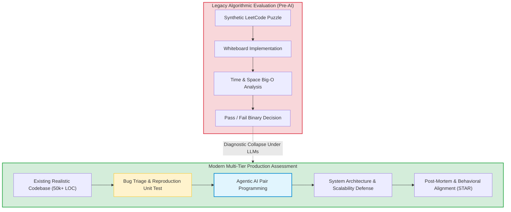

For over two decades, software engineering technical interviews were dominated by isolated puzzle solving: whiteboard algorithmic drills, reversing linked lists, and grinding hundreds of dynamic programming problems on LeetCode. While this filter tested basic algorithmic fluency and memorization, it bore virtually zero resemblance to day-to-day production engineering—where engineers navigate legacy monolithic codebases, debug distributed concurrency races, and weigh complex architectural trade-offs.

With the proliferation of frontier coding LLMs and autonomous agents capable of zero-shot solving competitive programming problems in seconds, the traditional algorithmic interview has experienced complete diagnostic failure. When candidate screening tools can be trivialized by an off-the-shelf language model, hiring managers are forced to rethink what engineering competence actually measures.

The software industry has radically pivoted toward high-fidelity engineering evaluations: pragmatic system design, deep codebase debugging, and candidate proficiency in driving autonomous coding agents.

This source audit analyzes why legacy algorithmic screening collapsed under generative AI, establishes an evidence-based roadmap for modern technical preparation (spanning distributed systems, object-oriented domain modeling, and behavioral STAR frameworks), and examines how candidate evaluation shifted toward SWE-bench-style repository environments across 2026.


## Why Has Generative AI Rendered Traditional LeetCode Interviews Obsolete?

The collapse of whiteboard algorithmic interviewing is rooted in a fundamental disconnect between synthetic isolated functions and real-world software development. As demonstrated in benchmarks like HumanEval and MBPP, foundation models achieve over 90% pass rates on isolated coding exercises because standard computer science interview questions are over-represented in pre-training data distributions.

Evaluating candidates on isolated puzzle solving creates three critical failure modes:
1. **High False Positives**: Candidates who memorize problem patterns (sliding window, two-pointer, DFS/BFS) pass screens without understanding modular software architecture or maintainability.
2. **High False Negatives**: Seasoned senior engineers who spend their days refactoring distributed systems and resolving production incidents fail arbitrary 45-minute trick problems.
3. **Cheating & Diagnostic Distortion**: Remote technical screens cannot reliably distinguish between a candidate's innate reasoning and discrete background LLM generation.

Consequently, forward-looking engineering organizations have shifted candidate evaluation from synthetic algorithmic puzzles to multi-layered production simulations:



## The Four Pillars of Modern Technical Interview Preparation

To succeed in contemporary technical evaluations, candidates must demonstrate structured reasoning across four core pillars:

### 1. Distributed Systems and Data-Intensive Design
System design interviews assess how an engineer handles ambiguity, scale, and operational failures. Rather than reciting buzzwords (Kafka, Redis, Kubernetes), high-scoring candidates systematically trace bottlenecks from first principles:
- **Functional & Non-Functional Requirements**: Defining read/write throughput, latency SLA targets (p99 < 50ms), data freshness tolerances, and compliance constraints.
- **Data Modeling & Storage Partitioning**: Contrasting relational transactional integrity (ACID) against distributed document stores and event sourcing. Designing partition keys to eliminate hotspot nodes.
- **Consensus & Fault Tolerance**: Mitigating network partitions using consensus mechanisms (Raft, Paxos) and implementing circuit breakers, exponential backoff, and idempotent consumers.
- **Reference Standard**: The definitive literature remains Martin Kleppmann’s *Designing Data-Intensive Applications*, which grounds high-level architecture in concrete physical disk and network realities.

### 2. Deep Codebase Navigation and Refactoring
Instead of writing 30 lines of clean code from scratch, candidates are dropped into an unfamiliar repository with a failing test suite. Evaluation criteria include:
- **Reproduction & Root-Cause Diagnosis**: Writing a minimal failing test before touching production code.
- **Codebase Design & Seam Identification**: Finding appropriate abstraction seams to inject dependency inversion without breaking existing callers.
- **Refactoring Hygiene**: Following Martin Fowler’s refactoring discipline—making small, atomic transformations verified by regression suites. Candidate workflows mirror the token-efficient patterns discussed in our guide on [agent-native interfaces](/posts/cli-anything-agent-native-interfaces/).

### 3. Object-Oriented Domain Modeling and API Contracts
Senior roles demand clean interface boundaries and domain-driven design:
- **Encapsulation & State Invariants**: Designing rich domain entities that prevent illegal system states rather than exposing anemic getters and setters.
- **Extensibility via Design Patterns**: Applying Strategy, Factory, and Observer patterns deliberately to isolate business logic from transport and persistence layers.
- **Contract-First API Design**: Specifying OpenAPI or GraphQL schemas with explicit error taxonomies before implementation.

### 4. Behavioral Excellence via the STAR Framework
The behavioral interview tests whether a candidate can operate effectively within complex human systems. High-signal narratives follow the STAR framework (Situation, Task, Action, Result) with measurable metrics:
- **Conflict Resolution**: How you navigated technical disagreements with product managers or staff architects using data and lightweight prototypes.
- **Incident Post-Mortems**: How you led triage during high-severity production outages, established blameless retrospectives, and built permanent architectural guardrails.

```python
"""
Example of Production Technical Interview Simulation:
Candidate is evaluated on concurrency control, idempotency, and error handling
rather than textbook algorithmic trivia.
"""

import time
import threading
from typing import Dict, Optional

class IdempotentPaymentProcessor:
    def __init__(self, processing_timeout_sec: float = 3.0):
        self._processed_keys: Dict[str, dict] = {}
        self._lock = threading.Lock()
        self.timeout = processing_timeout_sec

    def process_charge(self, idempotency_key: str, amount_cents: int, account_id: str) -> dict:
        if not idempotency_key:
            raise ValueError("Idempotency-Key header is required")

        # Fast-path check under thread lock
        with self._lock:
            if idempotency_key in self._processed_keys:
                record = self._processed_keys[idempotency_key]
                if record["status"] == "COMPLETED":
                    return {"status": "SUCCESS", "cached": True, "transaction_id": record["tx_id"]}
                elif record["status"] == "IN_FLIGHT":
                    raise RuntimeError("Concurrent transaction in flight with identical idempotency key")

            # Reserve transaction slot
            self._processed_keys[idempotency_key] = {
                "status": "IN_FLIGHT",
                "timestamp": time.time(),
                "account_id": account_id
            }

        # Simulate external downstream gateway interaction
        try:
            tx_id = f"tx_{int(time.time() * 1000)}"
            # Update record atomically upon successful external confirmation
            with self._lock:
                self._processed_keys[idempotency_key] = {
                    "status": "COMPLETED",
                    "tx_id": tx_id,
                    "amount": amount_cents,
                    "account_id": account_id
                }
            return {"status": "SUCCESS", "cached": False, "transaction_id": tx_id}

        except Exception as exc:
            # Clear reservation on unexpected failure to permit retry
            with self._lock:
                self._processed_keys.pop(idempotency_key, None)
            raise exc
```

## How Technical Hiring and Candidate Evaluation Evolved Across 2026

Between 2024 and 2026, technical recruiting underwent a generational transformation driven by coding agents and automated benchmark harnesses:

1. **Adoption of SWE-bench-Style Practical Audits**: Leading technology firms replaced automated HackerRank filters with sandboxed GitHub issues derived from public SWE-bench suites. Candidates are provided with an issue description, a reproduction harness, and an AI assistant, then evaluated on their ability to isolate the bug, verify edge cases, and push a compliant PR within 90 minutes.
2. **AI-Collaborative Pair Programming ("Harness Driving")**: Rather than banning LLMs, forward-thinking interviewers mandate their use. The interviewer observes how the candidate prompts, verifies, and course-corrects the AI tool. Does the candidate blindly accept hallucinated imports, or do they guide the model with precise architectural constraints and test-driven feedback loops? Similar principles of autonomous harness driving are analyzed in our review of [autonomous post-training loops](/posts/llm-self-evolution/).
3. **Multi-Agent Coordination and System Triage**: As engineering teams increasingly deploy multi-agent systems in production, senior architecture rounds now evaluate how candidates design agent safety boundaries, circuit breakers, and state persistence. Candidates are asked to diagnose failure loops in multi-agent networks, drawing on concepts covered in our study of [multi-agent system architectures](/posts/llm-build-multi-agent/).
4. **Verbal Architectural Defense over Live Typing**: Because raw code generation has become commoditized, interview weighting has shifted heavily toward interactive defense: explaining *why* an asynchronous queue was chosen over synchronous gRPC, quantifying failure blast radiuses, and defending data migration strategies.

## Key Takeaways

- **Algorithmic Memorization is Dead**: Generative AI has rendered isolated LeetCode challenges ineffective for assessing true software engineering competence.
- **Systems Thinking and Verification Dominate**: Candidates are evaluated on their ability to manage distributed failure states, maintain data consistency, and construct robust test suites.
- **AI Literacy is a Core Competency**: Modern technical interviews evaluate how effectively an engineer uses AI tools as a multiplier—scrutinizing their ability to detect subtle agent hallucinations and steer code generation.
- **Clean Communication Trumps Clever Hacks**: The highest-signal differentiator in senior interviews remains the capacity to articulate complex architectural trade-offs with structured clarity using established frameworks.

## New Questions

- **How Can Remote Interviewing Maintain Integrity in an Era of Real-Time Audio-Visual AI Copilots?** As multimodal agents provide real-time audio prompting directly into candidates' earpieces, will tech hiring return entirely to in-person assessment centers?
- **Will Entry-Level Hiring Vanish Without Whiteboard Puzzles?** If algorithmic screens disappear and practical evaluations require deep repo experience, how will universities and new graduates demonstrate competence without prior industry codebases?
- **How Will Standardized Developer Badges Evolve?** Will third-party verified benchmark runs on reproducible repositories replace the traditional multi-round interview process altogether?

## References

- Jimenez, C. E., Yang, J., Wettig, A., Yao, S., Pei, K., Press, O., & Narasimhan, K. (2024). *SWE-bench: Can Language Models Resolve Real-World GitHub Issues?* International Conference on Learning Representations (ICLR 2024). Available at: [https://arxiv.org/abs/2310.06770](https://arxiv.org/abs/2310.06770) (accessed 2026-10-18).
- Xu, F. F., Alon, U., Neubig, G., & Hellendoorn, V. J. (2022). *A Systematic Evaluation of Large Language Models of Code*. Advances in Neural Information Processing Systems (NeurIPS 2022). Available at: [https://arxiv.org/abs/2202.13161](https://arxiv.org/abs/2202.13161) (accessed 2026-10-18).
- Kleppmann, M. (2017). *Designing Data-Intensive Applications: The Big Ideas Behind Reliable, Scalable, and Maintainable Systems*. O'Reilly Media. Available at: [https://dataintensive.net/](https://dataintensive.net/) (accessed 2026-10-18).
- Fowler, M. (2018). *Refactoring: Improving the Design of Existing Code* (2nd ed.). Addison-Wesley Professional. Available at: [https://martinfowler.com/books/refactoring.html](https://martinfowler.com/books/refactoring.html) (accessed 2026-10-18).
