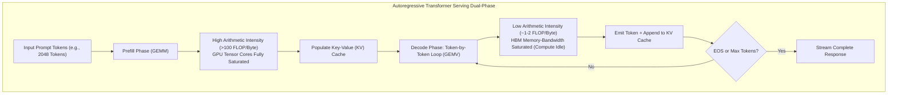
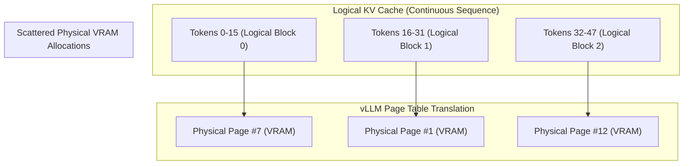
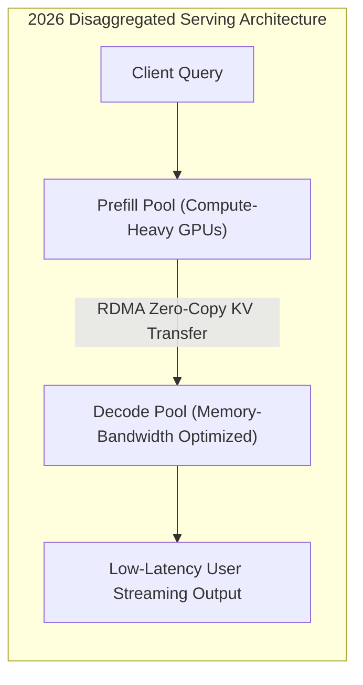

## Why Do Prefill and Decode Phases Exhibit Radically Opposing Hardware Bottlenecks?

When software engineers first benchmark large language model (LLM) serving systems, they frequently encounter an unintuitive paradox: modern tensor accelerators (such as the Nvidia H100 or AMD MI300X) capable of executing hundreds of teraflops per second sit at less than 5% compute utilization during interactive generation. Despite having immense parallel compute pipelines, production endpoints struggle to meet sub-30ms per-token latency service-level agreements (SLAs).

The root cause of this operational friction lies in the dual-phase execution lifecycle of autoregressive transformers: **the prefill phase** and **the decode phase**. These two stages occupy polar opposite ends of the **roofline performance model**:

1. **The Prefill Phase (Compute-Bound)**: When an inference server receives a prompt (e.g., a 2,048-token context), the entire sequence is ingested concurrently. The attention matrices and feed-forward layers execute massive general matrix-matrix multiplications (GEMMs). Because data reuse across the input tokens is high, arithmetic intensity routinely exceeds $100\text{ FLOPs per byte transferred}$, fully saturating GPU Tensor Cores.
2. **The Decode Phase (Memory-Bandwidth-Bound)**: Once prefill completes, the model generates output tokens autoregressively—one single token per forward pass. For every newly emitted token, the full multi-gigabyte parameter matrix of the model and the cached Key-Value (KV) tensors must be streamed from high-bandwidth device memory (HBM) into processing registers. The underlying operation degrades from a dense GEMM to a memory-bound general matrix-vector multiplication (GEMV). The arithmetic intensity collapses to approximately $1\text{ to }2\text{ FLOPs per byte}$.



Because modern GPUs are starved of data during the decode loop, mitigating inference bottlenecks requires architectural systems that maximize memory bandwidth utilization and convert serialized GEMV operations into parallel GEMMs.

---

## Systems Innovations for High-Throughput Serving

To resolve memory fragmentation and hardware stalling during the decode phase, the systems research community introduced three foundational serving primitives between 2022 and 2024:

```
Inference Optimization Primitives:
-------------------------------------------------------------------------------------------------
Technique               Primary Bottleneck Addressed      Algorithmic Mechanism
-------------------------------------------------------------------------------------------------
PagedAttention (vLLM)   Virtual Memory Fragmentation      Allocates KV-cache in non-contiguous physical pages
Continuous Batching     Static Batch Stragglers / Bubbles Schedules iteration-level tokens rather than request-level
Speculative Decoding    Memory-Bound GEMV Stalls          Draft model emits K tokens; Target verifies in 1 GEMM
Chunked Prefill         Prefill Head-of-Line Blocking     Splits long prefills into chunks to interleave with decode
-------------------------------------------------------------------------------------------------
```

### 1. PagedAttention: Eliminating KV Cache Memory Waste

In naive transformer serving, memory for the KV cache must be pre-allocated contiguously based on the maximum possible sequence length (e.g., 4,096 tokens). Kwon et al. (2023) demonstrated that in standard production workloads, up to **60% to 80% of GPU memory was wasted** due to internal and external fragmentation:
- **Internal fragmentation**: Reserving memory slots for future tokens that the model never ended up generating.
- **Reservation fragmentation**: Over-allocating memory across speculative concurrent requests.

Inspired by virtual memory paging in operating systems, **PagedAttention** partitions the KV cache into fixed-size physical blocks (typically holding 16 or 32 tokens). As explored in our source audit of [AWS Inferentia2 and Optimum Serving](/posts/huggingface-aws/), physical blocks do not need to reside contiguously in memory. A logical-to-physical block table translates attention addresses on-the-fly, allowing serving engines like **vLLM** to run with near-zero memory waste ($<4\%$), quadrupling server concurrency capacity.



### 2. Continuous Batching (Iteration-Level Scheduling)

Classical batching mechanisms (such as those in standard TensorFlow Serving or Triton Inference Server) processed requests synchronously: a batch waited until the slowest sequence completed generation before retiring the batch. This created massive "prefill bubbles" and wasted compute on finished slots.

Orca (Yu et al., 2022) introduced **continuous batching** (also known as iteration-level scheduling). Instead of batching at the request level, the engine batches at the iteration level. When an individual sequence emits an End-Of-Sequence (`<eos>`) token, its VRAM pages are immediately reclaimed, and a newly arrived request's prefill or another request's decode iteration is dynamically inserted into the running batch without pausing other concurrent streams.

---

## Speculative Decoding: Turning GEMV into Parallel GEMM

Even with continuous batching and PagedAttention, single-token decode steps remain memory-bound. As dissected in our mathematical study of [Bare-Metal NumPy Transformer Inference](/posts/llama-pure-numpy/), loading an unquantized 70B parameter model requires transferring ~140 GB across the memory bus just to predict one token.

Leviathan et al. (2023) and Chen et al. (2023) introduced **Speculative Decoding**. A lightweight draft model (e.g., a 1B or 7B model) rapidly autoregressively generates $K$ candidate tokens. Because the draft model is tiny, its memory access overhead is minimal.

Once $K$ draft tokens $[\hat{y}_1, \hat{y}_2, \dots, \hat{y}_K]$ are produced, the large target model runs a **single parallel forward pass** evaluating all $K$ tokens simultaneously using causal tree masks. This single forward pass is compute-bound (GEMM), streaming the 70B parameter weights across the memory bus once while validating multiple tokens:

```python
# Conceptual verification step in Speculative Decoding
def verify_speculative_tokens(target_model, prefix, draft_tokens, temperature=1.0):
    """
    Evaluates draft tokens in parallel within a single forward pass.
    """
    # Combine prefix and draft tokens into a single sequence
    full_seq = prefix + draft_tokens
    # Forward pass executes as a parallel GEMM across all K tokens
    logits = target_model(full_seq)
    
    accepted_tokens = []
    for i, token in enumerate(draft_tokens):
        # Sample probability distributions and apply rejection sampling criterion
        target_prob = softmax(logits[len(prefix) - 1 + i] / temperature)[token]
        draft_prob = draft_tokens_probs[i]
        
        # Modified rejection sampling ensures mathematical alignment with target model
        r = uniform_random(0, 1)
        if r < min(1.0, target_prob / draft_prob):
            accepted_tokens.append(token)
        else:
            # Rejection: Resample from target distribution and terminate speculative window
            resampled_token = sample_residual(logits[len(prefix) - 1 + i], draft_prob)
            accepted_tokens.append(resampled_token)
            break
            
    return accepted_tokens
```

Because verification is mathematically identical to sampling directly from the target model's distribution, speculative decoding achieves a $2\times$ to $3\times$ speedup with **zero degradation in output accuracy or perplexity**.

---

## Systemic Integration: Retrieval-Augmented Generation Interplay

Inference bottlenecks compound dramatically when LLMs are integrated with external knowledge retrieval. In our empirical guide on [Optimal RAG Configuration Strategies](/posts/the-most-optimal-rag-configuration/), retrieving 10 retrieved chunks of 500 tokens each expands the prefill length to over 5,000 tokens.

When an incoming 5,000-token RAG query enters a busy serving node, standard serving engines freeze all ongoing decode iterations to execute the massive prefill forward pass. This causes catastrophic jitter (spikes in Time-To-Next-Token, or TTNT).

To eliminate TTNT spikes, modern serving systems employ **Chunked Prefill** (Sarathi, Agrawal et al., 2024). The 5,000-token prefill is sliced into chunks of 512 tokens. Each chunk is co-batched alongside running decode iterations, maintaining consistent GPU compute saturation while guaranteeing smooth, jitter-free token streaming for active users.

---

## How Disaggregated Prefill-Decode and Micro-Architectures Evolved Across 2026

Between 2024 and 2026, the physical co-location of prefill and decode tasks on identical hardware reached architectural exhaustion:

### 1. Disaggregated Prefill-Decode Serving (Split-Architecture Clusters)
In 2026, leading production serving platforms (such as Mooncake and DistServe) physically decouple prefill nodes from decode nodes:
- **Prefill Clusters**: Equipped with compute-dense accelerators (e.g., Nvidia B200 / TPU v6) optimized for high FP8/FP4 GEMM throughput, handling massive prompt ingestion and document chunking.
- **Decode Clusters**: Equipped with memory-bandwidth-optimized hardware (e.g., AMD MI300X with 192GB HBM3 or Groq LPUs) optimized purely for streaming single-token generation.
- **Ultra-Fast KV-Transfer Fabrics**: High-speed PCIe Gen 5 and RDMA RoCE networks transfer the generated KV-cache state from the prefill node to the decode node in single-digit milliseconds.



### 2. Static SRAM-Based Processing (LPUs)
Architectures like Groq Language Processing Units (LPUs) abandoned external DRAM and HBM entirely. By storing foundation model weights directly within massive pools of distributed on-chip SRAM across interconnected chips, LPUs achieve memory bandwidths exceeding 80 TB/s, generating tokens at over 500 to 800 tokens per second for real-time conversational agents.

### 3. Native Test-Time Reasoning Compression
Modern reasoning models generate extensive intermediate thought tokens. Inference engines in 2026 deploy dynamic KV-cache pruning and cross-layer sharing, discarding intermediate scratchpad activations once a reasoning step completes, preventing context window memory exhaustion.

---

## Key Takeaways

- **Prefill and decode present opposite performance bottlenecks**: Prefill is compute-bound (GEMM), while decode is memory-bandwidth-bound (GEMV).
- **PagedAttention resolved the memory fragmentation crisis**: Partitioning KV caches into non-contiguous physical pages eliminated up to 80% memory waste in foundation model serving.
- **Continuous batching eliminates static scheduler bubbles**: Scheduling at the token-iteration boundary allows immediate resource recycling upon token completion.
- **Speculative decoding converts GEMV into parallel GEMM**: Small draft models propose candidate tokens that the large target model verifies in a single parallel pass without accuracy loss.
- **Disaggregated serving represents the 2026 production standard**: Physically separating compute-dense prefill nodes from memory-bandwidth-dense decode nodes optimizes hardware economics and eliminates latency jitter.

---

## New Questions

1. How do RDMA network serialization latencies impact Time-To-First-Token (TTFT) when offloading multi-gigabyte KV-cache states in disaggregated prefill-decode clusters?
2. What are the acceptance rate degradation boundaries of speculative decoding when the target model utilizes test-time search (e.g., Monte Carlo Tree Search) versus standard sampling?
3. Can sub-4-bit weight-only quantization (e.g., FP4 and INT2) fully overcome the memory-bandwidth wall on commodity client silicon without causing reasoning divergence?

---

## References

- Kwon, W., Li, Z., Zhuang, S., Sheng, Y., Zheng, L., Yu, C. H., Gonzalez, J. E., Zhang, H., & Stoica, I. (2023). *Efficient Memory Management for Large Language Model Serving with PagedAttention*. In Proceedings of the 29th ACM Symposium on Operating Systems Principles (SOSP '23), 611-626. Available at: <https://arxiv.org/abs/2309.06180> (accessed 2026-10-18).
- Yu, G. I., Jeong, J. S., Kim, G. W., Kim, S., & Chun, B. G. (2022). *Orca: A Distributed Serving System for Transformer-Based Generative Models*. In 16th USENIX Symposium on Operating Systems Design and Implementation (OSDI '22), 521-538. Available at: <https://www.usenix.org/conference/osdi22/presentation/yu> (accessed 2026-10-18).
- Leviathan, Y., Kalman, M., & Matias, Y. (2023). *Fast Inference from Transformers via Speculative Decoding*. In International Conference on Machine Learning (ICML), 19274-19286. Available at: <https://arxiv.org/abs/2211.17192> (accessed 2026-10-18).
- Agrawal, A., Kedia, N., Panwar, A., Mohan, J., Kwatra, N., Gulavani, B. S., Tumanov, A., & Ramjee, R. (2024). *Taming Throughput-Latency Tradeoff in LLM Inference with Sarathi-Serve*. In 18th USENIX Symposium on Operating Systems Design and Implementation (OSDI '24). Available at: <https://arxiv.org/abs/2403.02310> (accessed 2026-10-18).
