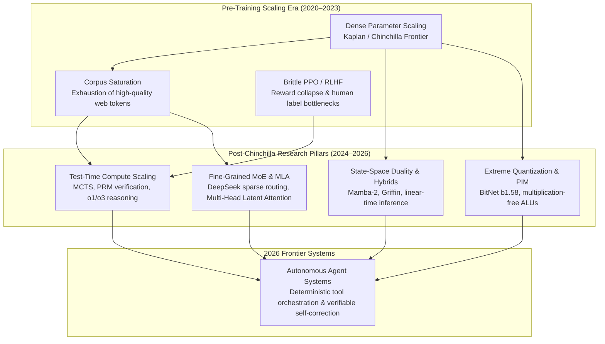

{: .light .w-75 .shadow .rounded-10 w='1212' h='668' }

## How Did Pre-Training Scaling Plateau Shift Research Toward Inference-Time Compute?

Between 2020 and 2023, frontier natural language processing was governed by the empirical power laws formalized by Kaplan et al. and refined by Chinchilla (Hoffmann et al.). The dominant formula for capability expansion was simple: scale parameter counts, expand token volume in proportional balance, and provision larger clusters of floating-point accelerators. However, as web-scale human-authored text hit exhaustion boundaries and data center capital constraints intensified, brute-force pre-training scaling encountered diminishing returns.

The inflection point of modern language modeling research moved beyond pre-training compute. Contemporary frontier laboratories now focus on four structural pivots: test-time search and verification scaling, sub-quadratic sequence models, fine-grained sparse routing, and extreme quantization. Rather than treating an LLM as a single-pass token predictor, modern research frames foundation models as cognitive simulation engines that trade latency and test-time FLOPs for verifiable deductive reasoning.

Understanding this architectural transition requires unpacking the mathematical underpinnings, empirical scaling laws, and hardware trade-offs governing post-Chinchilla research directions.



---

## 1. Test-Time Compute Scaling: Process Supervision and Search

The most consequential paradigm shift in contemporary LLM research is the formalization of test-time compute scaling laws (Snell et al., 2024). In traditional autoregressive generation, generating a token requires a single forward pass through $L$ Transformer layers. For complex mathematical, algorithmic, and logical problems, this single-pass structure forces the model to resolve multi-hop deductive steps within fixed intermediate representations.

Test-time compute scaling replaces fixed token generation with dynamic search across candidate solution trajectories:

$$P(\text{Correct} \mid x, C_{\text{test}}) = f(N_{\text{samples}}, \mathcal{V}_{\text{PRM}}, \mathcal{T}_{\text{search}})$$

Where $C_{\text{test}}$ represents the inference compute budget, $N_{\text{samples}}$ is the number of explored rollouts, $\mathcal{V}_{\text{PRM}}$ is a Process-Supervised Reward Model, and $\mathcal{T}_{\text{search}}$ represents the search topology (e.g., Monte Carlo Tree Search or beam search).

```
Problem Prompt (x) 
       │
       ├──► Step 1 ──► [PRM Score: 0.98] ──► Step 2a ──► [PRM Score: 0.42] (Pruned)
       │                                     │
       │                                     └──► Step 2b ──► [PRM Score: 0.96] ──► Verified Answer
       │
       └──► Step 1-alt ──► [PRM Score: 0.61] (Deferred)
```

### Process Supervision vs. Outcome Supervision
Lightman et al. demonstrated that training verifiers to evaluate each intermediate reasoning step (Process Reward Models, or PRMs) drastically reduces false positive hallucinations compared to Outcome Reward Models (ORMs) that merely check final answers. By coupling PRMs with tree search algorithms, a smaller model (such as an 8B parameter checkpoint) can outperform an unguided 70B parameter dense model on competitive programming (e.g., Codeforces) and Olympiad mathematics.

---

## 2. Sub-Quadratic Sequence Modeling: State-Space Duality

While dense multi-head attention remains dominant for bidirectional representation, its $\mathcal{O}(N^2)$ computational complexity and memory footprint impose severe barriers on multi-million-token contexts. As analyzed in our review of [Transformer architectural archetypes](/posts/llm-types/), managing the Key-Value (KV) cache for tens of thousands of concurrent users becomes memory-bound.

This constraint propelled the rapid development of State-Space Models (SSMs), notably Structured State Spaces (S4) and Mamba (Gu & Dao, 2023). Mamba replaces constant time-invariant convolutions with selective state spaces whose transition matrices depend dynamically on the input token:

$$h_t = \mathbf{A}_t h_{t-1} + \mathbf{B}_t x_t, \quad y_t = \mathbf{C}_t h_t + \mathbf{D} x_t$$

Where continuous parameters $(\Delta, \mathbf{A}, \mathbf{B}, \mathbf{C})$ are discretized into hardware-friendly recurrent updates. 

In Mamba-2 (Dao & Gu, 2024), the authors demonstrated the theoretical convergence known as **State-Space Duality (SSD)**: structured state-space transformations are mathematically equivalent to a specialized class of linear attention mechanisms with structured semi-separable 1-semiseparable kernel matrices. This revelation enabled SSD models to run on GPU tensor cores using matrix multiplication primitives rather than custom scan kernels, closing the hardware throughput gap with standard FlashAttention while retaining $\mathcal{O}(1)$ memory consumption per generated token during autoregressive decoding.

---

## 3. Fine-Grained Sparse Routing: DeepSeek MoE and Multi-Head Latent Attention

Mixture-of-Experts (MoE) architectures traditionally routed tokens to 1 or 2 large experts chosen from a set of 8 or 16 (e.g., Mixtral 8x7B). Recent research has dismantled this coarse allocation in favor of fine-grained micro-expert partitioning:

$$\mathbf{y} = \sum_{i \in \text{Shared}} \text{FFN}_i(\mathbf{x}) + \sum_{j \in \text{TopK}} g_j(\mathbf{x}) \text{FFN}_j(\mathbf{x})$$

By carving monolithic parameters into 64 to 256 micro-experts and designating a persistent fraction as shared experts, architectures like DeepSeekMoE ensure that common linguistic knowledge remains universally accessible while specialized domain parameters activate conditionally.

| Architecture Paradigm | Active Parameters | Total Parameters | Expert Granularity | KV Cache Footprint / Token |
| :--- | :--- | :--- | :--- | :--- |
| **Standard Dense (Llama-3-70B)** | 70B | 70B | Monolithic (1) | $2 \cdot n_{\text{layers}} \cdot d_{\text{kv}}$ (High) |
| **Coarse MoE (Mixtral 8x7B)** | 12.9B | 46.7B | 8 experts (Top-2) | Identical to Dense |
| **Fine-Grained MoE (DeepSeek-V2/V3)** | 21B | 236B | 160 experts (Top-6 + 2 shared) | Reduced by 93% via MLA |
| **Hybrid SSM-MoE (Jamba 1.5)** | 12B | 52B | 16 experts (Top-2) + Mamba layers | Reduced by 80% via SSM interleaved layers |

### Multi-Head Latent Attention (MLA)
In addition to micro-routing, DeepSeek introduced Multi-Head Latent Attention, which compresses the Key-Value projections into a low-dimensional latent vector $\mathbf{c}_t^{KV}$ prior to caching. During inference generation, only the compressed latent vector is read from High-Bandwidth Memory (HBM), drastically slashing memory bandwidth bottlenecks without degrading attention recall fidelity, directly complementing the foundational mechanics detailed in our study of [attention routing vs. associative FFN memory](/posts/deepdive-series-5/).

---

## 4. Extreme Quantization: The 1.58-Bit Frontier

Hardware memory bandwidth represents the primary cost driver for enterprise inference serving. While 8-bit (FP8, INT8) and 4-bit (AWQ, GPTQ) post-training quantization are now standard production tools, architectural research has advanced into natively trained 1-bit and ternary weights.

BitNet b1.58 (Wang et al., 2024) demonstrates that training linear projection layers with ternary weights $\{-1, 0, +1\}$ achieves parity with FP16 baselines across perplexity and downstream benchmarks once parameter scales exceed 3 billion:

$$W_{i, j} \in \{-1, 0, +1\}$$

```
Input Vector (x) ────► [ Addition & Subtraction Only ] ────► Output Vector (y)
                       (No Floating-Point Multiplications)
```

The mathematical consequence of ternary weights is profound: floating-point matrix multiplications ($\sum W_{ij} \cdot x_j$) collapse entirely into additions and subtractions. This eliminates power-hungry multiply-accumulate (MAC) arithmetic logic units, opening avenues for ultra-low-power SRAM accelerators and Processing-In-Memory (PIM) chips capable of executing multi-billion-parameter models at single-digit wattage.

---

## How LLM Research Trends Evolved Across 2026

Entering 2026, the artificial intelligence research frontier consolidated around three systemic breakthroughs:

1. **Reinforcement Learning with Verifiable Rewards (RLVR)**: Moving away from subjective human preference annotations (RLHF/DPO), state-of-the-art training pipelines now emphasize objective verification loops in domains with verifiable correctness (code compilation, theorem provers, formal logic solvers, and synthetic multi-agent game equilibria).
2. **Native Any-to-Any Autoregression**: Instead of bolting vision encoders or audio decoders onto an existing text model via cross-attention adapters, unified autoregressive models treat discrete audio tokens, visual patch tokens, and textual tokens as equivalent representations within a shared vocabulary, eliminating multi-modal latency overhead.
3. **Synthetic Data Curation & Model Collapse Mitigation**: With human-generated internet corpora depleted, researchers employ automated data filtering, mathematical synthesis pipelines, and adversarial game-theoretic data generation to train next-generation models without succumbing to the autophagous loop (model collapse) that degrades models trained on uncurated synthetic outputs. These automated benchmarking and evaluation standards are rigorously examined in our [Korean language model evaluation audit](/posts/evaluating-llm-use-case/).

---

## Key Takeaways

- **Compute Allocation Has Shifted**: The historical paradigm of concentrating 99% of compute budget into pre-training is obsolete; modern scaling optimizes post-training reinforcement learning and test-time verification search.
- **Hardware-Aware Architectural Convergence**: State-Space Duality (Mamba-2) and Multi-Head Latent Attention (MLA) prove that architectural innovations succeed only when they align with the physical realities of GPU SRAM tiling and memory bandwidth.
- **Deductive Verification Trumps Raw Fluency**: Frontier systems are moving away from probabilistic token guessing toward search-guided deductive verification, paving the way for truly autonomous enterprise agent runtimes.

---

## New Questions

- Will specialized test-time inference hardware (e.g., custom chips optimized for tree-search branch speculation) emerge to replace general-purpose matrix-multiplication accelerators?
- At what threshold does synthetic post-training data generation encounter catastrophic semantic collapse when applied to non-formal subjective disciplines such as creative writing and legal interpretation?

---

## References

- Kaplan, J., McCandlish, S., Henighan, T., Brown, T. B., Chess, B., Child, R., Gray, S., Radford, A., Wu, J., & Amodei, D. (2020). *Scaling Laws for Neural Language Models*. arXiv preprint arXiv:2001.08361. [https://arxiv.org/abs/2001.08361](https://arxiv.org/abs/2001.08361) (accessed 2026-10-18).
- Hoffmann, J., Borgeaud, S., Mensch, A., Sifre, L., Buchatskaya, E., Budden, D., ... & Sifre, L. (2022). *Training Compute-Optimal Large Language Models*. Advances in Neural Information Processing Systems, 35, 30016–30030. [https://arxiv.org/abs/2203.15556](https://arxiv.org/abs/2203.15556) (accessed 2026-10-18).
- Lightman, H., Kosaraju, V., Burda, Y., Couairon, H., Leike, J., & Sutskever, I. (2023). *Let's Verify Step by Step*. arXiv preprint arXiv:2305.20050. [https://arxiv.org/abs/2305.20050](https://arxiv.org/abs/2305.20050) (accessed 2026-10-18).
- Gu, A., & Dao, T. (2023). *Mamba: Linear-Time Sequence Modeling with Selective State Spaces*. arXiv preprint arXiv:2312.00752. [https://arxiv.org/abs/2312.00752](https://arxiv.org/abs/2312.00752) (accessed 2026-10-18).
- Dao, T., & Gu, A. (2024). *Transformers are SSMs: Generalized Models and Efficient Algorithms Through Structured State Space Duality*. International Conference on Machine Learning (ICML 2024). [https://arxiv.org/abs/2405.21060](https://arxiv.org/abs/2405.21060) (accessed 2026-10-18).
- Wang, S., Ma, S., Dong, L., Huang, S., Wang, H., Ma, Z., Yang, Y., Wang, R., Huang, Y., & Wei, F. (2024). *The Era of 1-bit LLMs: All Large Language Models are in 1.58 Bits*. arXiv preprint arXiv:2402.17764. [https://arxiv.org/abs/2402.17764](https://arxiv.org/abs/2402.17764) (accessed 2026-10-18).
- Snell, C., Lee, J., Xu, K., & Levine, S. (2024). *Scaling LLM Test-Time Compute Optimally Can Be More Effective than Scaling Model Parameters*. arXiv preprint arXiv:2408.03314. [https://arxiv.org/abs/2408.03314](https://arxiv.org/abs/2408.03314) (accessed 2026-10-18).
