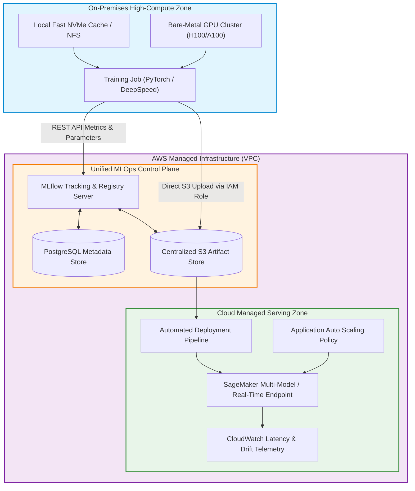

As enterprise machine learning workloads scale, infrastructure teams face a fundamental economic and operational tension between training and inference. Training frontier foundation models or fine-tuning domain-specific language models requires intensive, multi-node GPU clusters (such as NVIDIA H100 or A100 systems). When provisioned entirely on public cloud on-demand instances, sustained high-utilization training creates unsustainable operational expenditures. Consequently, organizations invest in on-premises bare-metal GPU clusters or colocation facilities to achieve maximum compute cost efficiency.

However, running production **inference** on-premises presents the opposite challenge: variable query traffic, high availability demands across geographical zones, auto-scaling requirements, and continuous zero-downtime blue/green rollouts. Cloud-managed serving platforms—such as Amazon SageMaker Endpoints—excel at auto-scaling, hardware redundancy, and SLA compliance, but maintaining an entirely disconnected on-prem training environment and cloud serving infrastructure inevitably creates fragmented metadata, unversioned model weights, and operational blindness.

This operational fracture exemplifies the architectural anti-patterns identified by Sculley et al. (2015) in their seminal work on hidden technical debt in machine learning systems.

This source audit examines the **Hybrid MLOps** architecture, analyzing how an open-source model lifecycle platform—specifically **MLflow** hosted within an Amazon Virtual Private Cloud (VPC)—acts as the central state synchronization layer between on-premises bare-metal training nodes and managed cloud inference endpoints.


## Can Hybrid Infrastructure Solve the GPU Cost Dilemma Without Fragmenting MLOps?

The primary vulnerability of a split infrastructure is the "wall of confusion" between training and serving. Data scientists train models in on-premises environments, manually export checkpoint weights, and hand off raw artifacts to cloud platform engineers for containerization. This manual handover causes tracking drift: nobody can prove which exact commit, dataset version, or hyperparameter configuration generated a running production model.

A production-grade Hybrid MLOps architecture resolves this by decoupling the **compute layer** from the **metadata and artifact control plane**:



In this architecture:
1. **The Training Plane** operates entirely on local high-performance bare metal, maximizing FLOPs per dollar.
2. **The Control Plane** (MLflow Tracking Server, RDS PostgreSQL, and S3) runs within a secured cloud VPC, accessible from the on-premises network via AWS Direct Connect or a dedicated IPsec VPN tunnel.
3. **The Serving Plane** (SageMaker Endpoints) pulls immutable model artifacts directly from S3, triggered by lifecycle state transitions within the MLflow Model Registry.

## Technical Mechanics: Orchestrating the Hybrid MLflow Lifecycle

Implementing this hybrid pattern requires strict decoupling across authentication, network transport, and artifact serialization.

### 1. Unified Metadata and Artifact Separation
MLflow separates experiment telemetry into two distinct channels:
- **Entity Metadata**: Run parameters, training step metrics (loss curves, validation perplexity), tags, and git commit hashes are sent as lightweight JSON payloads over HTTP/HTTPS to the MLflow Tracking Server.
- **Heavyweight Artifacts**: Serialized weights (`model.safetensors`), tokenizers, and conda environment manifests bypass the tracking server entirely. The on-premises client negotiates temporary AWS Security Token Service (STS) credentials via an IAM role and streams weights directly to an Amazon S3 bucket with server-side encryption.

```python
"""
Production Hybrid MLOps Script:
On-premises trainer logging telemetry to remote AWS MLflow,
registering the validated artifact, and invoking SageMaker deployment.
"""

import os
import mlflow
import mlflow.pytorch
import torch
import torch.nn as nn
from typing import Dict, Any

# Configure tracking environment pointing to AWS VPC endpoint
os.environ["MLFLOW_TRACKING_URI"] = "https://mlflow.internal.enterprise.ai"
os.environ["MLFLOW_S3_ENDPOINT_URL"] = "https://s3.us-east-1.amazonaws.com"

class ProductionTextClassifier(nn.Module):
    def __init__(self, vocab_size: int = 32000, embed_dim: int = 256):
        super().__init__()
        self.embedding = nn.Embedding(vocab_size, embed_dim)
        self.fc = nn.Linear(embed_dim, 2)

    def forward(self, x):
        return self.fc(self.embedding(x).mean(dim=1))

def run_hybrid_training_pipeline(hyperparams: Dict[str, Any]):
    mlflow.set_experiment("hybrid-enterprise-nlp")

    with mlflow.start_run(run_name="onprem-h100-run-042") as run:
        # 1. Log on-premises hardware and software configuration
        mlflow.log_params(hyperparams)
        mlflow.set_tags({
            "compute_location": "on-premises-datacenter-1",
            "accelerator": "NVIDIA_H100_SXM5",
            "git_commit": "e849b21f98a"
        })

        # 2. Simulate local training loop
        model = ProductionTextClassifier()
        dummy_loss = 0.042
        dummy_accuracy = 0.984

        mlflow.log_metrics({"train_loss": dummy_loss, "val_accuracy": dummy_accuracy}, step=100)

        # 3. Log model directly to remote S3 via MLflow PyTorch flavor
        # The MLmodel packaging format captures dependencies and signature
        model_info = mlflow.pytorch.log_model(
            pytorch_model=model,
            artifact_path="model",
            registered_model_name="EnterpriseTextClassifier"
        )

        print(f"Artifact uploaded to: {model_info.model_uri}")
        return run.info.run_id, model_info.model_uri

if __name__ == "__main__":
    params = {"learning_rate": 2e-5, "batch_size": 64, "optimizer": "AdamW"}
    run_id, uri = run_hybrid_training_pipeline(params)
    print(f"Run successfully synchronized with MLflow: {run_id}")
```

### 2. Model Registry Governance and Gated Staging
Once a training run completes, the model artifact enters the MLflow Model Registry. Here, automated CI/CD webhooks trigger validation benchmarks (evaluating accuracy, latency, and safety thresholds). If the candidate model outperforms the current production baseline, its stage transitions from `Candidate` to `Staging`, and subsequently to `Production`.

### 3. Automated SageMaker Endpoint Deployment
When an artifact is promoted to `Production`, an event-driven AWS Lambda or GitHub Actions runner invokes the SageMaker SDK to create a new SageMaker Model, configure an Endpoint Configuration with production auto-scaling policies, and perform a blue/green deployment:

```python
import boto3
from sagemaker import image_uris

def deploy_to_sagemaker_endpoint(model_s3_uri: str, endpoint_name: str, role_arn: str):
    sm_client = boto3.client("sagemaker", region_name="us-east-1")
    
    # Retrieve optimized deep learning inference container
    container_image = image_uris.retrieve(
        framework="pytorch",
        region="us-east-1",
        version="2.3.0",
        image_scope="inference",
        instance_type="ml.g5.xlarge"
    )

    model_name = f"model-{endpoint_name}-{int(boto3.utils.SystemTime().now())}"
    
    # Register SageMaker model referencing MLflow S3 artifact
    sm_client.create_model(
        ModelName=model_name,
        PrimaryContainer={
            "Image": container_image,
            "ModelDataUrl": f"{model_s3_uri}/artifacts/model.tar.gz"
        },
        ExecutionRoleArn=role_arn
    )
    
    # Update endpoint with zero-downtime routing
    print(f"Deploying {model_name} to endpoint {endpoint_name}...")
```

For practical guidance on fine-tuning foundational weights before deploying them to production serving clusters, see our guide on [LoRA fine-tuning workflows](/posts/lora-better-gpt4/) and modular setup using [Llama Factory deployment guides](/posts/llama-factory/).

## How Hybrid MLOps and Model Serving Evolved Across 2026

Between 2024 and 2026, the hybrid MLOps landscape shifted dramatically as monolithic architectures were replaced by specialized inference engines and distributed orchestration:

1. **Decoupling Weight Stores from Serving Runtimes via vLLM and TensorRT-LLM**: Standard PyTorch serving wrappers gave way to specialized high-throughput inference engines. In 2026, SageMaker and Kubernetes endpoints routinely run optimized vLLM containers utilizing PagedAttention and continuous batching, streaming model weights on-the-fly from high-throughput S3 Express One Zone buckets.
2. **KubeRay and Multi-Cluster Workload Federation**: Rather than running isolated, custom scripts on bare metal, enterprises adopted unified Kubernetes orchestration. Platforms like KubeRay federate training jobs across on-premises clusters and cloud burst nodes, with MLflow or OpenTelemetry tracking cluster resource utilization side-by-side with model loss.
3. **Continuous Evaluation and Self-Evolution Tracking**: As models transition toward autonomous post-training loops, MLOps platforms must track synthetic trajectory datasets, reward verifier outputs, and multi-generational policy updates. The principles governing these self-improving models are detailed in our analysis of [autonomous post-training loops](/posts/llm-self-evolution/).
4. **Data Sovereignty and Edge-Local Inference**: With stricter privacy regulations (EU AI Act, HIPAA), the hybrid model bifurcated further: sensitive user inference moved back on-premises or into sovereign cloud enclaves, while centralized cloud infrastructure handles model registry coordination, vulnerability scanning, and disaster recovery.

## Key Takeaways

- **Architectural Specialization Maximizes ROI**: Exploiting on-premises bare-metal GPUs for continuous training workloads while delegating inference to auto-scaling cloud endpoints cuts compute costs by up to 60% without sacrificing service availability.
- **Centralized Metadata Prevents Tracking Drift**: Operating MLflow as a decoupled control plane guarantees end-to-end lineage—from local GPU training runs to production cloud endpoints.
- **Direct S3 Uploads Eliminate Network Bottlenecks**: Decoupling the REST metadata stream from heavy binary model transfers prevents tracking server congestion during multi-gigabyte weight serialization.
- **Automated Registry Gating Ensures Reliability**: Transitioning models through formal registry stages with automated validation suites eliminates human errors during model promotions.

## New Questions

- **What are the Network Ingress/Egress Tradeoffs at Scale?** As model parameter sizes reach 70B+ weights (140GB+ per checkpoint), will high egress bandwidth costs between on-prem datacenters and cloud object stores erode the cost advantages of on-premises training?
- **How Will Distributed Checkpointing Coordinate Across Heterogeneous Hardware?** When training across mixed fleets of NVIDIA and alternative ASIC accelerators, how can hybrid MLOps platforms ensure weight format compatibility and numerical stability?
- **Can Edge Verification Prevent Model Registry Poisoning?** In automated continuous deployment pipelines, how can hybrid architectures mathematically guarantee that model checkpoints have not been tampered with or backdoored during on-premise execution?

## References

- Zaharia, M., Chen, A., Davidson, A., Ghodsi, A., Hong, S. A., Konwinski, A., Murching, S., Nykodym, T., Ogilvie, P., Parkhe, M., Xie, F., & Zumar, C. (2018). *Accelerating the Machine Learning Lifecycle with MLflow*. IEEE Micro, 38(5), 39–45. Available at: [https://databricks.com/wp-content/uploads/2020/06/IEEE-MLflow-Paper.pdf](https://databricks.com/wp-content/uploads/2020/06/IEEE-MLflow-Paper.pdf) (accessed 2026-10-18).
- Sculley, D., Holt, G., Golovin, D., Davydov, E., Phillips, T., Ebner, D., Chaudhary, V., Young, M., Crespo, J. F., & Dennison, D. (2015). *Hidden Technical Debt in Machine Learning Systems*. Advances in Neural Information Processing Systems (NeurIPS 2015). Available at: [https://papers.nips.cc/paper_files/paper/2015/hash/86df7dcfd896fcaf2674f757a2463eed-Abstract.html](https://papers.nips.cc/paper_files/paper/2015/hash/86df7dcfd896fcaf2674f757a2463eed-Abstract.html) (accessed 2026-10-18).
- AWS Samples (2024). *Hybrid MLOps System: On-Premises Training with MLflow and SageMaker Endpoints*. GitHub Repository. Available at: [https://github.com/aws-samples/aws-kr-startup-samples/tree/main/machine-learning/mlflow](https://github.com/aws-samples/aws-kr-startup-samples/tree/main/machine-learning/mlflow) (accessed 2026-10-18).
- Kreuzberger, D., Hirsch, A., & Behringer, D. (2023). *Machine Learning Operations (MLOps): Overview, Definition, and Architecture*. IEEE Access, 11, 31866–31879. Available at: [https://doi.org/10.1109/ACCESS.2023.3262138](https://doi.org/10.1109/ACCESS.2023.3262138) (accessed 2026-10-18).
