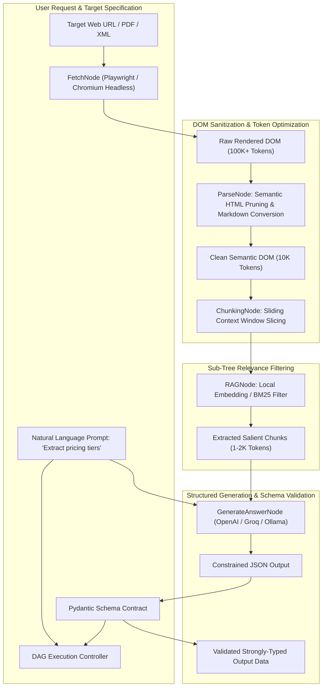
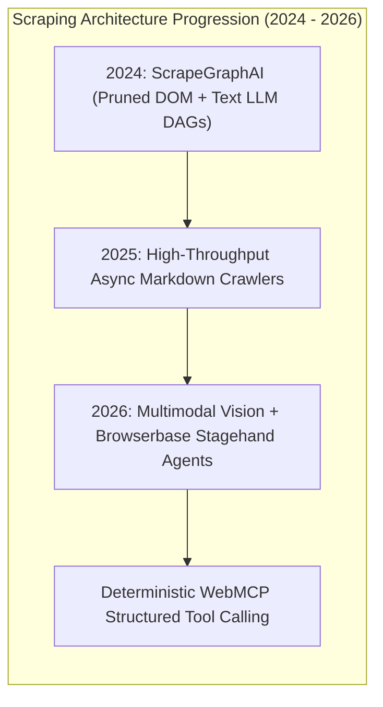

## Why Did Declarative Graph Pipelines Replace Fragile XPath Selectors in Modern Web Extraction?

For over two decades, web data extraction adhered to a rigid, deterministic paradigm: inspecting the Document Object Model (DOM), crafting brittle XPath expressions or CSS selectors (via libraries like BeautifulSoup, Scrapy, or Cheerio), and maintaining brittle regular expressions. However, modern Single-Page Applications (SPAs) built with React, Next.js, and automated Tailwind CSS bundlers shattered this methodology. Dynamic hash-based CSS class names (e.g., `class="css-1a7b8c_x2"`), client-side hydration delays, shadow DOM encodings, and frequent UI A/B testing meant that hand-crafted scraping pipelines required near-continuous manual maintenance.

In May 2024, **ScrapeGraphAI** emerged as a widely adopted open-source Python framework designed to solve scraper brittleness. Rather than relying on hardcoded DOM selectors or naive brute-force LLM prompting, ScrapeGraphAI formalized web extraction as an **executable Directed Acyclic Graph (DAG)**:
1. **Declarative Natural Language Extraction**: Developers specify extraction intent via semantic prompts and typed schema contracts rather than element coordinates.
2. **Modular Graph Nodes**: Decoupling the scraping lifecycle into discrete, interchangeable nodes (`FetchNode`, `ParseNode`, `RAGNode`, and `GenerateAnswerNode`).
3. **Semantic DOM Tree Pruning**: Slashing token consumption by up to $90\%$ by sanitizing HTML boilerplates (scripts, styles, tracking tags) before LLM ingestion.
4. **Multi-Model Provider Agnosticism**: Seamlessly switching between cloud APIs (OpenAI, Azure, Groq) and local open weights (Ollama, vLLM) depending on throughput and compliance requirements.



By engineering web scraping as a modular state machine rather than an ad-hoc script, ScrapeGraphAI transformed web scraping into a resilient, automated data acquisition pipeline.

---

## Architectural Deep-Dive: The Directed Acyclic Graph (DAG) Execution Model

At the core of ScrapeGraphAI is its base `Graph` abstraction. Instead of running a linear procedural script, every extraction workflow is defined as a graph containing state, inputs, nodes, and directed edges:

```
Core ScrapeGraphAI Graph Nodes:
-------------------------------------------------------------------------------------------------
Node Type             Primary Function                     Underlying Technology
-------------------------------------------------------------------------------------------------
FetchNode             Retrieves raw network payloads       Playwright Headless Chromium / Requests
ParseNode             Sanitizes and converts DOM trees     BeautifulSoup4 / Trafilatura / HTML2Text
RAGNode               Filters context for large documents  Local FAISS / ChromaDB / BM25 Ranking
GenerateAnswerNode    Executes structured LLM extraction   LangChain / Pydantic / JsonOutputParser
SpeechNode            Converts extracted text to audio     ElevenLabs / OpenAI Audio API
-------------------------------------------------------------------------------------------------
```

### 1. The Token Economics of Semantic DOM Pruning

A standard e-commerce product page or enterprise software dashboard frequently exceeds 1.5 megabytes of HTML, representing over $150,000$ tokens. Feeding raw HTML directly into a commercial LLM context window causes astronomical API costs and introduces severe distraction noise from irrelevant JavaScript trackers, CSS variables, and navigation menus.

The `ParseNode` executes a multi-stage deterministic pruning pipeline:
1. **Tag Stripping**: Stripping non-semantic elements: `<script>`, `<style>`, `<svg>`, `<iframe>`, `<meta>`, `<link>`, and hidden `aria-hidden="true"` containers.
2. **Attribute Pruning**: Removing internal framework attributes (`data-reactid`, `data-testid`, class hashes) while strictly preserving semantic anchors: `href`, `src`, `title`, `alt`, and table structures.
3. **HTML-to-Markdown Reduction**: Converting hierarchical nested `<div>` layouts into standardized Markdown tables and nested lists.

```python
# Semantic DOM pruning mechanics inside ParseNode
from bs4 import BeautifulSoup
import html2text

def sanitize_dom_for_llm(raw_html: str) -> str:
    """
    Strips non-semantic elements and compresses HTML into token-efficient Markdown.
    """
    soup = BeautifulSoup(raw_html, "html.parser")
    
    # Strip heavy non-content tags
    for tag in soup(["script", "style", "svg", "noscript", "iframe", "header", "footer"]):
        tag.decompose()
        
    # Convert cleaned DOM to Markdown
    converter = html2text.HTML2Text()
    converter.ignore_links = False
    converter.ignore_images = True
    converter.body_width = 0  # Disable line wrapping
    
    clean_markdown = converter.handle(str(soup))
    return clean_markdown
```

This deterministic reduction drops input token volume by **$85\%$ to $92\%$**, allowing the subsequent `RAGNode` and `GenerateAnswerNode` to operate within small, cost-effective context budgets.

---

## Schema-Driven Determinism with Pydantic

A critical vulnerability in early LLM web scraping was non-deterministic output: models emitted conversational filler (`"Sure! Here is the data you requested:"`), varied JSON keys across runs, or hallucinated missing fields.

ScrapeGraphAI solved this by binding graph outputs directly to **Pydantic v2 BaseModel schemas**. By providing a target Pydantic class, the framework enforces constrained grammar decoding at the API level (via OpenAI JSON Mode, Function Calling, or Ollama JSON schema constraints):

```python
from pydantic import BaseModel, Field
from typing import List
from scrapegraphai.graphs import SmartScraperGraph

# 1. Define explicit data contract
class PricingPlan(BaseModel):
    plan_name: str = Field(description="Name of the subscription tier")
    monthly_price: float = Field(description="Price per month in USD")
    features: List[str] = Field(description="List of included product features")

class PricingSchema(BaseModel):
    plans: List[PricingPlan]

# 2. Configure ScrapeGraphAI DAG
graph_config = {
    "llm": {
        "model": "groq/llama-3-70b-8192",
        "api_key": "YOUR_GROQ_KEY",
        "temperature": 0.0,
    },
    "headless": True,
}

# 3. Execute declarative extraction pipeline
smart_scraper = SmartScraperGraph(
    prompt="Extract all available pricing tiers and their key features",
    source="https://example.com/pricing",
    schema=PricingSchema,
    config=graph_config
)

result = smart_scraper.run()
```

If an LLM produces malformed fields (e.g., passing a string into a float field), the internal schema parser catches the validation error and triggers an immediate local self-correction retry node.

---

## Comparative Context: Evolution of Data Extraction Architectures

ScrapeGraphAI represents an intermediate architectural milestone connecting legacy web scrapers to autonomous web-browsing agents. As examined in our technical reviews of [RAG Configuration Strategies](/posts/the-most-optimal-rag-configuration/) and [Visualizing Vector Embeddings](/posts/visualize-rag-data/):

| Architecture Generation | Primary Mechanism | Adaptability to DOM Drift | Cost per Page | Maintenance Overhead |
| :--- | :--- | :--- | :--- | :--- |
| **Gen 1: Selectors (Scrapy, BS4)** | Hardcoded CSS / XPath | 0% (Breaks on CSS class changes) | ~$0.0001 (Pure CPU) | Extreme (Constant manual updates) |
| **Gen 2: Graph DAGs (ScrapeGraphAI)** | Pruned DOM + Directed LLM Nodes | 85% (Adapts to structural changes) | ~$0.002 - $0.01 | Low (Natural language updates) |
| **Gen 3: Agentic CDP (Stagehand, Crawl4AI)** | Browser CDP + Vision-Language Agents | 98% (Handles dynamic clicks/auth) | ~$0.02 - $0.05 | Minimal (Autonomous navigation) |

---

## How Agentic Web Scraping and Headless Browsing Evolved Across 2026

Between 2024 and 2026, static HTML scraping tools encountered the limits of anti-bot protections, CAPTCHA challenges, and canvas-rendered web apps:

### 1. The Emergence of High-Speed Markdown Crawlers (Crawl4AI)
While early frameworks launched heavyweight Chromium browser processes for every simple webpage, tools like **Crawl4AI** introduced asynchronous headless pipelines capable of extracting clean, LLM-ready markdown at thousands of pages per minute with minimal memory overhead, integrating directly into enterprise RAG indexing engines.

### 2. Multi-Modal Vision-Based Web Extraction (OmniScraper)
As explored in our analysis of [Vision-Language Model Trajectories](/posts/vision-language-model/), websites increasingly utilize SVG canvas charts, interactive WebGL interfaces, and anti-scraping DOM obfuscation that completely hide raw text from HTML inspection. Modern 2026 scrapers capture full-page high-resolution screenshots, feeding visual rasters directly into multimodal foundation models to extract data visually, bypassing DOM obfuscation entirely.



### 3. Agentic Browser Control via Model Context Protocol (MCP)
In modern autonomous agent architectures, scraping is no longer an isolated offline batch job. Autonomous agents connect directly to running Chrome profiles via standardized Model Context Protocol (MCP) servers, allowing models to authenticate behind corporate single sign-on (SSO), click dynamic pagination elements, and extract structured telemetry on-demand.

---

## Key Takeaways

- **Declarative graphs solve selector brittleness**: Replacing rigid XPath rules with semantic prompts and Pydantic schemas allows scrapers to withstand frequent website redesigns.
- **Semantic DOM pruning slashes API costs**: Stripping scripts, styles, and non-semantic HTML tags compresses token volume by up to $90\%$ prior to LLM extraction.
- **Pydantic schema binding eliminates hallucination**: Enforcing strict JSON schema contracts guarantees that downstream databases receive validated, strongly typed data.
- **Modular DAG architecture enables provider flexibility**: Decoupled graph nodes allow pipelines to mix local Ollama models for filtering and frontier cloud models for extraction.
- **2026 extraction merges multimodal vision and agentic CDP**: Modern enterprise scrapers combine high-speed markdown engines with vision-based page comprehension and autonomous browser agent protocols.

---

## New Questions

1. How do browser fingerprinting defenses (e.g., Cloudflare Turnstile, DataDome) interact with LLM-guided headless browser CDP event streams compared to traditional Playwright automation?
2. What are the latency and cost trade-offs of using multimodal vision screenshot extraction versus tokenized pruned DOM parsing on content-heavy web platforms?
3. To what extent can client-side WebAssembly models execute real-time schema extraction inside browser extensions without sending sensitive web session data to third-party APIs?

---

## References

- Perugachi-Copete, M. V., Coviello, L., & ScrapeGraphAI Team. (2024). *ScrapeGraphAI: You Only Scrape Once*. Open Source Software & Technical Documentation. Available at: <https://github.com/VinciGit00/Scrapegraph-ai> (accessed 2026-10-18).
- Microsoft Playwright Team. (2023). *Playwright: Fast and reliable end-to-end testing for modern web apps*. Microsoft Documentation. Available at: <https://playwright.dev/> (accessed 2026-10-18).
- Colvin, S., & Pydantic Contributors. (2023). *Pydantic: Data validation using Python type hints*. Technical Documentation. Available at: <https://docs.pydantic.dev/> (accessed 2026-10-18).
- Borgeaud, S., Mensch, A., Hoffmann, J., Cai, T., Rutherford, E., Millican, K., van den Driessche, G., Lespiau, J. B., Damoc, B., Clark, A., et al. (2022). *Improving Language Models by Retrieving from Trillions of Tokens*. In International Conference on Machine Learning (ICML), 2206-2240. Available at: <https://arxiv.org/abs/2112.04426> (accessed 2026-10-18).
