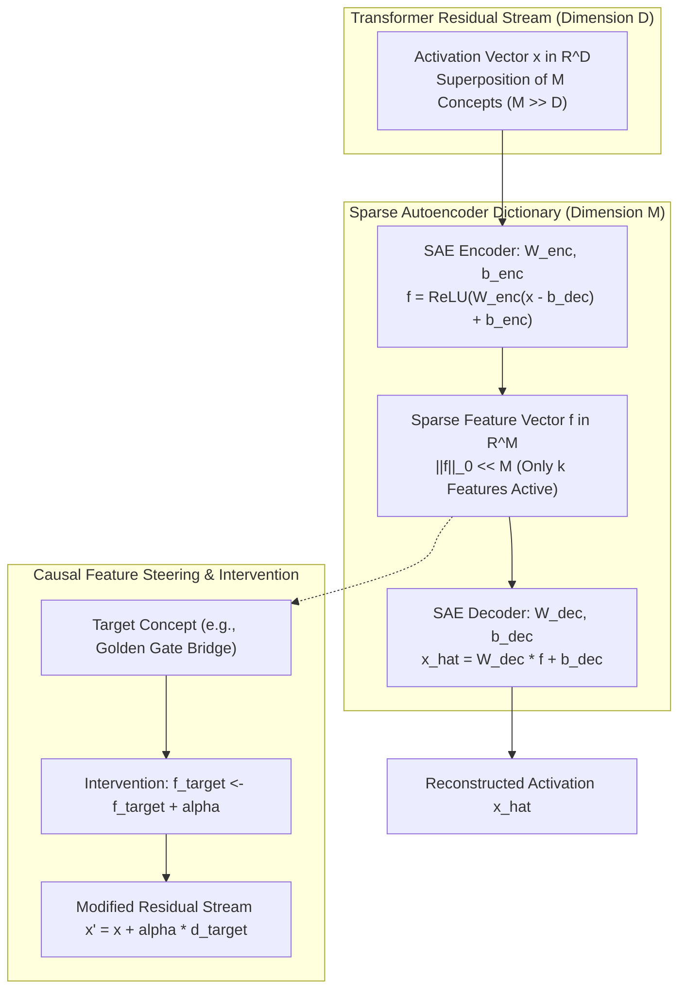
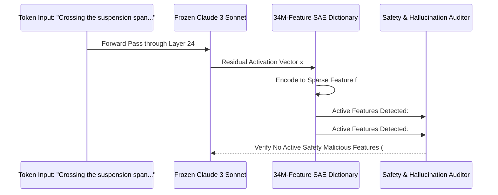

## How Does Sparse Dictionary Learning Resolve the Superposition Dilemma in Neural Networks?

Large language models represent high-dimensional world knowledge across billions of numerical weights. Historically, inspecting individual neurons within a deep neural network yielded opaque, uninterpretable activations. A single neuron in an intermediate multi-layer perceptron (MLP) layer might fire concurrently in response to quantum physics equations, romantic poetry in French, and base-64 encoded strings. This phenomenon—termed *polysemanticity*—rendered neural representations impenetrable black boxes.

The theoretical breakthrough articulated by Anthropic in *Scaling Monosemanticity: Extracting Interpretable Features from Claude 3 Sonnet* demonstrated that polysemanticity is an artifact of the **superposition hypothesis**. Neural networks represent vastly more conceptual features than their physical activation dimensions ($M \gg D$) by packing quasi-orthogonal feature directions into shared vector spaces. By deploying Sparse Autoencoders (SAEs), researchers can unroll superimposed activations into millions of monosemantic, human-interpretable directions that can be causally steered.

---

## The Mathematics of the Superposition Hypothesis and Sparse Autoencoders

Why do neural networks exhibit polysemanticity? Under the Johnson-Lindenstrauss lemma and compressed sensing theory, an inner-product vector space of dimension $D$ can host exponentially many almost-orthogonal vectors if the underlying data distribution is sparse (i.e., only a tiny fraction of features fire simultaneously for any given input sequence).

Because real-world language concepts are sparse—a document discussing orbital mechanics rarely discusses sourdough bread fermentation in the same sentence—the network minimizes loss by packing $M$ features into $D$ dimensions ($M \gg D$), paying a small penalty in cross-feature interference (noise).

### 1. Mathematical Formulation of Sparse Autoencoders

An SAE is an unsupervised dictionary learning architecture trained on the intermediate residual stream activations $\mathbf{x} \in \mathbb{R}^D$ of a frozen base model. The SAE projects $\mathbf{x}$ into an expanded feature latent space of dimension $M$ (where expansion factor $F = M / D$, typically $16\times$ to $64\times$):

$$\mathbf{f}(\mathbf{x}) = \text{ReLU}\left( \mathbf{W}_{\text{enc}} (\mathbf{x} - \mathbf{b}_{\text{dec}}) + \mathbf{b}_{\text{enc}} \right), \quad \mathbf{f} \in \mathbb{R}^M$$

The decoder reconstructs the original residual activation as a linear combination of unit-norm dictionary feature directions $\mathbf{d}_i \in \mathbb{R}^D$ (the columns of $\mathbf{W}_{\text{dec}}$):

$$\hat{\mathbf{x}} = \sum_{i=1}^M f_i \mathbf{d}_i + \mathbf{b}_{\text{dec}} = \mathbf{W}_{\text{dec}} \mathbf{f} + \mathbf{b}_{\text{dec}}$$

subject to the column normalization constraint:

$$\|\mathbf{W}_{\text{dec}, i}\|_2 = 1 \quad \forall i \in \{1, \dots, M\}$$

### 2. The Sparsity-Reconstruction Optimization Objective

Training balances reconstruction fidelity against activation sparsity:

$$\mathcal{L}_{\text{SAE}}(\theta) = \underbrace{\frac{1}{D} \|\mathbf{x} - \hat{\mathbf{x}}\|_2^2}_{\text{Reconstruction Loss (MSE)}} + \underbrace{\lambda \sum_{i=1}^M |f_i|}_{L_1 \text{ Sparsity Regularizer}}$$

The $L_1$ penalty enforces sparsity by driving the vast majority of latent activations $f_i$ to zero. As a result, for any token input, the $L_0$ norm (the count of non-zero features) satisfies $\|\mathbf{f}\|_0 \ll M$, isolating precise conceptual primitives.

| Metric | Dense Residual Stream $\mathbf{x}$ | Sparse Autoencoder Latent $\mathbf{f}$ |
| :--- | :--- | :--- |
| **Dimensionality** | $D \approx 4,096 \text{ to } 8,192$ | $M \approx 65,536 \text{ to } 33,554,432$ ($8\times\text{--}64\times$) |
| **Sparsity Level** | $100\%$ dense ($L_0 = D$) | Ultra-sparse ($L_0 \approx 20\text{--}100 \ll M$) |
| **Semantic Purity** | Polysemantic (superimposed mixture) | Monosemantic (atomic conceptual directions) |
| **Causal Steerability** | Poor (distorts unrelated capabilities) | High (isolated conceptual interventions) |

---

## Landmark Findings in Claude 3 Sonnet: From Golden Gate to Biosecurity

Anthropic scaled SAEs to intermediate layers of Claude 3 Sonnet, extracting over tens of millions of monosemantic features. The empirical properties observed established new benchmarks for neural explainability:

1. **Abstract and Multimodal Concepts**: Features activated monosemantically across diverse formats. A single feature corresponding to the "Golden Gate Bridge" fired when reading textual descriptions, reading the name in diverse languages, seeing images of the bridge, or reading hexadecimal coordinates of San Francisco.
2. **Safety-Critical Features**: The dictionary extracted dedicated directions for hazardous concepts, such as bioweapons synthesis, software vulnerabilities, deceptive alignment, and user sycophancy.
3. **Causal Steering via Feature Clamping**: By manually clamping a feature's activation $f_k \leftarrow \alpha$ during the forward pass, researchers demonstrated deterministic behavioral modification without retraining weights. Forcing the Golden Gate Bridge feature to extreme values caused the model to identify itself as the bridge in every generated completion, proving the feature's causal role in token generation.

This mechanistic control directly complements architectural interventions such as [DoLa contrastive decoding](/posts/new-decoding-to-reduce-hallucinations/) and provides transparency into [scaled dot-product attention mechanics](/posts/deepdive-series-4/).

---

## Overcoming SAE Limitations: Shrinkage and Dead Latents

While early $L_1$-penalized SAEs established proof-of-concept monosemanticity, they suffered from structural pathologies:

- **$L_1$ Shrinkage Bias**: Because the $L_1$ regularizer exerts constant downward pressure on all non-zero activations, true feature magnitudes are artificially suppressed. This degrades the downstream model's cross-entropy loss when reconstructed activations $\hat{\mathbf{x}}$ are substituted into the network.
- **Dead Latents**: Over the course of training, a substantial percentage ($20\text{–}40\%$) of dictionary atoms can stop activating altogether on the data distribution, wasting parameter memory.

To eliminate $L_1$ shrinkage, contemporary research deploys **TopK SAEs** and **JumpReLU activations**. In TopK architectures, the explicit $L_1$ loss is discarded. Instead, only the top $k$ activations are preserved while all other dimensions are masked to zero:

$$\mathbf{f}_{\text{TopK}}(\mathbf{x}) = \text{KeepTopK}\left( \mathbf{W}_{\text{enc}}(\mathbf{x} - \mathbf{b}_{\text{dec}}) + \mathbf{b}_{\text{enc}}, k \right)$$

This achieves exact, deterministic $L_0 = k$ sparsity without applying artificial shrinkage penalties to active features, substantially improving Pareto reconstruction frontiers.

---

## 2026 Technological Evolution: Automated Circuit Auditing and Guardrail Enforcement

In 2026 frontier deployments, mechanistic interpretability has transitioned from academic discovery into continuous production infrastructure:

- **Real-Time Feature Circuit Firewalls**: Instead of relying on brittle external input guardrails (regex or secondary LLM evaluators), production API gateways monitor internal SAE feature latents in real time. If safety-violating feature circuits (e.g., cyberattack execution plans) fire with high activation energy, the forward pass is terminated mid-generation before tokens are emitted.
- **Automated Interpretability Agents**: With dictionary sizes exceeding $100\text{ million}$ features across multi-layer networks, human annotation is impossible. Automated agentic pipelines (similar to Anthropic's Claude-based feature labeling) generate synthetic contrastive datasets, probe individual feature activations, and produce verified semantic cards for every dictionary direction.
- **Latent Steering for Persona Grounding**: Enterprise systems employ calibrated continuous steering vectors derived from SAE features to enforce brand voice, inhibit hallucinated facts, and ensure compliance without expensive fine-tuning loops.

---

## Key Takeaways

- **Superposition Explains Polysemanticity**: Models superimpose millions of concepts within thousands of neuron dimensions because language features are naturally sparse in text corpora.
- **Sparse Autoencoders Unroll Latent Geometry**: Training overcomplete autoencoders with sparsity penalties isolates monosemantic directions corresponding to distinct human concepts.
- **Features Are Causal Control Knobs**: Clamping or amplifying individual SAE features deterministically steers downstream model behavior and reasoning trajectories.
- **TopK Architectures Eliminate Shrinkage**: Replacing continuous $L_1$ penalties with TopK or JumpReLU activation functions restores full reconstruction fidelity without loss degradation.

---

## New Questions

- **Can SAE Dictionaries Reconstruct Multi-Token Compositional Circuits Completely?**: While individual features capture isolated nouns and concepts, how can researchers cleanly trace multi-layer causal circuits spanning tens of sequential attention heads?
- **What Is the Upper Bound of Feature Superposition in Scaled Transformers?**: As base models scale to tens of trillions of parameters, does the ratio of superposed features $M / D$ grow linearly, polynomial, or asymptotically saturate?

---

## References

- Templeton, A., Conerly, T., Marcus, J., Lindsey, J., Bricken, T., Chen, B., Pearce, A., Citro, C., Ameisen, E., Jones, A., Cunningham, H., Turner, N. L., McDougall, C., MacDiarmid, M., Tamkin, A., Pettit, S., Scott, K., & Olah, C. (2024). Scaling Monosemanticity: Extracting Interpretable Features from Claude 3 Sonnet. *Anthropic Research*. [https://transformer-circuits.pub/2024/scaling-monosemanticity/index.html](https://transformer-circuits.pub/2024/scaling-monosemanticity/index.html) (accessed 2026-10-18)
- Bricken, T., Templeton, A., Batson, J., Chen, B., Jermyn, A., Conerly, T., Turner, N., Anil, C., Denison, C., Askell, A., Lasenby, R., Wu, Y., Kravec, S., Schiefer, N., Maxwell, T., Joseph, N., Hatfield-Dodds, Z., Tamkin, A., Drain, K., & Olah, C. (2023). Towards Monosemanticity: Decomposing Language Models With Dictionary Learning. *Anthropic Research*. [https://transformer-circuits.pub/2023/monosemantic-features/index.html](https://transformer-circuits.pub/2023/monosemantic-features/index.html) (accessed 2026-10-18)
- Gao, L., Biderman, S., & Leahy, K. (2024). Scaling and Evaluating Sparse Autoencoders. *arXiv preprint*. [https://arxiv.org/abs/2406.04093](https://arxiv.org/abs/2406.04093) (accessed 2026-10-18)
- Cunningham, H., Ewart, A., Riggs, L., Huben, R., & Sharkey, L. (2023). Sparse Autoencoders Find Highly Interpretable Features in Language Models. *arXiv preprint*. [https://arxiv.org/abs/2309.08600](https://arxiv.org/abs/2309.08600) (accessed 2026-10-18)
