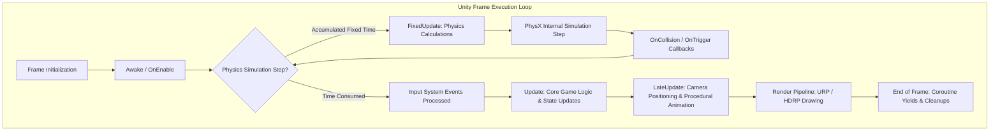
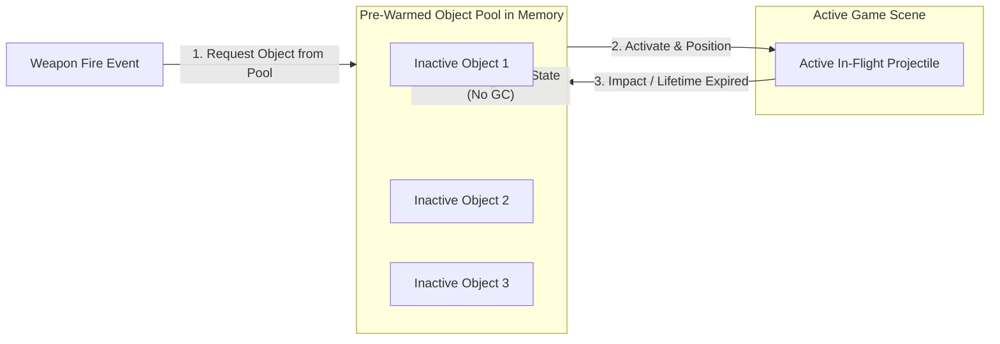

{: .light .w-75 .shadow .rounded-10 }

## How Do Modern Game Engines Bridge Rigid Monolithic Scripts and Decoupled Architecture?

When aspiring software engineers enter game development through introductory curricula such as Unity's *Create with Code*, the initial mental model is straightforward: create a 3D primitive, attach a `MonoBehaviour` script, and query player keyboard input inside an `Update()` loop to translate transforms. In introductory tutorials and small prototype scenes, this script-centric approach provides rapid visual feedback.

However, as projects scale toward commercial production—involving networked multi-agent logic, high-frequency physics interactions, inventory state persistence, and procedural level generation—monolithic `MonoBehaviour` scripts collapse under their own weight. Tightly coupled scripts querying `GetComponent<T>()` at runtime introduce hidden dependencies, non-deterministic execution orders, frame rate stuttering caused by managed Garbage Collection (GC) allocations, and unmaintainable scene spaghetti.

Transforming game development from naive script attachment into resilient systems engineering requires understanding the real-time execution lifecycle of the underlying game engine. By combining data-oriented component design, decoupled event channels via `ScriptableObject` architectures, deterministic physics tick separation, and pre-allocated memory pools, game programmers can construct systems capable of supporting complex real-time interactivity. Furthermore, this architectural foundation serves as the essential bedrock for modern 2026 game AI, where autonomous non-player characters (NPCs) are driven by local machine learning agents and embedded speech models rather than rigid finite state machines.



---

## The Core Unity Engine Lifecycle: Initialization, Physics, and Render Loops

The foundation of robust game architecture lies in respecting the engine's strict execution order. Unity does not execute `MonoBehaviour` methods randomly; it follows an explicit event loop defined by the C++ native engine layer.

### 1. Initialization and Lifecycle Hooks: Awake vs. Start
A frequent source of race conditions in beginner codebases is the improper sequencing of initialization logic:
- `Awake()` is invoked immediately when an object is instantiated, regardless of whether the component is enabled. It must be reserved strictly for internal state setup, self-referential initialization, and allocating data structures.
- `OnEnable()` fires whenever a component enters the active state, serving as the dedicated subscription point for C# delegates and event channels.
- `Start()` executes on the frame an object is enabled, immediately before its first physics or logic tick. `Start()` is the designated seam for cross-object queries and dependency resolution, guaranteeing that all sibling components have completed their internal `Awake()` allocations.

### 2. Decoupling Physics Ticks from Variable Render Framerates
A critical systems distinction in real-time simulations is the separation of `FixedUpdate()` from `Update()`:

- **`Update()` (Variable Time):** Executes once per rendered frame. The elapsed time between frames ($\Delta t$) fluctuates based on GPU load, scene complexity, and display refresh rates (e.g., from 16.6ms at 60 FPS down to 4.1ms at 240 FPS). Handling character position integration inside `Update()` without multiplying by `Time.deltaTime` results in framerate-dependent movement speeds.
- **`FixedUpdate()` (Deterministic Time):** Executes on a fixed, predictable physics timestep (configured by default to $\Delta t = 0.02\text{s}$ or 50Hz). The NVIDIA PhysX engine requires uniform numerical integration to avoid tunneling, clipping, and explosive force calculation errors. Rigidbodies and force applications must execute strictly within `FixedUpdate()`, while input polling must occur in `Update()` to avoid dropped button presses.
- **`LateUpdate()` (Post-Logic Synchronization):** Executes immediately after all scene `Update()` calls have terminated. This phase is reserved for tracking cameras, IK solvers, and positional clamps, preventing visual jitter caused by the camera updating before its target has moved.

---

## Component Decoupling: ScriptableObjects, Events, and Interface-Driven Design

In traditional object-oriented game code, a player character script often directly references the user interface, health meters, audio managers, and inventory databases. This creates a monolithic dependency web where modifying the UI breaks player movement, and unit testing isolated mechanics becomes impossible.

Production game development breaks this coupling through three established design patterns:

### 1. ScriptableObject-Based Architecture (The Event Channel Pattern)
Rather than having game objects directly hold references to each other, communication is routed through shared `ScriptableObject` assets that live independently of the scene hierarchy. 

```csharp
// Decoupled Game Event Architecture
[CreateAssetMenu(fileName = "NewGameEvent", menuName = "Events/Game Event")]
public class GameEvent : ScriptableObject
{
    private readonly List<GameEventListener> _listeners = new List<GameEventListener>();

    public void Raise()
    {
        for (int i = _listeners.Count - 1; i >= 0; i--)
        {
            _listeners[i].OnEventRaised();
        }
    }

    public void RegisterListener(GameEventListener listener) => _listeners.Add(listener);
    public void UnregisterListener(GameEventListener listener) => _listeners.Remove(listener);
}
```

When a player takes damage, the health script raises a `PlayerDamagedEvent`. The health script does not know or care whether a UI health bar, a sound effect manager, or an achievement tracker is listening. Each system registers as an independent listener in `OnEnable()` and unsubscribes in `OnDisable()`, entirely eliminating direct references.

### 2. Interface-Driven Capability Segregation
Instead of checking concrete classes using expensive reflection or runtime type casting (`player.GetComponent<HeroCharacter>()`), architectures define granular interfaces:
- `IDamageable`: Entities capable of receiving physical or elemental damage.
- `IInteractable`: Objects capable of reacting to player interaction prompts.
- `IPooledObject`: Game objects managed by centralized reuse pools.

A weapon projectile simply checks for `hitCollider.TryGetComponent<IDamageable>(out var target)` and executes `target.TakeDamage(amount)`, allowing the same projectile code to destroy crates, damage enemies, or trigger explosive barrels without specific class checks.

---

## Memory Management and Frame Pacing: Object Pooling and Garbage Collection Discipline

In managed runtimes like Unity's Mono / IL2CPP C# environment, memory allocations on the heap (`new MyClass()`, string concatenations, or boxing value types) trigger the automatic Garbage Collector (GC). When the GC runs an incremental or stop-the-world sweep, the game engine halts execution for 5 to 30 milliseconds, causing noticeable frame drops and micro-stuttering.

In fast-paced games (e.g., bullet-hell shooters or physics simulations), continuously spawning and destroying projectiles, particle effects, and audio sources via native `Instantiate()` and `Destroy()` is catastrophic. Each instantiation allocates unmanaged C++ engine structures alongside managed C# wrappers, followed by heap fragmentation upon destruction.

### The Object Pooling Pattern
To achieve deterministic zero-allocation frame loops, production games implement pre-warmed **Object Pools**:



By pre-allocating an array of 500 bullet objects during scene loading, the game continuously recycles inactive instances. When a bullet hits a target, its velocity and transform are reset, its `GameObject` is deactivated, and it is returned to the queue. No memory is allocated or freed during runtime gameplay, keeping the GC completely dormant.

---

## How Game Development and Engine Runtimes Evolved Across 2026: AI Agents and Dynamic NPCs

The evolution of game development across 2026 transformed how game engines interact with artificial intelligence:

1. **From Static Behavior Trees to Autonomous Local Agents:** For decades, game AI relied on rigid Finite State Machines (FSMs) and Goal-Oriented Action Planning (GOAP). In modern 2026 game design, NPCs incorporate local reasoning agents that dynamically react to environmental conditions, player reputations, and emergent narratives.
2. **Embedded On-Device Neural Synthesis:** Rather than streaming dialogue from expensive cloud voice services, modern client engines embed lightweight speech models directly into game processes. As evaluated in our source audit of [Supertonic 3: What On-Device TTS Starts to Look Like When ONNX Is the Contract](/posts/supertonic-onnx-runtime-tts/), 99M-parameter flow-matching models running on ONNX Runtime enable real-time, low-latency NPC voice synthesis on local consumer hardware without network dependencies.
3. **Extreme Low-Bit Inference on Edge Runtimes:** Integrating neural networks into game loops requires strict hardware budgeting so that AI inference does not cannibalize GPU cycles needed for 4K rendering. Modern edge compression—such as the ternary weight architectures analyzed in [PrismML 1-bit Bonsai: Extreme Low-Bit Quantization for Practical On-Device AI](/posts/prismml-1-bit-bonsai-on-device-ai/)—allows complex LLM-driven behaviors to run on background CPU threads without frame drops.
4. **Structured Knowledge Retrieval in Virtual Worlds:** Complex open-world RPGs now utilize high-performance vector and graph databases—analogous to the Rust architectures explored in [EdgeQuake: High-Performance Graph RAG in Rust](/posts/edgequake-graph-rag-rust/)—to allow NPC agents to query faction histories, geographic landmarks, and past player interactions with sub-millisecond retrieval latency.

---

## Key Takeaways

- **Respect the Engine Execution Order:** Understanding the distinction between `Awake()` (internal initialization), `Start()` (cross-component binding), `FixedUpdate()` (deterministic physics), and `Update()` (variable-rate rendering logic) is essential to prevent race conditions and physics tunneling.
- **Decouple via ScriptableObject Event Channels:** Eliminating direct component-to-component references through event-driven `ScriptableObject` architectures isolates dependencies and simplifies modular game testing.
- **Interface-Driven Design Replaces Concrete Casting:** Using granular interfaces (`IDamageable`, `IInteractable`) reduces coupling and eliminates expensive runtime reflection searches.
- **Zero-Allocation Discipline Prevents Frame Stutter:** In production gameplay loops, object pooling replaces runtime `Instantiate()` and `Destroy()` calls, preventing GC heap allocation spikes and micro-freezes.
- **Game Engines as Agent Execution Harnesses:** In 2026, game engine programming extends beyond rendering and collision; it acts as an execution harness hosting embedded local ML models, real-time neural audio, and dynamic autonomous agents.

---

## New Questions

1. **ECS / DOTS Memory Scaling:** How does the transition from traditional object-oriented `MonoBehaviour` hierarchies to Unity's Data-Oriented Technology Stack (DOTS/Entities) alter cache locality and SIMD parallelization in massive agent simulations?
2. **Determinism in Networked Physics:** What architectural patterns best reconcile non-deterministic local PhysX simulation ticks with server-authoritative rollback netcode in fast-paced multiplayer titles?
3. **Local Agent Inference Throttling:** How can game engines dynamically throttle on-device LLM inference threads when client hardware experiences sudden GPU thermal throttling or CPU spikes during heavy particle rendering?

---

## References

- [Unity Technologies: Execution Order of Event Functions Documentation](https://docs.unity3d.com/Manual/ExecutionOrder.html) (accessed 2026-10-18)
- [Unity Technologies: Create with Code Curriculum Courseware](https://learn.unity.com/course/create-with-code) (accessed 2026-10-18)
- [Robert Nystrom: Game Programming Patterns - Component, Object Pool, and Event Queue Patterns](https://gameprogrammingpatterns.com/) (accessed 2026-10-18)
- [Ryan Hipple: Game Architecture with ScriptableObjects (Unite Austin)](https://www.youtube.com/watch?v=raQ3iHhE_Kk) (accessed 2026-10-18)
- [Unity Technologies: Memory Management and Optimizing Garbage Collection in Unity](https://docs.unity3d.com/Manual/performance-garbage-collection.html) (accessed 2026-10-18)
