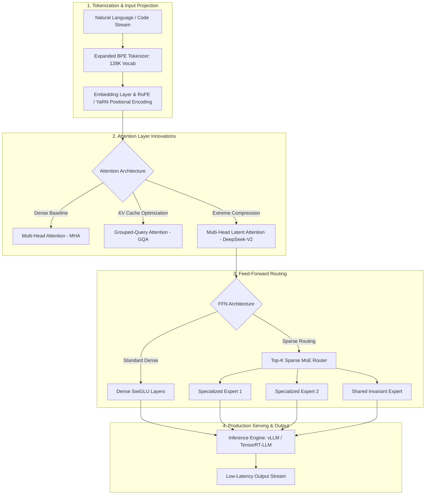
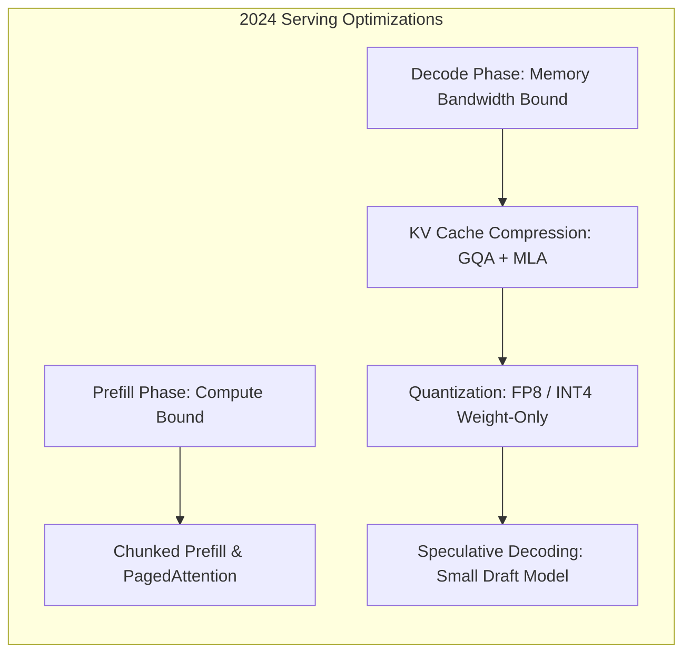

{: .light .w-75 .shadow .rounded-10 }

## What Structural Inflections Defined the 2024 Foundation Model Transition?

The first half of 2024 marked a decisive turning point in artificial intelligence engineering. The initial era of monolithic dense scaling—characterized by throwing undifferentiated web crawls at increasingly large Transformer parameters—encountered fundamental economic and computational boundaries. Frontier research organizations faced severe memory bandwidth bottlenecks during inference, GPU cluster power constraints, and the impending exhaustion of high-quality human text on the public internet.

In response, the foundation model landscape fractured into specialized architectural trajectories. Rather than competing solely on raw parameter counts, major releases between January and June 2024—including Meta's Llama 3, DeepSeek-V2, Mistral's Mixtral 8x22B, Databricks' DBRX, Google's Gemini 1.5, and Microsoft's Phi-3—pioneered structural architectural innovations. These models demonstrated that throughput, memory footprints, and reasoning depth could be radically improved through fine-grained Mixture of Experts (MoE), Multi-Head Latent Attention (MLA), vocabulary expansion, and aggressively curated synthetic pre-training data.

This source audit synthesizes the architectural inflections that defined the 2024 foundation model wave. By examining technical documentation, arXiv surveys, and ablation benchmarks across training methodologies, data selection pipelines, inference serving optimizations, and agentic runtimes, we map how these foundational shifts established the infrastructure for modern reasoning systems.



---

## The Core Technical Divergence: Dense Scaling vs. Sparse Mixture of Experts

The most prominent architectural division of 2024 occurred between dense scaling advocates and sparse Mixture of Experts (MoE) practitioners.

### 1. The Dense Vanguard: Meta Llama 3
Meta's Llama 3 family (8B and 70B, followed by 405B) doubled down on dense standard decoder-only Transformers, demonstrating that dense models were significantly undertrained relative to the Chinchilla scaling laws. While Chinchilla optimal compute suggested training an 8B parameter model on roughly 200 billion tokens, Llama 3 was pre-trained on over **15 trillion tokens**.

Key dense architectural enhancements included:
- **Expanded Vocabulary (128K Tiktoken BPE):** Transitioning from Llama 2's 32K vocabulary to a 128K token dictionary reduced token counts per prompt by 15% to 20%, dramatically improving inference throughput on multilingual text and source code.
- **Grouped-Query Attention (GQA):** Standardized across all model sizes, GQA grouped key-value heads (e.g., 8 KV heads for 64 query heads in the 70B model), slashing KV cache memory footprints by up to 87.5% and enabling long-context inference without catastrophic VRAM exhaustion.

### 2. The Sparse Revolution: DeepSeek-V2, DBRX, and Mixtral 8x22B
Conversely, teams seeking to optimize operational serving costs shifted to sparse MoE designs. In an MoE model, only a small subset of parameters is activated for any single token:

$$
\mathbf{y} = \sum_{i=1}^E G(\mathbf{x})_i E_i(\mathbf{x})
$$

Where $E_i(\mathbf{x})$ represents the output of expert network $i$, and $G(\mathbf{x})$ is a sparse softmax gating router selecting the top-$k$ experts.

The breakthrough release of **DeepSeek-V2** (arXiv:2405.04434) set new records for inference economics through two innovations:
- **Multi-Head Latent Attention (MLA):** Standard GQA still consumes substantial memory during long-sequence decoding. DeepSeek-V2 compressed the Key and Value matrices into a low-dimensional latent vector via low-rank projection:
  
  $$
  \mathbf{c}_t^{KV} = W_{DKV} \mathbf{h}_t
  $$
  
  During inference, only the compressed latent vector $\mathbf{c}_t^{KV}$ is retained in the KV cache, reducing the KV cache footprint by **93.3%** compared to standard Multi-Head Attention (MHA).
- **Fine-Grained Expert Routing (DeepSeekMoE):** While Mixtral 8x22B activated 2 out of 8 large experts (routing 39B active parameters out of 141B total), DeepSeek-V2 partitioned the FFN into 160 tiny experts alongside 2 shared experts, activating 6 routed experts per token. This fine-grained granularity yielded superior specialization and higher parameter efficiency (21B active parameters out of 236B total).

---

## Pre-Training Data Economics: Synthetic Filtering and Instruction Curation

The 2024 survey literature emphasized that model performance is primarily a reflection of training data quality rather than raw parameter quantity. As web crawls became contaminated with machine-generated noise, frontier labs pivoted toward aggressive filtering and synthetic data generation.

```
2024 Pre-Training Pipeline:
Raw Web Text ───> Heuristic & Quality Filters ───> Deduplication (MinHash) ───> Synthetic Augmentation (Phi-3)
(Unfiltered)      (Perplexity & Toxicity)        (Cluster Pruning)             (High-Density Curated Tokens)
```

### 1. Textbook Quality and Synthetic Pre-Training
Microsoft's **Phi-3** family (arXiv:2404.14219) demonstrated that a 3.8-billion parameter model could match or exceed the reasoning capabilities of models 10 times its size by training on "textbook-quality" data. The pre-training corpus combined heavily filtered educational web pages with synthetic datasets generated by frontier models specifically targeting mathematical problem solving, deductive logic, and programming paradigms.

### 2. Data Selection Strategies for Continual Learning
Surveys such as Albalak et al. (*Data Selection for Language Models*, arXiv:2402.16827) highlighted that naive continual training on new domains causes catastrophic forgetting. Production workflows adopted importance resampling and domain balance ratios, preserving a 10% to 20% rehearsal buffer of general pre-training data during specialized fine-tuning.

---

## Inference and Serving Realities: The Shift to Roofline Efficiency and KV-Cache Quantization

In production deployments, the true cost of an LLM is determined by serving efficiency. The operational reality of autoregressive decoding is governed by the **Roofline Model**:

During prompt prefill (ingesting the prompt), operations are compute-bound, saturating GPU tensor cores. During token-by-token generation (decoding), memory bandwidth is the primary bottleneck. Loading billions of model weights from GPU High Bandwidth Memory (HBM) into SRAM to generate a single token leaves tensor cores underutilized.



The 2024 serving research ecosystem (analyzed in Yuan et al., *LLM Inference Unveiled*, arXiv:2402.16363) addressed memory bandwidth through three dominant techniques:
- **PagedAttention (vLLM):** Virtual memory paging for KV caches, eliminating fragmentation and boosting GPU batch concurrency by $2\times$ to $4\times$.
- **Native FP8 Precision:** Hardware support on NVIDIA Hopper (H100) GPUs allowed FP8 execution with negligible degradation in perplexity, doubling throughput per compute node.
- **Speculative Decoding:** A compact draft model (e.g., 1B parameters) generates speculative token bursts verified in parallel by the target 70B model in a single forward pass, accelerating generation latency by $1.5\times$ to $2.5\times$.

---

## How Foundation Model Architectures Evolved Across 2026: Reasoning Models and Test-Time Compute

Reviewing the 2024 foundation model wave from the vantage point of 2026 reveals how the fundamental objectives of model engineering shifted:

1. **From Pure Pre-Training Scaling to Test-Time Reasoning:** In 2024, models were primarily raw next-token predictors. As detailed in our analysis of [Stop Generating, Start Thinking: The Architecture of Reasoning AI](/posts/stop-generating-start-thinking/), modern systems (such as OpenAI o1/o3 and DeepSeek-R1) trade inference compute for verified reasoning steps, allocating hidden thinking tokens and Monte Carlo tree searches before emitting final answers.
2. **Workstation-Scale Frontier Inference:** Architectural refinements in fine-grained MoE routing and quantization paved the way for local desktop models. As explored in [Qwen 3.5 Medium: Sonnet-Class Local Inference on Workstation Hardware](/posts/qwen35-medium-sonnet-performance/), modern 35B/3B-active MoE models now deliver frontier-grade reasoning on local workstations, an achievement built directly upon 2024 MoE foundations.
3. **Evidence-Gated Autonomous Agent Runtimes:** The raw conversational capabilities developed in 2024 evolved into deterministic agent harnesses. As examined in [RLM-FORGE: Architecting Evidence-Gated Recursion in Multi-Agent Loops](/posts/rlm-forge-evidence-gated-recursion/), modern agent architectures enforce strict execution policies (TraceGuard) that prevent models from committing unverified hallucinations into parent context state.
4. **Structured Dual-Memory Retrieval:** The simple vector search tutorials popular in early 2024 matured into production dual-memory architectures. As synthesized in [Retrieval-Augmented Generation: Architectural Foundations and Production Evolution](/posts/rag-guid/), production systems now blend BM25 lexical indices, dense vectors, cross-encoders, and knowledge graphs into unified knowledge pipelines.

---

## Key Takeaways

- **The End of Naive Scaling:** The 2024 model wave demonstrated that throwing raw web crawls at dense Transformers yields diminishing returns; data quality and architectural efficiency became the primary differentiators.
- **MoE Emerges as the Dominant Architecture:** Fine-grained expert routing (DeepSeekMoE) and large sparse models (Mixtral 8x22B, DBRX) established that activating a fraction of total parameters dramatically lowers serving costs while maintaining frontier quality.
- **MLA Resolves the KV Cache Bottleneck:** DeepSeek-V2's Multi-Head Latent Attention compressed KV cache memory by over 90%, transforming long-context serving economics.
- **Synthetic Data and Small Language Models:** Microsoft's Phi-3 validated that sub-4B models trained on heavily curated, synthetic textbook datasets can rival massive models on reasoning benchmarks.
- **Serving Is a Memory Bandwidth Problem:** Roofline model insights catalyzed the widespread adoption of GQA, PagedAttention, FP8 inference, and speculative decoding to overcome decoding memory bottlenecks.

---

## New Questions

1. **Synthetic Data Contamination and Model Collapse:** As subsequent model generations are trained on outputs generated by 2024-era LLMs, what mathematical safeguards prevent autophagous loop collapse and linguistic mode collapse?
2. **Dynamic Routing Latency in Distributed MoE:** How do inter-node network interconnect latencies (InfiniBand vs. NVLink) affect expert routing efficiency when individual MoE experts are partitioned across multi-node GPU clusters?
3. **The Balance Between Pre-Training and Test-Time Compute:** What is the exact economic Pareto frontier between investing training compute into a 400B dense model versus deploying an 8B model equipped with extensive test-time reasoning search?

---

## References

- [DeepSeek-AI: DeepSeek-V2 - A Strong, Economical, and Efficient Mixture-of-Experts Language Model (arXiv:2405.04434)](https://arxiv.org/abs/2405.04434) (accessed 2026-10-18)
- [Abdin et al.: Phi-3 Technical Report - Highly Capable Language Models Locally on Your Phone (arXiv:2404.14219)](https://arxiv.org/abs/2404.14219) (accessed 2026-10-18)
- [Yuan et al.: LLM Inference Unveiled - Survey and Roofline Model Insights (arXiv:2402.16363)](https://arxiv.org/abs/2402.16363) (accessed 2026-10-18)
- [Albalak et al.: Survey on Data Selection for Language Models (arXiv:2402.16827)](https://arxiv.org/abs/2402.16827) (accessed 2026-10-18)
- [Meta AI: Introducing Meta Llama 3 - The Most Capable Openly Available LLM to Date](https://ai.meta.com/blog/meta-llama-3/) (accessed 2026-10-18)
- [Mistral AI: Cheaper, Better, Faster - Mixtral 8x22B](https://mistral.ai/news/mixtral-8x22b/) (accessed 2026-10-18)
