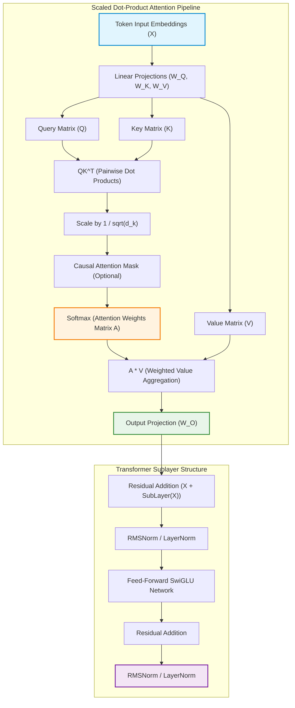

Natural language processing (NLP) has undergone the most radical architectural transformation in computational history. For decades, computational linguistics relied on hand-engineered grammatical rules, statistical n-gram frequencies, and vector space models like TF-IDF. The arrival of deep learning introduced continuous distributed representations—pioneered by Word2Vec and GloVe—yet early deep models remained fundamentally constrained by sequential recurrence.

The introduction of the **Transformer** by Vaswani et al. (2017) eradicated sequential bottlenecks, establishing self-attention as the universal foundation for modern generative AI, multimodal perception, and autonomous agent systems.

Understanding contemporary frontier models requires auditing the foundational mechanics of NLP: how raw unicode strings are discretized into subword tokens, how high-dimensional vectors capture context-dependent semantics, and why self-attention scales efficiently across massive distributed clusters.

This source audit traces the architectural progression of NLP, details the mechanics of tokenization and multi-head attention, and analyzes how Transformer execution evolved into hardware-accelerated linear and hybrid runtimes across 2026.


## Why Did Self-Attention Replace Recurrence as the Core Primitive of Language Modeling?

Before 2017, the state of the art in sequence modeling was defined by Recurrent Neural Networks (RNNs), specifically Long Short-Term Memory (LSTM) networks and Gated Recurrent Units (GRUs). While RNNs theoretically maintained an internal hidden state across arbitrary sequence lengths, they suffered from two fatal limitations:

1. **Sequential Compute Dependency**: An RNN computes hidden state $h_t$ as a function of the previous hidden state $h_{t-1}$ and current token $x_t$:
   $$h_t = \sigma(W_{hh} h_{t-1} + W_{xh} x_t + b)$$
   Because step $t$ strictly requires the completion of step $t-1$, sequential training cannot be parallelized across the time dimension on modern parallel hardware (GPUs/TPUs).
2. **Information Bottleneck and Vanishing Gradients**: Compressing an entire variable-length sequence into a single fixed-size hidden vector inevitably forces a trade-off between past and present context. Backpropagation through time (BPTT) over hundreds of steps leads to exponential gradient decay or explosion.

The Transformer bypassed recurrence entirely by enabling every token in a sequence to attend directly to every other token in parallel via **Scaled Dot-Product Attention**:



## Mathematical Mechanics: From Subwords to Multi-Head Projections

A modern language model execution pipeline consists of three mathematically rigorous transformations:

### 1. Tokenization and Subword Segmentation
Raw text is not ingested as characters or whole words. Character-level tokenization produces overly long sequences that exhaust memory quadratic attention limits, while word-level tokenization creates massive out-of-vocabulary (OOV) failure modes. Modern models utilize subword algorithms:
- **Byte-Pair Encoding (BPE)**: Progressively merges the most frequent pairs of adjacent byte symbols until a target vocabulary size (typically 32k to 128k) is reached.
- **Byte-level BPE**: Ingests raw UTF-8 bytes directly, ensuring every possible unicode character can be represented without OOV tokens.

### 2. Multi-Head Attention Formulation
Instead of computing a single attention distribution, Multi-Head Attention linearly projects Queries, Keys, and Values $h$ times with different parameter matrices:

$$\text{MultiHead}(Q, K, V) = \text{Concat}(\text{head}_1, \dots, \text{head}_h)W^O$$

$$\text{head}_i = \text{Attention}(QW_i^Q, KW_i^K, VW_i^V)$$

$$\text{Attention}(Q, K, V) = \text{softmax}\left(\frac{QK^T}{\sqrt{d_k}} + M\right)V$$

Where $\sqrt{d_k}$ prevents dot-product magnitudes from growing large in high dimensions (which would push softmax gradients into vanishing saturation regions), and $M$ is an optional causal mask ensuring step $t$ cannot observe tokens at step $t+1$.

```python
"""
PyTorch implementation of Scaled Dot-Product Multi-Head Attention
Illustrating explicit query, key, value projections and causal masking.
"""

import math
import torch
import torch.nn as nn

class CausalMultiHeadAttention(nn.Module):
    def __init__(self, embed_dim: int, num_heads: int, max_seq_len: int = 2048):
        super().__init__()
        assert embed_dim % num_heads == 0, "embed_dim must be divisible by num_heads"
        self.embed_dim = embed_dim
        self.num_heads = num_heads
        self.head_dim = embed_dim // num_heads

        # Combined Q, K, V projection for computational efficiency
        self.qkv_proj = nn.Linear(embed_dim, 3 * embed_dim, bias=False)
        self.out_proj = nn.Linear(embed_dim, embed_dim, bias=False)

        # Register lower-triangular causal attention mask
        mask = torch.tril(torch.ones(max_seq_len, max_seq_len)).view(
            1, 1, max_seq_len, max_seq_len
        )
        self.register_buffer("causal_mask", mask)

    def forward(self, x: torch.Tensor) -> torch.Tensor:
        batch_size, seq_len, _ = x.shape

        # Project and split into Query, Key, Value
        qkv = self.qkv_proj(x)
        qkv = qkv.reshape(batch_size, seq_len, 3, self.num_heads, self.head_dim)
        qkv = qkv.permute(2, 0, 3, 1, 4)  # (3, batch, heads, seq_len, head_dim)
        q, k, v = qkv[0], qkv[1], qkv[2]

        # Compute scaled attention scores: (Q @ K^T) / sqrt(d_k)
        scores = torch.matmul(q, k.transpose(-2, -1)) / math.sqrt(self.head_dim)

        # Apply causal masking (prevent attending to future tokens)
        scores = scores.masked_fill(
            self.causal_mask[:, :, :seq_len, :seq_len] == 0, float("-inf")
        )

        # Compute softmax attention probabilities
        attention_weights = torch.softmax(scores, dim=-1)

        # Weighted aggregation: A @ V
        context = torch.matmul(attention_weights, v)
        context = context.permute(0, 2, 1, 3).contiguous().view(batch_size, seq_len, self.embed_dim)

        return self.out_proj(context)
```

For practical techniques on fine-tuning foundational attention layers without retraining full weights, consult our analysis of [LoRA parameter-efficient fine-tuning](/posts/lora-better-gpt4/) and modular recipes in our [Llama Factory training workflows](/posts/llama-factory/).

## How Modern NLP and Transformer Runtimes Evolved Across 2026

Between 2024 and 2026, Transformer research moved beyond basic dense attention toward architectural efficiency, memory tiering, and hybrid state-space formulations:

1. **Hardware-Aware IO Acceleration (FlashAttention-3)**: Standard attention implementations suffer from severe GPU High-Bandwidth Memory (HBM) bandwidth bottlenecks. FlashAttention algorithms restructure matrix multiplication and softmax tiling into fast on-chip SRAM, cutting memory IO by $5\times$ and allowing context windows to expand from 8k to 1M+ tokens.
2. **Rotary Position Embeddings (RoPE) and Context Extrapolation**: Early sinusoidal and learned absolute position embeddings failed to extrapolate beyond training lengths. Modern architectures adopt RoPE, which applies rotation matrices directly to query and key vectors in complex 2D subspaces, preserving relative positional distance across millions of tokens.
3. **Hybrid Attention-State Space Models (Mamba-2 & Jamba)**: To overcome quadratic $O(N^2)$ memory complexity during auto-regressive generation, 2026 systems combine standard Multi-Head Attention layers with linear State Space Models (SSMs). The SSM layers compress long-horizon historical context in linear $O(N)$ time, while periodic attention layers provide precise associative recall.
4. **Autonomous Self-Evolution and Post-Training Refinement**: Base Transformer pre-training is no longer the final step. Contemporary models undergo recursive synthetic data generation and iterative preference optimization to bootstrap complex reasoning capabilities, as detailed in our audit of [autonomous post-training loops](/posts/llm-self-evolution/).

## Key Takeaways

- **Parallelism Over Recurrence**: The Transformer's decisive advantage over RNNs is complete temporal parallelization during training, enabling massive compute scaling on GPU clusters.
- **Tokenization Dictates Model Boundaries**: Subword algorithms like byte-level BPE determine sequence length, inference latency, and cross-lingual representation efficiency.
- **Attention Provides Direct Information Routing**: Scaled dot-product attention creates a dynamically parameterized graph where any token can communicate directly with any previous token in $O(1)$ path length.
- **Memory IO, Not FLOPs, is the Bottleneck**: Modern attention scaling relies heavily on SRAM tiling (FlashAttention) and KV-cache compression (Grouped-Query Attention) rather than raw compute scaling alone.

## New Questions

- **Can Pure Attention Ever Achieve True Sub-Quadratic Inference Without Context Loss?** While hybrid SSMs and linear attention models achieve $O(N)$ time complexity, do they inherently sacrifice needle-in-a-haystack associative recall compared to dense softmax attention?
- **Will Byte-Level Multi-Scale Models Replace Subword Tokenizers Entirely?** As inference hardware accelerates, can models train directly on raw byte streams to eliminate tokenization artifacts, vocabulary mismatch, and multilingual bias?
- **How Will Test-Time Reasoning Distort Transformer Memory Requirements?** With reasoning models generating thousands of internal thought tokens before answering, how will data center memory infrastructure adapt to explosive KV-cache bloat?

## References

- Vaswani, A., Shazeer, N., Parmar, N., Uszkoreit, J., Jones, L., Gomez, A. N., Kaiser, Ł., & Polosukhin, I. (2017). *Attention Is All You Need*. Advances in Neural Information Processing Systems (NeurIPS 2017). Available at: [https://arxiv.org/abs/1706.03762](https://arxiv.org/abs/1706.03762) (accessed 2026-10-18).
- Devlin, J., Chang, M. W., Lee, K., & Toutanova, K. (2018). *BERT: Pre-training of Deep Bidirectional Transformers for Language Understanding*. NAACL-HLT 2019. Available at: [https://arxiv.org/abs/1810.04805](https://arxiv.org/abs/1810.04805) (accessed 2026-10-18).
- Wolf, T., Debut, L., Sanh, V., Chaumond, J., Delangue, C., Moi, A., Cistac, P., Rault, T., Louf, R., Funtowicz, M., & Davison, J. (2020). *Transformers: State-of-the-Art Natural Language Processing*. Proceedings of the 2020 EMNLP System Demonstrations. Available at: [https://arxiv.org/abs/1910.03771](https://arxiv.org/abs/1910.03771) (accessed 2026-10-18).
- Dao, T. (2023). *FlashAttention-2: Faster Attention with Better Parallelism and Work Partitioning*. International Conference on Learning Representations (ICLR 2024). Available at: [https://arxiv.org/abs/2307.08691](https://arxiv.org/abs/2307.08691) (accessed 2026-10-18).
