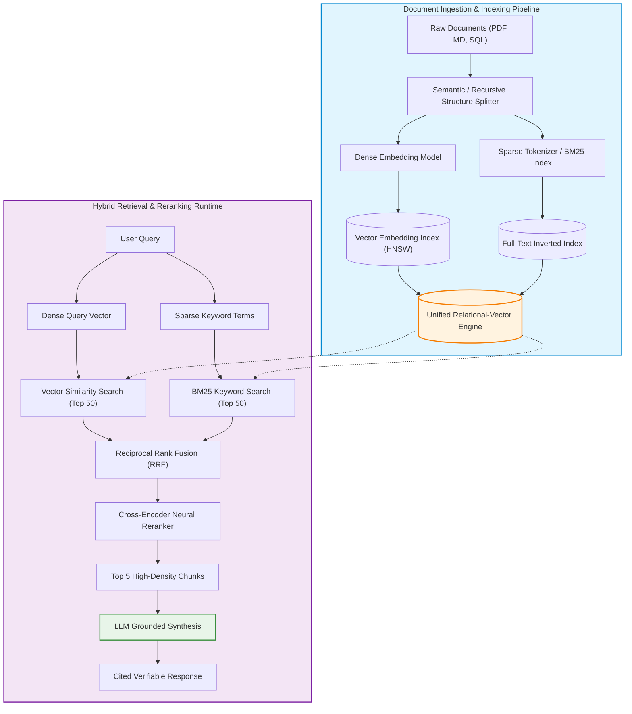

While frontier large language models demonstrate impressive conversational fluency, deploying them in enterprise environments immediately reveals their core limitation: parametric memory is static, cut off from real-time organizational records, and prone to confident hallucinations when answering domain-specific queries. Attempting to solve this through continual pre-training or fine-tuning is computationally prohibitive and fails to provide auditable source provenance or granular access controls.

To bridge static foundational weights with dynamic corporate knowledge, the industry converged on **Retrieval-Augmented Generation (RAG)**, formalized by Lewis et al. (2020). By retrieving relevant reference documents from external stores and injecting them into the model's inference context window, RAG transforms generative models into grounded reasoning engines.

However, naive tutorial implementations—relying solely on basic text chunking and isolated vector similarity search—fail rapidly in production. They lose exact keyword matches, struggle with structured tabular data, and flood the context window with irrelevant noise.

This source audit analyzes the architectural mechanics of building production-grade RAG systems with LangChain, evaluates the operational advantages of unified relational-vector engines (such as SingleStore and pgvector), and traces the evolution from naive semantic retrieval toward agentic GraphRAG and late-interaction systems across 2026.


## Why Does Naive Vector Search Fail in Production Enterprise RAG?

In prototype demonstrations, naive RAG appears straightforward: split documents into 500-token chunks, compute dense embeddings via an encoder, store vectors in an isolated index, and retrieve the top-$k$ nearest neighbors via cosine similarity.

In enterprise production, this naive pipeline encounters three catastrophic failure modes:

1. **The Lexical Matching Deficit**: Dense embedding models map text into high-dimensional semantic spaces. While effective at capturing broad conceptual similarity, they struggle with exact lexical tokens—such as product SKUs, error codes, legal statute numbers, or specific person names. A user searching for `CVE-2024-38077` might retrieve generic discussions on Windows security vulnerabilities while missing the exact patch note.
2. **Context Fragmentation and Chunk Boundary Severing**: Arbitrary fixed-size chunking frequently cuts through sentences, tables, or logical code blocks. When a qualifying condition is split into chunk $A$ and its consequence into chunk $B$, the retriever supplies incomplete evidence, inducing the generator to fabricate assumptions.
3. **The Dual-Database Synchronization Tax**: Storing vector embeddings in a specialized standalone vector index while keeping business metadata, user permissions, and transactional records in a separate relational database creates distributed state drift. Updates, deletions, and role-based access control (RBAC) filtering require complex two-phase synchronization pipelines.

Modern architectures solve this through **Hybrid Retrieval Engines** combined with unified storage:



## Technical Implementation: Hybrid Retrieval with LangChain and Unified Stores

Using unified databases like **SingleStore** or PostgreSQL with `pgvector` allows engineers to execute both vector distance functions and full-text SQL queries in a single atomic transaction.

The following production pattern demonstrates a complete LangChain hybrid pipeline with metadata filtering, document splitting, and reciprocal rank fusion:

```python
"""
Production RAG pipeline with LangChain Expression Language (LCEL)
Demonstrating hybrid document splitting, contextual compression, and grounded synthesis.
"""

from typing import List
from langchain_core.documents import Document
from langchain_core.prompts import ChatPromptTemplate
from langchain_core.runnables import RunnablePassthrough, RunnableParallel
from langchain_core.output_parsers import StrOutputParser
from langchain_text_splitters import RecursiveCharacterTextSplitter

class ProductionRAGPipeline:
    def __init__(self, vector_store, chat_model, reranker=None):
        self.store = vector_store
        self.llm = chat_model
        self.reranker = reranker
        self.splitter = RecursiveCharacterTextSplitter(
            chunk_size=600,
            chunk_overlap=120,
            separators=["\n\n", "\n", "(?<=\\.) ", " "]
        )

    def prepare_documents(self, raw_docs: List[Document]) -> List[Document]:
        """Splits documents preserving metadata for auditable provenance."""
        split_docs = self.splitter.split_documents(raw_docs)
        for i, doc in enumerate(split_docs):
            doc.metadata["chunk_id"] = f"{doc.metadata.get('source', 'unknown')}_{i}"
        return split_docs

    def build_chain(self):
        prompt_template = ChatPromptTemplate.from_messages([
            ("system", (
                "You are an enterprise knowledge assistant. Answer the user question strictly "
                "using the provided context documents. If the context does not contain enough "
                "information to answer definitively, state that you do not know. Always cite "
                "the source document IDs for your claims.\n\n"
                "Context Documents:\n{context}"
            )),
            ("human", "{question}")
        ])

        def format_docs(docs: List[Document]) -> str:
            return "\n\n".join(
                f"[Source: {d.metadata.get('chunk_id')}]\n{d.page_content}"
                for d in docs
            )

        retriever = self.store.as_retriever(
            search_type="similarity_score_threshold",
            search_kwargs={"k": 5, "score_threshold": 0.75}
        )

        rag_chain = (
            RunnableParallel({
                "context": retriever | format_docs,
                "question": RunnablePassthrough()
            })
            | prompt_template
            | self.llm
            | StrOutputParser()
        )
        return rag_chain
```

For a deeper dive into the underlying attention mechanisms that process these injected context sequences, see our analysis of [Transformer self-attention foundations](/posts/nlp-course-trying/). For managing the deployment and tracking of these pipelines across hybrid clouds, review our guide on [hybrid MLOps tracking pipelines](/posts/hybrid-mlops-using-mlflow/).

## How Enterprise RAG and Retrieval Pipelines Evolved Across 2026

Between 2024 and 2026, retrieval systems transitioned from passive single-turn lookup tables to proactive, multi-hop reasoning networks:

1. **From Naive Vectors to GraphRAG**: Pioneered by Edge et al. (2024), GraphRAG constructs knowledge graphs during ingestion—extracting entities, relationships, and hierarchical community clusters. While standard vector RAG answers localized questions well ("What is customer X's renewal date?"), GraphRAG enables global thematic synthesis across thousands of documents ("What are the top three security risks identified across all customer audits this year?").
2. **Late-Interaction Token Indexing (ColBERT / PLAID)**: As popularized by Khattab & Zaharia (2020), ColBERT retains individual token embeddings rather than collapsing an entire chunk into one vector. At query time, a "MaxSim" operator aligns every query token with the best matching document token, preserving granular lexical precision while retaining semantic generalization.
3. **Agentic Retrieval-in-the-Loop**: Modern agents do not execute a single retrieval query. When a query is ambiguous, an autonomous agent rewrites the prompt, performs speculative multi-hop searches, inspects the retrieved results, and executes follow-up sub-queries if evidence is missing. The architectural constraints of these multi-agent environments are explored in our study of [multi-agent orchestration systems](/posts/llm-build-multi-agent/).
4. **Context Window Expansion vs. Retrieval Economics**: Although 2026 models feature multi-million token context windows, RAG remains dominant. Stuffing millions of tokens into an inference prompt incurs severe latency delays (Time-To-First-Token) and prohibitive financial costs. Targeted retrieval delivers high-density answers at a fraction of the token expenditure.

## Key Takeaways

- **Hybrid Search Outperforms Pure Semantic Vector Search**: Combining dense vector proximity (semantic meaning) with sparse inverted index matches (exact keywords) eliminates retrieval blindness in technical and compliance domains.
- **Unified Databases Minimize Architectural Complexity**: Storing vector embeddings alongside relational business tables in unified engines like SingleStore or pgvector prevents dual-system synchronization lag.
- **Reranking is the Highest-ROI Retrieval Optimization**: Passing the top-50 candidates through a cross-encoder reranker before context injection improves downstream response accuracy far more than simply scaling embedding dimensions.
- **Context Provenance is Essential for Enterprise Trust**: Production RAG must enforce strict system prompts that require explicit citation of chunk identifiers, allowing automated verification filters to catch hallucinations.

## New Questions

- **When Does GraphRAG Extraction Cost Exceed Business Value?** Extracting entities and community summaries via LLMs during ingestion introduces significant pre-processing compute costs; what data volume thresholds justify this overhead?
- **How Will RAG Maintain Privacy Under Multi-Tenant Agent Swarms?** As autonomous agents retrieve information on behalf of different corporate users, how can authorization boundaries be enforced at the sub-chunk embedding level without degrading latency?
- **Will Memory-Augmented Foundation Models Supplant External RAG?** If future architectures integrate dynamic, continually updated state-space memories directly into weights, will external retrieval databases become obsolete?

## References

- Lewis, P., Perez, E., Piktus, A., Petroni, F., Karpukhin, V., Goyal, N., Küttler, H., Lewis, M., Yih, W., Rocktäschel, T., Riedel, S., & Kiela, D. (2020). *Retrieval-Augmented Generation for Knowledge-Intensive NLP Tasks*. Advances in Neural Information Processing Systems (NeurIPS 2020). Available at: [https://arxiv.org/abs/2005.11401](https://arxiv.org/abs/2005.11401) (accessed 2026-10-18).
- Gao, Y., Xiong, Y., Gao, X., Jia, K., Pan, J., Bi, Y., Dai, Y., Sun, J., & Wang, H. (2023). *Retrieval-Augmented Generation for Large Language Models: A Survey*. arXiv:2312.10997. Available at: [https://arxiv.org/abs/2312.10997](https://arxiv.org/abs/2312.10997) (accessed 2026-10-18).
- Khattab, O., & Zaharia, M. (2020). *ColBERT: Efficient and Effective Passage Search via Contextualized Late Interaction over BERT*. Proceedings of the 43rd International ACM SIGIR Conference on Research and Development in Information Retrieval. Available at: [https://arxiv.org/abs/2004.12832](https://arxiv.org/abs/2004.12832) (accessed 2026-10-18).
- Edge, D., Trinh, H., Cheng, N., Bradley, J., Chao, A., Mody, A., Truitt, S., & Larson, J. (2024). *From Local to Global: A Graph RAG Approach to Query-Focused Summarization*. arXiv:2404.16130. Available at: [https://arxiv.org/abs/2404.16130](https://arxiv.org/abs/2404.16130) (accessed 2026-10-18).
