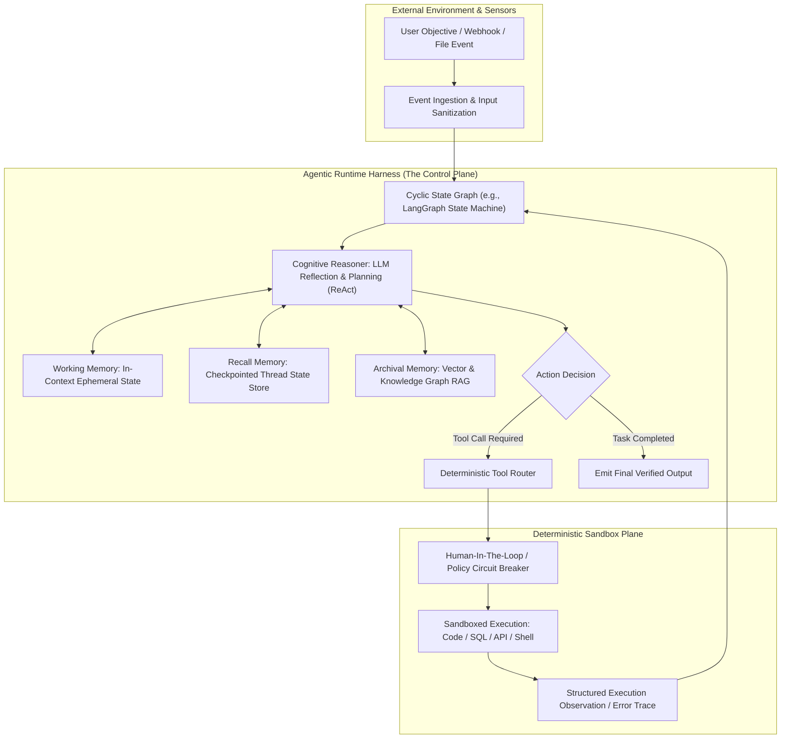
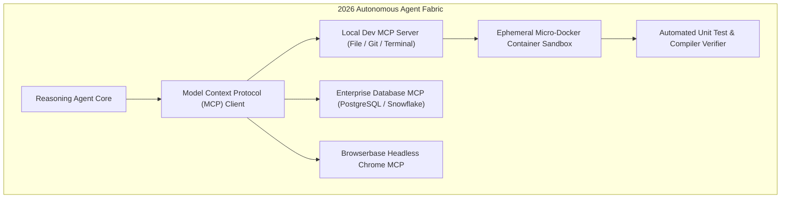

## Why Do Foundation Models Alone Fail to Form Autonomous Agents Without Runtime Harnesses?

A prevailing misconception during the early wave of generative AI was that scaling foundation model parameters would automatically yield autonomous problem-solving agents. In practice, deploying an unconstrained large language model (LLM) into open-ended operational workflows exposed severe systemic failures:
1. **Statelessness and Context Oblivion**: Raw autoregressive decoders possess no durable memory beyond their immediate context window. Once a session terminates or the context token limit is reached, all procedural experience evaporates.
2. **Infinite Action Loops and Hallucinated APIs**: When a model attempts multi-step problem solving without an execution harness, minor tool call failures trigger compounding errors, causing the model to repeatedly execute identical broken actions.
3. **Absence of Environmental Grounding**: Without deterministic sandbox verification, foundation models cannot verify whether an executed SQL mutation, shell script, or external API update succeeded or caused irreversible data corruption.

An autonomous AI agent is not simply an LLM; it is a **cybernetic feedback loop** where the foundation model functions as a central cognitive planner embedded within a structured execution harness. By late May 2024, the artificial intelligence industry experienced a paradigm shift: moving away from rigid, linear prompt chains toward **dynamic, cyclic agent runtimes** governed by state graphs, tiered memory hierarchies, and formal tool protocols.



By constraining model actions within an explicit control plane, agent harnesses transform probabilistic text predictors into reliable software systems.

---

## Deconstructing the Agentic Architecture Stack

A production-grade agent runtime requires four tightly integrated subsystems, moving far beyond simple chat completions:

```
Core Agent Subsystem Matrix:
-------------------------------------------------------------------------------------------------
Subsystem             Primary Operational Function         Key Technical Implementations
-------------------------------------------------------------------------------------------------
Cognitive Core        Reasoning, decomposition, synthesis  Frontier LLMs (GPT-4o, Claude 3.5 Sonnet)
Control Plane         State transitions, loops, branching  LangGraph, AutoGen, CrewAI, Semantic Kernel
Memory Architecture   Temporal state, retrieval, recall    Mem0, Zep, Hybrid Dense/Graph Vector Stores
Action Engine         Deterministic tool dispatch, sandboxes Model Context Protocol (MCP), Docker, WASM
-------------------------------------------------------------------------------------------------
```

### 1. The Control Plane: Linear Chains vs Cyclic State Graphs

Early agent frameworks (such as legacy LangChain chains or AutoGPT) relied on naive `while` loops running unconstrained prompt completions. In production, these loops suffered from unpredictable termination criteria and untraceable states.

The industry transitioned to **Cyclic State Graphs** (popularized by **LangGraph** in 2024). In a state graph:
- **State is explicit and immutable**: Every state transition emits a new versioned state dictionary.
- **Nodes represent computational steps**: Executing an LLM call, a tool execution, or a human approval gate.
- **Edges define conditional routing**: Dynamically directing control flow based on validation outcomes.
- **Checkpointers enable persistence**: Saving the entire execution graph to disk at every superstep, allowing sessions to pause, resume, travel backward in time, or solicit human input.

```python
# Simplified representation of a Cyclic State Graph in LangGraph
from typing import TypedDict, Annotated, List
import operator
from langgraph.graph import StateGraph, END

class AgentState(TypedDict):
    messages: Annotated[List[dict], operator.add]
    loop_count: int
    is_verified: bool

def reason_node(state: AgentState):
    # LLM deliberates on current context and decides next action
    response = llm.invoke(state["messages"])
    return {"messages": [response], "loop_count": state["loop_count"] + 1}

def tool_node(state: AgentState):
    # Execute deterministic tool in sandbox
    obs = execute_tool(state["messages"][-1].tool_calls)
    return {"messages": [obs]}

def should_continue(state: AgentState):
    if state["is_verified"] or state["loop_count"] >= 5:
        return END
    return "tools" if state["messages"][-1].tool_calls else "reason"

# Build execution graph
workflow = StateGraph(AgentState)
workflow.add_node("reason", reason_node)
workflow.add_node("tools", tool_node)
workflow.set_entry_point("reason")
workflow.add_conditional_edges("reason", should_continue)
workflow.add_edge("tools", "reason")
app = workflow.compile()
```

### 2. Tiered Memory Architectures: Beyond Flat Context Windows

Modern agent engineering categorizes memory into three temporal tiers, preventing context window saturation:
1. **Working Memory**: The immediate in-context scratchpad, containing actively manipulated variables and current turn observations.
2. **Recall / Episodic Memory**: Thread-level histories storing past conversational episodes and user corrections, indexed by session ID.
3. **Archival / Semantic Memory**: Global, cross-session knowledge indexed in hybrid vector databases and entity knowledge graphs, retrieved via semantic similarity queries.

As analyzed in our technical study on [Agentic Application Design Patterns](/posts/agentic-application-design-patterns/), structured memory compaction ensures that agents do not re-ingest thousands of historical tokens on every sub-task iteration.

---

## Evaluating the 2024 Framework Landscape

Choosing the appropriate orchestration framework depends on the underlying system complexity and integration surface:

| Framework | Core Philosophy | Best Suited For | Trade-Off Limitation |
| :--- | :--- | :--- | :--- |
| **LangGraph** | Cyclic state machines with checkpointers | Multi-agent coordination, human-in-the-loop | Steep learning curve, boilerplate code |
| **LlamaIndex** | Data-centric indexing and retrieval | RAG-heavy agents, structured document parsing | Less granular control over arbitrary state loops |
| **AutoGen** | Conversational multi-agent consensus | Simulation, collaborative brainstorming | High token cost, susceptibility to chatter loops |
| **Haystack** | Component-based linear pipelines | Enterprise document QA, production search | Rigid graph structures, less dynamic agent loops |

Connecting to our earlier source audits on [Multi-Agent LLM Systems](/posts/llm-build-multi-agent/) and [LLM Agent Principles](/posts/llm-agents/), modern enterprise deployments rarely rely on single monolithic frameworks; they combine specialized indexing (LlamaIndex) with robust state machine orchestration (LangGraph).

---

## How Autonomous Agent Architectures Evolved Across 2026

Between 2024 and 2026, the agentic systems landscape matured from experimental code scripts into standardized enterprise infrastructure:

### 1. Standardization via the Model Context Protocol (MCP)
In early 2024, every agent framework wrote custom proprietary wrappers for file access, GitHub APIs, and database connections. In 2026, Anthropic's open **Model Context Protocol (MCP)** emerged as the universal standard. Tools and resources expose standard JSON-RPC endpoints, allowing any agent runtime to discover, authenticate, and execute enterprise tools seamlessly.

### 2. Hardened Sandboxes and Sovereignty Boundaries
Running unconstrained code generated by foundation models directly on host machines posed catastrophic security vulnerabilities. In 2026, production agents operate within isolated, micro-containerized sandboxes (e.g., lightweight Docker containers or WASM runtimes). File writes and shell commands are cryptographically bounded, and explicit SLA circuit breakers (`MAX_TOKENS`, `MAX_COST`, `MAX_LOOPS`) terminate runaways automatically.



### 3. Test-Time Search and Rule-Based Verifiers
In 2026, autonomous coding agents (such as Codex, Claude Code, and Antigravity) no longer rely on single-pass greedy generations. Agents execute deep test-time tree search (Monte Carlo Tree Search paired with Process Reward Models), executing code in local sandboxes, inspecting stack traces, and self-correcting errors before presenting solutions to human developers.

---

## Key Takeaways

- **Foundation models are engines, not complete agents**: Autonomous agency requires a surrounding harness providing state graphs, memory persistence, and sandbox grounding.
- **Cyclic state graphs replaced fragile while-loops**: Explicit state dictionaries, conditional branching, and checkpointing provide deterministic execution boundaries.
- **Tiered memory prevents context window overflow**: Splitting memory into working, recall, and archival stores ensures long-term persistence without token bloat.
- **Model Context Protocol (MCP) standardized tool integration**: Universal client-server protocols eliminated fragmented, proprietary tool wrappers across the industry.
- **2026 systems mandate isolated sandboxes and verifiers**: Modern production agents execute within ephemeral containers and utilize automated test verifiers to achieve high task completion rates.

---

## New Questions

1. How do multi-agent consensus protocols (e.g., debate versus hierarchical manager-worker) perform on economic token efficiency when executing complex refactors across multi-million-line codebases?
2. What are the security threat vectors of prompt injection when autonomous agents ingest untrusted third-party web content via MCP tools?
3. To what extent does test-time verification using automated compilers eliminate the need for human-in-the-loop approval gates in safety-critical infrastructure deployments?

---

## References

- Yao, S., Zhao, J., Yu, D., Du, N., Shafran, I., Narasimhan, K., & Cao, Y. (2023). *ReAct: Synergizing Reasoning and Acting in Language Models*. In International Conference on Learning Representations (ICLR). Available at: <https://arxiv.org/abs/2210.03629> (accessed 2026-10-18).
- Park, J. S., O'Brien, J. C., Cai, C. J., Morris, M. R., Liang, P., & Bernstein, M. S. (2023). *Generative Agents: Interactive Simulacra of Human Behavior*. In Proceedings of the 36th Annual ACM Symposium on User Interface Software and Technology (UIST '23), 1-22. Available at: <https://arxiv.org/abs/2304.03442> (accessed 2026-10-18).
- LangChain Team. (2024). *LangGraph: Building Language Agents as Graphs*. Official LangChain Architecture Documentation. Available at: <https://github.com/langchain-ai/langgraph> (accessed 2026-10-18).
- Anthropic. (2024). *Building Effective Agents: A Practical Guide to Designing Agentic Systems*. Anthropic Research Publication. Available at: <https://www.anthropic.com/research/building-effective-agents> (accessed 2026-10-18).
