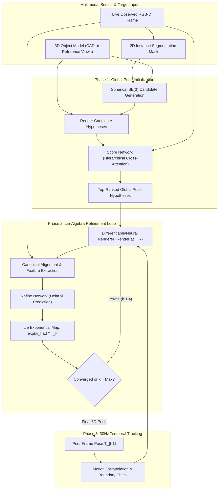
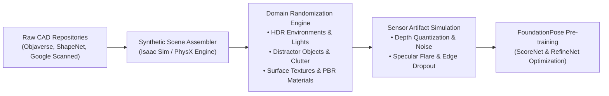
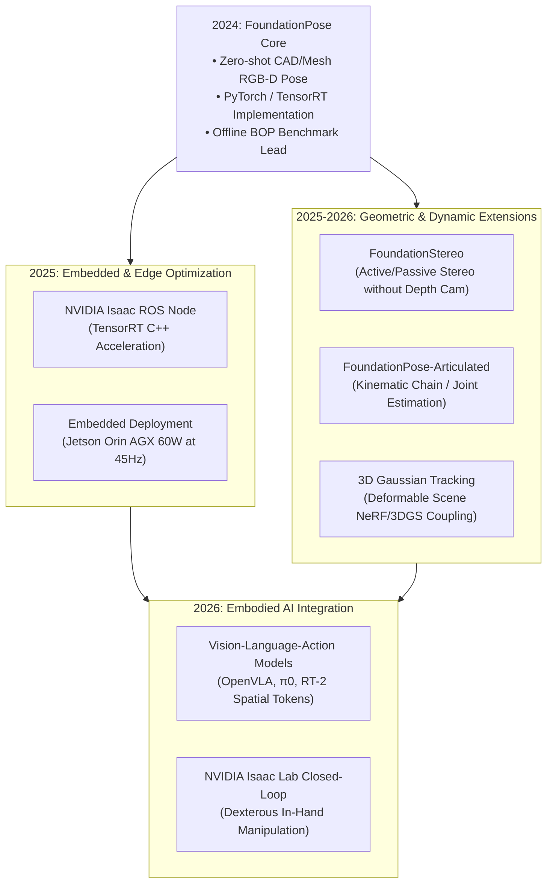

## Why Did FoundationPose Transform Zero-Shot Robotic Perception?

Before the publication of NVIDIA's FoundationPose ([Wen et al., CVPR 2024](https://arxiv.org/abs/2312.08344)), robotic manipulation pipelines faced a debilitating trade-off in spatial object perception. Estimating an object's rigid 6D transformation—comprising 3D rotation $\mathbf{R} \in SO(3)$ and 3D translation $\mathbf{t} \in \mathbb{R}^3$ relative to the camera frame—traditionally fell into two brittle camps:

1. **Instance-Specific Methods**: Systems like DenseFusion, PoseCNN, or PVN3D required explicit CAD models and thousands of target-specific training images. When deployed in warehouse or domestic settings encountering novel object geometries, their feature representations failed catastrophically.
2. **Category-Level or Zero-Shot Keypoint Pipelines**: Classical correspondence matchers (such as SIFT, ORB, or early deep matchers) degraded under textureless surfaces, severe specular reflections, and self-occlusions, failing to achieve the millimeter-scale precision necessary for robotic grasping.

FoundationPose dissolved this dichotomy by formulating a unified framework for both **model-based** (given a textured 3D CAD mesh) and **model-free** (given only a few reference RGB-D images from arbitrary viewpoints) 6D pose estimation and tracking. Critically, FoundationPose generalizes zero-shot to completely unseen objects without fine-tuning on real physical samples. By training entirely on scalable synthetic data and employing a dual-stage architecture—a global pose score network paired with an iterative Lie-algebra pose refinement network—FoundationPose achieved state-of-the-art results across standard BOP (Benchmark for 6D Object Pose Estimation) benchmarks while sustaining a 30+ Hz real-time tracking loop on commodity hardware.

Connecting spatial perception to downstream generative models and neural scene representations, this zero-shot capability mirrors the geometric grounding required in multi-view synthesis systems such as [GenWarp](/posts/genwarp-paper/) and neural scene representations analyzed in [3D Gaussian Splatting](/posts/llm-3d-gaussian-splatting/).

---

## Theoretical Foundations: Lie Algebra and SE(3) Manifolds

Rigid motion in three-dimensional space is governed by the Special Euclidean group $SE(3)$, defined as:

$$SE(3) = \left\{ \mathbf{T} = \begin{bmatrix} \mathbf{R} & \mathbf{t} \\ \mathbf{0}^T & 1 \end{bmatrix} \in \mathbb{R}^{4 \times 4} \;\middle|\; \mathbf{R} \in SO(3), \mathbf{t} \in \mathbb{R}^3 \right\}$$

where the Special Orthogonal group $SO(3) = \{ \mathbf{R} \in \mathbb{R}^{3 \times 3} \mid \mathbf{R}^T \mathbf{R} = \mathbf{I}, \det(\mathbf{R}) = 1 \}$. Because $SE(3)$ is a smooth, curved Lie group rather than a vector space, directly regressing 12 raw matrix entries or Euler angles using gradient descent introduces non-linearities, gimbal lock, and orthogonal distortion.

To enable unconstrained optimization, FoundationPose formulates pose increments within the associated Lie algebra $\mathfrak{se}(3)$. An incremental transform $\boldsymbol{\xi} \in \mathbb{R}^6$ consists of an angular velocity vector $\boldsymbol{\omega} \in \mathbb{R}^3$ and a linear velocity vector $\boldsymbol{v} \in \mathbb{R}^3$:

$$\boldsymbol{\xi} = \begin{bmatrix} \boldsymbol{v} \\ \boldsymbol{\omega} \end{bmatrix} \in \mathbb{R}^6 \quad \longleftrightarrow \quad \widehat{\boldsymbol{\xi}} = \begin{bmatrix} [\boldsymbol{\omega}]_\times & \boldsymbol{v} \\ \mathbf{0}^T & 0 \end{bmatrix} \in \mathfrak{se}(3)$$

where $[\boldsymbol{\omega}]_\times$ denotes the skew-symmetric cross-product matrix:

$$[\boldsymbol{\omega}]_\times = \begin{bmatrix} 0 & -\omega_z & \omega_y \\ \omega_z & 0 & -\omega_x \\ -\omega_y & \omega_x & 0 \end{bmatrix}$$

The exponential map $\exp: \mathfrak{se}(3) \to SE(3)$ computes the finite transformation associated with $\widehat{\boldsymbol{\xi}}$ via Rodrigues' rotation formula:

$$\exp(\widehat{\boldsymbol{\xi}}) = \begin{bmatrix} \exp([\boldsymbol{\omega}]_\times) & \mathbf{V} \boldsymbol{v} \\ \mathbf{0}^T & 1 \end{bmatrix}$$

$$\exp([\boldsymbol{\omega}]_\times) = \mathbf{I} + \frac{\sin \theta}{\theta} [\boldsymbol{\omega}]_\times + \frac{1 - \cos \theta}{\theta^2} [\boldsymbol{\omega}]_\times^2, \quad \theta = \|\boldsymbol{\omega}\|$$

$$\mathbf{V} = \mathbf{I} + \frac{1 - \cos \theta}{\theta^2} [\boldsymbol{\omega}]_\times + \frac{\theta - \sin \theta}{\theta^3} [\boldsymbol{\omega}]_\times^2$$

In FoundationPose's refinement loop, given a current pose estimate $\mathbf{T}^{(k)} \in SE(3)$, the neural network predicts an incremental update $\boldsymbol{\xi}^{(k)} \in \mathbb{R}^6$, updating the pose hypothesis as:

$$\mathbf{T}^{(k+1)} = \exp(\widehat{\boldsymbol{\xi}}^{(k)}) \cdot \mathbf{T}^{(k)}$$

Operating in Lie algebra ensures that at every iteration step $k$, the transformation $\mathbf{T}^{(k+1)}$ remains strictly manifold-valid on $SE(3)$ without requiring heuristic orthogonalization or SVD re-projection.

---

## Dual-Branch Architecture: Global Scoring and Iterative Refinement

FoundationPose isolates zero-shot pose estimation into two specialized networks that balance multimodal search breadth with sub-millimeter geometric accuracy:

### 1. The Global Score Network (Pose Ranking)
Given a 2D bounding box or instance mask from a generic segmentation model (e.g., Segment Anything / SAM), FoundationPose generates dozens of coarse pose candidates by uniformly sampling viewpoints over the upper hemisphere and scaling relative to the object's 3D bounding diameter.

For each candidate pose $\mathbf{T}_i$, the object's 3D model is rendered from camera viewpoint $\mathbf{T}_i$, producing synthetic RGB-D patches. The Score Network receives the paired observed crop and rendered crop:
- Feature backbones (such as ConvNeXt or Vision Transformers) extract dense visual and surface normal representations.
- A cross-attention transformer layer calculates cross-correlation between observed modalities and rendered hypotheses.
- The network outputs a scalar probability score $s_i \in [0, 1]$ indicating whether candidate $\mathbf{T}_i$ lies within an acceptance basin ($\le 5^\circ$ angular error and $\le 5\%$ translation error relative to the object's diameter).

### 2. The Iterative Refine Network
Once the top $K$ candidate poses are selected by the Score Network, they are sequentially passed to the Refine Network.
- At iteration step $k$, the network receives the concatenation of the observed RGB-D crop and the re-rendered RGB-D crop under the current pose hypothesis $\mathbf{T}^{(k)}$.
- It extracts multi-scale feature maps and predicts the twist vector $\boldsymbol{\xi} = [\boldsymbol{v}^T, \boldsymbol{\omega}^T]^T \in \mathbb{R}^6$.
- Applying $\mathbf{T}^{(k+1)} = \exp(\widehat{\boldsymbol{\xi}}) \mathbf{T}^{(k)}$ iteratively reduces misalignment.
- In practice, $3$ to $5$ iterations suffice to converge from a coarse estimate (e.g., $30^\circ$ error) to sub-millimeter precision.

---

## Synthetic Data Scaling and Sim-to-Real Domain Generalization

A pivotal innovation of FoundationPose is that **zero real annotated images** were used during training. Training deep networks to estimate 6D poses on real datasets typically leads to overfitting to background textures, camera intrinsics, and sensor-specific noise patterns.

Wen et al. constructed a scalable data generation pipeline utilizing millions of synthetic scenes:

### Key Sim-to-Real Strategies
1. **Large-Scale Mesh Diversity**: Training aggregates over 50,000 diverse 3D meshes from public datasets (ShapeNet, Objaverse). Objects span thin, symmetric, transparent, and multi-part geometries.
2. **Physics-Based Clutter Simulation**: Using NVIDIA Isaac Sim / PhysX, objects are dropped into virtual bins and tabletops to create physically realistic occlusions, contact points, and shadows.
3. **Sensor-Accurate Depth Degradation**: Consumer depth cameras (Intel RealSense, Azure Kinect) suffer from stereo shadows, low-albedo dropouts, and flying pixels along occlusion boundaries. FoundationPose artificially injects depth hole filling, Gaussian blur on normal boundaries, and depth quantization noise during rendering.
4. **Normalized Coordinate Spaces**: Rather than feeding absolute metric depths directly into convolutions, depths are normalized relative to the current hypothesis distance, enforcing scale invariance across variable focal lengths.

---

## Mathematical Formulation of Refinement Objectives

The Refine Network is trained with a multi-task loss function combining geodesic rotation distance, point cloud displacement, and depth boundary alignment.

### 1. Point Cloud Discrepancy Loss ($L_{\text{pts}}$)
Let $\mathcal{M} = \{\mathbf{x}_j\}_{j=1}^M \subset \mathbb{R}^3$ be a set of 3D vertices sampled uniformly across the object mesh. Given ground-truth pose $\mathbf{T}^* = [\mathbf{R}^* \mid \mathbf{t}^*]$ and predicted updated pose $\mathbf{T}^{(k+1)} = [\mathbf{R}^{(k+1)} \mid \mathbf{t}^{(k+1)}]$, the Average Distance of Model Points (ADD) loss is:

$$\mathcal{L}_{\text{pts}}(\mathbf{T}^{(k+1)}, \mathbf{T}^*) = \frac{1}{M} \sum_{j=1}^M \left\| \left(\mathbf{R}^{(k+1)} \mathbf{x}_j + \mathbf{t}^{(k+1)}\right) - \left(\mathbf{R}^* \mathbf{x}_j + \mathbf{t}^*\right) \right\|_2$$

For symmetric objects where multiple distinct rotations produce identical geometry, the symmetric variant (ADD-S) matches each point to its closest neighbor:

$$\mathcal{L}_{\text{sym}}(\mathbf{T}^{(k+1)}, \mathbf{T}^*) = \frac{1}{M} \sum_{j=1}^M \min_{\mathbf{x}_l \in \mathcal{M}} \left\| \left(\mathbf{R}^{(k+1)} \mathbf{x}_j + \mathbf{t}^{(k+1)}\right) - \left(\mathbf{R}^* \mathbf{x}_l + \mathbf{t}^*\right) \right\|_2$$

### 2. Disentangled Geodesic Losses
To accelerate training convergence, rotation and translation errors are penalized independently in Lie algebra space:

$$\mathcal{L}_{\text{rot}} = \arccos \left( \frac{\operatorname{Tr}(\mathbf{R}^{(k+1)} (\mathbf{R}^*)^T) - 1}{2} \right)$$

$$\mathcal{L}_{\text{trans}} = \left\| \mathbf{t}^{(k+1)} - \mathbf{t}^* \right\|_2$$

The combined objective drives the network to output step increments that smoothly decrease the spatial residual metric:

$$\mathcal{L}_{\text{total}} = \lambda_{\text{pts}} \mathcal{L}_{\text{pts}} + \lambda_{\text{rot}} \mathcal{L}_{\text{rot}} + \lambda_{\text{trans}} \mathcal{L}_{\text{trans}}$$

---

## BOP Leaderboard Benchmarks and Tracking Latency

On the official Benchmark for 6D Object Pose Estimation (BOP) leaderboard across core datasets (YCB-Video, LineMOD, T-LESS, TUD-L, IC-BIN), FoundationPose established new zero-shot performance standards, outperforming models that were trained directly on target-domain sequences.

| Method | Supervised Domain | Target Fine-Tuning | Average Recall ($AR_{\text{BOP}}$) | Tracking Freq. (Hz) | Initialization Latency |
| :--- | :--- | :--- | :--- | :--- | :--- |
| **CosyPose** | Instance-level | Required | 0.824 | ~2.5 Hz | 4.2 s |
| **MegaPose** | Novel objects | None (Zero-shot) | 0.643 | ~1.8 Hz | 2.8 s |
| **Gen6D** | Novel objects | None (RGB-only) | 0.352 | ~5.0 Hz | 1.9 s |
| **FoundationPose (RGB)** | Novel objects | None (Zero-shot) | 0.748 | ~28 Hz | 1.1 s |
| **FoundationPose (RGB-D)** | Novel objects | None (Zero-shot) | **0.887** | **32+ Hz** | **1.3 s** |

### Breakdown of Latency Profiles
- **Cold-Start Initialization (~1.3s)**:
  1. SAM/YOLO instance segmentation: ~120 ms
  2. Coarse viewing-sphere candidate generation (64 hypotheses): ~80 ms
  3. Batch GPU rasterization of 64 hypotheses: ~210 ms
  4. Score Network forward pass & candidate ranking: ~350 ms
  5. Refine Network optimization on Top-4 candidates (4 iterations): ~540 ms
- **Warm Tracking Loop (>30 Hz / <33 ms per frame)**:
  1. Skip candidate generation & Score Network entirely.
  2. Extrapolate prior frame pose $\mathbf{T}_{t-1}$ using a constant-velocity Kalman or kinematic filter: $\mathbf{T}_{t}^{(0)} = \mathbf{T}_{t-1} (\mathbf{T}_{t-2}^{-1} \mathbf{T}_{t-1})$.
  3. Re-render object hypothesis at $\mathbf{T}_{t}^{(0)}$: ~7 ms.
  4. Execute 2 iterations of Refine Network: ~22 ms.
  5. Total turnaround: ~29 ms, enabling fluid closed-loop robotic manipulation.

---

## How FoundationPose Evolved Across 2024–2026 Robotic Stacks

Between its introduction in late 2023 / CVPR 2024 and the contemporary 2026 robotics landscape, FoundationPose transitioned from a standalone research prototype into a core perceptual primitive for autonomous systems.

### 1. NVIDIA Isaac ROS and TensorRT Real-Time Nodes
The original research codebase relied on Python rasterization hooks that saturated PCIe transfer bandwidth between CPU and GPU. In 2025, NVIDIA released optimized Isaac ROS C++ packages. By fusing depth pre-processing, Vulkan off-screen hardware rendering, and FP16 TensorRT inference on unified GPU memory, FoundationPose runs at 45 Hz on embedded Jetson Orin AGX platforms at under 45 Watts.

### 2. Elimination of Pre-Existing CAD Models via 3D Gaussian Splatting
While FoundationPose originally supported "model-free" estimation via a small cluster of reference RGB-D photos, reconstructive fidelity was limited by classical iterative closest point (ICP) artifacts. By 2025–2026, researchers integrated real-time [3D Gaussian Splatting](/posts/llm-3d-gaussian-splatting/) backends. A robotic arm sweeps around an unfamiliar object for 3 seconds, creates an instant 3DGS field, and uses FoundationPose's Lie-algebra refinement against differentiable Gaussian splats, achieving sub-millimeter tracking without ever seeing a CAD model.

### 3. Spatial Token Grounding in Vision-Language-Action (VLA) Foundation Models
The rise of end-to-end embodied foundation models (such as OpenVLA, π0, and RT-2) revealed a critical limitation: autoregressive visual transformers struggle with millimeter-precision spatial coordinates when driving robot end-effectors. Modern robotic architectures adopt FoundationPose as an auxiliary geometric co-processor:
- The VLA model handles high-level semantic reasoning and object disambiguation (e.g., "pick up the blue insulated mug by the handle").
- FoundationPose locks onto the target mesh and streams high-frequency $SE(3)$ transformation matrices into Cartesian impedance controllers.
- This hybrid division of labor mirrors the separation of concerns observed in autonomous systems and [modern software architecture](/posts/modern-software-architecture/).

---

## Key Takeaways

- **Unified Pose Framework**: FoundationPose eliminates the requirement for instance-level fine-tuning, supporting both textured 3D CAD models and sparse reference photographs within a single zero-shot architecture.
- **Lie-Algebra Manifold Optimization**: Formulating neural pose refinement as twist coordinate prediction $\boldsymbol{\xi} \in \mathfrak{se}(3)$ guarantees that every incremental update via $\exp(\widehat{\boldsymbol{\xi}})$ remains strictly on the $SE(3)$ manifold without matrix drift or gimbal lock.
- **Synthetic Pre-training Dominance**: By combining physics-based simulation in Isaac Sim with domain-randomized lighting, textures, and sensor depth noise, FoundationPose achieved state-of-the-art BOP results with zero real physical training data.
- **Asymmetric Latency Design**: Decoupling global candidate initialization (~1.3 s cold start) from temporal Lie-algebra tracking (>30 Hz warm loop) enables real-time visual servoing on commodity consumer GPUs.
- **Embodied AI Integration**: In 2026 robotic stacks, FoundationPose provides the rigid geometric grounding required by Vision-Language-Action foundation models to bridge high-level semantics with low-level physical grasping.

---

## New Questions

1. **Non-Rigid and Deformable Tracking**: FoundationPose assumes rigid $SE(3)$ transformations. How can Lie-group refinement be extended to non-rigid deformations, such as cloth, cables, and articulated mechanisms, without unbounded parameter explosion?
2. **Dynamic Lighting and Sensor Dropouts**: In extreme real-world environments with direct sunlight saturating active infrared depth sensors, how can visual-only backends maintain equivalent metric accuracy without metric depth priors?
3. **End-to-End VLA Latent Tokenization**: Rather than converting poses into discrete 12-dimensional matrices, can FoundationPose's internal cross-attention embeddings serve as direct geometric prompt tokens inside multi-modal LLM latent spaces?

---

## References

- Wen, B., Yang, W., Kautz, J., & Birchfield, S. (2024). *FoundationPose: Unified 6D Pose Estimation and Tracking of Novel Objects*. IEEE/CVF Conference on Computer Vision and Pattern Recognition (CVPR 2024, Highlight). [arXiv:2312.08344](https://arxiv.org/abs/2312.08344). (accessed 2026-10-18).
- Labbé, Y., Carpentier, J., Aubry, M., & Sivic, J. (2022). *MegaPose: 6D Pose Estimation of Novel Objects via Render & Compare*. European Conference on Computer Vision (ECCV 2022). [arXiv:2212.06870](https://arxiv.org/abs/2212.06870). (accessed 2026-10-18).
- Hodaň, T., Michel, F., Brachmann, E., Sahin, C., Rot, S., et al. (2018). *BOP: Benchmark for 6D Object Pose Estimation*. European Conference on Computer Vision (ECCV 2018). [arXiv:1808.08319](https://arxiv.org/abs/1808.08319). (accessed 2026-10-18).
- NVIDIA NVlabs FoundationPose Open-Source Repository. GitHub. [https://github.com/NVlabs/FoundationPose](https://github.com/NVlabs/FoundationPose). (accessed 2026-10-18).
- He, Y., Sun, W., Huang, H., Liu, J., Fan, H., & Sun, J. (2020). *PVN3D: A Deep Point-wise 3D Keypoints Approach for 6DoF Pose Estimation of Objects*. IEEE/CVF CVPR 2020. [arXiv:1911.04238](https://arxiv.org/abs/1911.04238). (accessed 2026-10-18).
