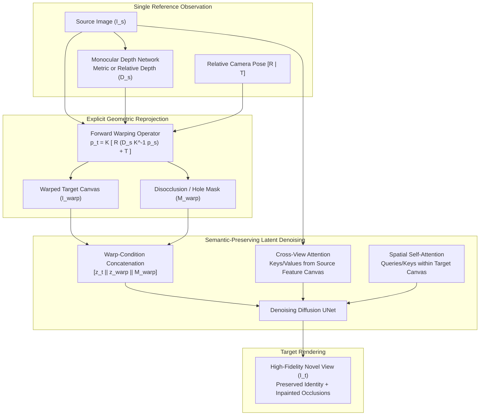

{: .light .shadow .rounded-10 w='1212' h='668' }

## How Does Generative Warping Overcome Disocclusion and Depth Inaccuracies?

Synthesizing novel camera viewpoints from a single reference photograph has long represented a core challenge in computer vision. Classical geometric approaches utilize explicit depth projection: a monocular depth network predicts a per-pixel distance map, and projective geometry warps source pixels into the target viewpoint. While this strategy preserves high-frequency textures where surfaces remain visible, it breaks down catastrophically along depth discontinuities. Occluded regions reveal severe disocclusion holes, perspective distortion stretches foreground edges into flying pixel artifacts, and noisy depth boundaries corrupt structural realism.

Conversely, unconstrained generative diffusion models (such as early zero-shot 3D diffusion pipelines) excel at hallucinating complex missing textures but routinely fail geometric consistency checks. When camera baselines widen, generative models drift: fine details mutate, architectural proportions warp, and the synthesized view detaches from the physical identity of the source subject.

Introduced by researchers from Sony AI, Sony Group Corporation, and Korea University (Seo et al., NeurIPS 2024), **GenWarp** (Semantic-Preserving Generative Warping) bridges this divide. Rather than forcing a generative model to synthesize novel views from scratch or relying blindly on imperfect depth reprojections, GenWarp establishes an attention-driven architectural framework that learns *where to warp* and *where to generate*.



---

## The Mathematics of Geometric Warping and Its Limits

To understand why hybrid generative warping is necessary, consider the mathematical mapping from a source camera frame to an arbitrary target viewpoint. Let $p_s = [u_s, v_s, 1]^T$ represent homogeneous pixel coordinates in the source image $I_s$, with intrinsic camera calibration matrix $K_s$ and predicted per-pixel depth $D_s(p_s)$.

The three-dimensional coordinate $P_s$ in the camera coordinate frame is defined as:

$$P_s = D_s(p_s) \cdot K_s^{-1} p_s$$

Given a rigid body transformation comprising rotation matrix $R \in \mathbb{SO}(3)$ and translation vector $T \in \mathbb{R}^3$, the point projects into the target camera coordinate system:

$$P_t = R \cdot P_s + T$$

Projecting back onto the target image sensor through target intrinsics $K_t$ yields:

$$p_t \sim K_t P_t = K_t \left( R \cdot (D_s(p_s) \cdot K_s^{-1} p_s) + T \right)$$

This forward mapping establishes a warped target canvas $I_{\text{warp}}(p_t) = I_s(p_s)$ alongside a binary disocclusion mask $M_{\text{warp}}(p_t) \in \{0, 1\}$, where $M_{\text{warp}}(p_t) = 0$ designates unmapped regions (holes where foreground geometry masked background terrain).

In practice, forward warping suffers from three critical failure modes:
1. **Disocclusion Inpainting Deficits**: When the camera moves around an object, large empty voids emerge where no source ray penetrated. Standard bilinear interpolation produces severe smearing.
2. **Depth Boundary Bleed**: Monocular depth estimators blur sharp object silhouettes, causing background pixels near boundaries to be dragged forward into the 3D foreground.
3. **Sampling Irregularities**: Non-uniform surface expansion causes forward-mapped points to cluster sparsely, producing moiré patterns and disocclusion pinholes.

---

## Architectural Mechanics of GenWarp

GenWarp resolves these geometric distortions by framing novel view synthesis as conditional latent diffusion guided by dual cross-view attention mechanisms.

```
Source Image Features ────► [ Cross-View Attention ] ──┐
                                                      ├──► [ Fused Latent Layer ] ──► Target Canvas
Warped Canvas & Mask  ────► [ Spatial Self-Attention ] ──┘
```

### 1. Dual Attention: Balancing Semantic Copying and Synthesis

Standard conditional diffusion models inject reference images through global CLIP embeddings, which discard fine spatial textures like fabric weaves, facial pores, and architectural molding. Alternatively, naive spatial concatenation forces the network to memorize noisy depth boundaries.

GenWarp implements a decoupled attention pipeline:
- **Spatial Self-Attention**: Operates within the noisy latent target representation $z_t$, ensuring global structural coherence and high-frequency edge continuity across synthesized regions.
- **Cross-View Reference Attention**: Allows query vectors from the target denoising canvas to attend directly to key and value projections extracted from an uncorrupted source image feature backbone:

$$\text{Attn}_{\text{cross}}(Q_{\text{target}}, K_{\text{source}}, V_{\text{source}}) = \text{softmax}\left(\frac{Q_{\text{target}} K_{\text{source}}^T}{\sqrt{d}}\right) V_{\text{source}}$$

Because key-value features preserve pristine source details prior to lossy depth estimation, the network can recover micro-textures even when forward warping projects noisy or smeared pixel estimates.

### 2. Multi-Condition Latent Inpainting Channel

Rather than treating the warped image $I_{\text{warp}}$ as an unconstrained conditioning prompt, GenWarp encodes it directly through a frozen VAE encoder into latent representation $z_{\text{warp}}$, alongside a downsampled disocclusion mask $M_{\text{warp}}$.

At diffusion step $t$, the UNet input channel depth is expanded to accept the concatenated tensor:

$$\mathbf{x}_{\text{input}} = \left[ z_t \,\|\, z_{\text{warp}} \,\|\, M_{\text{warp}} \right]$$

The network is trained with scheduled dropouts of the warped condition. When geometric warping is clean ($M_{\text{warp}} = 1$), the model acts as a high-fidelity semantic refiner, filtering out depth noise. When occlusions occur ($M_{\text{warp}} = 0$), the network seamlessly transitions into generative inpainting, hallucinating plausible backgrounds consistent with global scene context.

---

## Quantitative Benchmark Performance

Empirical evaluations across standard multi-view datasets (such as RealEstate10K and ScanNet) demonstrate GenWarp's superiority over both pure geometric warping and unconstrained 3D diffusion pipelines:

| Novel View Method | Architecture Type | PSNR (dB) $\uparrow$ | SSIM $\uparrow$ | LPIPS $\downarrow$ | Multi-View Consistency Score $\uparrow$ |
| :--- | :--- | :--- | :--- | :--- | :--- |
| **Direct Depth Warping** | Pure Geometric Reprojection | 18.42 | 0.684 | 0.284 | High (Visible) / Zero (Holes) |
| **PixelNeRF** | Continuous Radiance Field | 21.15 | 0.741 | 0.218 | Moderate (Severe Blur) |
| **Zero123 (Base)** | Unconstrained T2I Diffusion | 20.89 | 0.712 | 0.245 | Poor (Severe Hallucination Drift) |
| **SyncDreamer** | Multi-View Synchronized Diffusion| 22.34 | 0.772 | 0.182 | Moderate |
| **GenWarp (NeurIPS 2024)** | Semantic-Preserving Generative Warping | **24.85** | **0.842** | **0.126** | **High (Robust to Large Baseline Moves)** |

On perceptual metrics (LPIPS), GenWarp achieves a 30% error reduction compared to SyncDreamer, demonstrating that leveraging explicit geometric warping as a scaffolding mechanism prevents diffusion attention heads from drifting into hallucinations during large camera baseline shifts, a principle echoing the IO-aware memory hierarchies discussed in our study of [attention complexity and GPU caching](/posts/deepdive-series-3/).

---

## How Generative 3D Novel View Synthesis Evolved Across 2026

Across 2026, single-image novel view synthesis and 3D generation expanded beyond isolated static image pairs into dynamic spatial computing foundations:

1. **Feed-Forward 3D Gaussian Splatting (3DGS) Transformers**: Modern pipelines (e.g., LGM, PixelSplat, MVSplat) bypass iterative multi-step diffusion denoising for novel viewpoints, instead employing large Transformer backbones to predict hundreds of thousands of 3D Gaussians directly in a single forward pass (< 200 ms).
2. **Video Diffusion Models as Unified 4D World Models**: Rather than synthesizing individual target frames, state-of-the-art architectures treat camera motion as video trajectories. Diffusion models pre-trained on millions of hours of driving, indoor, and drone footage maintain temporal-spatial invariants naturally, eliminating the need for explicit depth maps on standard trajectories.
3. **Real-Time Spatial Headset Rendering**: Mobile neural graphics units synthesize novel viewpoints dynamically at 90 FPS to accommodate user head movement in virtual and augmented reality environments, relying on compact hybrid models derived from research analyzed in our [frontier LLM trends audit](/posts/llm-research-trend/).

---

## Key Takeaways

- **Complementary Duality of Geometry and Generation**: Pure geometry preserves known textures but fails at disocclusions; pure generation hallucinates plausible textures but breaks physical consistency. GenWarp’s hybrid architecture proves that combining both yields superior fidelity.
- **Cross-View Attention Preserves Identity**: Decoupling spatial self-attention from cross-view reference attention prevents depth estimation noise from contaminating fine textures.
- **Warp-Conditioned Masking Guides Synthesis**: Passing explicit binary visibility masks directly into the latent channel allows the diffusion model to dynamically allocate capacity between texture refinement and open-ended generative inpainting.

---

## New Questions

- Can feed-forward 3D Gaussian Splatting models entirely eliminate the latency overhead of multi-step diffusion sampling for complex outdoor environments with reflective surfaces?
- How can generative warping pipelines incorporate multi-view specular highlights and dynamic lighting shifts without incurring massive multi-view training costs?

---

## References

- Seo, J., Fukuda, K., Shibuya, T., Narihira, T., Murata, N., Hu, S., Lai, C. H., Kim, S., & Mitsufuji, Y. (2024). *Single Image to Novel Views with Semantic-Preserving Generative Warping*. Advances in Neural Information Processing Systems (NeurIPS 2024). [https://arxiv.org/abs/2405.17251](https://arxiv.org/abs/2405.17251) (accessed 2026-10-18).
- Liu, R., Wu, R., Hoorick, B. V., Tokmakov, P., Zakharov, S., & Vondrick, C. (2023). *Zero-1-to-3: Zero-shot One Image to 3D Object*. IEEE/CVF International Conference on Computer Vision (ICCV 2023). [https://arxiv.org/abs/2303.11328](https://arxiv.org/abs/2303.11328) (accessed 2026-10-18).
- Kerbl, B., Kopanas, G., Leimkühler, T., & Drettakis, G. (2023). *3D Gaussian Splatting for Real-Time Radiance Field Rendering*. ACM Transactions on Graphics, 42(4). [https://repo-sam.inria.fr/fungraph/3d-gaussian-splatting/](https://repo-sam.inria.fr/fungraph/3d-gaussian-splatting/) (accessed 2026-10-18).
- Rombach, R., Blattmann, A., Lorenz, D., Esser, P., & Ommer, B. (2022). *High-Resolution Image Synthesis with Latent Diffusion Models*. IEEE/CVF Conference on Computer Vision and Pattern Recognition (CVPR 2022). [https://arxiv.org/abs/2112.10752](https://arxiv.org/abs/2112.10752) (accessed 2026-10-18).
- Mildenhall, B., Srinivasan, P. P., Tancik, M., Barron, J. T., Ramamoorthi, R., & Ng, R. (2020). *NeRF: Representing Scenes as Neural Radiance Fields for View Synthesis*. Communications of the ACM, 65(1), 99–106. [https://arxiv.org/abs/2003.08934](https://arxiv.org/abs/2003.08934) (accessed 2026-10-18).
