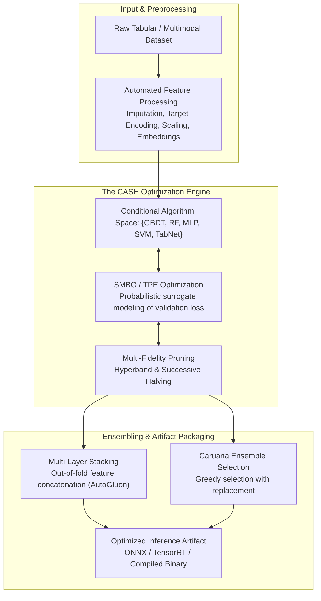

{: .light .shadow .rounded-10 w='1212' h='668' }

## How Does Automated Machine Learning Solve the Combined CASH Problem?

Building competitive machine learning pipelines traditionally demanded extensive trial-and-error by human practitioners. Selecting appropriate imputation strategies, encoding categorical features, picking classification or regression algorithms, tuning continuous hyperparameters, and assembling multi-model blends required weeks of empirical experimentation. 

Automated Machine Learning (AutoML) arose to formalize this workflow into a mathematically rigorous optimization problem. Rather than treating pipeline configuration as an artisanal craft, AutoML frames end-to-end model creation as a search problem over high-dimensional, mixed-type, conditional search spaces. 

Early discourse often reduced AutoML to superficial library catalogs. In enterprise production, however, engineering teams must evaluate the underlying algorithmic trade-offs: how search algorithms navigate non-convex loss landscapes, how multi-fidelity schedulers prune unpromising candidates, and how modern agentic workflows synthesize bespoke code rather than searching fixed parameter grids.



---

## Formulating the Combined Algorithm Selection and Hyperparameter Problem

At the theoretical core of AutoML lies the **Combined Algorithm Selection and Hyperparameter optimization (CASH)** problem, formalized by Thornton et al. (2013). 

Given a set of learning algorithms $\mathcal{A} = \{A^{(1)}, A^{(2)}, \dots, A^{(R)}\}$, where each algorithm $A^{(j)}$ possesses a hyperparameter space $\Lambda^{(j)}$, the combined search space is represented as:

$$\mathbf{\Lambda} = \bigcup_{j=1}^R \left( \{A^{(j)}\} \times \Lambda^{(j)} \right)$$

Given a dataset $D$ partitioned into $K$ cross-validation folds $D_{\text{train}}^{(k)}$ and $D_{\text{val}}^{(k)}$, the CASH objective seeks an optimal algorithm-hyperparameter configuration $A^* \in \mathcal{A}$ and $\lambda^* \in \Lambda^*$ that minimizes the mean generalization loss $\mathcal{L}$:

$$A^*, \lambda^* = \arg\min_{A^{(j)} \in \mathcal{A}, \lambda \in \Lambda^{(j)}} \frac{1}{K} \sum_{k=1}^K \mathcal{L}\left(A_{\lambda}^{(j)}, D_{\text{train}}^{(k)}, D_{\text{val}}^{(k)}\right)$$

The mathematical challenge stems from three properties:
1. **Hierarchical / Conditional Dependencies**: Hyperparameters of a decision tree (e.g., `max_depth`, `min_samples_leaf`) have zero effect if the outer algorithm selector chooses a Support Vector Machine.
2. **Expensive Black-Box Evaluations**: Evaluating $\mathcal{L}(A_{\lambda}^{(j)})$ requires full model training and validation, which may consume hours on modern datasets.
3. **Non-Differentiability**: The algorithm index $j$ is categorical and discrete, rendering direct gradient descent inapplicable.

---

## Mathematical Optimization Paradigms in AutoML

AutoML systems deploy distinct algorithmic strategies to navigate the CASH landscape efficiently:

### 1. Sequential Model-Based Optimization (SMBO) and TPE

SMBO approximates the true expensive black-box function $\mathcal{L}(\lambda)$ with an inexpensive probabilistic surrogate model $\hat{f}(\lambda)$. Popularized in Auto-Sklearn (Feurer et al.), Bayesian optimization iteratively updates the surrogate and selects the next point via an **Acquisition Function**, typically Expected Improvement (EI):

$$\text{EI}(\lambda) = \mathbb{E}\left[ \max(0, f_{\min} - f(\lambda)) \right]$$

Rather than modeling the posterior $p(y \mid \lambda)$ using computationally intensive Gaussian Processes (which scale cubically as $\mathcal{O}(N^3)$ with evaluated configurations), Tree-structured Parzen Estimators (TPE, Bergstra et al.) invert the conditioning via Bayes' rule:

$$p(\lambda \mid y) = \begin{cases} \ell(\lambda) & \text{if } y < y^* \\ g(\lambda) & \text{if } y \ge y^* \end{cases}$$

Where $y^*$ is a quantile threshold of historical validation losses. TPE maximizes the ratio $\ell(\lambda) / g(\lambda)$, focusing evaluations on regions with high probability of outperforming the best current validation score while exploring under-sampled domains. As explored in our survey of [foundational algorithms](/posts/10-core-algorithms/), efficient parameter space partitioning is essential for scaling search in high-dimensional domains.

---

### 2. Multi-Fidelity Optimization: Successive Halving and Hyperband

Bayesian optimization spends considerable compute running unpromising configurations to completion. Multi-fidelity algorithms (Li et al., 2017) introduce early-stopping schedulers based on resource allocations (subsets of training data, epoch counts, or tree iterations):

```
Round 0: 81 configurations evaluated on 1 epoch   ────► [Prune bottom 66%]
Round 1: 27 configurations evaluated on 3 epochs  ────► [Prune bottom 66%]
Round 2:  9 configurations evaluated on 9 epochs  ────► [Prune bottom 66%]
Round 3:  3 configurations evaluated on 27 epochs ────► [Prune bottom 66%]
Round 4:  1 winning configuration evaluated on 81 epochs
```

By allocating small resource slices to many candidates and geometrically scaling budgets only for top performers, Hyperband achieves up to an order-of-magnitude speedup over pure random search or Gaussian Process optimization.

---

### 3. Multi-Layer Stacking Without Search: The AutoGluon Paradigm

In contrast to iterative search systems, AutoGluon (Erickson et al., 2020) shifts the design philosophy from hyperparameter search toward **multi-layer stacking with out-of-fold representations**.

Rather than searching for a single best hyperparameter configuration, AutoGluon trains a diverse suite of un-tuned or lightly tuned baseline models (LightGBM, CatBoost, XGBoost, TabNet, Random Forests) across cross-validation folds. The out-of-fold validation predictions serve as auxiliary input features for stacked downstream layers:

$$\mathbf{x}_{\text{layer } l+1} = \left[ \mathbf{x}_{\text{raw}} \,\|\, \hat{\mathbf{y}}_1^{(l)} \,\|\, \hat{\mathbf{y}}_2^{(l)} \,\|\, \dots \,\|\, \hat{\mathbf{y}}_M^{(l)} \right]$$

By concatenating raw features with intermediate model probability distributions across multiple layers and finishing with an ensemble selection step, AutoGluon consistently wins competitive tabular benchmarks without getting trapped in expensive hyperparameter optimization loops. This paradigm closely aligns with modern data warehousing and feature extraction standards analyzed in our [data engineering stack architecture review](/posts/explore-the-landscape-of-open-source-data-engineering/).

---

## Architectural Comparison of Production AutoML Frameworks

| Framework | Core Optimization Paradigm | Tabular Strength | Deep Learning / Multimodal | Ensembling Mechanism | Primary Bottleneck |
| :--- | :--- | :--- | :--- | :--- | :--- |
| **AutoGluon** | Multi-layer stacking + Caruana post-fit | **State-of-the-art** | High (Text/Image/Tabular) | Multi-layer out-of-fold stacking | High RAM footprint during multi-model fitting |
| **Auto-Sklearn 2.0** | SMAC / Bayesian SMBO + Meta-learning | Strong | Limited (Sklearn wrapper) | Greedy ensemble selection | Slow on large datasets (> 1M rows) |
| **FLAML (Microsoft)** | Cost-FOCUSED economic search (CFO) | High (Fast GBDTs) | Moderate (HuggingFace tuning) | Blended search + weighted average | Limited native deep architecture search |
| **H2O AutoML** | Random search + Stacked Ensembles | Strong | Moderate (Deep Water) | Super Learner stacking | JVM dependency, memory overhead |
| **TPOT** | Genetic programming (NSGA-II) | Moderate | None (Sklearn pipelines) | Pareto-optimal pipeline export | Computationally expensive evolution cycles |

---

## Production Deployment and MLOps Considerations

Deploying automated pipelines into production environments introduces challenges not present in manual model development:

1. **Pipeline Serialization Fragility**: AutoML frameworks construct complex directed acyclic graphs (DAGs) containing multi-stage imputers, encoders, and nested models. Exporting these artifacts into standard formats (ONNX, PMML) often fails due to custom Python lambda transforms.
2. **Inference Latency Bloat**: Ensembles containing 20 distinct Gradient Boosted Decision Trees and multi-layer perceptrons produce high accuracy but unacceptable latency (> 100 ms) for real-time recommendation engines. Productionization requires knowledge distillation—compressing the AutoML ensemble into a single fast student model, a dynamic examined in our [machine learning engineering concepts audit](/posts/machine-learning-interview-questions/).
3. **Data Drift and Retraining Instability**: Because AutoML engines pick algorithm classes dynamically, retraining an AutoML pipeline on drifted production data may unexpectedly swap an interpretable Linear Model for an opaque GBDT, introducing compliance and monitoring challenges.

---

## How AutoML Evolved Across 2026

By 2026, the classical definition of AutoML expanded beyond mathematical parameter search into autonomous LLM-driven software engineering:

1. **LLM-Driven Code Synthesizers (Agentic AutoML)**: Autonomous coding agents (such as SWE-bench and AutoKaggle frameworks) iteratively write, execute, inspect, and debug end-to-end Python ML scripts. Rather than picking from hardcoded libraries, agents invent bespoke domain-specific feature transforms, verify syntax against execution errors, and inspect diagnostic residual plots.
2. **Foundation Model Tabular Zero-Shot Transfer**: Transformers pre-trained across thousands of diverse tabular datasets (e.g., TabPFN and successor tabular foundation models) predict class distributions via in-context learning in a single forward pass (< 1 second), completely eliminating both training loops and hyperparameter tuning for datasets under 50,000 samples.
3. **Automated Multimodal Fusion**: Modern AutoML engines automatically identify image columns, audio streams, unstructured text, and numerical tables within single relational databases, routing each modality to pre-trained frozen backbones before performing cross-attention fusion.

---

## Key Takeaways

- **The Power of Stacking Over Tuning**: Multi-layer model stacking with cross-validated out-of-fold predictions (as demonstrated by AutoGluon) consistently outperforms exhaustive hyperparameter tuning of single algorithms.
- **Multi-Fidelity Resource Allocation Is Mandatory**: Modern datasets cannot afford exhaustive black-box evaluations; successive halving and Hyperband are essential to prune unpromising candidates early.
- **The Shift to Agentic ML Engineering**: The future of AutoML belongs not to rigid hyperparameter grids, but to autonomous code-generating agents capable of formulating hypotheses, testing feature transformations, and refactoring ML pipelines programmatically.

---

## New Questions

- At what dataset scale do tabular foundation models (in-context TabPFN architectures) surpass the empirical accuracy of multi-layer GBDT stacking ensembles?
- How can organizations ensure regulatory explainability (e.g., EU AI Act compliance) when autonomous agentic AutoML pipelines invent complex synthetic features dynamically?

---

## References

- Thornton, C., Hutter, F., Hoos, H. H., & Leyton-Brown, K. (2013). *Auto-WEKA: Combined Selection and Hyperparameter Optimization of Classification Algorithms*. ACM SIGKDD International Conference on Knowledge Discovery and Data Mining. [https://doi.org/10.1145/2487575.2487629](https://doi.org/10.1145/2487575.2487629) (accessed 2026-10-18).
- Feurer, M., Klein, A., Eggensperger, K., Springenberg, J., Blum, M., & Hutter, F. (2015). *Efficient and Robust Automated Machine Learning*. Advances in Neural Information Processing Systems, 28. [https://papers.nips.cc/paper/2015/hash/11d0e62e3f23f11e98112f531394e3b9-Abstract.html](https://papers.nips.cc/paper/2015/hash/11d0e62e3f23f11e98112f531394e3b9-Abstract.html) (accessed 2026-10-18).
- Li, L., Jamieson, K., DeSalvo, G., Rostamizadeh, A., & Talwalkar, A. (2017). *Hyperband: A Novel Bandit-Based Approach to Hyperparameter Optimization*. Journal of Machine Learning Research, 18(1), 6765–6816. [https://jmlr.org/papers/v18/16-558.html](https://jmlr.org/papers/v18/16-558.html) (accessed 2026-10-18).
- Erickson, N., Mueller, J., Shirkov, A., Zhang, H., Larroy, P., Li, M., & Smola, A. (2020). *AutoGluon-Tabular: Robust and Accurate AutoML for Structured Data*. arXiv preprint arXiv:2003.06505. [https://arxiv.org/abs/2003.06505](https://arxiv.org/abs/2003.06505) (accessed 2026-10-18).
- Wang, C., Wu, Q., Weimer, M., & Zhu, E. (2021). *FLAML: A Fast and Lightweight AutoML Library*. Proceedings of Machine Learning and Systems, 3, 434–447. [https://proceedings.mlsys.org/paper_files/paper/2021/hash/92cc227532d17e56e07902b254dfad10-Abstract.html](https://proceedings.mlsys.org/paper_files/paper/2021/hash/92cc227532d17e56e07902b254dfad10-Abstract.html) (accessed 2026-10-18).
