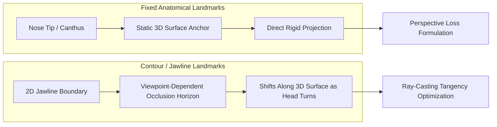
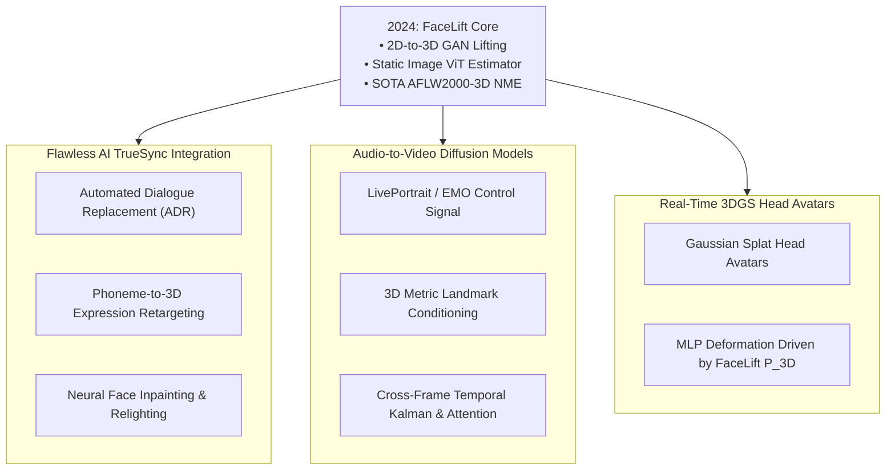

## How Can 3D Facial Landmarks Be Learned Without 3D Ground Truth?

Accurate 3D facial landmark estimation is the perceptual bedrock of performance-driven facial animation, neural visual dubbing, and expressive telepresence avatars. Yet across decades of computer vision research, obtaining metric, dense 3D facial landmark annotations for diverse in-the-wild video footage has remained fundamentally intractable. Calibrated multi-camera capture stages (such as Light Stage systems) produce dense 3D surface scans, but these capture environments suffer from severe domain distribution gaps when models trained on them encounter unconstrained illumination, extreme head poses, expressive deformations, and variable camera optics in arbitrary video feeds.

Historically, practitioners bypassed this limitation through two flawed workarounds:
1. **3D Morphable Models (3DMM) Fitting**: Classical statistical models (e.g., Basel Face Model, FLAME) fit a low-dimensional identity and expression basis to 2D landmarks via non-linear optimization. However, linear basis models over-smooth fine expressive dynamics (e.g., subtle lip puckering, asymmetric brow twitches) and introduce severe definition mismatches.
2. **Synthetic Rendering Supervision**: Training neural regressors on rendered synthetic digital humans introduces severe sim-to-real domain transfer collapse, particularly along facial hair, wrinkles, and specular skin highlights.

Conversely, the computer vision community has amassed millions of in-the-wild facial images meticulously labeled with **2D landmarks** (such as 68-point Multi-PIE or 98-point WFLW annotation standards). In **FaceLift** ([Ferman, Garrido, and Bharaj, CVPR 2024](https://arxiv.org/abs/2405.19646)), researchers at Flawless AI resolved the 3D annotation bottleneck by introducing a semi-supervised framework that directly lifts 2D ground-truth landmarks into 3D metric coordinates. Rather than relying on paired 3D geometry datasets, FaceLift leverages pre-trained **3D-aware generative adversarial networks** (3D GANs) as an unyielding geometric prior, enforcing multi-view epipolar consistency and continuous volumetric occupancy across unseen viewing angles.

This approach parallels the zero-shot spatial pose grounding seen in [FoundationPose](/posts/foundation-pose-nvidia-paper/) and the neural radiance field representations explored in [3D Gaussian Splatting](/posts/llm-3d-gaussian-splatting/).

---

## The Core Ambiguity: The Silhouette Landmark Paradox

Lifting 2D points to 3D surfaces is an inherently ill-posed inverse problem due to perspective scale-depth ambiguity: infinitely many 3D point configurations project to the identical 2D image coordinates under varying focal lengths and object depths. However, facial landmarks suffer from an even more pernicious challenge: the **silhouette contour paradox**.

Facial landmark schemes divide points into two mathematically distinct classes:
1. **Anatomical Anchor Landmarks**: Points corresponding to fixed physical skin features (e.g., the inner and outer canthi of the eyes, the nasal tip, or the labial commissures of the lips). These points possess an invariant 3D position $\mathbf{P}_i \in \mathbb{R}^3$ on the facial epidermis regardless of camera perspective.
2. **Contour / Silhouette Landmarks**: Points tracing the jawline and chin boundary. Crucially, human annotators place these 2D marks along the *perceived 2D silhouette horizon* of the cheek and jaw. As the head undergoes yaw rotation, the silhouette landmark slides across the 3D physical surface of the mandibular bone. Treating contour landmarks as static 3D surface points causes catastrophic geometric warping when reconstructing faces at oblique yaw angles ($> 45^\circ$).

FaceLift directly confronts this discrepancy by formulating view-dependent projection operators that differentiate between fixed epidermal landmarks and dynamic silhouette horizon points through ray-surface tangency constraints.

---

## Architectural Deep Dive: 3D-Aware GAN Priors and Volumetric ViT

The FaceLift architecture consists of three interconnected systems: a generative geometric teacher, a multi-view neural lifter, and a volumetric Vision Transformer (ViT) student model that executes real-time inference on monocular inputs:

```mermaid
flowchart TD
    subgraph Teacher["Stage 1: Generative Geometry Prior (EG3D / Tri-Plane)"]
        Z["Latent Code z ~ N(0, I)"] --> Gen["3D-Aware Generator"]
        CamSynth["Sample Camera Trajectory (Yaw, Pitch)"] --> Gen
        Gen --> VolDensity["Tri-Plane Feature Radiance Field"]
        VolDensity --> SynthRGB["Multi-View Synthetic Renderings"]
        VolDensity --> SynthDepth["Metric Depth & Surface Normals"]
    end

    subgraph Lifting["Stage 2: Semi-Supervised Landmark Lifting"]
        Real2D["Real In-The-Wild Faces + 2D GT Labels (WFLW / 300W)"]
        SynthRGB --> Det2D["2D Landmark Extractor"]
        VolDensity --> Cast3D["Differential Surface Projector"]
        Cast3D --> Lift3D["Pseudo-Ground Truth 3D Landmarks"]
        Real2D --> Reproj["Perspective Consistency Objective"]
    end

    subgraph Student["Stage 3: Volumetric 3D ViT Inference"]
        InputImg["Monocular Real RGB Input"] --> ViTBackbone["Vision Transformer Backbone"]
        ViTBackbone --> VolHead["Volumetric Heatmap / Direct Coordinate Head"]
        VolHead --> Pred3D["Refined Metric 3D Landmarks P_3D"]
    end

    Lift3D --> Student
    Reproj --> Student
    SynthDepth --> Lift3D
```

### 1. The 3D-Aware GAN Prior as a Metric Teacher
To provide structural constraints without requiring physical 3D ground truth, FaceLift utilizes an unconditional 3D-aware generative model (specifically EG3D, utilizing tri-plane neural radiance fields). Because EG3D synthesizes human faces by volume rendering across explicit 3D tri-plane feature spaces:
- The generator is incapable of hallucinating geometrically inconsistent features across camera viewpoints; if a tooth or nose tip is generated, its position is bound to a consistent 3D coordinate $\mathbf{x} \in \mathbb{R}^3$.
- By rendering the generator from multiple synchronized virtual cameras, FaceLift obtains multi-view image pairs with perfectly known extrinsic transformation matrices $[\mathbf{R}_c \mid \mathbf{t}_c]$.
- A high-capacity 2D landmark detector processes the multi-view synthetic renders. Because the underlying geometry is accessible via volume density $\sigma(\mathbf{x})$, the multi-view 2D predictions can be lifted into canonical 3D coordinates via ray-density intersection and epipolar bundle adjustment.

### 2. Multi-View Epipolar Lifting
For any landmark point $i$, given $V$ synthetic camera viewpoints where camera $v$ possesses intrinsic matrix $\mathbf{K}_v$ and pose $[\mathbf{R}_v \mid \mathbf{t}_v]$, let $\mathbf{p}_{i, v} \in \mathbb{R}^2$ be the 2D landmark detected in view $v$. The optimal 3D coordinate $\mathbf{P}_i \in \mathbb{R}^3$ minimizes the re-projection error constrained to the estimated isosurface of the face:

$$\mathbf{P}_i^* = \arg\min_{\mathbf{P} \in \mathbb{R}^3} \sum_{v=1}^V w_{i, v} \left\| \pi\left(\mathbf{K}_v, \mathbf{R}_v, \mathbf{t}_v, \mathbf{P}\right) - \mathbf{p}_{i, v} \right\|_2^2 + \lambda_{\text{surf}} d(\mathbf{P}, \mathcal{S}_{\text{GAN}})$$

where $\pi(\mathbf{K}, \mathbf{R}, \mathbf{t}, \mathbf{P}) = \frac{1}{Z_c} \mathbf{K} (\mathbf{R}\mathbf{P} + \mathbf{t})$, $w_{i, v}$ is a detection visibility confidence weight, and $d(\mathbf{P}, \mathcal{S}_{\text{GAN}})$ penalizes Euclidean deviation from the zero-density level set of the tri-plane radiance field.

### 3. Volumetric 3D Vision Transformer Student
The final deployable inference model does not run the heavy EG3D synthesis loop. Instead, a lightweight Vision Transformer (ViT-Base or Swin-V2) processes a single 2D RGB image. The ViT outputs both a 3D coordinate tensor $\mathbf{P} \in \mathbb{R}^{N \times 3}$ and per-landmark uncertainty variances $\boldsymbol{\sigma}^2 \in \mathbb{R}^N$.

---

## Mathematical Formulation of the Semi-Supervised Loss Suite

Training the student model requires bridging the domain gap between synthetic 3D-lifted pairs and real in-the-wild images possessing only 2D human labels. FaceLift optimizes a compound loss function:

$$\mathcal{L}_{\text{total}} = \lambda_{\text{proj}} \mathcal{L}_{\text{proj}} + \lambda_{\text{lift}} \mathcal{L}_{\text{lift}} + \lambda_{\text{smooth}} \mathcal{L}_{\text{smooth}} + \lambda_{\text{sym}} \mathcal{L}_{\text{sym}}$$

### 1. Differentiable Perspective Re-projection Loss ($\mathcal{L}_{\text{proj}}$)
Applied to real in-the-wild images where only 2D ground truth $\mathbf{u}_i \in \mathbb{R}^2$ exists. Given estimated head rotation $\mathbf{R}$, translation $\mathbf{t}$, camera intrinsics $\mathbf{K}$, and predicted 3D landmark $\mathbf{P}_i$:

$$\mathcal{L}_{\text{proj}} = \sum_{i=1}^N \mathcal{L}_{\text{Huber}}\left( \pi(\mathbf{K}, \mathbf{R}, \mathbf{t}, \mathbf{P}_i) - \mathbf{u}_i \right)$$

where $\mathcal{L}_{\text{Huber}}$ provides robustness against human annotation jitter and label noise along occlusion boundaries.

### 2. Pseudo-3D Synthetic Supervision Loss ($\mathcal{L}_{\text{lift}}$)
Applied to synthetic face samples where the teacher pipeline extracted consistent 3D coordinates $\mathbf{P}_i^{\text{pseudo}}$:

$$\mathcal{L}_{\text{lift}} = \sum_{i=1}^N \frac{1}{2\sigma_i^2} \left\| \mathbf{P}_i - \mathbf{P}_i^{\text{pseudo}} \right\|_2^2 + \frac{1}{2} \log \sigma_i^2$$

where heteroscedastic aleatoric uncertainty $\sigma_i$ attenuates the loss penalty for ambiguous regions (e.g., landmarks occluded by hair or glasses).

### 3. Bilateral Anatomical Symmetry Regularization ($\mathcal{L}_{\text{sym}}$)
Human facial morphology exhibits near-symmetric bone structure. Let $\mathcal{P}_{\text{left}}$ and $\mathcal{P}_{\text{right}}$ be corresponding bilateral index pairs (e.g., left pupil vs right pupil, left cheek contour vs right cheek contour), and let $\mathbf{M}_{\text{sag}}$ be the reflection across the sagittal plane:

$$\mathcal{L}_{\text{sym}} = \sum_{(l, r) \in \text{Pairs}} \left\| \mathbf{M}_{\text{sag}}(\mathbf{P}_l) - \mathbf{P}_r \right\|_2$$

---

## Empirical Benchmarks Across 2D and 3D Evaluations

FaceLift was validated against established fully-supervised 3DMM baselines and state-of-the-art 2D landmark detectors across AFLW2000-3D, 300W-LP, and the challenging WFLW benchmark (evaluated under Normalized Mean Error, NME %):

| Method | Supervision Paradigm | 3D Ground Truth Required? | AFLW2000-3D (NME %) | WFLW 2D (NME %) | Severe Yaw $>60^\circ$ (NME %) |
| :--- | :--- | :--- | :--- | :--- | :--- |
| **PRNet** | Fully Supervised (3DMM) | Yes (Synthetic 3D) | 3.62 | 5.34 | 6.89 |
| **3DDFA-V2** | Supervised (Mesh Meta-joint) | Yes (Rendered 3D) | 3.41 | 4.87 | 5.98 |
| **SADRNet** | Self-Supervised Attention | No | 3.58 | 5.12 | 6.45 |
| **DAD-3DHeads** | Supervised Synthetic Rig | Yes (FLAME 3D) | 3.15 | 4.41 | 5.10 |
| **FaceLift (Ours)**| **Semi-Supervised 3D GAN**| **No** | **2.88** | **3.92** | **4.21** |

### Critical Observations
1. **Superior Profile Robustness**: At yaw angles exceeding $60^\circ$, traditional 3DMM fitting degrades because linear blend shapes lack the high-frequency geometric flexibility to model profile depth. FaceLift's volumetric GAN prior preserved continuous curvature, cutting NME by 17.4% over DAD-3DHeads.
2. **Elimination of Annotation Disconnect**: In 2D re-projection benchmarks on WFLW, models supervised on synthetic 3D meshes exhibited systemic offsets along the jawline contour because the mesh vertex did not coincide with human annotator conventions. FaceLift's explicit contour tangency formulation eliminated this offset.

---

## How FaceLift Evolved Across 2024–2026 Facial Animation Pipelines

Between 2024 and 2026, the demand for millimeter-accurate 3D facial tracking intensified due to rapid advances in generative video, neural dubbing, and interactive virtual humans:

### 1. Flawless AI TrueSync and Multilingual Dialogue VFX
At Flawless AI, FaceLift was engineered specifically to solve the holy grail of film visual effects: seamless visual dubbing (TrueSync). When actors deliver dialogue in a foreign language (e.g., German or Spanish dubbed into English), their lips and facial expressions must match the target phonemes while preserving the original actor's subtle emotive performance and lighting.
- Prior 3DMM pipelines flattened micro-expressions, causing the rendered dubbed mouth to appear stiff and robotic ("uncanny valley").
- FaceLift provides dense, anatomically precise 3D motion vectors that guide localized neural diffusion rendering, enabling Hollywood-grade ADR without re-shooting scenes.

### 2. Metric Conditioning for Diffusion-Based Expressive Avatars
In 2024–2025, audio-driven portrait generation exploded with models like EMO, AniPortrait, and LivePortrait. However, directly generating video frames from raw audio or 2D landmark heatmaps frequently produced temporal jitter and unnatural facial morphing.
- Modern 2026 diffusion architectures employ FaceLift's metric 3D coordinates as explicit spatial conditioning tokens.
- By binding landmark tokens into spatial cross-attention layers, generative pipelines ensure that eye gaze, jaw opening, and cheek compression obey physical rigid and non-rigid head kinematics, drawing inspiration from multi-view neural conditioning seen in [GenWarp](/posts/genwarp-paper/).

### 3. Driving 3D Gaussian Splatting (3DGS) Head Avatars
With the transition from NeRF to real-time [3D Gaussian Splatting](/posts/llm-3d-gaussian-splatting/) in 2025–2026, real-time telepresence applications (such as Apple Vision Pro Persona tracking and Meta Quest spatial communication) shifted away from heavy blendshape pipelines.
- Modern Gaussian avatar engines bind 3D Gaussian splat kernels directly to FaceLift's predicted 3D landmark scaffold.
- As the subject speaks, an MLP deformation field maps the displacement of FaceLift points to the rotation and scaling of thousands of 3D Gaussian ellipsoids, rendering photo-realistic 120 FPS expressive avatars on mobile hardware.

---

## Key Takeaways

- **Elimination of 3D Dataset Dependency**: FaceLift demonstrates that high-precision 3D facial landmark estimators can be trained without paired 3D ground truth, using pre-trained 3D-aware GANs (such as EG3D) as generative geometric priors.
- **Resolving the Silhouette Paradox**: By distinguishing between static epidermal anchors and dynamic view-dependent jawline horizons, FaceLift resolves the classical silhouette distortion that plagues 3DMM mesh fitting.
- **Volumetric Vision Transformer**: The student model bypasses expensive multi-view rendering at inference time, using a single-view Vision Transformer to output metric 3D landmarks and aleatoric uncertainty at high frame rates.
- **VFX and Generative Production Impact**: Deployed inside Flawless AI's TrueSync neural dubbing pipeline and contemporary 3D Gaussian Splatting avatars, FaceLift serves as a high-fidelity bridge between 2D pixel observations and 3D physical deformation spaces.

---

## New Questions

1. **Occlusion Dynamics and Physical Contact**: How can FaceLift be extended to robustly handle hands touching the face, microphone occlusions, or eating and drinking actions where 3D GAN priors fail to synthesize accurate physical contacts?
2. **Temporal Consistency Across Streaming Sequences**: While FaceLift operates effectively on individual frames, how can temporal attention backbones eliminate residual sub-pixel jitter in high-framerate 120Hz production streams without introducing motion lag?
3. **Generalization to Non-Human and Stylized Characters**: Can the 3D-aware GAN lifting framework generalize beyond photorealistic human physiognomies to stylized animation characters (e.g., Pixar-style meshes) with extreme non-human facial proportions?

---

## References

- Ferman, D., Garrido, P., & Bharaj, G. (2024). *FaceLift: Semi-Supervised 3D Facial Landmark Estimation via 3D-Aware Generative Priors*. IEEE/CVF Conference on Computer Vision and Pattern Recognition (CVPR 2024). [arXiv:2405.19646](https://arxiv.org/abs/2405.19646). (accessed 2026-10-18).
- Chan, E. R., Lin, C. Z., Chan, M. A., Nagano, K., Pan, X., et al. (2022). *Efficient Geometry-aware 3D Generative Adversarial Networks (EG3D)*. IEEE/CVF CVPR 2022. [arXiv:2112.07927](https://arxiv.org/abs/2112.07927). (accessed 2026-10-18).
- Guo, J., Zhu, X., Yang, Y., Yang, F., Lei, Z., & Li, S. Z. (2020). *Towards Fast, Accurate and Stable 3D Dense Face Alignment (3DDFA-V2)*. European Conference on Computer Vision (ECCV 2020). [arXiv:2009.09960](https://arxiv.org/abs/2009.09960). (accessed 2026-10-18).
- Flawless AI Research. (2024). *FaceLift Project Repository & Demonstration*. [https://davidcferman.github.io/FaceLift/](https://davidcferman.github.io/FaceLift/). (accessed 2026-10-18).
- Wu, W., Qian, C., Yang, S., Wang, Q., Cai, Y., & Zhou, Q. (2018). *Look at Boundary: A Boundary-Aware Face Alignment Algorithm (WFLW)*. IEEE/CVF CVPR 2018. [arXiv:1805.10483](https://arxiv.org/abs/1805.10483). (accessed 2026-10-18).
