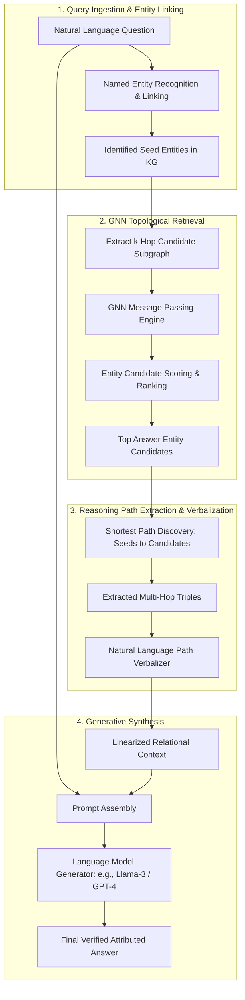

{: .light .w-75 .shadow .rounded-10 }

## Why Does Multi-Hop Relational Reasoning Expose the Structural Flaws of Vector RAG?

Standard Retrieval-Augmented Generation (RAG) relies almost entirely on dense vector embedding similarity. When applied to unstructured narrative documents, embedding search works adequately by retrieving text chunks that share semantic proximity with a user's prompt. 

However, when applied to Knowledge Graph Question Answering (KGQA) and complex structured domains, standard vector RAG suffers immediate structural breakdown. Real-world enterprise knowledge is inherently relational: questions frequently require multi-hop traversal (e.g., *"Which subsidiaries of companies acquired by Founder X prior to 2020 operate in medical device manufacturing?"*). To answer such queries, an information retrieval system must traverse multiple explicit entity-relation-entity edges $(\text{head}, \text{relation}, \text{tail})$ across a structured topology.

Standard vector search fails on multi-hop graph queries due to three fundamental limitations:
1. **Semantic Flattening:** Vector embeddings project text chunks into continuous latent space, destroying explicit directed edge relationships, multi-hop dependencies, and relational constraints.
2. **Context Linearization Limits:** Attempting to feed an entire Knowledge Graph (KG) subgraph into a large language model prompt causes catastrophic context explosion. Linearizing thousands of triples into markdown text overwhelms the LLM's attention mechanism and incurs prohibitive token costs.
3. **LLM Topological Blindness:** While frontier LLMs excel at linguistic parsing and grammatical synthesis, their self-attention layers struggle with combinatorial path finding and exhaustive graph traversal over dense subgraphs.

Conversely, Graph Neural Networks (GNNs) excel at processing complex graph topologies and executing multi-hop relational message passing, but lack the general language comprehension and contextual reasoning required to parse nuanced questions and generate coherent answers.

To resolve this dichotomy, Costas Mavromatis and George Karypis (University of Minnesota and Amazon Web Services) introduced **GNN-RAG** (*GNN-RAG: Graph Neural Retrieval for Large Language Modeling*, arXiv:2405.20139). This source audit deconstructs the GNN-RAG architecture, analyzing how pairing GNN-driven topological reasoning with LLM natural language generation establishes a new benchmark for multi-hop question answering.



---

## The Core Division of Labor: Graph Topology vs. Natural Language Synthesis

The foundational insight of GNN-RAG is an explicit division of labor between graph topological search and linguistic generation:

- **The GNN Acts as the High-Recall Graph Retriever:** The GNN's sole responsibility is structural reasoning. It traverses millions of candidate edges in the knowledge base, filters out irrelevant branches via message passing, scores candidate entities, and extracts compact reasoning paths.
- **The LLM Acts as the High-Precision Language Reasoner:** The language model is completely insulated from raw graph topology. It receives only verbalized, linear reasoning paths corresponding to the GNN's highest-probability candidate trajectories, using its semantic capabilities to synthesize a coherent, attributed response.

This architecture completely eliminates the need to dump raw knowledge subgraphs into the LLM context, slashing prompt token consumption while maintaining state-of-the-art multi-hop retrieval accuracy.

---

## Graph Neural Reasoning: Message Passing and Candidate Entity Scoring

The GNN retrieval stage begins by linking query entities to nodes within the Knowledge Graph $\mathcal{G} = (\mathcal{V}, \mathcal{E}, \mathcal{R})$, identifying a set of seed entities $\mathcal{V}_q \subset \mathcal{V}$. The system extracts a $k$-hop enclosing subgraph surrounding $\mathcal{V}_q$.

To reason over this subgraph, GNN-RAG applies relation-aware message passing. For an entity node $v \in \mathcal{V}$ at layer $l$, the node's representation $\mathbf{h}_v^{(l)}$ is updated by aggregating representations from its relational neighbors $\mathcal{N}_r(v)$:

$$
\mathbf{h}_v^{(l+1)} = \sigma\left( \mathbf{W}_0^{(l)} \mathbf{h}_v^{(l)} + \sum_{r \in \mathcal{R}} \sum_{u \in \mathcal{N}_r(v)} \frac{1}{|\mathcal{N}_r(v)|} \mathbf{W}_r^{(l)} \mathbf{h}_u^{(l)} + \mathbf{W}_q^{(l)} \mathbf{q} \right)
$$

Where $\mathbf{W}_r^{(l)}$ represents relation-specific transformation matrices, $\mathbf{q}$ is the dense representation of the natural language question, and $\sigma$ is an activation function (such as ReLU).

Through $L$ layers of message passing, information propagates across $L$ hops within the graph. The final representation $\mathbf{h}_v^{(L)}$ encapsulates both topological position and semantic relevance to the question $\mathbf{q}$. A binary classification head scores each node to determine its probability of being a correct answer entity:

$$
P(v \in \mathcal{A} \mid \mathcal{G}, q) = \text{Sigmoid}\left( \mathbf{w}^\top \mathbf{h}_v^{(L)} \right)
$$

By delegating entity candidate scoring to the GNN, the system evaluates millions of candidate combinations in milliseconds using tensor operations, avoiding expensive LLM API calls.

---

## Path Extraction and Verbalization: Translating Topological Subgraphs into Natural Context

Once the GNN identifies the top-$M$ candidate answer entities $\hat{\mathcal{A}} \subset \mathcal{V}$, GNN-RAG must translate this structural evidence into a format suitable for generative language models.

Rather than providing disjoint entity lists, GNN-RAG reconstructs the **causal reasoning paths** connecting query seed entities $\mathcal{V}_q$ to the predicted answer candidates $\hat{\mathcal{A}}$. For each candidate $a \in \hat{\mathcal{A}}$, the system extracts the shortest relational paths:

$$
\mathcal{P}(v_q \to a) = \left( v_q, r_1, v_1, r_2, v_2, \dots, r_k, a \right)
$$

These graph paths are passed through a deterministic **Verbalizer**, which converts raw triples into concise, human-readable declarative sentences:

```
Raw Graph Path:
(Entity: Christopher Nolan) ──[directed]──> (Entity: Oppenheimer) ──[won_award]──> (Entity: Academy Award for Best Picture)

Verbalized Sentence:
"Christopher Nolan directed Oppenheimer, which won the Academy Award for Best Picture."
```

By providing the LLM with verbalized reasoning paths rather than raw triplets or uncurated text chunks:
1. **Token Efficiency:** The prompt receives only the precise topological paths necessary to answer the question, typically reducing context tokens by over 80%.
2. **Provenance and Attributability:** The LLM's output is directly grounded in explicit, auditable knowledge graph edges, preventing hallucinations.

---

## Empirical Benchmarks: SOTA Performance on WebQSP and ComplexWebQuestions

GNN-RAG was evaluated on two widely recognized, challenging multi-hop Knowledge Graph Question Answering benchmarks: **WebQSP** (primarily 1-to-2 hop queries) and **ComplexWebQuestions (CWQ)** (complex multi-hop queries requiring multi-constraint reasoning).

### Quantitative Performance Comparison (Hits@1 / F1 Score)

| Method Architecture | Retrieval Type | WebQSP (Hits@1) | CWQ (Hits@1) | Token Overhead |
|:---|:---|:---|:---|:---|
| **Direct Generation (GPT-4)** | None (Parametric) | 71.2 | 52.4 | Low |
| **Vanilla RAG (Dense Vector)** | Vector Embedding | 68.4 | 48.1 | High |
| **RoG (Reasoning-on-Graphs)** | LLM Path Planning | 78.6 | 62.1 | Very High |
| **ToG (Think-on-Graph)** | Iterative LLM Search | 81.4 | 65.8 | Extremely High |
| **GNN-RAG (Llama-3-8B)** | **GNN Topological** | **83.7** | **70.2** | **Minimal** |
| **GNN-RAG (GPT-4)** | **GNN Topological** | **85.1** | **72.6** | **Minimal** |

### Benchmark Analysis:
- **Surpassing Proprietary Frontier Models:** When paired with a compact open-weights model like Llama-3-8B, GNN-RAG achieves a Hits@1 of **70.2** on ComplexWebQuestions, dramatically outperforming raw GPT-4 (52.4) and Vanilla Vector RAG (48.1).
- **Outperforming LLM-Based Graph Explorers:** Frameworks like Think-on-Graph (ToG) use the LLM itself to explore graph edges step-by-step, incurring massive API costs and compounding latency. GNN-RAG outperforms ToG while reducing execution latency by an order of magnitude, proving that specialized GNNs are fundamentally better suited for topological graph search than autoregressive language models.

---

## How Graph-Augmented RAG Systems Evolved Across 2026

The release of GNN-RAG in mid-2024 catalyzed a substantial transformation across enterprise knowledge architectures:

1. **Convergence of Graph RAG and Vector Databases:** In modern 2026 systems, pure vector databases are rarely deployed in isolation. Systems like [EdgeQuake: High-Performance Graph RAG in Rust](/posts/edgequake-graph-rag-rust/) natively combine graph databases (Apache AGE) and vector indices (pgvector) inside unified PostgreSQL engines, executing graph traversals and embedding similarity searches concurrently.
2. **Transition from Heuristic RAG to Systematic Workflows:** As detailed in our analysis of [Building Systematic RAG Workflows: Beyond the Naive Vector Search Pattern](/posts/rag-systematic-workflow/), production pipelines now integrate hybrid sparse-dense retrieval, intent routing, and cross-encoders alongside graph extractors.
3. **Formal Dual-Memory Foundations:** The evolution from early RAG formulations—explored in our audit of [Retrieval-Augmented Generation: Architectural Foundations and Production Evolution](/posts/rag-guid/)—culminated in hybrid architectures where non-parametric memory is bifurcated into unstructured passage indices and structured entity-relational graphs.
4. **Deterministic Evidence Contracts in Autonomous Runtimes:** Modern multi-agent harnesses—such as the runtime policy gates examined in [RLM-FORGE: Architecting Evidence-Gated Recursion in Multi-Agent Loops](/posts/rlm-forge-evidence-gated-recursion/)—use graph-derived reasoning paths as immutable evidence handles, barring agent controllers from accepting claims that lack underlying graph verification.

---

## Key Takeaways

- **Vector Search Fails on Multi-Hop Queries:** Dense vector similarity collapses when queries require traversing multi-entity relational dependencies across structured knowledge bases.
- **Topological Specialization via GNNs:** Delegating graph traversal and candidate scoring to a Graph Neural Network leverages message-passing tensor efficiency, avoiding the token costs and hallucinations of LLM graph exploration.
- **Shortest Path Verbalization:** Linearizing only the shortest causal reasoning paths between seed entities and top candidates reduces prompt token overhead by over 80% while maximizing synthesis accuracy.
- **SOTA Multi-Hop Performance:** GNN-RAG achieves industry-leading Hits@1 scores on WebQSP (85.1) and ComplexWebQuestions (72.6), allowing 8B open models to substantially outperform raw GPT-4.
- **The Blueprint for Enterprise Knowledge Runtimes:** GNN-RAG established the modern design pattern for structured RAG: specialized graph neural models for topological retrieval paired with frontier language models for final natural language generation.

---

## New Questions

1. **Continuous Graph Ingestion and Dynamic GNN Retraining:** How can GNN-RAG maintain sub-second retrieval accuracy when enterprise knowledge graphs undergo thousands of real-time entity updates per minute without requiring full GNN retraining?
2. **Heterogeneous Multi-Modal Graphs:** How effectively can GNN message passing scale when knowledge graph edges connect multi-modal nodes (e.g., text entities linked to audio tensors, image embeddings, and tabular schemas)?
3. **Hyper-Relational Complex Edges:** What architectural modifications are required for GNN-RAG to handle hyper-relational knowledge graphs where edges themselves possess temporal qualifiers, confidence weights, and spatial metadata?

---

## References

- [Mavromatis & Karypis: GNN-RAG - Graph Neural Retrieval for Large Language Modeling (arXiv:2405.20139)](https://arxiv.org/abs/2405.20139) (accessed 2026-10-18)
- [GNN-RAG Official Open Source Code Repository](https://github.com/cmavro/GNN-RAG) (accessed 2026-10-18)
- [Sun et al.: Think-on-Graph - Deep and Responsible Reasoning of Large Language Models on Knowledge Graphs (ICLR 2024 / arXiv:2307.07697)](https://arxiv.org/abs/2307.07697) (accessed 2026-10-18)
- [Yasunaga et al.: QA-GNN - Reasoning with Language Models and Knowledge Graphs for Question Answering (NAACL 2021 / arXiv:2104.06378)](https://arxiv.org/abs/2104.06378) (accessed 2026-10-18)
- [Luo et al.: Reasoning on Graphs - Faithful and Interpretable Language Modeling with Knowledge Graphs (ICLR 2024 / arXiv:2310.01061)](https://arxiv.org/abs/2310.01061) (accessed 2026-10-18)
