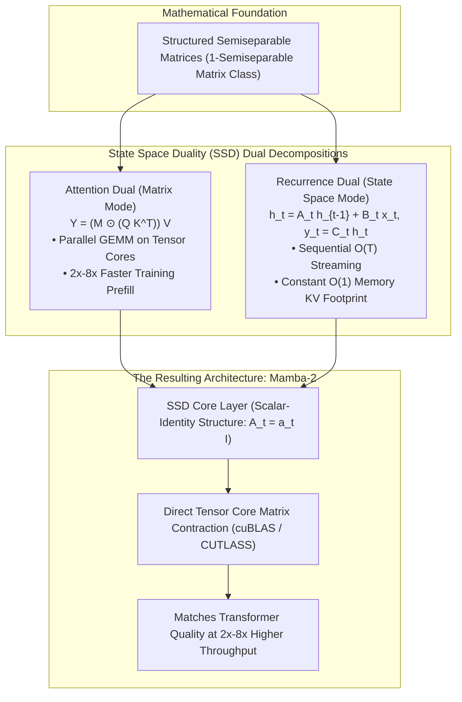
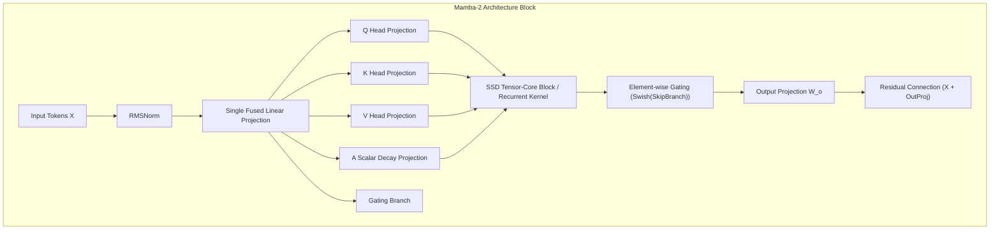
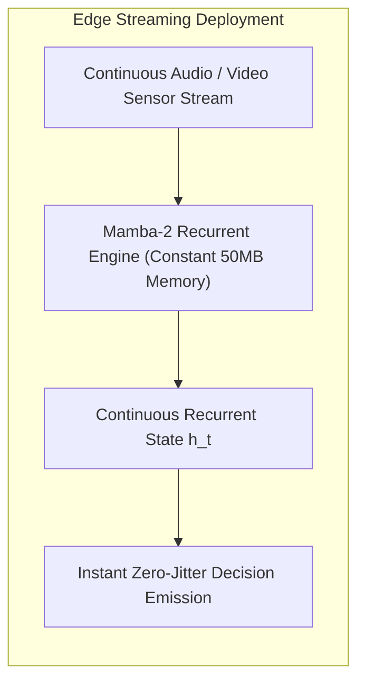

## Why Did State Space Duality Prove That Transformers and SSMs Are Two Faces of the Same Matrix Class?

For over seven years, the deep learning sequence modeling landscape was polarized between two competing algorithmic paradigms:
1. **The Transformer Architecture**: Based on softmax attention ($O(N^2)$ computational and memory complexity). Transformers achieved unmatched associative recall, in-context learning, and pretraining stability because their attention matrices compute direct pairwise comparisons between every token across the sequence. However, during autoregressive generation, storing and retrieving the growing Key-Value (KV) cache causes severe memory-bandwidth bottlenecks.
2. **State Space Models (SSMs)**: Recurrence-based architectures (such as S4 and Mamba) that maintain a compressed hidden state ($h_t \in \mathbb{R}^d$), operating with linear $O(N)$ computational complexity and constant $O(1)$ inference memory. While SSMs achieved remarkable throughput on long sequences, they often lagged behind full attention on complex multi-hop retrieval and associative recall tasks (such as needle-in-a-haystack or copying benchmarks).

In May 2024, Tri Dao (Princeton) and Albert Gu (Carnegie Mellon) published **Transformers are SSMs: Generalized Models and Efficient Algorithms Through Structured State Space Duality** (arXiv:2405.21060). The authors shattered the theoretical divide between attention and recurrence by introducing the **State Space Duality (SSD)** framework. 

SSD proved that selective State Space Models and causal Linear Attention variants are mathematically equivalent: both represent dual algorithmic decompositions of a well-studied mathematical object known as a **Structured Semiseparable Matrix**.



By demonstrating that continuous state space transitions map directly to structured matrix multiplications, SSD enabled the design of **Mamba-2**, an architecture that executes between $2\times$ and $8\times$ faster than original Mamba while maintaining full parity with modern Transformers.

---

## Mathematical Foundations: From State Spaces to Semiseparable Matrices

To understand why Mamba-1 was memory-bound on GPUs and how SSD resolved it, we must inspect the linear recurrence relation defining state space models:

$$h_t = A_t h_{t-1} + B_t x_t, \quad y_t = C_t h_t$$

where $x_t \in \mathbb{R}$ is the input scalar, $h_t \in \mathbb{R}^N$ is the latent hidden state, and $y_t \in \mathbb{R}$ is the output. Unrolling this recurrence from $t = 1$ to $T$ produces an explicit input-to-output matrix transformation:

$$\mathbf{y} = M \mathbf{x}$$

where the matrix $M \in \mathbb{R}^{T \times T}$ is strictly lower-triangular. The element at row $j$ and column $i$ ($j \ge i$) is given by:

$$M_{j, i} = C_j^\top \left(\prod_{k=i+1}^j A_k\right) B_i$$

```
Matrix Representation of Causal State Space Operators:
-------------------------------------------------------------------------------------------------
[ y_0 ]   [ C_0 B_0               0                   0          ] [ x_0 ]
[ y_1 ] = [ C_1 A_1 B_0           C_1 B_1             0          ] [ x_1 ]
[ y_2 ]   [ C_2 A_2 A_1 B_0       C_2 A_2 B_1         C_2 B_2    ] [ x_2 ]
-------------------------------------------------------------------------------------------------
```

This matrix structure is the exact definition of a **1-semiseparable matrix**: any submatrix strictly contained within the lower-triangular portion has a maximum rank of $N$ (the state dimension).

### The Dual Perspectives of Semiseparable Multiplication

A matrix-vector multiplication $y = M x$ for a semiseparable matrix can be evaluated through two distinct algorithmic modes:
1. **The Recurrent Mode (Linear Time $O(T)$)**: Evaluating the state sequentially step-by-step ($h_t = A_t h_{t-1} + B_t x_t$). This mode requires constant $O(N)$ memory state per head, making it optimal for autoregressive token decoding.
2. **The Matrix Dual Mode (Parallel Block Contractions)**: Slicing the matrix $M$ into diagonal and off-diagonal blocks. Off-diagonal low-rank blocks can be computed using standard general matrix-matrix multiplications (GEMMs) directly on GPU **Tensor Cores**, achieving massive training parallelism.

---

## Why Mamba-1 Stalled on Tensor Cores, and How Mamba-2 Fixed It

While Mamba-1 introduced selective state space modeling with great theoretical acclaim, it suffered from a severe systems limitation: **inability to utilize GPU Tensor Cores**.

In Mamba-1, the transition matrix $A_t$ was diagonal ($N$ independent complex or real decay rates per channel). To compute the selective scan, Dao and Gu had to write a custom hardware-aware GPU kernel in CUDA/Triton that loaded the recurrence state into GPU SRAM registers. Because the state transition was an element-wise recurrence rather than a dense matrix multiplication, the hardware was constrained by GPU register file capacity and memory bandwidth, leaving Nvidia Tensor Cores (designed strictly for dense $16 \times 16$ FP16/BF16 matrix tiles) completely unutilized.

```
Hardware Execution Comparison:
-------------------------------------------------------------------------------------------------
Dimension                Mamba-1 (Selective Scan)           Mamba-2 (State Space Duality)
-------------------------------------------------------------------------------------------------
Transition Structure A   Diagonal Matrix (N unique values)  Scalar × Identity (A_t = a_t I)
Primary Compute Engine   SRAM Registers & ALU Vector Units  Tensor Cores (Dense GEMM Systolic Arrays)
Hardware Utilization     ~20% - 35% of Peak GPU TFLOPS      ~60% - 85% of Peak GPU TFLOPS
Multi-Head Attention Map Non-standard per-channel mapping   Multi-Head / Grouped-Query Head Layout
Training Throughput      1x Baseline                        2x to 8x Acceleration over Mamba-1
-------------------------------------------------------------------------------------------------
```

### The Scalar-Identity Structural Constraint

Mamba-2 introduced a crucial simplification: it restricted the transition matrix $A_t$ to a **scalar times identity matrix**:

$$A_t = a_t \cdot \mathbf{I}, \quad a_t \in \mathbb{R}$$

While this theoretically reduces the per-step expressivity of individual state channels, Dao and Gu demonstrated that compensating by expanding the state dimension $N$ (from $N = 16$ in Mamba-1 to $N = 64$ or $128$ in Mamba-2) resulted in superior downstream modeling accuracy.

Because $A_t$ is a scalar, the cumulative state decay between token $i$ and token $j$ simplifies to:

$$\prod_{k=i+1}^j A_k = \left(\prod_{k=i+1}^j a_k\right) \mathbf{I} = \exp\left(s_j - s_i\right) \mathbf{I}$$

This allowed Mamba-2 to formulate the block recurrence as a tiled matrix product:

$$Y_{\text{block}} = \left( (Q K^\top) \odot L \right) V$$

where $L_{j, i} = \exp(s_j - s_i)$ acts as a causal 1-semiseparable decay mask. By casting the operation into $(Q K^\top) \odot L$, Mamba-2 maps directly to cuBLAS and CUTLASS matrix multiplication kernels, saturating modern GPU Tensor Cores.

```python
# Simplified PyTorch/Triton conceptual formulation of Mamba-2 SSD Block Mode
import torch
import torch.nn.functional as F

def ssd_block_forward(Q, K, V, decay_logits, block_size=64):
    """
    Computes Mamba-2 block-parallel attention using Tensor Cores.
    Q: [batch, seq_len, num_heads, head_dim]
    K: [batch, seq_len, num_heads, head_dim]
    V: [batch, seq_len, num_heads, head_dim]
    decay_logits: [batch, seq_len, num_heads]
    """
    # 1. Compute cumulative decay rates
    decay = torch.exp(decay_logits)
    cumulative_decay = torch.cumsum(decay, dim=1)
    
    # 2. Intra-block computation via dense GEMM
    # Compute standard causal attention-like dot products
    scores = torch.einsum("bshd,bthd->bsht", Q, K)
    
    # Apply semiseparable causal decay mask
    decay_mask = torch.exp(cumulative_decay[:, :, :, None] - cumulative_decay[:, None, :, :])
    causal_mask = torch.tril(torch.ones_like(scores))
    scores = scores * decay_mask * causal_mask
    
    # 3. Contract with Value tensors via Tensor Core GEMM
    Y_intra = torch.einsum("bsht,bthd->bshd", scores, V)
    return Y_intra
```

---

## Unifying Mamba-2 with the Attention Architecture

By aligning the mathematical structure of Mamba-2 with Linear Attention, Dao and Gu unified the vocabulary and engineering patterns of SSMs with Transformers. As analyzed in our first-principles breakdown of [Pure NumPy Llama 3 Inference](/posts/llama-pure-numpy/):
- **Multi-Head Layouts**: Mamba-2 adopts standard Multi-Head Attention (MHA) and Grouped-Query Attention (GQA) head projections ($Q, K, V, A$), allowing it to share optimized memory structures with transformer engines.
- **Single Forward Pass Weight Projection**: A single fused linear projection emits $Q, K, V, X$ simultaneously, reducing kernel launch overhead.
- **Unified Checkpoint Sharding**: Mamba-2 can be distributed across multi-GPU clusters using standard Tensor Parallelism (TP) and Megatron-style column-row parallel matrix splits.



---

## How Hybrid Linear-Attention Architectures Evolved Across 2026

Between 2024 and 2026, the theoretical bridge built by State Space Duality transformed the commercial model landscape:

### 1. Hybrid Transformer-SSM Architectures (Jamba and Nemotron-H)
While pure SSMs excel at continuous generation, full softmax attention remains superior at exact, needle-in-a-haystack retrieval across multi-thousand-token documents. In 2026, leading frontier architectures adopt **hybrid ratios**:
- **80% Mamba-2 / SSD Layers**: Handling bulk sequence processing, long-range syntax, and fast constant-memory decoding.
- **20% Standard Softmax Attention Layers**: Interspersed periodically (e.g., every 4th or 8th layer) to provide high-fidelity associative recall and precise in-context copy mechanisms.

### 2. Elimination of the Memory-Bandwidth Wall at the Edge
On edge devices (smartphones, robotics microcontrollers, and laptops explored in our source audit of [Phi-3 WebGPU Deployment](/posts/phi3-webgpu/)), storing 128K-token KV caches in DRAM is physically impossible. Hybrid SSD models maintain infinite-context streaming with an absolute constant memory ceiling, enabling continuous ambient voice and sensor tracking.



### 3. Unified Compiler Frameworks (FlashLinearAttention)
The SSD formulation spurred a wave of specialized GPU libraries (such as `fla` / FlashLinearAttention), which provide standardized Triton kernels for RetNet, Linear Attention, RWKV-6, and Mamba-2 within a unified matrix compiler.

---

## Key Takeaways

- **State Space Duality mathematically unified Transformers and SSMs**: Proving that causal linear attention and state space models represent dual decompositions of 1-semiseparable matrices.
- **Mamba-2 unlocked GPU Tensor Cores**: Constraining transition matrix $A_t$ to a scalar-identity structure enabled direct dense matrix multiplications, achieving a $2\times$ to $8\times$ training throughput speedup.
- **Dual modes optimize the inference-training lifecycle**: Matrix mode enables parallel pretraining on Tensor Cores, while recurrent mode enables constant $O(1)$ memory decoding.
- **SSD adopted standard transformer multi-head topologies**: Aligning projections with multi-head attention layouts allowed Mamba-2 to integrate seamlessly with existing distributed serving frameworks.
- **2026 architectures converge on hybrid designs**: Modern production models combine 80% Mamba-2 layers with 20% full attention layers, balancing constant-memory streaming with precise associative recall.

---

## New Questions

1. How does the expressivity of scalar-identity transition matrices in Mamba-2 degrade on non-Markovian symbolic reasoning tasks compared to generalized non-diagonal state transitions?
2. What are the optimal layer interleaving frequencies when combining Mamba-2 blocks with full softmax attention to maximize recall in 1-million-token context windows?
3. Can 1-bit quantization (such as BitNet ternary weights) be applied directly to semiseparable matrix operators without causing exponential numerical decay in recurrent state accumulation?

---

## References

- Dao, T., & Gu, A. (2024). *Transformers are SSMs: Generalized Models and Efficient Algorithms Through Structured State Space Duality*. arXiv preprint arXiv:2405.21060. Available at: <https://arxiv.org/abs/2405.21060> (accessed 2026-10-18).
- Gu, A., & Dao, T. (2023). *Mamba: Linear-Time Sequence Modeling with Selective State Spaces*. arXiv preprint arXiv:2312.00752. Available at: <https://arxiv.org/abs/2312.00752> (accessed 2026-10-18).
- Katharopoulos, A., Vyas, A., Pappas, N., & Fleuret, F. (2020). *Transformers are RNNs: Fast Autoregressive Transformers with Linear Attention*. In International Conference on Machine Learning (ICML), 5156-5165. Available at: <https://arxiv.org/abs/2006.16236> (accessed 2026-10-18).
- Vaswani, A., Shazeer, N., Parmar, N., Uszkoreit, J., Jones, L., Gomez, A. N., Kaiser, Ł., & Polosukhin, I. (2017). *Attention Is All You Need*. Advances in Neural Information Processing Systems (NeurIPS), 30, 5998-6008. Available at: <https://arxiv.org/abs/1706.03762> (accessed 2026-10-18).
