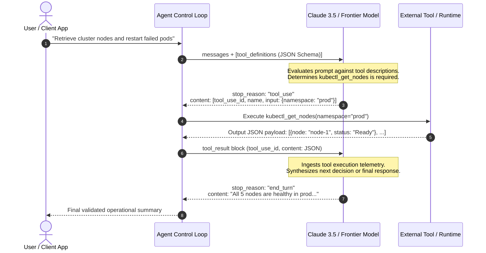

Large language models trained purely on static pre-training corpora suffer from insurmountable boundaries: their knowledge is fixed at training cutoffs, they cannot perform verified arithmetic without token drift, and they lack agency to interact with external digital environments. Early attempts to grant models external reach relied on loose text prompting—instructing models to wrap commands in Markdown code blocks or pseudocode snippets. This approach failed in production due to syntax hallucinations, unparseable JSON, and fragile downstream execution layers.

The formalization of **Tool Use (Function Calling)** resolved this fragility. Pioneered by theoretical foundations in Toolformer (Schick et al., 2023) and ReAct (Yao et al., 2023), tool use provides a typed contract between probabilistic neural representations and deterministic software systems. With Claude 3, Anthropic introduced native support for structured JSON Schema tool definitions, enabling models to inspect tool signatures, emit strongly typed call blocks, evaluate return payloads, and autonomously drive multi-turn execution loops.

Understanding tool use is foundational to modern agentic harness engineering. When an agent can reliably query databases, execute sandboxed code, and triage API errors, it graduates from a passive text generator into an autonomous software collaborator.

This source audit analyzes the architectural mechanics of Anthropic's tool-use protocol, details how client-side control loops manage state and exceptions, evaluates defensive loop constraints, and traces how function calling evolved toward open protocols like the Model Context Protocol (MCP) across 2026.


## Why Does Native Tool Use Turn Language Models into Deterministic Agents?

The fundamental challenge in agentic AI is bridging the gap between non-deterministic token sampling and the rigid syntax requirements of operating systems and APIs. When an engineer asks an LLM to "query customer records and calculate current billings," an ungrounded model will often invent hypothetical API payloads or approximate arithmetic.

Native tool use enforces a deterministic handshake governed by strict schema validation:



This sequence guarantees four critical guarantees:
1. **Schema Conformity**: Claude is trained to emit tool inputs strictly adhering to standard JSON Schema specifications (validating types, required properties, and enums).
2. **Explicit Separation of Intent and Execution**: The model does not execute code itself; it emits an operational request (`tool_use`). The host environment maintains sovereignty, inspecting permissions, validating parameters, and executing the action in a sandboxed runtime.
3. **Contextual Ingestion of Results**: The tool output is wrapped in a dedicated `tool_result` message block, preserving conversation integrity and allowing the model to ground its subsequent generation in real-world facts.
4. **Self-Correcting Reflexion Loops**: If a tool call fails (e.g., throwing a `404 Not Found` or database timeout), the client sends the error message back to Claude marked with `is_error=True`. The model inspects the error, adjusts its query parameters, and retries autonomously.

## Technical Mechanics: Building a Production Agent Loop with Anthropic

In production agent architectures, the client application manages the execution loop, enforcing safety circuit breakers (maximum iterations, token budgets, execution timeouts).

The following production script demonstrates a complete self-healing agent loop using the Anthropic API, incorporating JSON Schema parameter validation, sandboxed tool execution, and defensive error propagation:

```python
"""
Production Agent Harness with Anthropic Tool Use
Demonstrating JSON Schema definition, tool dispatch, error feedback, and loop circuit breakers.
"""

import json
from typing import Any, Dict, List
import anthropic

# Initialize Anthropic Client
client = anthropic.Anthropic()

# 1. Define Tool Specifications via JSON Schema
TOOLS = [
    {
        "name": "query_database",
        "description": "Executes a read-only SQL query against the analytics replica and returns records.",
        "input_schema": {
            "type": "object",
            "properties": {
                "query": {
                    "type": "string",
                    "description": "SQL SELECT query string to execute. Must be read-only."
                },
                "max_rows": {
                    "type": "integer",
                    "description": "Maximum rows to return.",
                    "default": 10
                }
            },
            "required": ["query"]
        }
    }
]

def execute_local_tool(name: str, tool_inputs: Dict[str, Any]) -> str:
    """Mock sandboxed tool dispatcher with runtime safety checks."""
    if name == "query_database":
        sql = tool_inputs.get("query", "")
        # Enforce defensive SQL guardrails
        if any(keyword in sql.upper() for keyword in ["DROP", "DELETE", "UPDATE", "INSERT"]):
            raise PermissionError("Disallowed write operation in read-only tool")
        return json.dumps([
            {"user_id": 101, "status": "active", "tier": "enterprise"},
            {"user_id": 102, "status": "pending", "tier": "standard"}
        ])
    raise NotImplementedError(f"Unknown tool: {name}")

def run_agent_loop(user_prompt: str, max_iterations: int = 5) -> str:
    """Autonomous agent control loop with circuit breaker limits."""
    messages: List[Dict[str, Any]] = [{"role": "user", "content": user_prompt}]
    
    for iteration in range(max_iterations):
        response = client.messages.create(
            model="claude-3-5-sonnet-20241022",
            max_tokens=2048,
            tools=TOOLS,
            messages=messages
        )

        # Append assistant response to conversational state
        messages.append({"role": "assistant", "content": response.content})

        # Check if model has completed its objective
        if response.stop_reason == "end_turn":
            text_blocks = [b.text for b in response.content if hasattr(b, "text")]
            return "\n".join(text_blocks)

        # Process tool calls
        if response.stop_reason == "tool_use":
            tool_results = []
            for block in response.content:
                if block.type == "tool_use":
                    try:
                        result_str = execute_local_tool(block.name, block.input)
                        is_error = False
                    except Exception as exc:
                        result_str = f"Error executing tool {block.name}: {str(exc)}"
                        is_error = True

                    tool_results.append({
                        "type": "tool_result",
                        "tool_use_id": block.id,
                        "content": result_str,
                        "is_error": is_error
                    })

            # Feed tool results back into the conversation context
            messages.append({"role": "user", "content": tool_results})

    raise TimeoutError(f"Agent exceeded maximum iteration limit of {max_iterations}")
```

For practical guidance on structuring agent-native CLI tools and command wrappers for LLM execution, consult our analysis of [agent-native CLI interfaces](/posts/cli-anything-agent-native-interfaces/). When coordinating multiple specialized tool-using agents within a federated team, refer to our study of [multi-agent orchestration systems](/posts/llm-build-multi-agent/).

## How Tool-Use Architectures and Agent Protocols Evolved Across 2026

Between 2024 and 2026, function calling evolved from vendor-specific REST schemas into a unified, operating-system-level standard:

1. **Standardization on the Model Context Protocol (MCP)**: Initially, every model provider (OpenAI, Anthropic, Google) required proprietary JSON schemas for tool definitions. Anthropic's open-sourcing of MCP in late 2024 unified tool, prompt, and resource discovery across providers. Tools are no longer hardcoded into scripts; agents dynamically discover capabilities exposed by local and remote MCP servers over stdio and Server-Sent Events (SSE).
2. **Computer Use and Multimodal Action Spaces**: With the release of Claude 3.5 Sonnet's Computer Use capabilities, tool use expanded beyond high-level APIs to low-level desktop interaction: taking screenshots, mouse coordinate clicking, keyboard typing, and terminal command dispatch. This shifted agent engineering from API integration to robust visual verification loops.
3. **Streaming Tool Invocations and Speculative Execution**: Modern agent runtimes stream tool arguments token-by-token. As soon as the tool name and initial required parameters are generated, the host system begins warming sandboxes, pre-fetching DNS records, and speculatively preparing connections before the model finishes its output generation.
4. **Integration with Enterprise Retrieval Engines**: Modern agents integrate tool calling directly into dynamic knowledge retrieval pipelines, dynamically invoking hybrid search and reranking tools to synthesize factual answers, as covered in our guide on [production RAG retrieval pipelines](/posts/try-implementing-rag-using-langchain/).

## Key Takeaways

- **Tool Use Transforms Probabilistic Models into Agents**: By decoupling generation from execution, tool use enables foundation models to interact safely with external systems through typed JSON Schema contracts.
- **The Host Environment Retains Sovereignty**: Models do not execute code; they express intent via `tool_use` blocks. The client harness controls execution, authentication, and security boundaries.
- **Feedback Loops Enable Autonomous Error Recovery**: Flagging failed executions with `is_error=True` allows the model to inspect runtime error messages and adjust arguments dynamically.
- **Circuit Breakers are Mandatory in Production**: Operating autonomous agent loops requires strict constraints (`max_iterations`, timeout thresholds, token budgets) to prevent runaway billing and infinite execution loops.

## New Questions

- **How Can Host Systems Guarantee Sandboxed Safety with OS-Level Computer Use?** As models execute bash commands and control desktop UI elements directly, how can enterprises prevent prompt-injection attacks from triggering malicious local system mutations?
- **What is the Latency Floor of Multi-Turn Tool Chains?** When an agent requires 10 sequential tool calls to complete a complex objective, how will engineering teams manage cumulative Time-to-Result delays?
- **Will Dynamic Tool Discovery Outperform Hardcoded Tool Catalogs?** As agents gain access to thousands of MCP tools, how can tool-selection routers prevent context window bloat and parameter interference?

## References

- Anthropic (2024). *Tool Use (Function Calling) with Claude 3*. Anthropic Engineering Documentation. Available at: [https://docs.anthropic.com/en/docs/build-with-claude/tool-use](https://docs.anthropic.com/en/docs/build-with-claude/tool-use) (accessed 2026-10-18).
- Schick, T., Dwivedi-Yu, J., Dessì, R., Raileanu, R., Lomeli, M., Zettlemoyer, L., Cancedda, N., & Scialom, T. (2023). *Toolformer: Language Models Can Teach Themselves to Use Tools*. Advances in Neural Information Processing Systems (NeurIPS 2023). Available at: [https://arxiv.org/abs/2302.04761](https://arxiv.org/abs/2302.04761) (accessed 2026-10-18).
- Yao, S., Zhao, J., Yu, D., Du, N., Shafran, I., Narasimhan, K., & Cao, Y. (2023). *ReAct: Synergizing Reasoning and Acting in Language Models*. International Conference on Learning Representations (ICLR 2023). Available at: [https://arxiv.org/abs/2210.03629](https://arxiv.org/abs/2210.03629) (accessed 2026-10-18).
- Anthropic (2024). *Anthropic Tool Use Course*. GitHub Repository. Available at: [https://github.com/anthropics/courses/tree/master/tool_use](https://github.com/anthropics/courses/tree/master/tool_use) (accessed 2026-10-18).
