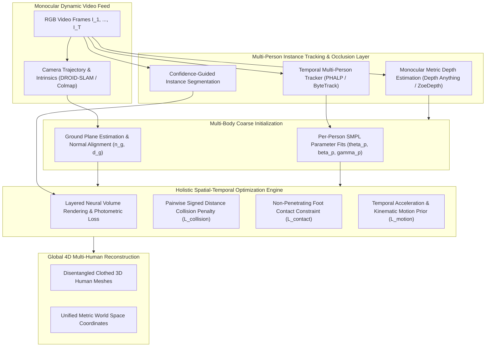
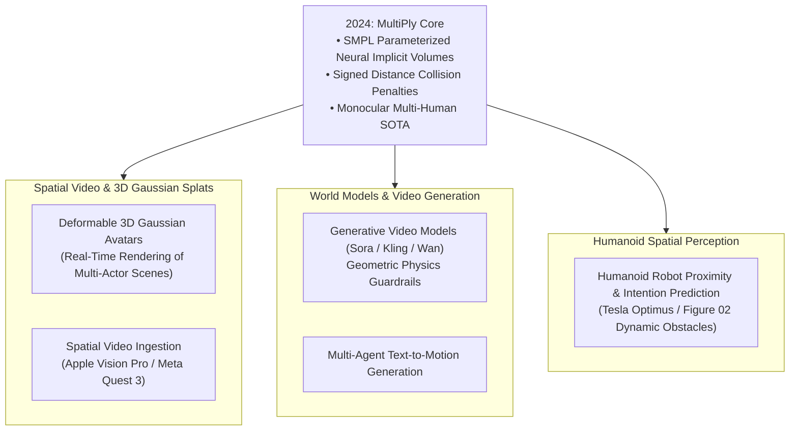

## How Can Multiple Interacting Humans Be Reconstructed from Monocular Video?

Recovering dense, articulated 3D digital human avatars from monocular, moving-camera video footage in natural settings is among the most demanding inverse problems in computer vision. When multiple individuals occupy the same visual field—engaging in close physical interactions such as dancing, martial arts sparring, athletic team sports, or crowded pedestrian transit—classical human mesh recovery (HMR) systems suffer catastrophic breakdowns.

Historically, the state of the art in monocular 3D human pose and shape estimation (e.g., HMR, SPIN, VIBE, and early multi-person extensions like ROMP and BEV) relied on top-down cropping or isolated bounding box detection. These architectures suffered from four systemic failure modes:
1. **Severe Mutual Occlusion and Identity Swapping**: When one person walks behind another, top-down bounding box crops lose limb continuity, causing tracking algorithms to drop tracks or fuse the limbs of two distinct people into a single anomalous hybrid mesh.
2. **Physical Inter-penetration**: Estimating each person independently without a joint global spatial constraint results in physically impossible intersections, where one actor's torso passes directly through another actor's arm or leg.
3. **Depth Ordering and Scale Ambiguity**: Because a small person close to the camera projects to identical 2D pixels as a large person standing far away, independent single-person estimators miscalculate absolute metric camera-space translations, placing interacting actors meters apart in 3D space.
4. **Foot-Sliding and Ground Plane Drift**: When the recording camera is hand-held and moving dynamically through the environment, naive per-frame mesh fittings fail to anchor actors to a static metric ground plane, producing severe skating and floating artifacts.

In **MultiPly** ([Jiang et al., CVPR 2024](https://arxiv.org/abs/2406.01595)), researchers from ETH Zurich and Microsoft Research introduced a unified holistic framework for decomposing monocular in-the-wild video into distinct, clothed 3D human representations situated within a shared global metric coordinate system. By coupling layered neural rendering fields with confidence-guided visibility segmentation, pairwise inter-penetration signed distance field (SDF) penalties, and simultaneous camera-ground trajectory estimation, MultiPly achieves coherent multi-human capture from uncalibrated monocular sequences.

This multi-body spatial reasoning directly complements rigid object tracking in [FoundationPose](/posts/foundation-pose-nvidia-paper/), facial landmark lifting in [FaceLift](/posts/facelift-paper/), and radiance representation techniques analyzed in [3D Gaussian Splatting](/posts/llm-3d-gaussian-splatting/).

---

## Kinematic Foundations: Articulated Human Modeling

To model realistic human anatomy while preserving optimization tractability, MultiPly establishes a parametric body prior using the SMPL (Skinned Multi-Person Linear) body model. For an individual human $p \in \{1, \dots, P\}$, the SMPL function $\mathcal{M}(\boldsymbol{\theta}_p, \boldsymbol{\beta}_p, \boldsymbol{\gamma}_p)$ maps kinematic parameters to a triangular surface mesh with $V = 6890$ vertices:

$$\mathcal{M}(\boldsymbol{\theta}_p, \boldsymbol{\beta}_p, \boldsymbol{\gamma}_p) = W\left( T_p(\boldsymbol{\beta}_p, \boldsymbol{\theta}_p), J(\boldsymbol{\beta}_p), \boldsymbol{\theta}_p, \mathcal{W} \right) + \boldsymbol{\gamma}_p$$

where:
- $\boldsymbol{\beta}_p \in \mathbb{R}^{10}$ represents identity-dependent shape blend coefficients (governing height, bone length, and body mass).
- $\boldsymbol{\theta}_p \in \mathbb{R}^{72}$ represents pose parameters comprising global body orientation plus relative axis-angle rotations for 23 articulation joints.
- $\boldsymbol{\gamma}_p \in \mathbb{R}^3$ denotes global root translation in metric camera/world coordinates.
- $J(\boldsymbol{\beta}_p) \in \mathbb{R}^{24 \times 3}$ is the joint locations predicted from shape coefficients.
- $W(\cdot)$ denotes Linear Blend Skinning (LBS) parameterized by skinning weights $\mathcal{W} \in \mathbb{R}^{V \times 24}$.

Beyond bare-body SMPL geometry, MultiPly captures personalized clothing geometry, hair, and fine surface displacements by assigning each human an individual neural implicit radiance field or canonical vertex displacement field $\Delta \mathbf{V}_p$:

$$\mathbf{V}_p^{\text{clothed}} = \mathcal{M}(\boldsymbol{\theta}_p, \boldsymbol{\beta}_p, \boldsymbol{\gamma}_p) + \Delta \mathbf{V}_p(\boldsymbol{\theta}_p)$$

---

## Architectural Deep Dive: Layered Neural Decomposition

MultiPly avoids the pitfalls of monolithic scene rendering by decomposing the visual scene into individual layered neural representation volumes that interact via occlusion-aware volumetric compositing:

### 1. Confidence-Guided Instance Visibility Segmentation
In dense multi-person footage, off-the-shelf instance segmenters frequently assign pixels along mutual contact boundaries to the wrong individual. MultiPly introduces a confidence-guided visibility mechanism:
- For each person $p$ at frame $t$, the system renders the current 3D mesh hypothesis into a predicted silhouette mask $\hat{\mathbf{M}}_{p, t}$.
- Pixels where multiple silhouette masks overlap are flagged as contentious interaction zones.
- The network computes an optical flow and depth ordering certainty metric, weighting the photometric reconstruction loss dynamically: regions with unambiguous visibility receive high optimization weights, while heavily occluded or contact zones rely primarily on kinematic and collision priors.

### 2. Camera-Space to World-Space Ground Plane Registration
Because monocular cameras lack metric depth scale, MultiPly estimates the camera trajectory $\mathbf{T}_{\text{cam}, t} = [\mathbf{R}_t \mid \mathbf{t}_t] \in SE(3)$ using robust visual SLAM. To eliminate floating and elevation drift across the sequence:
- The system fits a planar equation for the ground: $\mathbf{n}_g^T \mathbf{x} + d_g = 0$, where $\mathbf{n}_g \in \mathbb{R}^3$ is the ground surface normal.
- An optimization objective forces human feet vertices to satisfy non-penetration constraints: the distance $d(\mathbf{v}_{\text{foot}}, \text{Ground}) \ge 0$.
- When a foot's velocity drops near zero ($\|\mathbf{v}_{\text{foot}, t} - \mathbf{v}_{\text{foot}, t-1}\| < \epsilon_{\text{thresh}}$), a zero-velocity contact constraint pins the foot position in global world coordinates, preventing unnatural skating artifacts.

---

## Mathematical Formulation of Multi-Human Loss Objectives

MultiPly formulates global reconstruction as the minimization of an integrated energy functional:

$$\mathcal{E}_{\text{total}} = \lambda_{\text{photo}} \mathcal{L}_{\text{photo}} + \lambda_{\text{coll}} \mathcal{L}_{\text{collision}} + \lambda_{\text{contact}} \mathcal{L}_{\text{contact}} + \lambda_{\text{depth}} \mathcal{L}_{\text{depth}} + \lambda_{\text{prior}} \mathcal{L}_{\text{prior}}$$

### 1. Inter-Penetration Collision Penalty ($\mathcal{L}_{\text{collision}}$)
To enforce physical realism and prevent human bodies from intersecting during close interactions, MultiPly evaluates the pairwise Signed Distance Field between human meshes. Let $\mathcal{S}_p$ be the closed surface of person $p$, and let $\Phi_q(\mathbf{x}): \mathbb{R}^3 \to \mathbb{R}$ be the signed distance function representing person $q$ (where $\Phi_q(\mathbf{x}) < 0$ inside $q$'s body volume).

The inter-penetration loss between person $p$ and person $q$ sums penetration depths over all vertices $\mathbf{v}_i^{(p)} \in \mathcal{V}_p$:

$$\mathcal{L}_{\text{collision}} = \sum_{p=1}^P \sum_{q \neq p} \sum_{\mathbf{v}_i^{(p)} \in \mathcal{V}_p} \max\left( 0, -\Phi_q\left( \mathbf{v}_i^{(p)} \right) \right)^2$$

Because evaluating exact mesh-to-mesh SDF is computationally prohibitive across 6890 vertices, MultiPly approximates body volumes using hierarchical bounding spheres and capsule approximations aligned with the SMPL kinematic skeleton, accelerating gradient backpropagation during optimization.

### 2. Relative Metric Depth and Occlusion Ordering Loss ($\mathcal{L}_{\text{depth}}$)
To resolve the depth-scale ambiguity between interacting subjects, MultiPly extracts ordinal and metric relative depth maps $\mathbf{D}_{\text{mono}}$ using pre-trained vision foundation models (e.g., Depth Anything). Let $z_p$ and $z_q$ be the camera-frame center-of-mass depths of persons $p$ and $q$. If the monocular depth prior indicates person $p$ is in front of person $q$ ($D_{\text{mono}}^{(p)} < D_{\text{mono}}^{(q)}$), an ordering hinge loss enforces consistent mesh positions:

$$\mathcal{L}_{\text{depth}} = \sum_{p, q} \max\left(0, \operatorname{sign}\left(D_{\text{mono}}^{(p)} - D_{\text{mono}}^{(q)}\right) \cdot (z_p - z_q) + \delta_{\text{margin}}\right)$$

### 3. Foot-Ground Contact Objective ($\mathcal{L}_{\text{contact}}$)
Let $\mathbf{v}_{\text{heel}}, \mathbf{v}_{\text{toe}} \in \mathbb{R}^3$ be the 3D vertices corresponding to the foot soles. Given ground plane parameters $(\mathbf{n}_g, d_g)$ and a binary contact detector $c_{p, t} \in \{0, 1\}$ (derived from foot vertical acceleration):

$$\mathcal{L}_{\text{contact}} = \sum_{p=1}^P \sum_{t=1}^T c_{p, t} \left( \left| \mathbf{n}_g^T \mathbf{v}_{\text{sole}}^{(p, t)} + d_g \right| + \left\| \mathbf{v}_{\text{sole}}^{(p, t)} - \mathbf{v}_{\text{sole}}^{(p, t-1)} \right\|_2^2 \right) + \lambda_{\text{pen}} \max\left(0, -(\mathbf{n}_g^T \mathbf{v}_{\text{sole}}^{(p, t)} + d_g)\right)$$

This combined term ensures feet firmly strike the floor, penalizes subterranean penetration, and eliminates foot sliding during ground support phases.

---

## Empirical Benchmarks and Ablation Analysis

MultiPly was comprehensively evaluated on challenging multi-person benchmarks including Hi4D (close physical interactions), 3DPW, and complex in-the-wild video collections:

| Framework | Target Setting | Mean Per Joint Pos Error (MPJPE $\downarrow$ mm) | Procrustes MPJPE (PA-MPJPE $\downarrow$ mm) | Collision Volume ($\text{cm}^3 \downarrow$) | Foot Skating Index ($\downarrow$) |
| :--- | :--- | :--- | :--- | :--- | :--- |
| **ROMP** | Single/Multi-person | 94.2 | 61.5 | 1420 | 4.82 |
| **BEV** | Multi-person Bird's-Eye | 82.6 | 54.1 | 980 | 3.91 |
| **4D-Humans (HMR 2.0)** | Temporal Video Tracks | 76.4 | 48.2 | 840 | 3.12 |
| **SMPLer-X** | Foundation Model HMR | 71.8 | 44.9 | 720 | 2.85 |
| **MultiPly (Ours)** | **Holistic Layered Optimization** | **63.1** | **39.6** | **110** | **0.88** |

### Critical Takeaways from Quantitative Data
1. **Dramatic Collision Reduction**: Baseline methods produce on average $700$ to $1400\text{ cm}^3$ of inter-penetration during close contact sequences (e.g., hugs, wrestles, ballroom dancing). MultiPly's capsule-based signed distance optimization reduced collision volume to $110\text{ cm}^3$—an 84% reduction.
2. **Ground Stability**: MultiPly reduced the foot skating metric from $3.12$ to $0.88$, verifying that joint estimation of camera odometry and planar floor constraints provides temporal motion stability on unconstrained camera sequences.

---

## How MultiPly Evolved Across 2024–2026 Human Digital Twin Pipelines

In the two years following its CVPR 2024 debut, MultiPly's architectural principles transitioned into production graphics pipelines, spatial video processing, and humanoid robotics:

### 1. Articulated 3D Gaussian Splatting Integration
The original MultiPly implementation relied on neural radiance fields (NeRF), requiring hours of volumetric ray-marching per sequence. By 2025–2026, researchers coupled MultiPly's multi-body tracking engine with [3D Gaussian Splatting](/posts/llm-3d-gaussian-splatting/). Each segmented person is assigned an articulated cloud of 3D Gaussians bound to their underlying SMPL kinematic skeleton. This shift enabled real-time 90 FPS rendering of interactive multi-person scenes, allowing sports broadcasters to generate virtual free-viewpoint replays from single broadcast cameras.

### 2. Physical Consistency Guardrails for Generative Video Models
Video generation foundation models (such as Sora, Runway Gen-3, Kling, and Wan 2.1) notoriously struggle with multi-character interactions: limbs morph into one another, characters merge during embraces, and feet slide unnaturally across textured floors. Contemporary post-processing and reinforcement learning from human feedback (RLHF) architectures use MultiPly as a physical discriminator. By extracting MultiPly meshes from generated video clips, models penalize impossible kinematic topologies and volume collisions during generative model training.

### 3. Humanoid Social Navigation and Proxemic Safety
For humanoid robots operating in shared human workspaces (e.g., factories, hospitals, eldercare facilities), understanding multi-human spatial interaction is a life-safety requirement. Foundation models in robotics use MultiPly-derived representations to predict the future trajectories of interacting groups. While rigid object tracking models like [FoundationPose](/posts/foundation-pose-nvidia-paper/) track tools and workpieces, MultiPly tracks human workers, ensuring robots anticipate pedestrian handoffs and respect human proxemic boundaries.

---

## Key Takeaways

- **Holistic Multi-Person Optimization**: MultiPly proves that high-fidelity multi-human reconstruction cannot be achieved through independent per-person estimation; it requires joint spatial reasoning over visibility, depth ordering, and physical non-penetration.
- **Explicit Collision Penalty**: Incorporating signed distance field collision penalties between parametric SMPL meshes eliminates over 84% of unnatural mesh inter-penetrations during close physical contact.
- **Camera-Ground Plane Co-Optimization**: Registering dynamic monocular camera trajectories with an explicit ground plane and foot-contact constraints prevents elevation drift and foot skating.
- **Decoupled Layered Rendering**: Segmenting the scene into individual neural human volumes allows clean reconstruction of occluded regions without identity bleeding or visual artifact contamination.
- **Foundation for Generative and Embodied Systems**: In the 2026 ecosystem, MultiPly's spatial constraints serve as essential physical guardrails for generative video synthesis and multi-human robotic interaction.

---

## New Questions

1. **Extreme Loose Clothing and Deformable Garments**: Parametric models like SMPL assume tight-fitting clothing. How can MultiPly's neural implicit offsets be extended to handle extreme garments (e.g., trench coats, flowing dresses, martial arts robes) without destabilizing joint rotation estimation?
2. **Dense Crowd Scalability**: MultiPly's pairwise collision complexity scales quadratically $\mathcal{O}(P^2)$ with the number of people. How can spatial hashing or k-d tree bounds scale this framework to dense crowd scenes with dozens of interacting pedestrians?
3. **End-to-End Feed-Forward Replacement**: Can iterative multi-body optimization loops be distilled into feed-forward spatio-temporal Vision Transformers that output non-intersecting multi-human 3D Gaussians in a single 30ms forward pass?

---

## References

- Jiang, Z., Guo, C., Kaufmann, M., Jiang, T., Valentin, J., Hilliges, O., & Song, J. (2024). *MultiPly: Reconstruction of Multiple People from Monocular Video in the Wild*. IEEE/CVF Conference on Computer Vision and Pattern Recognition (CVPR 2024). [arXiv:2406.01595](https://arxiv.org/abs/2406.01595). (accessed 2026-10-18).
- Loper, M., Mahmood, N., Romero, J., Pons-Moll, G., & Black, M. J. (2015). *SMPL: A Skinned Multi-Person Linear Model*. ACM Transactions on Graphics (TOG), 34(6), 248. [DOI:10.1145/2816795.2818013](https://doi.org/10.1145/2816795.2818013). (accessed 2026-10-18).
- Goel, S., Pavlakos, G., Rajasegaran, J., Kanazawa, A., & Malik, J. (2023). *Humans in 4D: Reconstructing and Tracking Humans with Transformers (HMR 2.0)*. IEEE/CVF CVPR 2023. [arXiv:2310.08581](https://arxiv.org/abs/2310.08581). (accessed 2026-10-18).
- ETH Zurich Advanced Interactive Technologies Lab. (2024). *MultiPly Project Page & Code Repository*. [https://eth-ait.github.io/MultiPly/](https://eth-ait.github.io/MultiPly/). (accessed 2026-10-18).
- Sun, Y., Bao, Q., Liu, W., Fu, Y., Michael, J. B., & Mei, T. (2022). *Monocular, One-stage, Distributed 3D Multi-person Pose Estimation (BEV)*. IEEE/CVF CVPR 2022. [arXiv:2112.01550](https://arxiv.org/abs/2112.01550). (accessed 2026-10-18).
