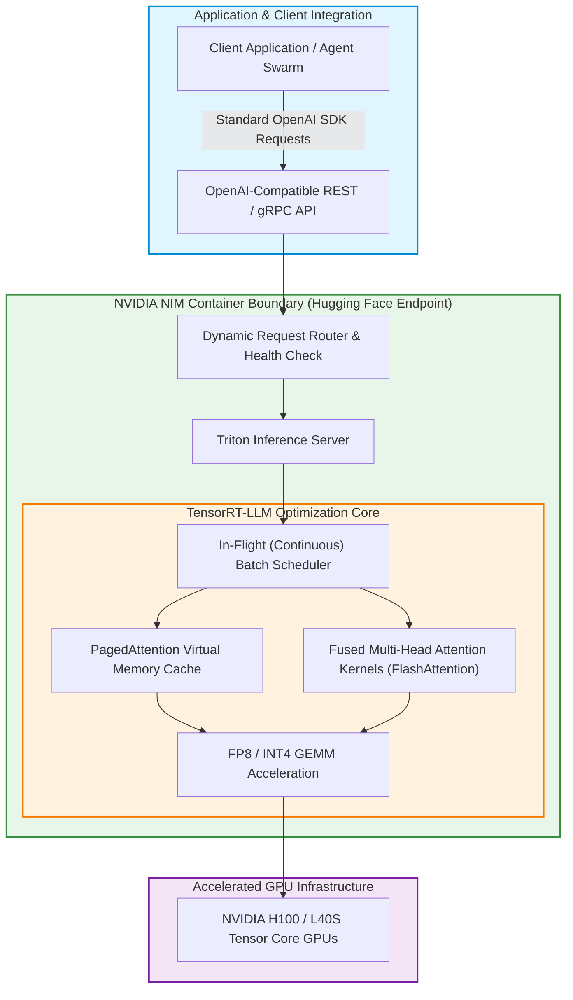

Deploying generative large language models to enterprise production environments reveals an immediate architectural chasm between training and serving. While PyTorch and Hugging Face Transformers provide intuitive abstractions for experimentation and fine-tuning, running raw Python inference loops (`model.generate()`) under multi-tenant production traffic results in operational catastrophe: severe GPU High-Bandwidth Memory (HBM) fragmentation, high latency variance, and low GPU compute utilization.

To maximize throughput and minimize latency on modern GPU hardware, models must be compiled, quantized, and orchestrated through specialized C++ inference engines. However, manually building optimized TensorRT execution engines, configuring Triton Inference Server instances, and maintaining multi-cloud deployment manifests requires deep systems engineering expertise.

The partnership announced at COMPUTEX between NVIDIA and Hugging Face resolved this friction by introducing **NVIDIA NIM (NVIDIA Inference Microservice)** natively onto **Hugging Face Inference Endpoints**.

This source audit analyzes why containerized microservices represent the gold standard for high-throughput model serving, evaluates the core compiler optimizations inside TensorRT-LLM (such as in-flight batching and paged attention), and examines how enterprise inference pipelines evolved toward prefill-decode disaggregation across 2026.


## Why Does Containerized Microservice Inference Outperform Raw PyTorch Serving?

The fundamental bottleneck in LLM inference is not compute capacity (FLOPs), but **memory bandwidth**. During the auto-regressive generation phase, each token requires loading billions of model parameters from high-bandwidth memory (HBM) into on-chip cache (SRAM) just to compute a single matrix-vector multiplication.

In naive serving frameworks, three systemic flaws degrade performance:
1. **Static Batching Inefficiencies**: Static batching requires all concurrent sequences in a batch to wait until the longest sequence completes generation. Short 20-token answers waste GPU cycles idling while a 1,000-token answer finishes.
2. **KV-Cache Memory Fragmentation**: Allocating fixed contiguous memory for the Key-Value (KV) cache of every active request leads to up to 60-80% memory waste, as documented by Kwon et al. (2023).
3. **Python Runtime Overhead**: Python's Global Interpreter Lock (GIL) and serialization latency introduce significant overhead per request, severely capping queries per second (QPS).

NVIDIA NIM solves these limitations by packaging an entire optimized systems stack into an Open Container Initiative (OCI) microservice:



## Core Systems Innovations inside NVIDIA NIM and TensorRT-LLM

NVIDIA NIM delivers orders-of-magnitude improvements in throughput (up to 9,000 tokens/second on H100 clusters for models like Llama 3 8B) through four key systems innovations:

### 1. In-Flight (Continuous) Batching
Rather than batching at the request level, TensorRT-LLM operates at the **iteration level**. As soon as a sequence completes its generation (emitting an end-of-sequence `<eos>` token), its memory slot is immediately evicted, and a newly arrived request is injected into the very next forward pass. This keeps GPU compute units saturated at 95%+ utilization.

### 2. Paged Attention and Non-Contiguous KV-Cache
Borrowing virtual memory paging principles from operating systems, PagedAttention divides the dynamic KV-cache into discrete fixed-size blocks (e.g., 16 or 32 tokens). Blocks are allocated dynamically on-demand, virtually eliminating internal and external memory fragmentation and allowing up to $4\times$ more concurrent requests per GPU.

### 3. Fused Kernels and Quantization (FP8 / AWQ)
TensorRT-LLM replaces individual element-wise operations with fused CUDA kernels, keeping intermediate activations inside fast on-chip SRAM rather than writing them back to global HBM. Furthermore, native FP8 quantization halves memory footprint without accuracy degradation on modern Ada Lovelace and Hopper architectures.

```python
"""
Python Client interacting with NVIDIA NIM on Hugging Face Endpoints.
Demonstrating streaming token consumption, latency profiling, and TTFT measurement.
"""

import time
import os
from openai import OpenAI

# Initialize client using standard OpenAI interface pointing to Hugging Face NIM endpoint
client = OpenAI(
    base_url="https://api-inference.huggingface.co/models/nvidia/Llama-3-8B-Instruct/v1",
    api_key=os.environ.get("HF_TOKEN", "hf_mock_token")
)

def benchmark_nim_streaming(prompt: str) -> dict:
    start_time = time.perf_counter()
    first_token_time = None
    token_count = 0
    full_response = []

    stream = client.chat.completions.create(
        model="meta-llama/Meta-Llama-3-8B-Instruct",
        messages=[
            {"role": "system", "content": "You are a high-performance system architect."},
            {"role": "user", "content": prompt}
        ],
        temperature=0.2,
        max_tokens=512,
        stream=True
    )

    for chunk in stream:
        delta = chunk.choices[0].delta.content
        if delta:
            if first_token_time is None:
                first_token_time = time.perf_counter()
            full_response.append(delta)
            token_count += 1

    end_time = time.perf_counter()
    
    ttft_ms = (first_token_time - start_time) * 1000 if first_token_time else 0.0
    total_time_sec = end_time - start_time
    tokens_per_sec = token_count / (end_time - first_token_time) if first_token_time else 0.0

    return {
        "text": "".join(full_response),
        "total_tokens": token_count,
        "ttft_ms": round(ttft_ms, 2),
        "tokens_per_second": round(tokens_per_sec, 2),
        "total_time_sec": round(total_time_sec, 3)
    }

if __name__ == "__main__":
    test_prompt = "Explain the mechanics of in-flight batching in high-throughput LLM serving."
    print("Executing benchmark against NVIDIA NIM...")
    # metrics = benchmark_nim_streaming(test_prompt)
    # print(f"TTFT: {metrics['ttft_ms']}ms | Throughput: {metrics['tokens_per_second']} tok/s")
```

For practical guidance on fine-tuning weights before compiling them into TensorRT-LLM engines, review our analysis of [LoRA fine-tuning workflows](/posts/lora-better-gpt4/) and foundational attention mechanisms in our audit of [Transformer self-attention mechanics](/posts/nlp-course-trying/). For managing the full lifecycle of training on-prem and serving via cloud endpoints, see our guide on [hybrid MLOps tracking architectures](/posts/hybrid-mlops-using-mlflow/).

## How Containerized Inference and Edge Microservices Evolved Across 2026

Between 2024 and 2026, the architecture of generative AI serving matured from isolated container instances into globally distributed, disaggregated serving meshes:

1. **Prefill-Decode Disaggregation (Chunked Prefill Separation)**: The computational profiles of the prefill stage (compute-bound, processing large prompt token matrices) and the decode stage (memory-bandwidth bound, generating one token at a time) are diametrically opposed. 2026 architectures split workloads across dedicated clusters: high-throughput prefill nodes process incoming contexts and stream KV-cache states over high-speed InfiniBand to decode-specialized nodes, eliminating interference.
2. **Speculative Decoding with Multi-Tier Draft Models**: Modern NIM containers integrate speculative decoding as a default. A lightweight 1B draft model proposes 5 candidate tokens in parallel, which the primary 70B model verifies in a single forward pass, doubling generation speed without altering mathematical output distributions.
3. **Confidential Computing and Hardware Enclaves**: Enterprise deployment on public endpoints demands cryptographic security. 2026 NIM instances leverage NVIDIA Confidential Computing (CC) on Hopper and Blackwell GPUs, hardware-encrypting model weights and customer prompt contexts in memory to prevent hypervisor snooping.
4. **Dynamic LoRA Adapter Routing**: Rather than spinning up separate containers for every fine-tuned domain variant, a single base NIM container dynamically hot-swaps multi-tenant LoRA adapters in microseconds on a per-request basis.

## Key Takeaways

- **Memory Bandwidth Governs Inference Economics**: LLM serving bottlenecks occur in memory bandwidth, making compilation tools like TensorRT-LLM and FlashAttention mandatory for cost-effective deployment.
- **In-Flight Batching Eliminates Idle GPU Cycles**: Scheduling batches at the token iteration level rather than the request level maximizes GPU saturation and slashes tail latency.
- **Microservice Packaging Standardizes MLOps**: Packaging the compiler, serving engine, and OpenAI-compatible API into a self-contained container decouples infrastructure provisioning from model updates.
- **Hugging Face Endpoints Democratize High-Performance Hardware**: Integrating NIM into managed endpoints gives developers instant access to enterprise-grade inference without needing in-house CUDA systems teams.

## New Questions

- **How Will Disaggregated Serving Impact Cross-Data-Center Network Bandwidth?** As prefill and decode stages run on separate hardware clusters, will transferring gigabytes of raw KV-cache tensors over networks introduce severe latency bottlenecks?
- **What are the Financial Break-Even Points for Managed Endpoints vs. Self-Hosted Kubernetes?** At what monthly query volume does managing raw KubeRay or vLLM deployments on bare-metal cloud compute become cheaper than managed serverless endpoints?
- **How Will Test-Time Reasoning Tokens Distort Autoscaling Metrics?** When reasoning models output thousands of internal chain-of-thought tokens per user query, how will classic concurrency-based autoscaling algorithms adapt to extreme request duration variability?

## References

- NVIDIA (2024). *NVIDIA NIM: Accelerated Generative AI Inference Microservices*. NVIDIA Developer Documentation. Available at: [https://developer.nvidia.com/nemo-microservices-nim](https://developer.nvidia.com/nemo-microservices-nim) (accessed 2026-10-18).
- Hugging Face (2024). *Deploy NVIDIA NIM on Hugging Face Inference Endpoints*. Hugging Face Blog. Available at: [https://huggingface.co/blog/nvidia-nim](https://huggingface.co/blog/nvidia-nim) (accessed 2026-10-18).
- Kwon, W., Li, Z., Zhuang, S., Sheng, Y., Zheng, L., Yu, C. H., Gonzalez, J. E., Zhang, H., & Stoica, I. (2023). *Efficient Memory Management for Large Language Model Serving with PagedAttention*. Proceedings of the 29th ACM Symposium on Operating Systems Principles (SOSP 2023). Available at: [https://arxiv.org/abs/2309.06180](https://arxiv.org/abs/2309.06180) (accessed 2026-10-18).
- NVIDIA (2023). *TensorRT-LLM: A TensorRT Toolbox for Optimized Large Language Model Inference*. GitHub Repository. Available at: [https://github.com/NVIDIA/TensorRT-LLM](https://github.com/NVIDIA/TensorRT-LLM) (accessed 2026-10-18).
