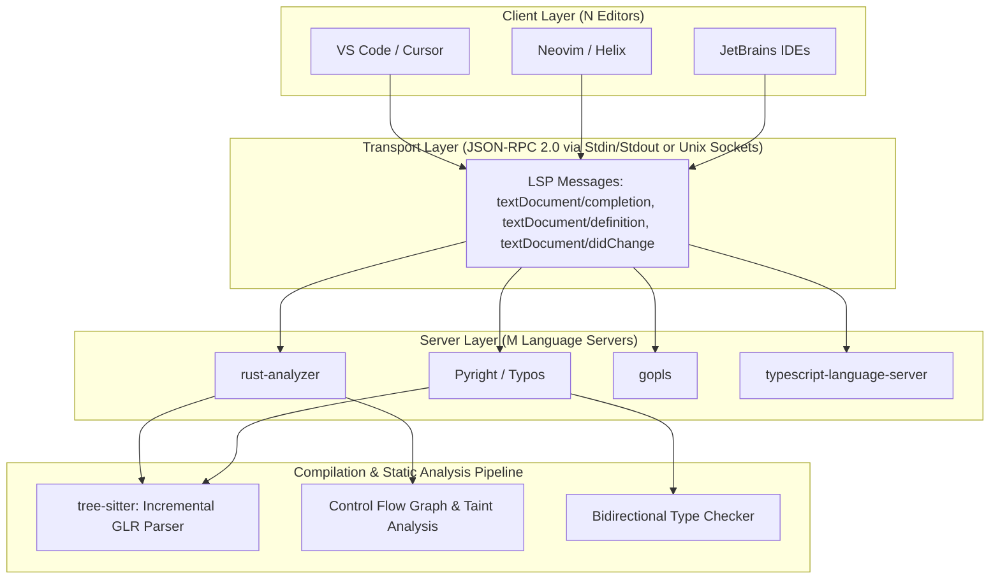
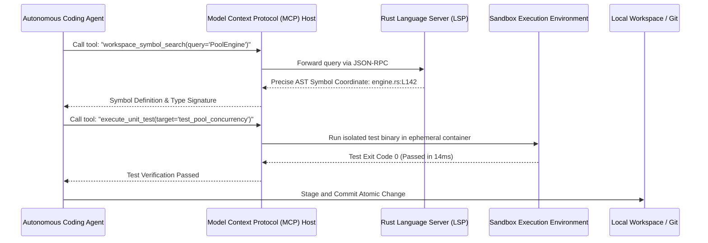

## How Did the Language Server Protocol Solve the $M \times N$ Tooling Complexity Problem?

Historically, developer productivity tooling was plagued by quadratic integration scaling. If an engineering ecosystem supported $M$ programming languages (e.g., Rust, TypeScript, Python, Go) and $N$ code editors (e.g., VS Code, Neovim, Emacs, Sublime Text, JetBrains), providing autocomplete, syntax highlighting, definition jumping, and diagnostic linting required implementing $M \times N$ bespoke editor plugins. Each plugin duplicate-parsed source code and implemented custom type-checking heuristics, producing inconsistent developer experiences and fragmented maintenance.

The introduction of the Language Server Protocol (LSP)—initially pioneered by Microsoft, OmniSharp, and Red Hat—revolutionized software engineering by decoupling language intelligence from editor display logic. By establishing a standardized JSON-RPC 2.0 protocol over inter-process communication (IPC) channels, the ecosystem compressed the integration complexity from $O(M \times N)$ to $O(M + N)$. Modern developer environments rely on this protocol alongside incremental concrete syntax trees (CST) and the emerging Model Context Protocol (MCP) to turn raw text files into deterministic execution graphs.



---

## Architectural Breakdown of the Language Server Protocol

The Language Server Protocol operates asynchronously across standard I/O streams (`stdio`) or local loopback sockets. A language client (the text editor) and a language server (a background compiler daemon) exchange JSON-RPC packets structured with explicit message boundaries and content-length headers.

### 1. Document Synchronization Lifecycle

Synchronization follows a reactive publish-subscribe model. When a developer modifies a buffer, the editor dispatches an incremental document update rather than transferring entire multi-megabyte source files:

```json
{
  "jsonrpc": "2.0",
  "method": "textDocument/didChange",
  "params": {
    "textDocument": {
      "uri": "file:///workspace/src/engine.rs",
      "version": 42
    },
    "contentChanges": [
      {
        "range": {
          "start": { "line": 104, "character": 12 },
          "end": { "line": 104, "character": 15 }
        },
        "rangeLength": 3,
        "text": "fetch_record"
      }
    ]
  }
}
```

The language server receives this range patch, applies it to an in-memory virtual file system (VFS), updates its syntax tree, runs incremental type checking, and pushes back diagnostics without blocking the user's keystrokes:

```json
{
  "jsonrpc": "2.0",
  "method": "textDocument/publishDiagnostics",
  "params": {
    "uri": "file:///workspace/src/engine.rs",
    "diagnostics": [
      {
        "range": {
          "start": { "line": 104, "character": 12 },
          "end": { "line": 104, "character": 24 }
        },
        "severity": 1,
        "message": "no method named `fetch_record` found for struct `DatabasePool` in the current scope"
      }
    ]
  }
}
```

---

## Incremental Syntax Parsing: The Tree-Sitter Paradigm

Prior to modern parser generators, text editors relied on regular expression grammar files (such as TextMate grammars) to highlight code. RegEx tokenizers have severe limitations: they lack nested state awareness, fail on multiline construct boundaries, and consume excessive CPU during document reflows.

**Tree-sitter** transformed IDE syntax analysis by compiling formal context-free grammars into deterministic, generalized LR (GLR) parser tables in C. Tree-sitter enforces three critical design invariants:

1. **Robust Error Recovery**: Real-world source code is syntactically invalid $95\%$ of the time during active editing. While traditional batch compilers abort upon encountering an unexpected token, Tree-sitter isolates syntax errors to local leaf nodes, constructing a valid Concrete Syntax Tree (CST) for the remainder of the document.
2. **Sub-Millisecond Incremental Reparsing**: When a keystroke modifies an identifier, Tree-sitter does not rebuild the tree from scratch. It navigates to the modified leaf, re-parses the local grammar branch in $O(\log N)$ time, and emits a persistent data-structure diff.
3. **Zero-Allocation Node Traversal**: The resulting syntax tree exposes memory-efficient C/WASM bindings that allow language servers and AI agents to query symbols using S-expression patterns.

```scheme
;; Tree-sitter S-expression query to match all public function declarations
(function_item
  visibility_modifier: (visibility_modifier) @vis
  name: (identifier) @fn_name
  parameters: (parameters) @params
  (#match? @vis "^pub$"))
```

---

## Comparing Developer Tooling Paradigms

Understanding developer infrastructure requires contrasting static rule engines, compiler daemons, and agentic runtime frameworks:

| Dimension | TextMate / RegEx Linter | Language Server (LSP) | Agentic Runtime (MCP) |
| :--- | :--- | :--- | :--- |
| **Parsing Model** | Line-by-line regular expressions | Full Concrete / Abstract Syntax Tree | Semantic vector index + AST tools |
| **State Awareness** | Stateless or single-line scope stack | Cross-file semantic project index | Multi-repo context & execution trace |
| **Latency Budget** | $< 1 \text{ ms}$ (pure regex matching) | $10 \text{--} 50 \text{ ms}$ (asynchronous IPC) | $200 \text{--} 1,500 \text{ ms}$ (LLM reasoning pass) |
| **Semantic Depth** | Lexical tokens only | Type hierarchies, call graphs, references | Intent synthesis, automated refactoring |
| **Failure Tolerance** | Fails silently on edge cases | Localized syntax error nodes | Hallucination mitigation required |

---

## Static Analysis and Taint Tracking: Beyond Syntax

High-assurance developer environments integrate static analysis passes directly into CI pipelines and IDE telemetry. As detailed in our examination of [modern software development lifecycles](/posts/software-development-cycle/) and [enterprise web reliability layers](/posts/web-application-10-essential/), catching security and memory bugs before merge is exponentially cheaper than post-deployment remediation.

Static analyzers construct a **Control Flow Graph (CFG)** of basic blocks connected by control edges. Using monotone framework lattice theory, analyzers perform data-flow taint analysis:

$$\mathbf{In}[B] = \bigcup_{P \in \text{Pred}[B]} \mathbf{Out}[P], \quad \mathbf{Out}[B] = \text{Gen}[B] \cup (\mathbf{In}[B] \setminus \text{Kill}[B])$$

If an untrusted user input (Source) flows into a SQL query or shell execution statement (Sink) without traversing a sanitization node (Sanitizer), the compiler generates a build-breaking diagnostic.

---

## 2026 Technological Evolution: The Model Context Protocol (MCP) and Autonomous Coding Agents

In the 2026 developer ecosystem, the Language Server Protocol has been joined by the **Model Context Protocol (MCP)**. While LSP bridges editors with language compilers, MCP bridges AI coding agents with the physical operating system:



1. **Deterministic Agent Grounding**: Autonomous agents no longer rely on brittle string searching (`grep` or blind text replacement). By calling LSP tools via MCP, agents navigate codebase symbol graphs, resolve type definitions, and inspect compiler diagnostics with $100\%$ precision before writing code.
2. **AST-Aware Refactoring Engines**: Coding tools execute AST rewrite passes using libraries like `ast-grep` and `jscodeshift`. Refactorings preserve non-modified code formatting, comment blocks, and docstrings without risk of hallucinating syntax errors.
3. **Ephemeral Sandbox Testing**: Modern agents verify code changes by compiling and executing unit test suites within microVMs or containerized environments before presenting diffs to human reviewers. For details on enterprise agent architectures, see our [generative AI ecosystem review](/posts/generative-ai-eco-system/).

---

## Key Takeaways

- **Decoupled Architecture Solves Complexity**: The Language Server Protocol reduced developer tooling friction from $O(M \times N)$ to $O(M + N)$ by separating UI editors from compiler daemons.
- **Tree-Sitter Enables Fault-Tolerant Parsing**: GLR incremental parsing provides sub-millisecond syntax trees that remain robust even when source code is incomplete or syntactically invalid.
- **Static Analysis Enforces Safety Shifts**: Control flow graph analysis and taint propagation catch vulnerabilities and memory safety bugs prior to code execution.
- **MCP Extends Tooling to AI Agents**: The Model Context Protocol empowers autonomous coding agents to execute compilers, tests, and AST refactorings with programmatic determinism.

---

## New Questions

- **Can Agentic Tool Calls Match Human Keystroke Latency?**: As agents take on inline completions, can local neural models evaluate LSP symbols within the strict $50\text{ms}$ interactive typing budget?
- **Will Formal Verification Replace Static Heuristics?**: With growing compute budgets, will automated SMT solvers and proof assistants become standard components of everyday IDE compiler loops?

---

## References

- Microsoft. (2024). Language Server Protocol Specification - 3.17. *Microsoft Developer Documentation*. [https://microsoft.github.io/language-server-protocol/specifications/lsp/3.17/specification/](https://microsoft.github.io/language-server-protocol/specifications/lsp/3.17/specification/) (accessed 2026-10-18)
- Brunsfeld, M. (2024). Tree-sitter: An Incremental Parsing System for Programming Tools. *GitHub Documentation*. [https://tree-sitter.github.io/tree-sitter/](https://tree-sitter.github.io/tree-sitter/) (accessed 2026-10-18)
- Nielson, F., Nielson, H. R., & Hankin, C. (2019). Principles of Program Analysis. *Springer Publishing*. [https://link.springer.com/book/10.1007/978-3-662-03811-6](https://link.springer.com/book/10.1007/978-3-662-03811-6) (accessed 2026-10-18)
- Anthropic. (2024). Model Context Protocol (MCP) Open Specification. *Anthropic Open Source Documentation*. [https://modelcontextprotocol.io/](https://modelcontextprotocol.io/) (accessed 2026-10-18)
