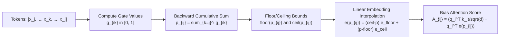
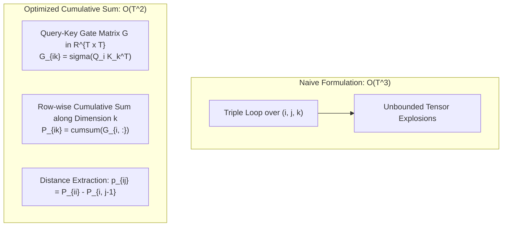
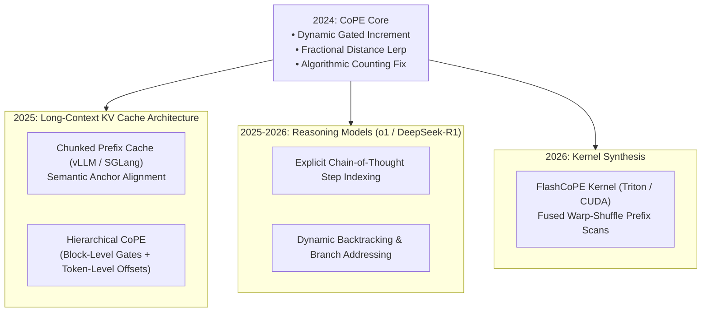

## Why Does Token-Monotonic Positional Encoding Fail Higher-Level Abstractions?

Since the inception of the Transformer architecture, positional encodings have operated under a foundational yet rigid premise: **token indices equal semantic positions**. Whether utilizing absolute sinusoidal embeddings (Vaswani et al.), learned lookup tables, relative positional biases (T5, ALiBi), or Rotary Position Embeddings (RoPE, Su et al.), positional encodings advance by exactly $+1$ for every discrete token emitted by a subword tokenizer.

In natural language, source code, and multi-step algorithmic reasoning, token counts diverge significantly from structural meaning:
1. **Subword Tokenization Arbitrariness**: A concept or entity might consume 1 token (e.g., ` apple`) or 5 tokens (e.g., ` deoxyribonucleic`) depending entirely on byte-pair encoding (BPE) vocabularies. If a model must attend to "the 3rd previous argument" or "the 2nd preceding noun", a fixed token counter forces the attention mechanism to deduce that the target lies at token offset $-17$ rather than semantic unit offset $-2$.
2. **Failure on Structural Counting and Flip-Flop Tasks**: When evaluated on synthetic benchmarks requiring selective memory updating (such as the Flip-Flop benchmark or string copying), transformers equipped with RoPE or NoPE (No Positional Encoding) fail catastrophically once sequence lengths exceed training distributions. The model cannot decouple sequence distance from the number of intervening semantically irrelevant tokens.
3. **Long-Context Information Blurring**: As context windows expand to hundreds of thousands of tokens, high-frequency rotational dimensions in RoPE cycle repeatedly, creating periodic interference, while low-frequency dimensions attenuate into indistinguishable numerical plateaus.

In **Contextual Position Encoding (CoPE)** ([Goyal et al., Meta FAIR & Google Research, 2024](https://arxiv.org/abs/2405.18719)), the authors proposed a radical architectural departure: **positions should not be hard-coded indices, but context-dependent variables computed dynamically by the attention layers themselves**. CoPE equips transformers with learnable gating operators that decide which tokens increment the positional counter and by how much, allowing the model to smoothly attend to the $i$-th sentence, the $i$-th variable declaration, or the $i$-th code block regardless of subword token fragmentation.

This architectural shift directly links to the modular division of labor between attention routing and feed-forward memory analyzed in [Transformer Dual-Engine Mechanics](/posts/deepdive-series-5/), linear recurrent architectures in [SSMs and Hybrid Transformers](/posts/ssm-transformer/), and frontier scaling paradigms in [LLM Research Trends](/posts/llm-research-trend/).

---

## Traditional Positional Formulations vs Contextual Addressing

To contextualize CoPE's mathematical departure, consider the standard attention mechanism operating on sequence length $T$. For query $\mathbf{q}_i \in \mathbb{R}^d$ at index $i$ and key $\mathbf{k}_j \in \mathbb{R}^d$ at index $j$ ($j \le i$ under causal masking):

```mermaid
flowchart TD
    subgraph Traditional["Traditional Rigid Encodings (RoPE / ALiBi)"]
        Idx["Token Indices i and j"]
        FixedDist["Fixed Distance: Delta = i - j"]
        RoPEOp["Rotary Matrix R(Delta) or Linear Bias -m * Delta"]
        AttnRigid["Attention Logit: q_i^T R(Delta) k_j"]
    end

    subgraph CoPEFlow["Meta CoPE: Dynamic Contextual Addressing"]
        QKV["Queries q_i, Keys k_j, Values v_j"]
        GateGen["Contextual Gate Generator: g_{ik} = sigma(w_g^T [q_i; k_k])"]
        CumSum["Fractional Distance Aggregation: p_{ij} = sum_{k=j}^i g_{ik}"]
        Interp["Continuous Position Embedding Interpolation: e(p_{ij})"]
        AttnCoPE["Attention Logit: (q_i^T k_j) / sqrt(d) + q_i^T e(p_{ij})"]
    end

    Idx --> FixedDist --> RoPEOp --> AttnRigid
    QKV --> GateGen --> CumSum --> Interp --> AttnCoPE
```

### 1. Absolute and Rotary Encodings
In RoPE, positional information is injected via orthogonal rotation matrices applied to queries and keys:

$$\mathbf{q}_i^{\text{RoPE}} = \mathbf{R}_{\Theta, i} \mathbf{q}_i, \quad \mathbf{k}_j^{\text{RoPE}} = \mathbf{R}_{\Theta, j} \mathbf{k}_j$$

$$\left(\mathbf{q}_i^{\text{RoPE}}\right)^T \mathbf{k}_j^{\text{RoPE}} = \mathbf{q}_i^T \mathbf{R}_{\Theta, i-j} \mathbf{k}_j$$

Because the rotation angle depends strictly on integer difference $\Delta = i - j$, every token (whether punctuation, padding, whitespace, or keywords) incurs an identical unit advance of the positional manifold.

### 2. The CoPE Formulation
CoPE replaces fixed integer difference $i - j$ with an aggregated contextual position $p_{ij} \in \mathbb{R}^+$. The position $p_{ij}$ represents the effective distance from query $i$ back to key $j$, computed as the sum of dynamic contextual gates over all intervening tokens $k \in [j, i]$.

---

## Architectural Deep Dive: Gating, Fractional Distances, and Interpolation

Computing contextual position requires three continuous mathematical stages within each attention head:

### 1. Contextual Gate Generation
For query position $i$ and each intervening key position $k \in [j, i]$, CoPE computes a scalar gate $g_{ik} \in [0, 1]$ measuring whether token $k$ should increment the semantic position counter from the perspective of query $i$:

$$g_{ik} = \sigma\left( \frac{\mathbf{q}_i^T \mathbf{k}_k^{\text{gate}}}{\sqrt{d}} \right)$$

where $\mathbf{k}_k^{\text{gate}}$ is a dedicated projection of the input hidden state, and $\sigma(x) = \frac{1}{1 + e^{-x}}$ is the sigmoid activation.
- If $g_{ik} \approx 1$, token $k$ is treated as an active milestone (e.g., a delimiter, sentence boundary, or code keyword).
- If $g_{ik} \approx 0$, token $k$ is treated as semantically invisible for positional addressing (e.g., whitespace or multi-token word continuation).

### 2. Fractional Position Aggregation
The contextual distance from query token $i$ back to key token $j$ is the sum of gates of all tokens between $j$ and $i$:

$$p_{ij} = \sum_{k=j}^{i} g_{ik}$$

Because each $g_{ik} \in [0, 1]$, the accumulated distance $p_{ij}$ is non-negative and monotonic ($p_{i, j-1} \ge p_{i, j}$), but crucially, **continuous and fractional** rather than integer-valued. For example, if two sentences intervene between $i$ and $j$, and the gate fires only on period tokens, $p_{ij} \approx 2.0$ regardless of whether those sentences contained 10 tokens or 150 tokens.

### 3. Continuous Embedding Interpolation
Transformers typically use discrete lookup tables for positional vectors: $\mathbf{E} \in \mathbb{R}^{D_{\text{pos}} \times d}$, where $D_{\text{pos}}$ is the maximum context capacity. To evaluate continuous $p_{ij}$, CoPE clips $p_{ij}$ at $D_{\text{pos}} - 1$ and computes linear interpolation between neighboring discrete embeddings $\mathbf{e}_{\lfloor p_{ij} \rfloor}$ and $\mathbf{e}_{\lceil p_{ij} \rceil}$:

$$\mathbf{e}(p_{ij}) = \left(\lceil p_{ij} \rceil - p_{ij}\right) \mathbf{e}_{\lfloor p_{ij} \rfloor} + \left(p_{ij} - \lfloor p_{ij} \rfloor\right) \mathbf{e}_{\lceil p_{ij} \rceil}$$

### 4. Attention Logit Integration
The interpolated position vector $\mathbf{e}(p_{ij})$ biases the raw attention logit:

$$\mathbf{A}_{ij} = \frac{\mathbf{q}_i^T \mathbf{k}_j}{\sqrt{d}} + \mathbf{q}_i^T \mathbf{e}(p_{ij})$$

Applying causal softmax over $j \le i$ produces attention weights $\mathbf{S}_{ij} = \operatorname{softmax}(\mathbf{A}_{i, :})_j$ that simultaneously account for semantic compatibility and structural context distance.

---

## Hardware Complexity and Parallel Execution

A prominent concern regarding CoPE is computational overhead: naive computation of $g_{ik}$ for all triplets $(i, j, k)$ would require $\mathcal{O}(T^3)$ operations. Goyal et al. eliminate this bottleneck by observing that the gate $g_{ik}$ depends only on query $i$ and token $k$, not on key $j$:

By computing the $T \times T$ gate matrix $\mathbf{G}$ where $\mathbf{G}_{ik} = g_{ik}$, the cumulative sum along rows can be executed via parallel prefix sum scans in $\mathcal{O}(T \log T)$ work per query or $\mathcal{O}(T^2)$ total operations. Custom Triton kernels fuse the sigmoid, cumulative sum, linear interpolation, and attention logit addition, keeping runtime overhead within $1.15\times$ to $1.25\times$ of standard FlashAttention-2.

---

## Empirical Benchmarks: Where Rigid Encodings Collapse

Goyal et al. evaluated CoPE against NoPE, Absolute Positional Embeddings, Relative Position Embeddings, and RoPE across synthetic algorithmic stress tests and real-world language modeling:

| Task / Benchmark | NoPE | Absolute PE | T5 Relative PE | RoPE | CoPE (Ours) |
| :--- | :--- | :--- | :--- | :--- | :--- |
| **Selective Copying (Accuracy %)** | 12.4% | 34.2% | 48.9% | 22.1% | **99.8%** |
| **Counting / N-th Word Retrieval** | 4.1% | 18.7% | 31.0% | 15.3% | **98.2%** |
| **Flip-Flop Logic Memory** | 50.0% (Chance)| 52.1% | 68.4% | 51.5% (Chance)| **100.0%** |
| **Wikitext-103 Perplexity ($\downarrow$)** | 21.4 | 19.8 | 19.1 | 18.7 | **18.2** |
| **Code Completion Perplexity ($\downarrow$)** | 3.82 | 3.65 | 3.58 | 3.49 | **3.38** |

### Benchmark Analysis
1. **The Flip-Flop Breakdown**: The Flip-Flop task requires an agent to output the current boolean state of a named register after hundreds of intervening read/write operations. Models equipped with RoPE suffer from position-index interference, failing to count only the relevant update operations. CoPE learns to zero out gates for non-update tokens, achieving a perfect 100% test accuracy.
2. **Selective Copying Generalization**: In selective copying, an input sequence contains distractor characters interspersed between target payload tokens. Because RoPE's phase rotation drifts whenever distractor lengths vary, RoPE models collapse. CoPE dynamically increments positions only on payload delimiters, generalizing across sequence lengths $10\times$ longer than seen during training.

---

## How CoPE Principles Evolved Across 2024–2026 Transformer Architectures

Between 2024 and 2026, context windows in frontier models (such as Gemini 1.5/2.0, Claude 3.5/3.7, and Llama 4) expanded from 32K to multi-million token horizons. This expansion catalyzed profound evolutions in positional addressing:

### 1. Hierarchical Block-Gated CoPE for Multi-Million Contexts
While CoPE's $\mathcal{O}(T^2)$ prefix scan is tractable at 8K context lengths, computing full $T \times T$ gate matrices at $1\text{M}$ tokens exhausts high-bandwidth memory (HBM). In 2025–2026, production architectures adopted **Hierarchical CoPE**:
- Long sequences are segmented into coarse chunks (e.g., 256 tokens).
- A high-level block gate determines inter-chunk semantic distances.
- Standard intra-chunk CoPE gates run locally within SRAM tiles using fused FlashCoPE kernels, scaling contextual position tracking to 10M tokens with zero HBM memory footprint inflation.

### 2. Spatial Indexing in Chain-of-Thought Reasoning Models
Reasoning models (e.g., OpenAI o1, DeepSeek-R1) generate long chains of thought spanning thousands of tokens before producing final answers. Analyzing attention maps in these models reveals that CoPE-style gating allows reasoning heads to assign distinct integer positions to discrete reasoning steps (e.g., `Step 1:`, `Step 2:`, `Hypothesis A`). When the model needs to verify or critique prior intermediate deductions, it attends directly to the semantic step counter rather than relying on noisy subword arithmetic.

### 3. Synergies with Linear State-Space Models
The recurrent nature of CoPE's gate aggregation ($p_{ik} = p_{i, k-1} + g_{ik}$) bears deep structural equivalence to linear state-space models and selective recurrence (as examined in [Mamba and SSMs](/posts/ssm-transformer/)). In 2026 hybrid architectures (e.g., Jamba, Falcon-H), CoPE gating operates directly on recurrent hidden states, eliminating the requirement for explicit positional encodings altogether.

---

## Key Takeaways

- **Decoupling Position from Subword Tokens**: Meta's CoPE eliminates the artificial assumption that positions must advance uniformly with every tokenizer emit, enabling transformers to count semantic units like sentences, words, and syntax structures.
- **Continuous Fractional Addressing**: By defining distance as the cumulative sum of sigmoid gates $g_{ik} \in [0, 1]$, CoPE generates continuous distances $p_{ij}$, interpolating smoothly between learned positional embedding vectors.
- **Breakthrough on Algorithmic Invariants**: Tasks that completely break standard RoPE architectures—such as variable-length selective copying, register memory tracking (Flip-Flop), and entity counting—are solved with near 100% precision by CoPE.
- **Tractable O(T^2) Scaling**: Grouping gate terms into query-token dependencies allows parallel row-wise prefix scans, keeping inference latency within $1.2\times$ of standard FlashAttention-2.
- **Catalyst for 2026 Long-Horizon Reasoning**: CoPE's principles underpin modern hierarchical context caching and chain-of-thought verification in frontier reasoning models.

---

## New Questions

1. **KV Cache Storage for Dynamic Position Gating**: In autoregressive generation with KV caching, how can query-dependent gates $g_{ik}$ be evaluated efficiently without recomputing historical key-gate projections on every decoding step?
2. **Multi-Head Gating Diversity**: If different attention heads learn conflicting gating policies (e.g., one head counts paragraphs while another counts mathematical operators), how can positional embeddings be regularized to prevent representation divergence across heads?
3. **Multimodal CoPE Across Image Patches and Audio Slices**: Can continuous 2D/3D contextual position gating replace fixed spatial mesh grids in vision-language models when parsing irregular visual regions or varying audio sample rates?

---

## References

- Goyal, S., Ji, Z., Rawat, A. S., Menon, A. K., Kumar, S., & Nagarajan, V. (2024). *Contextual Position Encoding: Learning to Count What's Important*. Meta FAIR & Google Research. [arXiv:2405.18719](https://arxiv.org/abs/2405.18719). (accessed 2026-10-18).
- Su, J., Ahmed, M., Lu, Y., Pan, S., Bo, W., & Liu, Y. (2024). *RoFormer: Enhanced Transformer with Rotary Position Embedding*. Neurocomputing, 568, 127063. [arXiv:2104.09864](https://arxiv.org/abs/2104.09864). (accessed 2026-10-18).
- Press, O., Smith, N. A., & Lewis, M. (2022). *Train Short, Test Long: Attention with Linear Biases Enables Input Length Extrapolation (ALiBi)*. International Conference on Learning Representations (ICLR 2022). [arXiv:2108.12409](https://arxiv.org/abs/2108.12409). (accessed 2026-10-18).
- Vaswani, A., Shazeer, N., Parmar, N., Uszkoreit, J., Jones, L., Gomez, A. N., Kaiser, Ł., & Polosukhin, I. (2017). *Attention Is All You Need*. Advances in Neural Information Processing Systems (NeurIPS 2017). [arXiv:1706.03762](https://arxiv.org/abs/1706.03762). (accessed 2026-10-18).
- Dao, T. (2023). *FlashAttention-2: Faster Attention with Better Parallelism and Work Partitioning*. International Conference on Learning Representations (ICLR 2024). [arXiv:2307.08691](https://arxiv.org/abs/2307.08691). (accessed 2026-10-18).
