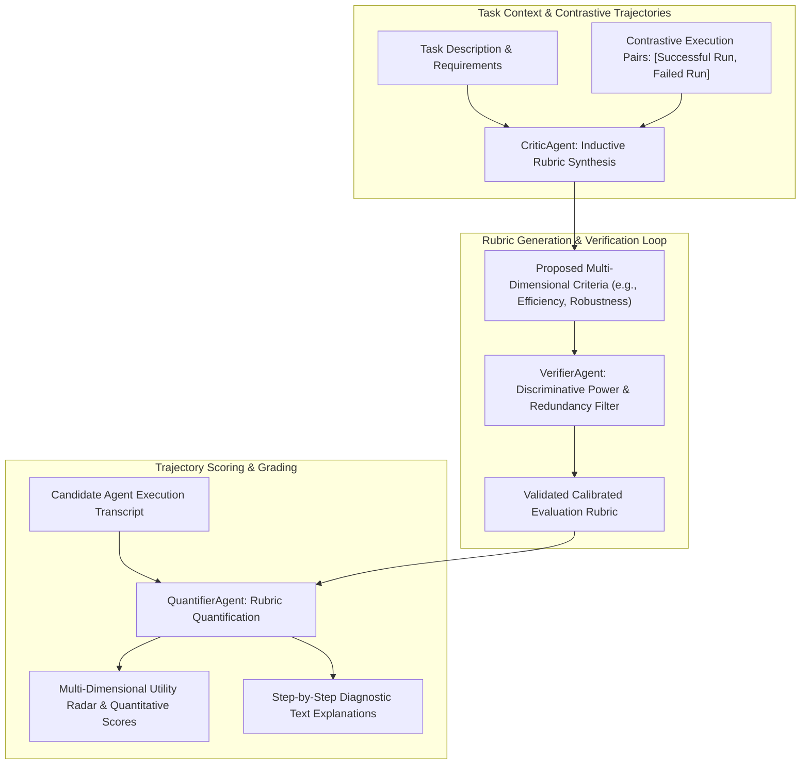
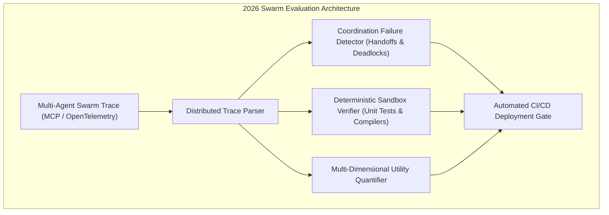

## Why Do Traditional Benchmark Metrics Fail to Capture Multi-Step Autonomous Agent Utility?

Evaluating autonomous agent applications presents fundamentally different challenges than benchmarking static large language models. In standard natural language processing, evaluation relies on fixed input-output pairs evaluated via token exact matches, BLEU/ROUGE overlap, or multiple-choice accuracy (as examined in our source audit of [MMLU-Pro Evaluation Frameworks](/posts/evaluating-llm/)). 

However, in autonomous agentic workflows—such as software engineering refactoring, web data harvesting, or automated customer support—evaluation cannot be reduced to a single output token string:
1. **Multiple Valid Trajectories**: An agent tasked with resolving an API bug can execute dozens of valid tool combinations (e.g., inspecting logs first versus running unit tests first). Penalizing deviations from a single reference trajectory yields false negatives.
2. **Hidden Side Effects**: An agent might emit a text summary declaring complete success while leaving corrupted database records, broken dependency trees, or unauthorized cloud resources in its wake.
3. **Task-Specific Utility Dimensions**: Different production domains require divergent quality rubrics. A medical assistant mandates strict factual verifiability and uncertainty admission, whereas a creative scripting agent prioritizes narrative novelty and conversational engagement.

In spring 2024, Microsoft Research introduced **AgentEval** (Samarinas et al., 2024), a multi-agent framework designed to automate the generation, verification, and quantification of domain-specific evaluation rubrics without requiring human engineers to author custom scoring functions by hand.



By decomposing evaluation into specialized multi-agent roles, AgentEval replaced brittle hardcoded heuristics with an adaptive, self-calibrating assessment pipeline.

---

## The Tri-Agent Decomposition: Critic, Verifier, and Quantifier

Standard "LLM-as-a-judge" implementations suffer from severe cognitive biases: position bias (favoring the first presented option), verbosity bias (equating length with quality), and rubric drift. AgentEval counteracts these vulnerabilities by distributing the evaluation pipeline across three distinct agentic roles:

```
AgentEval Functional Role Matrix:
-------------------------------------------------------------------------------------------------
Agent Role        Primary Core Responsibility                     Validation Mechanism
-------------------------------------------------------------------------------------------------
CriticAgent       Induces evaluation criteria from contrastive data Analyzes divergence between success and failure
VerifierAgent     Screens criteria for necessity and informativeness Formal discriminative power test
QuantifierAgent   Scores execution transcripts against verified rubrics Multi-turn Likert grading with explicit rationale
-------------------------------------------------------------------------------------------------
```

### 1. CriticAgent: Inductive Criteria Formulation

Instead of asking an LLM to generate generic evaluation metrics in the abstract, the `CriticAgent` is provided with:
- The target task prompt.
- At least one known successful execution trajectory ($T_{\text{success}}$).
- At least one known failed execution trajectory ($T_{\text{failure}}$).

By performing differential contrastive analysis across the paired transcripts, the CriticAgent identifies the latent factors that distinguish task mastery from operational collapse (e.g., checking whether error recovery was attempted, whether intermediate tool outputs were verified, and whether token budgets were respected).

### 2. VerifierAgent: Filtering and Calibration

Not all criteria proposed by an LLM are valid. Many criteria are redundant, trivial (e.g., "emits polite greetings"), or unfalsifiable. The `VerifierAgent` executes a rigorous filtering audit:
- **Informativeness**: Can the criterion be quantified objectively from the observed trajectory?
- **Non-Redundancy**: Does this metric overlap significantly with an existing criterion?
- **Discriminative Power**: Does this criterion reliably assign higher scores to $T_{\text{success}}$ than to $T_{\text{failure}}$ across validation splits?

Criteria failing these verification gates are pruned, yielding a lean, orthogonal assessment rubric.

### 3. QuantifierAgent: Grounded Scoring and Diagnosis

The `QuantifierAgent` scores target execution transcripts against the verified rubric. Rather than emitting an ungrounded scalar score, the Quantifier operates via anchored grading:
- Assigning Likert scores ($1$ to $5$) bounded by explicit behavioral descriptions per level.
- Citing specific line numbers and tool call timestamps from the transcript to justify each score.
- Flagging catastrophic safety failures or policy violations that trigger automatic score zeroing.

```python
# Simplified representation of AgentEval evaluation contract
from typing import List, Dict
from pydantic import BaseModel, Field

class EvaluationCriterion(BaseModel):
    name: str = Field(description="Name of the quality dimension")
    description: str = Field(description="Detailed operational definition")
    scoring_guide: Dict[int, str] = Field(description="Anchored descriptions for ratings 1 through 5")

class EvaluationReport(BaseModel):
    criterion_name: str
    score: int = Field(ge=1, le=5)
    evidence: List[str] = Field(description="Direct transcript quotes and tool call IDs")
    critique: str = Field(description="Diagnostic rationale for the assigned rating")

class AgentEvalPipeline:
    def __init__(self, critic_agent, verifier_agent, quantifier_agent):
        self.critic = critic_agent
        self.verifier = verifier_agent
        self.quantifier = quantifier_agent

    def evaluate_trajectory(self, task: str, trajectory: dict, exemplars: list) -> List[EvaluationReport]:
        # 1. Synthesize candidate criteria
        candidate_criteria = self.critic.generate_criteria(task, exemplars)
        # 2. Prune redundant or low-discrimination criteria
        verified_rubric = self.verifier.filter_criteria(candidate_criteria, exemplars)
        # 3. Score candidate execution against validated rubric
        reports = self.quantifier.score_trajectory(trajectory, verified_rubric)
        return reports
```

---

## Empirical Validation: Math Problem Solving and Household Robotics

In empirical evaluations conducted by Microsoft Research, AgentEval was benchmarked across two diverse operational environments: complex mathematical theorem proving (GSM8K and MATH) and embodied household planning (ALFWorld).

```
Comparative Evaluation Reliability (Human Expert Alignment):
-------------------------------------------------------------------------------------------------
Evaluation Methodology         Pearson Correlation (r)    Spearman Rank (ρ)    Rubric Specificity
-------------------------------------------------------------------------------------------------
Generic Single-Prompt LLM      0.42                       0.38                 Low (Generalist)
Human Domain Expert Panel      0.88                       0.85                 High (Labor-Intensive)
AgentEval Automated Pipeline   0.81                       0.79                 High (Domain-Tailored)
-------------------------------------------------------------------------------------------------
```

In ALFWorld household planning environments—where agents navigate simulated spatial rooms, manipulate objects, and recover from missing items—generic evaluations only measured whether the final goal condition was satisfied. AgentEval successfully exposed nuanced failure modes that binary metrics ignored:
- **Path Inefficiency**: Agents circling between identical rooms repeatedly before finding an object.
- **State Amnesia**: Dropping previously gathered tools to pick up irrelevant props.
- **Safety Hazards**: Placing flammable items near heat sources during task completion.

By quantifying these intermediate behavioral dimensions, engineering teams could debug agent planning harnesses (as explored in our architectural study on [Agentic Design Patterns](/posts/llm-ai-agent/)) without manual transcript review.

---

## How Multi-Agent Evaluation and Transcript Grading Evolved Across 2026

Between 2024 and 2026, the principles pioneered by AgentEval evolved into standardized enterprise observability and evaluation fabrics:

### 1. Transcript-Level Trace Ingestion (OpenTelemetry and MCP)
In 2024, passing complex multi-agent execution traces to evaluators required custom JSON serializations. In 2026, the ecosystem standardized around OpenTelemetry and Model Context Protocol (MCP) trace logs. Evaluator agents ingest standardized span graphs, analyzing step durations, tool argument validations, and subagent delegation handoffs natively.

### 2. Multi-Agent Coordination Failure Detection
As multi-agent swarms proliferated, evaluation shifted from individual agent competence to collective team dynamics. Modern 2026 evaluation harnesses specifically detect:
- **Handoff Drops**: Loss of critical contextual parameters when Agent A delegates a sub-task to Agent B.
- **Blame Loops**: Agents repeatedly rejecting each other's code submissions in infinite review cycles.
- **Role Drift**: Worker agents assuming coordinator responsibilities without explicit handoff prompts.



### 3. Continuous Production Evaluation Gates in CI/CD
Modern software engineering organizations deploy automated multi-agent evaluators directly into continuous integration (CI/CD) pipelines (e.g., evaluating pull requests generated by autonomous coding agents against SWE-bench style testbeds before triggering human review).

---

## Key Takeaways

- **Single scalar metrics fail on autonomous agents**: Binary success/failure flags conceal spatial inefficiencies, hallucinated API calls, and safety hazards.
- **Multi-agent role separation mitigates judge bias**: Decomposing evaluation into CriticAgent, VerifierAgent, and QuantifierAgent stabilizes scoring rubrics.
- **Contrastive learning induces domain-specific rubrics**: Analyzing differences between successful and failed runs produces high-discrimination criteria.
- **Anchored Likert scoring provides actionable engineering diagnostics**: Grounded behavioral descriptions and cited transcript evidence allow developers to isolate harness failures.
- **2026 evaluation focuses on multi-agent swarm coordination**: Modern evaluation pipelines assess handoff fidelity, deadlocks, and sandbox verification within continuous CI/CD gates.

---

## New Questions

1. How can automated criteria verification distinguish between genuine behavioral progress and deceptive reward hacking in multi-turn interactive environments?
2. What are the sample complexity limits of contrastive exemplar induction when evaluating long-horizon autonomous coding tasks spanning thousands of tool invocations?
3. To what extent do self-referential biases affect QuantifierAgent scoring when evaluating outputs generated by the same base foundation model family?

---

## References

- Samarinas, C., Cheng, H., & Microsoft Research Team. (2024). *AgentEval: A Multi-Agent Framework for Assessing the Utility of Language Model Applications*. arXiv preprint arXiv:2404.09341. Available at: <https://arxiv.org/abs/2404.09341> (accessed 2026-10-18).
- Zheng, L., Chiang, W. L., Sheng, Y., Zhuang, S., Wu, Z., Zhuang, Y., Lin, Z., Li, Z., Li, D., Xing, E., et al. (2024). *Judging LLM-as-a-Judge with MT-Bench and Chatbot Arena*. Advances in Neural Information Processing Systems (NeurIPS), 36. Available at: <https://arxiv.org/abs/2306.05685> (accessed 2026-10-18).
- Wang, X., Wei, J., Schuurmans, D., Le, Q. V., Chi, E. H., Narang, S., Chowdhery, A., & Zhou, D. (2023). *Self-Consistency Improves Chain of Thought Reasoning in Language Models*. In International Conference on Learning Representations (ICLR). Available at: <https://arxiv.org/abs/2203.11171> (accessed 2026-10-18).
- Wu, Q., Bansal, G., Zhang, J., Wu, Y., Li, B., Zhu, E., Jiang, L., Zhang, X., Zhang, S., Liu, J., et al. (2023). *AutoGen: Enabling Next-Gen LLM Applications via Multi-Agent Conversation*. arXiv preprint arXiv:2308.08155. Available at: <https://arxiv.org/abs/2308.08155> (accessed 2026-10-18).
