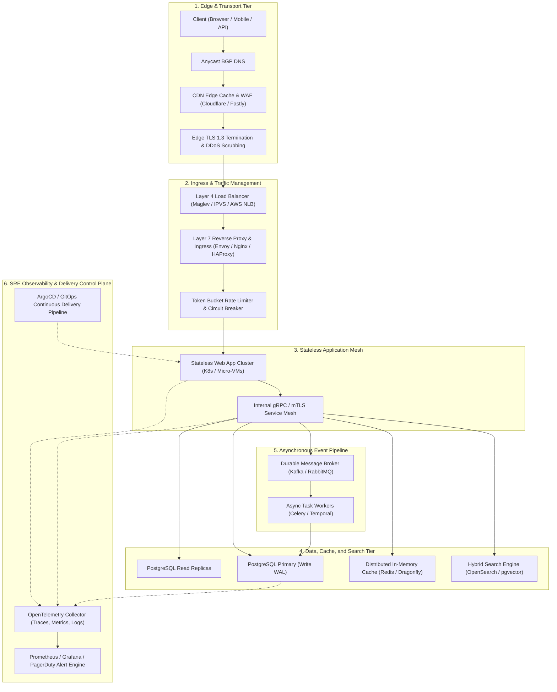
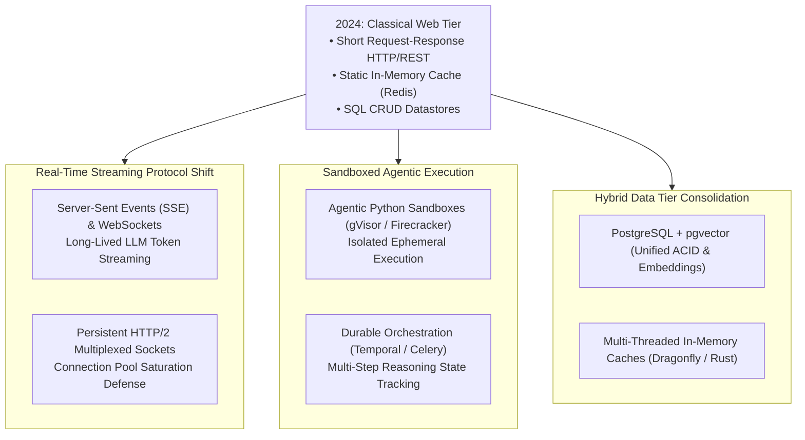

## What Distinguishes Toy Web Prototypes from Scalable Production Systems?

The architectural gulf between a local web prototype and a production-grade distributed web application is defined not by framework choice, but by **failure tolerance, data decoupling, and operational observability**. A local application runs monolithic processes connecting directly to a local database over loopback interfaces. In contrast, a production web system operates across distributed physical regions, where networks are fundamentally untrusted, latency is non-deterministic, servers crash without warning, and traffic patterns exhibit extreme bursts.

Under classical systems engineering principles—from Martin Fowler's enterprise patterns to Google's Site Reliability Engineering (SRE) frameworks and Martin Kleppmann's *Designing Data-Intensive Applications*—reliability is not an emergent property of application code. It is an engineering outcome achieved by decomposing software into ten discrete, decoupled architectural layers. Each layer isolates failure domains, provides backpressure under saturation, and protects stateful data stores from cascading outages.

This architectural decoupling underpins micro-VM container boundaries analyzed in [Anything as a Service (XaaS)](/posts/anything-as-a-service/), hexagonal domain boundaries in [Modern Software Architecture](/posts/modern-software-architecture/), and sandboxed runtime execution in [Agentic Data Analysts](/posts/agentic-data-analyst/).

---

## Architectural Topology: The 10 Core Reliability Layers

A resilient web architecture routes user intent from the public internet through increasingly secure and structured zones of trust:

---

## Deconstructing the 10 Production Layers

### 1. Anycast DNS, CDN, and Edge Security
Before a packet reaches backend infrastructure, edge networks terminate the transport layer close to the user:
- **Anycast BGP Routing**: Distributes incoming DNS and HTTP traffic across globally distributed Points of Presence (PoPs), minimizing round-trip time (RTT).
- **Edge Caching**: Serves immutable static assets (JavaScript bundles, images, media) and stale-while-revalidate API responses directly from RAM at the edge.
- **Web Application Firewall (WAF)**: Mitigates volumetric DDoS attacks (SYN floods, UDP amplification) and inspects HTTP payloads for SQL injection, cross-site scripting (XSS), and automated scraping botnets.

### 2. Layer 4 and Layer 7 Ingress Routing
Traffic entering a data center or cloud Virtual Private Cloud (VPC) passes through dual-stage load balancing:
- **Layer 4 (Transport Level)**: Operates at TCP/UDP layers using hardware-accelerated packet forwarding (e.g., Linux IPVS, AWS NLB, or Google Maglev). It distributes raw TCP streams across Layer 7 proxies without decrypting TLS payloads.
- **Layer 7 (Application Level)**: Proxies like Envoy or Nginx terminate TLS, inspect HTTP/2 and HTTP/3 headers, evaluate path-based routing (e.g., `/api/v1/checkout` vs `/static`), and inject distributed tracing headers (`traceparent`).

### 3. Traffic Shedding, Rate Limiting, and Circuit Breakers
To prevent sudden traffic spikes from overwhelming downstream databases, ingress proxies enforce mathematical traffic shaping:
- **Token Bucket Algorithm**: Each client IP or API key is assigned a bucket of tokens refilled at rate $r$ with capacity $C$. If tokens are exhausted, requests receive HTTP 429 (Too Many Requests).
- **Circuit Breakers**: When an upstream microservice fails (e.g., $>50\%$ error rate over 10 seconds), the circuit transitions from *Closed* to *Open*, failing fast immediately to prevent resource starvation.

### 4. Stateless Compute and Micro-VM Workloads
Application servers run business logic without persisting local state between HTTP transactions:
- **Stateless Invariance**: All session data, user state, and uploads are stored externally in Redis or object storage (S3). Any server instance can be abruptly terminated by the Kubernetes autoscaler without dropping active user sessions.
- **Graceful Shutdown**: On receiving `SIGTERM`, containers stop accepting new connections, finish executing in-flight HTTP requests within a grace period (e.g., 30 seconds), and close open database pools cleanly.

### 5. Primary Relational Data Storage (ACID Baseline)
Relational databases (e.g., PostgreSQL, MySQL) provide authoritative truth:
- **Write-Ahead Logging (WAL)**: Ensures durability ($D$ in ACID) by appending state transitions to sequential disk logs before modifying in-memory buffer pools.
- **Connection Pooling**: Applications must not open direct TCP connections per request. Middlewares like PgBouncer maintain pre-warmed connection pools, eliminating database CPU spikes caused by connection setup overhead.
- **Read/Write Splitting**: Writes route to the primary instance, while read-heavy analytical and rendering queries route to read replicas synchronized via asynchronous or semi-synchronous physical streaming replication.

### 6. Distributed In-Memory Caching and Invalidation
Disk-backed databases cannot sustain millions of reads per second. In-memory datastores (Redis, Dragonfly, Memcached) shield primary databases:
- **Cache-Aside (Lazy Loading)**: The application queries cache first; on a cache miss, it reads from PostgreSQL, populates the cache, and returns data.
- **Cache Stampede Prevention**: If a popular key expires under high load, thousands of concurrent requests hit the database simultaneously. Systems mitigate this using the **XFetch probabilistic early expiration algorithm**:

$$\Delta t - \beta \cdot \ln(u) \cdot \delta > \text{TTL}$$

where $\Delta t$ is the computation time, $\beta > 0$ is an aggressiveness parameter, $u \sim \mathcal{U}(0, 1)$, and $\delta$ is the remaining time to live. As TTL nears zero, the probability of background recomputation approaches 1 before the key expires.

### 7. Asynchronous Task Queues and Event Streaming
Operations that take longer than 100 milliseconds (email dispatch, PDF report generation, video transcoding, external API calls) must never execute synchronously within an HTTP request lifecycle:
- **Durable Message Brokers**: Systems like Kafka, RabbitMQ, or Amazon SQS decouple producers from consumers.
- **Idempotency**: Message delivery in distributed networks guarantees at-least-once delivery. Worker jobs must verify idempotency keys (e.g., checking an `idempotency_token` table) to prevent duplicate side effects (such as double charging a credit card).
- **Dead Letter Queues (DLQ)**: Tasks that fail repeatedly after exponential backoff are routed to a DLQ for manual inspection without halting the worker pipeline.

### 8. Full-Text and Hybrid Vector Information Retrieval
Relational B-Tree indices cannot efficiently execute fuzzy linguistic matching, typo tolerance, or semantic vector lookups:
- **Inverted Indices**: Search engines (Elasticsearch, OpenSearch) parse text into tokenized inverted indices for sub-10ms keyword retrieval.
- **Dense Vector Search**: Integrating HNSW (Hierarchical Navigable Small World) indices (via pgvector or dedicated vector databases) enables semantic similarity search for RAG and recommendation systems.

### 9. Unified Observability: Traces, Metrics, and Structured Logs
You cannot debug what you cannot observe. Modern production systems standardize telemetry via the CNCF OpenTelemetry (OTel) specification:
- **Distributed Traces**: Trace IDs propagate across service boundaries, mapping the entire call graph of an HTTP request across 10 microservices to pinpoint latency bottlenecks.
- **Metrics**: High-cardinality time-series metrics (request rates, error rates, CPU saturation, memory p99 latency) visualized in Grafana.
- **Structured JSON Logs**: Application logs emit machine-readable JSON containing `timestamp`, `log_level`, `trace_id`, and `context`, ingested into Elasticsearch or ClickHouse.

### 10. Automated CI/CD and Progressive Delivery
Code transitions from git repositories to live clusters through strictly automated pipelines:
- **GitOps Reconciliation**: Declarative configurations stored in git are continuously synced to Kubernetes clusters via tools like ArgoCD.
- **Canary Rollouts**: New code releases deploy to 2% of user traffic while automated analyzers evaluate error rates and latency. If canary metrics degrade, the release rolls back automatically within seconds without human intervention.

---

## Core Distributed Systems Formulations

Production web architecture is governed by fundamental mathematical constraints:

### 1. Little's Law and System Concurrency
In any stable queueing system, the average number of concurrent requests $L$ in the system equals the arrival rate $\lambda$ multiplied by the average request latency $W$:

$$L = \lambda \cdot W$$

If an API receives $\lambda = 1,000\text{ requests/sec}$ and average database latency degrades from $W = 50\text{ ms}$ to $W = 500\text{ ms}$, the required concurrent server capacity $L$ increases tenfold from $50$ to $500$. If thread pools or database connection limits cannot scale to $500$, the system experiences immediate socket exhaustion and cascading outages.

### 2. SRE Error Budget and Multi-Window Burn Rate Alerting
Site Reliability Engineering defines reliability via Service Level Objectives (SLOs). For an availability target of $99.9\%$ ($3$ nines) over a $30$-day window, the allowable error budget is $0.1\% = 0.001$.

Alerting on raw threshold violations produces alert fatigue. Modern SRE uses **burn rate equations** to notify engineers based on the rate of budget consumption:

$$\text{Burn Rate } B = \frac{\text{Observed Error Rate}}{1 - \text{SLO Target}}$$

A burn rate of $B = 14.4$ consumes $2\%$ of the monthly budget in 1 hour. Automated monitoring triggers immediate pager alerts only when both short-window (e.g., 5-minute) and long-window (e.g., 1-hour) burn rates exceed critical thresholds.

---

## How Modern Web Architecture Evolved Across 2024–2026 AI Workloads

Between 2024 and 2026, the proliferation of generative AI and autonomous agent systems fundamentally reshaped standard production web tiers:

### 1. Long-Lived Streaming Connections and Socket Exhaustion
Classical web APIs processed transactions in under 200 ms. In 2026, generative LLM completions stream tokens over Server-Sent Events (SSE) or WebSockets for 10 to 60 seconds per request.
- Traditional synchronous worker pools (e.g., Gunicorn or PHP-FPM) exhaust thread capacity under a fraction of normal load.
- Production architectures shifted to asynchronous, non-blocking runtimes (Node.js, Go, Rust Actix/Axum, or Python FastAPI/uvicorn) backed by edge proxies configured with long idle read timeouts and HTTP/2 multiplexing.

### 2. Ephemeral Code Execution Sandboxes
Modern web applications incorporating [Agentic Data Analysts](/posts/agentic-data-analyst/) allow users to generate and run arbitrary Python, SQL, or shell code.
- Running untrusted code on production application nodes is a severe security vulnerability.
- Modern production stacks deploy ephemeral micro-VM sandboxes (utilizing AWS Firecracker or Google gVisor) that initialize in sub-100ms, execute the isolated task with strict CPU/memory quotas, and terminate immediately upon output collection.

### 3. Data Tier Consolidation via pgvector and High-Throughput Engines
In 2023, organizations deployed fragmented infrastructure stacks: PostgreSQL for relational data, Redis for caching, Pinecone for vector search, and Elasticsearch for text. By 2025–2026, operational overhead forced architectural consolidation:
- PostgreSQL with `pgvector` and HNSW indexing handles both transactional ACID data and dense semantic embeddings within a single database instance, eliminating distributed data synchronization lag.
- Multi-threaded in-memory engines written in C++ and Rust (such as Dragonfly) replaced single-threaded Redis clusters, delivering $25\times$ higher throughput on identical cloud hardware.

---

## Key Takeaways

- **Decoupling Over Monolithic Coupling**: High-availability web applications isolate failure domains across ten distinct tiers, preventing traffic bursts or backend errors from triggering systemic outages.
- **Stateless Compute Invariance**: Application nodes must maintain zero local session state, allowing the infrastructure to autoscale or restart containers abruptly without dropping transactions.
- **Queueing Invariants**: Little's Law ($L = \lambda W$) dictates that any latency degradation in stateful databases causes exponential concurrency accumulation at the web layer; rate limiters and circuit breakers are mandatory.
- **Probabilistic Caching**: Cache-aside architectures must deploy stampede prevention algorithms (such as XFetch) to eliminate catastrophic thundering herd database crashes on key expiration.
- **Observability Over Guesswork**: Standardizing on OpenTelemetry distributed tracing and multi-window SLO burn-rate alerting ensures engineering teams diagnose root causes in minutes rather than hours.

---

## New Questions

1. **Edge-Native Compute vs Centralized Cloud**: As edge runtimes (Cloudflare Workers, Deno Deploy) add lightweight transactional databases at the edge, how will data consistency models reconcile distributed multi-region edge writes without introducing high synchronization latency?
2. **AI Token Backpressure**: When upstream LLM providers throttle inference API endpoints, how can Layer 7 ingress proxies dynamically propagate backpressure down to end-user clients without terminating long-lived streaming connections?
3. **Formal Verification of Infrastructure as Code**: Can declarative cloud topologies (Terraform, Pulumi, Kubernetes CRDs) be formally verified using SMT solvers to mathematically prove the absence of circular routing dependencies and security boundary leaks prior to deployment?

---

## References

- Kleppmann, M. (2017). *Designing Data-Intensive Applications: The Big Ideas Behind Reliable, Scalable, and Maintainable Systems*. O'Reilly Media. ISBN: 978-1449373320. (accessed 2026-10-18).
- Beyer, B., Jones, C., Petoff, J., & Murphy, N. R. (2016). *Site Reliability Engineering: How Google Runs Production Systems*. O'Reilly Media. [https://sre.google/sre-book/table-of-contents/](https://sre.google/sre-book/table-of-contents/). (accessed 2026-10-18).
- Fowler, M. (2002). *Patterns of Enterprise Application Architecture*. Addison-Wesley Professional. ISBN: 978-0321127426. (accessed 2026-10-18).
- OpenTelemetry Documentation and Specifications. Cloud Native Computing Foundation (CNCF). [https://opentelemetry.io/docs/](https://opentelemetry.io/docs/). (accessed 2026-10-18).
- Vattani, A., Chierichetti, F., & Lowenstein, K. (2015). *Optimal Probabilistic Cache Stampede Prevention (XFetch)*. Proceedings of the VLDB Endowment. [DOI:10.14778/2777598.2777603](https://doi.org/10.14778/2777598.2777603). (accessed 2026-10-18).
