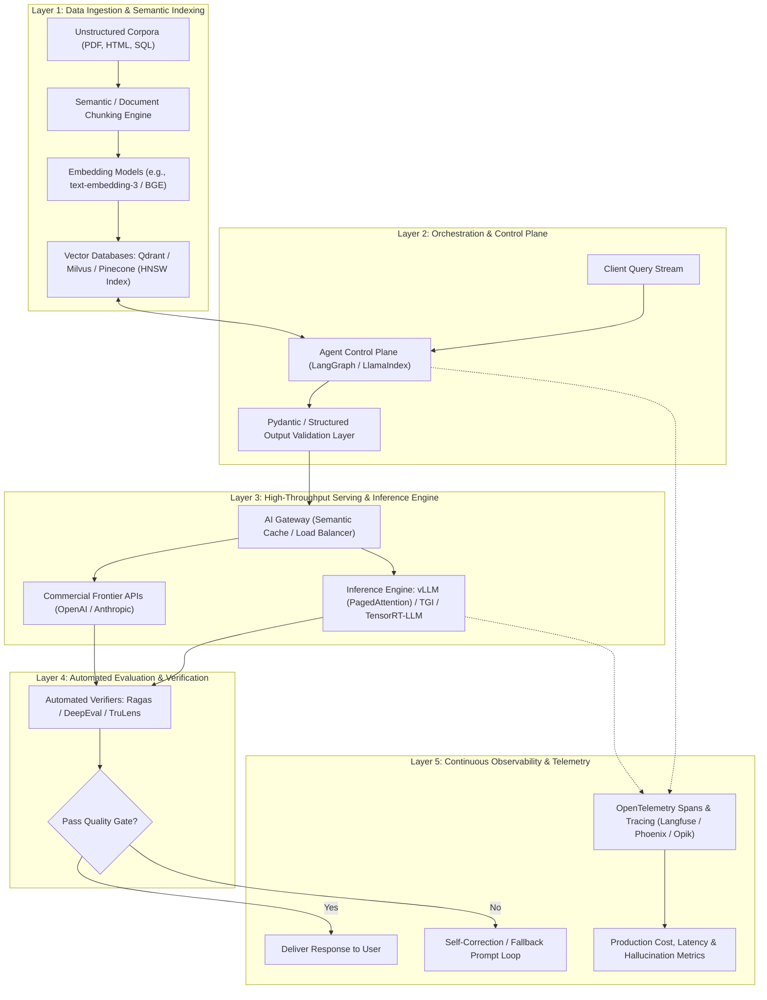
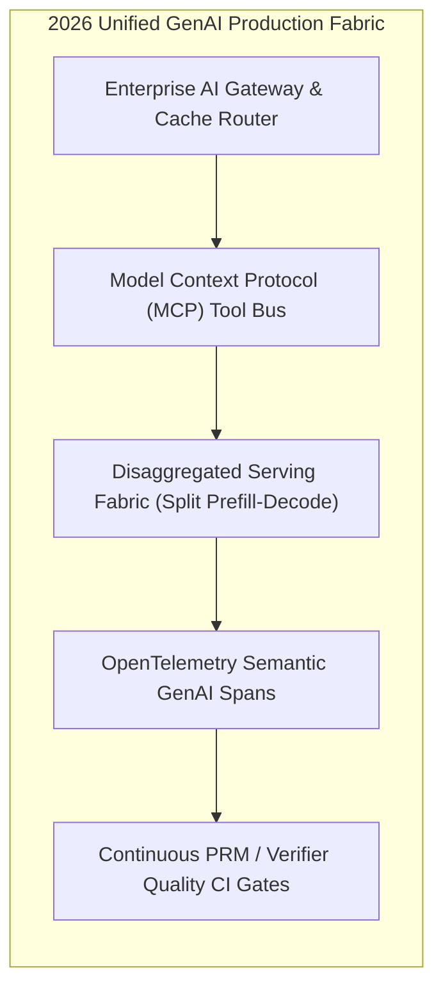

## Why Did Enterprise LLM Applications Require a Five-Layer Decoupled Infrastructure Stack?

During the initial experimental wave of foundation model adoption, building a prototype required little more than an OpenAI API key and twenty lines of Python script. However, when software engineering organizations attempted to graduate these prototypes into enterprise production environments—serving tens of thousands of concurrent users under strict latency, cost, and compliance service-level agreements (SLAs)—naive architectures collapsed.

Production systems encountered systemic challenges:
1. **Unbounded API Latency and Gateway Throttling**: Direct reliance on commercial proprietary endpoints without caching or fallback routing caused cascading failures during provider outages.
2. **Context Degradation and Memory Bloat**: Unchecked prompt concatenations exceeded token context budgets, driving up inference costs while degrading answer quality.
3. **Observability Blind Spots**: When an application produced a hallucinated answer or failed a tool call, developers could not inspect intermediate reasoning steps, token latency breakdowns, or retrieval relevance scores.

By mid-2024, enterprise generative AI engineering converged on a formalized **five-layer decoupled infrastructure stack**. Rather than viewing an LLM application as a monolithic prompt-response loop, production platforms architected modular boundaries between data ingestion, semantic indexing, runtime orchestration, high-throughput serving, and continuous observability.



By enforcing clean separation of concerns across these five layers, engineering teams achieved horizontal scalability, vendor independence, and deterministic error recovery.

---

## Technical Deep-Dive Across the Five Production Layers

A robust production system demands specialized architectural trade-offs within each subsystem:

```
Enterprise Production LLM Infrastructure Matrix:
-------------------------------------------------------------------------------------------------
Layer                 Primary Objective                   Dominant Tools & Frameworks
-------------------------------------------------------------------------------------------------
1. Data & Indexing    Deterministic context extraction    Unstructured, Chonkie, Qdrant, Milvus, pgvector
2. Orchestration      State management, tool routing      LangGraph, LlamaIndex, Pydantic, Semantic Kernel
3. Model Serving      Low-latency, high-concurrency GEMM  vLLM (PagedAttention), SGLang, Hugging Face TGI
4. Evaluation         Continuous quality verification     Ragas, DeepEval, TruLens, AgentEval
5. Observability      Span tracing, token accounting      Langfuse, Arize Phoenix, Opik, OpenTelemetry
-------------------------------------------------------------------------------------------------
```

### Layer 1: Data Ingestion and Semantic Indexing

The foundation of any Retrieval-Augmented Generation (RAG) architecture rests on data preparation. As explored in our source audit of [Vector Embeddings Architecture](/posts/llm-vectorembedding/), simple fixed-size character chunking breaks semantic cohesion.

Production pipelines implement:
- **Recursive Document Chunking**: Slicing along natural grammatical boundaries (paragraphs, code blocks, tables) with overlapping sliding windows.
- **Hierarchical Indexing**: Storing small sentence chunks ($128$ tokens) for dense vector search, while mapping them to parent document chunks ($1,024$ tokens) injected into the LLM prompt.
- **HNSW Graph Tuning**: Balancing vector index construction parameters (`ef_search` and `M`) in vector databases (e.g., Qdrant, Milvus) to guarantee sub-10ms ANN (Approximate Nearest Neighbor) retrieval across millions of vectors.

### Layer 2: Orchestration, State Graphs, and Structured Outputs

As analyzed in our architectural review of [Agentic Orchestration Runtimes](/posts/llm-ai-agent/), string concatenation inside linear prompt templates is insufficient for production. Production applications deploy:
- **Cyclic State Graphs (LangGraph)**: Modeling business logic as finite state machines with durable checkpointing, enabling human-in-the-loop validation and time-travel debugging.
- **Constrained Grammar Decoding**: Enforcing strict Pydantic v2 schemas using context-free grammars (such as Outlines or XGrammar), mathematically guaranteeing that models emit valid JSON matching internal API contracts.

### Layer 3: High-Throughput Serving and AI Gateways

In our technical breakdown of [Inference Bottleneck Mitigation](/posts/llm-mitigate-inference-bottleneck/), autoregressive generation was shown to be strictly memory-bandwidth bound. To serve enterprise workloads efficiently, organizations deploy:
- **PagedAttention Engines (vLLM)**: Slicing the continuous Key-Value (KV) cache into virtual memory pages, eliminating external memory fragmentation.
- **Continuous Batching**: Iteration-level scheduling that inserts and evicts requests dynamically at token boundaries, achieving $4\times$ to $8\times$ higher throughput than static batching.
- **AI Gateways**: Reverse proxies (such as LiteLLM or Cloudflare AI Gateway) that enforce rate limits, handle fallback failover between cloud providers, and maintain semantic caches (storing previous query-response pairs in Redis) to reduce API spend by up to $30\%$.

```python
# Production LLM Request Pipeline with Structured Validation and Observability
from pydantic import BaseModel, Field
import litellm
import time

class FinancialSummary(BaseModel):
    ticker: str = Field(description="Stock ticker symbol")
    revenue_growth_yoy: float = Field(description="Year-over-year revenue growth percentage")
    key_risks: list[str] = Field(description="Primary operational risks identified")

def execute_production_llm_call(prompt: str, user_id: str) -> FinancialSummary:
    """
    Executes resilient foundation model call with tracing and schema enforcement.
    """
    start_time = time.time()
    
    # 1. Dispatch request through Gateway with fallback routing
    response = litellm.completion(
        model="groq/llama-3-70b-8192",
        fallbacks=["openai/gpt-4o", "anthropic/claude-3-5-sonnet-20240620"],
        messages=[{"role": "user", "content": prompt}],
        response_format={"type": "json_object", "schema": FinancialSummary.model_json_schema()},
        metadata={"user_id": user_id, "start_time": start_time}
    )
    
    # 2. Enforce Pydantic validation
    raw_json = response.choices[0].message.content
    validated_output = FinancialSummary.model_validate_json(raw_json)
    
    return validated_output
```

### Layer 4 & 5: Continuous Evaluation and Telemetry

Without continuous measurement, LLM applications silently degrade over time due to prompt drift or underlying foundation model API updates. Connecting to our audit of [Microsoft AgentEval](/posts/llm-agents-eval/):
- **Automated Metric Suites (Ragas)**: Continuously evaluating live production logs across four core dimensions: Faithfulness (absence of hallucination), Answer Relevance, Context Precision, and Context Recall.
- **OpenTelemetry Tracing (Langfuse / Opik)**: Recording distributed spans for every user query, capturing exact token counts, time-to-first-token (TTFT), token-per-second emission speeds, and database query latencies.

---

## How Modern Enterprise LLM Infrastructure Evolved Across 2026

Between 2024 and 2026, the components of the production stack matured from fragmented open-source libraries into unified infrastructure fabrics:

### 1. Standardization via OpenTelemetry GenAI Semantic Conventions
In 2024, every observability tool defined proprietary JSON formats for traces and logs. In 2026, the OpenTelemetry Foundation formalized the **GenAI Semantic Conventions**. Every major foundation model provider, vector database, and orchestration library natively emits standard spans, allowing enterprise security operations centers (SOCs) to monitor LLM traffic within standard Datadog, Grafana, or OpenTelemetry dashboards.

### 2. Disaggregated Prefill-Decode Infrastructure
As serving throughput scaled, hosting prefill and decode phases on identical GPU nodes became economically unviable. Modern 2026 datacenters operate **disaggregated serving clusters**: compute-dense accelerators (B200 / TPU v6) ingest large multi-thousand-token prompts in parallel, transferring KV-cache state across high-speed RDMA networks to memory-bandwidth-optimized decode clusters for token streaming.



### 3. Native Model Context Protocol (MCP) Integration
In early 2024, connecting an LLM to internal company databases required writing custom LangChain tools or API wrappers. In 2026, the **Model Context Protocol (MCP)** unified data and tool integration. Enterprise databases, document stores, and code repositories expose standardized MCP endpoints, allowing agents to query live corporate systems with built-in access control and cryptographic authentication.

---

## Key Takeaways

- **Production requires a decoupled five-layer architecture**: Data ingestion, orchestration, high-throughput serving, evaluation, and observability must operate with modular boundaries.
- **Continuous batching and PagedAttention are essential**: Foundation model hosting demands virtual memory paging to eliminate fragmentation and maximize concurrency.
- **Pydantic schema binding prevents downstream failures**: Constrained grammar decoding ensures that probabilistic model outputs adhere strictly to typed API contracts.
- **Automated evaluators replace manual spot-checking**: Metric frameworks like Ragas and AgentEval quantify faithfulness and context relevance in CI/CD and production streams.
- **2026 infrastructure centers on OpenTelemetry and MCP**: Standardized telemetry conventions and protocol-driven tool calling establish enterprise reliability.

---

## New Questions

1. How do semantic caching layers handle cache invalidation when underlying enterprise database records update dynamically in real time?
2. What are the network bandwidth bottlenecks of transferring multi-gigabyte KV caches across RDMA fabrics in distributed prefill-decode architectures?
3. To what extent do automated LLM-as-a-judge evaluation frameworks introduce systematic blind spots when validating domain-specific mathematical proofs?

---

## References

- Narwani, A., & Generative AI Community. (2024). *Applied LLMs Mastery: Tools and Frameworks for Building Generative AI Applications*. Open Source Curriculum. Available at: <https://github.com/aishwaryanr/awesome-generative-ai-guide> (accessed 2026-10-18).
- Chase, H., & LangChain Team. (2023). *Architecting Production-Ready Large Language Model Applications*. Technical Documentation. Available at: <https://www.langchain.com/blog> (accessed 2026-10-18).
- Kwon, W., Li, Z., Zhuang, S., Sheng, Y., Zheng, L., Yu, C. H., Gonzalez, J. E., Zhang, H., & Stoica, I. (2023). *Efficient Memory Management for Large Language Model Serving with PagedAttention*. In Proceedings of the 29th ACM Symposium on Operating Systems Principles (SOSP '23), 611-626. Available at: <https://arxiv.org/abs/2309.06180> (accessed 2026-10-18).
- Es, S., James, J., Espinosa-Anke, L., & Schockaert, S. (2023). *RAGAS: Automated Evaluation of Retrieval Augmented Generation*. arXiv preprint arXiv:2309.15217. Available at: <https://arxiv.org/abs/2309.15217> (accessed 2026-10-18).
