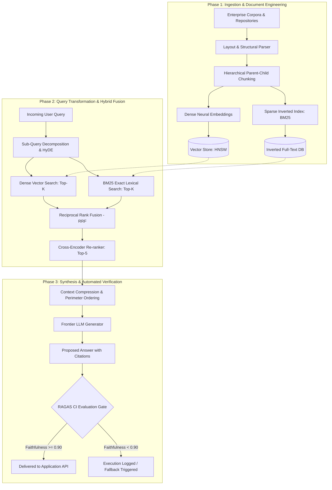

{: .light .w-75 .shadow .rounded-10 }

## What Separates a Hackathon RAG Demo from Production Information Retrieval?

In modern software engineering, assembling a basic prototype of Retrieval-Augmented Generation (RAG) requires scarcely fifty lines of Python. Frameworks such as LangChain and LlamaIndex make it trivial to ingest a PDF directory, split text into arbitrary 500-token chunks, compute dense embeddings via an OpenAI or Hugging Face endpoint, store the resulting vectors in Chroma or FAISS, and feed the top-3 nearest neighbors into a conversational prompt. In controlled demonstrations with uniform text and straightforward queries, this setup creates the illusion of a solved problem.

However, transitioning a RAG pipeline from a quick weekend prototype into an enterprise-grade production service exposes massive operational fragility. In production environments, systems must ingest messy, heterogeneous data sources—multi-column PDF tables, legal contracts with cross-referencing clauses, temporal documentation, and proprietary code repositories. Furthermore, user inquiries are rarely phrased as neat, keyword-rich matches; users submit ambiguous, multi-part, or under-specified questions.

Under real-world conditions, naive vector similarity search experiences high failure rates:
- **Semantic Drift and Dilution:** Relevant facts are fragmented across arbitrary chunk boundaries, stripping away essential surrounding qualifiers.
- **Out-of-Vocabulary Blind Spots:** Dense bi-encoders struggle with exact alphanumeric matches, including product SKUs, UUIDs, function signatures, and error codes.
- **Hallucinated Grounding:** Language models incorporate ungrounded assumptions or synthesize hallucinations when the retrieved context lacks sufficient evidence.

Engineering a resilient RAG system requires shifting from prompt-based heuristics to disciplined systems engineering. This source audit deconstructs the multi-phase delivery roadmap necessary to construct, optimize, and evaluate enterprise-grade RAG systems, spanning ingestion geometry, hybrid index fusion, cross-encoder re-ranking, and automated Continuous Integration (CI) evaluation harnesses.



---

## Phase 1: Ingestion Topologies and Document Engineering

The success of any retrieval pipeline is fundamentally constrained by its ingestion architecture. In naive systems, document processing is treated as an afterthought: raw text is sliced using fixed character or token counts with a static overlap (e.g., 500 tokens with a 50-token overlap).

Production document engineering requires parsing document **geometry and structure**:

### 1. Layout-Aware and Syntax-Aware Extraction
- **Tabular Data Preservation:** Financial reports and technical specifications embed core insights in tables. Flat text windowing converts table rows into disjointed strings, destroying row-column associations. Production ingestion parses tables into structured JSON or Markdown grids, preserving column headers as metadata prefixes for each cell value.
- **AST-Aware Code Splitting:** When indexing source code, fixed character chunking splits class definitions across functions. Utilizing tree-sitter parsers allows chunks to correspond to complete Abstract Syntax Tree (AST) functional units, ensuring variable declarations remain coupled to execution logic.

### 2. Hierarchical Parent-Child Document Indexing
To resolve the fundamental conflict between retrieval precision and generative context:
- **Child Chunks (100–200 tokens):** Micro-chunks optimize dense vector search. Because the text is tightly bounded around an atomic concept, its embedding vector is sharp and unpolluted by adjacent topics.
- **Parent Chunks (800–1,500 tokens):** Stored in a document database linked via metadata foreign keys. When a child chunk achieves a high similarity score, the system retrieves its enclosing parent section to populate the LLM's context window. The generator receives full narrative context without clipping critical caveats or definitions.

---

## Phase 2: Advanced Hybrid Retrieval, Dynamic Routing, and Re-Ranking

Relying on a single Approximate Nearest Neighbor (ANN) vector search guarantees failure on domain-specific corpora. Production architectures implement a multi-stage retrieval and refinement pipeline:

### 1. Hybrid Index Fusion via Reciprocal Rank Fusion (RRF)
Vector embeddings capture semantic concepts, while sparse lexical search (BM25 or SPLADE) captures exact keyword hits. Production systems query both indices concurrently and interleave candidates using Reciprocal Rank Fusion:

$$
\text{RRF\_Score}(d \in D) = \sum_{m \in M} \frac{1}{k + r_m(d)}
$$

Where $r_m(d)$ is the rank of document $d$ in retriever $m$, and $k$ is a constant factor (typically $k=60$). RRF normalizes disparate score distributions without brittle manual weight tuning, ensuring that an exact SKU match from BM25 and a semantic match from dense search are both elevated to the re-ranking candidate pool.

### 2. Cross-Encoder Re-Ranking
Bi-encoders independently compute query and passage vectors ($\mathbf{q}$ and $\mathbf{d}$), mapping them into a shared latent space via dot products to enable sub-millisecond search over millions of records. However, bi-encoders sacrifice token-to-token cross-attention.

To restore precision, the top-50 hybrid candidates are passed through a **Cross-Encoder Re-ranker** (e.g., BGE-Reranker-Large or Cohere Rerank):

```
Bi-Encoder Search:     Cosine( E_Q(query), E_D(document) )
Cross-Encoder Score:   BERT( [CLS] query [SEP] document [EOS] )
```

Cross-encoders evaluate full multi-head attention across all combined query and document tokens, discarding superficially similar false positives and pruning the context down to the top-5 highest-density passages.

### 3. Context Optimization and Perimeter Placement
Frontier language models exhibit the "lost-in-the-middle" attention phenomenon: attention weights are highest at the beginning and end of long prompts, while tokens in the middle suffer degraded recall. Production context formatters sort retrieved passages so that the highest-ranked evidence sits at the absolute start and end of the context block, placing lower-confidence passages in the interior.

---

## Phase 3: Continuous Evaluation, Groundedness Gates, and Regression Testing

A RAG architecture cannot be safely maintained without automated evaluation harnesses. Adjusting a chunking parameter, updating an embedding model, or modifying a system prompt will inadvertently cause silent performance regressions unless guarded by rigorous testing.

Production teams enforce the **RAG Triad** of automated metrics:

| Metric Name | Evaluation Scope | Mathematical Target | Failure Root Cause |
|:---|:---|:---|:---|
| **Context Relevance** | Evaluates retrieved passages against the user query. | $\frac{|\text{Relevant Sentences in Context}|}{|\text{Total Sentences in Context}|} \ge 0.85$ | Ingestion noise, poor chunking boundaries, un-tuned re-rankers. |
| **Faithfulness / Groundedness** | Evaluates generated answer claims against retrieved passages. | $\frac{|\text{Verifiable Claims in Answer}|}{|\text{Total Claims Asserted}|} \ge 0.95$ | Generator hallucination, excessive model temperature, missing context evidence. |
| **Answer Relevance** | Evaluates final answer completeness against the original query. | Semantic cosine similarity between question and generated answer $\ge 0.90$ | Prompt evasion, over-cautious refusal filters, context fragmentation. |

By executing these evaluations programmatically via frameworks like RAGAS in CI/CD pipelines, engineering teams establish automated quality gates: pull requests that degrade faithfulness or context precision are automatically blocked from merging.

---

## How Production RAG Architecture Evolved Across 2026

The trajectory of retrieval-augmented systems across 2026 transformed RAG from an ad-hoc augmentation pattern into an integrated, dual-memory systems discipline:

1. **The Rise of Graph RAG:** Vector proximity alone cannot resolve multi-hop, cross-document relationship reasoning. As demonstrated in our source audits of [EdgeQuake: High-Performance Graph RAG in Rust](/posts/edgequake-graph-rag-rust/) and [GNN-RAG: Bridging Graph Neural Reasoning and Large Language Model Synthesis](/posts/gnn-rag-paper/), modern production architectures integrate knowledge graph traversal (subgraph extraction, shortest reasoning paths) directly with vector search.
2. **From Heuristics to Formal Information Retrieval:** As traced in [Retrieval-Augmented Generation: Architectural Foundations and Production Evolution](/posts/rag-guid/), RAG graduated from experimental scripts into formal distributed retrieval systems incorporating bi-encoders, BM25 indices, and cross-encoder re-ranking.
3. **Deterministic Evidence Contracts in Multi-Agent Loops:** Modern autonomous agent harnesses—such as the execution policies analyzed in [RLM-FORGE: Architecting Evidence-Gated Recursion in Multi-Agent Loops](/posts/rlm-forge-evidence-gated-recursion/)—enforce strict evidence-gating contracts (TraceGuard) that halt state mutations if an agent introduces claims lacking explicit fact tokens.
4. **Automated Systematic Workflows:** As synthesized in [Building Systematic RAG Workflows: Beyond the Naive Vector Search Pattern](/posts/rag-systematic-workflow/), production teams now treat ingestion, routing, hybrid search, and evaluation as an instrumented, closed-loop engineering harness.

---

## Key Takeaways

- **Document Geometry Dictates Retrieval Limits:** Flat character chunking fragments semantic context; layout-aware extraction and hierarchical parent-child indexing preserve both search precision and synthesis completeness.
- **Hybrid Index Fusion Is Mandatory:** Pairing dense vector embeddings with sparse lexical inverted indices (BM25) via Reciprocal Rank Fusion ensures high recall across conceptual semantics and exact alphanumeric identifiers.
- **Cross-Encoders Eliminate False Positives:** Re-ranking the top-50 hybrid candidates through a cross-attention encoder filters out irrelevant passages before prompt assembly, drastically improving generative precision.
- **Perimeter Context Placement Mitigates Attention Decay:** Ordering retrieved context so that the most critical evidence sits at the beginning and end of the context window counters the "lost-in-the-middle" attention drop.
- **Continuous CI Metric Gating Prevents Regression:** Automated tracking of Context Relevance, Faithfulness, and Answer Relevance (the RAG Triad) in CI/CD pipelines ensures that pipeline updates do not introduce silent hallucinations.

---

## New Questions

1. **Context Window Expansion vs. Retrieval Latency:** With frontier models supporting million-token context windows, what is the exact economic and latency tipping point where multi-stage RAG outperforms full-context prompting?
2. **Incremental Index Freshness in Streaming Pipelines:** How can production vector and graph indices maintain real-time sub-second freshness under high-volume streaming document updates without triggering full index rebuilds?
3. **Dynamic Re-Ranking Optimization on Edge Hardware:** How can cross-encoder re-ranking be quantized and accelerated to run locally on client workstations without introducing excessive CPU thermal throttling?

---

## References

- [Es et al.: RAGAS - Automated Evaluation of Retrieval Augmented Generation (EACL 2024 / arXiv:2309.15217)](https://arxiv.org/abs/2309.15217) (accessed 2026-10-18)
- [Gao et al.: Retrieval-Augmented Generation for Large Language Models - A Survey (arXiv:2312.10997)](https://arxiv.org/abs/2312.10997) (accessed 2026-10-18)
- [Lewis et al.: Retrieval-Augmented Generation for Knowledge-Intensive NLP Tasks (NeurIPS 2020 / arXiv:2005.11401)](https://arxiv.org/abs/2005.11401) (accessed 2026-10-18)
- [Liu et al.: Lost in the Middle - How Language Models Use Long Contexts (TACL 2024 / arXiv:2307.03172)](https://arxiv.org/abs/2307.03172) (accessed 2026-10-18)
- [Cormack, Clarke & Buettcher: Reciprocal Rank Fusion Outperforms Condorcet and Individual Rank Learning Methods (SIGIR 2009)](https://dl.acm.org/doi/10.1145/1571941.1572114) (accessed 2026-10-18)
