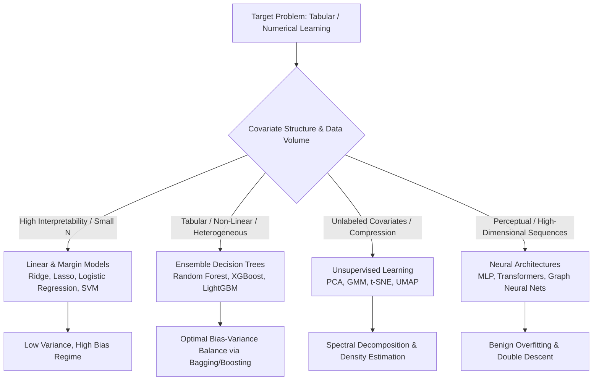
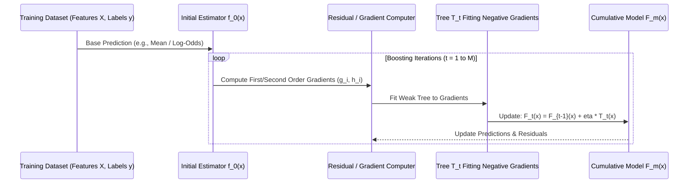

## How Does the Bias-Variance Decomposition Dictate Algorithmic Selection?

Supervised statistical learning centers on estimating an unknown target function $f(\mathbf{x})$ that maps input covariates $\mathbf{x} \in \mathbb{R}^d$ to responses $y \in \mathcal{Y}$, subject to additive irreducible noise $\epsilon \sim \mathcal{N}(0, \sigma^2)$:

$$y = f(\mathbf{x}) + \epsilon$$

When an estimator $\hat{f}(\mathbf{x})$ is trained on a finite realization of training data $\mathcal{D}$, its expected generalization error on unseen test samples decomposes into three distinct terms:

$$\mathbb{E}_{\mathcal{D}, \epsilon}\left[ (y - \hat{f}(\mathbf{x}))^2 \right] = \underbrace{\left( f(\mathbf{x}) - \mathbb{E}_{\mathcal{D}}[\hat{f}(\mathbf{x})] \right)^2}_{\text{Bias}^2} + \underbrace{\mathbb{E}_{\mathcal{D}}\left[ \left( \hat{f}(\mathbf{x}) - \mathbb{E}_{\mathcal{D}}[\hat{f}(\mathbf{x})] \right)^2 \right]}_{\text{Variance}} + \underbrace{\sigma^2}_{\text{Irreducible Error}}$$

Every machine learning model—from elementary regularized regression to gradient boosted decision trees and deep transformers—navigates this fundamental tension. High-bias algorithms enforce strong structural assumptions (e.g., linearity), preventing overfitting on small sample sizes at the expense of under-representing complex nonlinear interactions. Conversely, high-variance algorithms possess high representational capacity but risk fitting idiosyncratic training noise unless constrained by regularization or ensemble averaging.

---

## Core Mathematical Families of Statistical Machine Learning

To make principled architectural selections, machine learning engineers must evaluate algorithms across their governing loss surfaces, optimization procedures, and inductive biases:

### 1. Convex Linear and Margin Formulations

- **Ordinary Least Squares (OLS) & Ridge Regression**: Under the Gauss-Markov theorem, OLS provides the Best Linear Unbiased Estimator (BLUE). To stabilize matrix inversion when feature covariance matrices $\mathbf{X}^T \mathbf{X}$ are ill-conditioned, Ridge regression ($L_2$ regularization) adds an isotropic penalty:
  $$\hat{\mathbf{w}}_{\text{ridge}} = (\mathbf{X}^T \mathbf{X} + \lambda \mathbf{I})^{-1} \mathbf{X}^T \mathbf{y}$$
  This injects small parameter bias while dramatically shrinking estimator variance.
- **Support Vector Machines (SVM)**: SVMs identify the unique maximal margin hyperplane separating binary classes. In dual form, the optimization maximizes:
  $$\max_{\boldsymbol{\alpha}} \sum_{i=1}^n \alpha_i - \frac{1}{2} \sum_{i,j=1}^n \alpha_i \alpha_j y_i y_j K(\mathbf{x}_i, \mathbf{x}_j) \quad \text{s.t.} \quad 0 \le \alpha_i \le C, \; \sum_{i=1}^n \alpha_i y_i = 0$$
  Via Mercer's theorem, nonlinear kernels $K(\mathbf{x}_i, \mathbf{x}_j) = \exp(-\gamma \|\mathbf{x}_i - \mathbf{x}_j\|^2)$ project inputs into infinite-dimensional Hilbert spaces without computing explicit coordinate transformations.

### 2. Decision Trees and Ensemble Mechanisms

- **Classification and Regression Trees (CART)**: Greedy binary partitioners split nodes by maximizing purity gains. For classification, splits minimize Gini impurity:
  $$I_G(p) = 1 - \sum_{k=1}^K p_k^2$$
  Unpruned trees have near-zero bias on training sets but catastrophic variance.
- **Random Forests (Bagging)**: Breiman demonstrated that averaging $B$ randomized, de-correlated decision trees reduces ensemble variance without inflating individual tree bias. The variance of an average of $B$ identical estimators with pairwise correlation $\rho$ is:
  $$\mathrm{Var}\left( \frac{1}{B} \sum_{b=1}^B T_b(\mathbf{x}) \right) = \rho \sigma^2 + \frac{1 - \rho}{B} \sigma^2$$
  As $B \to \infty$, the second term vanishes, leaving the irreducible ensemble variance bounded entirely by tree correlation $\rho$, which random feature subsampling ($m = \sqrt{d}$) actively suppresses.
- **Gradient Boosted Decision Trees (GBDT)**: Rather than building trees independently, boosting trains trees sequentially to fit the pseudo-residuals of the existing ensemble. In XGBoost, the objective at step $t$ uses a second-order Taylor expansion:
  $$\mathcal{L}^{(t)} \approx \sum_{i=1}^n \left[ g_i f_t(\mathbf{x}_i) + \frac{1}{2} h_i f_t^2(\mathbf{x}_i) \right] + \gamma T + \frac{1}{2} \lambda \sum_{j=1}^T w_j^2$$
  where $g_i = \partial_{\hat{y}^{(t-1)}} \ell(y_i, \hat{y}^{(t-1)})$ and $h_i = \partial_{\hat{y}^{(t-1)}}^2 \ell(y_i, \hat{y}^{(t-1)})$, enabling exact analytical leaf weight updates.

---

## Comparative Architectural Matrix

The following matrix contrasts operational boundaries across classical machine learning architectures:

| Algorithm Family | Training Complexity | Inference Latency | Handling of Missing Data | Inductive Bias |
| :--- | :--- | :--- | :--- | :--- |
| **Ridge / Lasso** | $O(d^3 + n d^2)$ | $O(d)$ | Poor (Requires Imputation) | Linear additive relationships |
| **Support Vector Machines** | $O(n^2 \text{ to } n^3)$ | $O(n_{\text{support}} \cdot d)$ | Poor (Sensitive to scale) | Maximal margin separation |
| **Random Forest** | $O(B \cdot n \log n \cdot \sqrt{d})$ | $O(B \cdot \text{depth})$ | High (Surrogate splits) | Hierarchical orthogonal bounds |
| **XGBoost / LightGBM** | $O(M \cdot n \cdot d)$ | $O(M \cdot \text{depth})$ | Native optimal default routing | Additive functional gradient trees |
| **Deep Neural Networks** | $O(E \cdot n \cdot W)$ | $O(W)$ | Poor (Requires normalized tensor) | Smoothness, compositionality |

---

## Production Data Quality and Distributed Learning Integration

Deploying classical machine learning models at enterprise scale requires rigorous data contracts and distributed training paradigms. As established in our research on [data quality assurance in machine learning](/posts/ensuring-data-quality-in-machine-learning/), tabular models are highly vulnerable to covariate shift, label noise, and schema drift. When datasets cross jurisdictional boundaries, federated architectures allow models like logistic regression and XGBoost to train across decentralized nodes without centralizing raw records, as explored in [federated learning systems](/posts/federated-learning-bringing-the-data/) and [generative AI taxonomy](/posts/generativeai-term/).

---

## 2026 Technological Evolution: Tabular Foundation Models and In-Context Learning

In 2026 production systems, the historical distinction between tabular tree algorithms and deep neural networks has transformed through tabular foundation models:

1. **Prior-Data Fitted Networks (TabPFN)**: Rather than training weights on tabular datasets via iterative gradient descent, models like TabPFN execute full Bayesian inference in a single forward pass. Pretrained entirely on synthetic datasets generated from causal structural equation priors, TabPFN achieves competitive accuracy with tuned LightGBM on small-to-medium tables ($N < 10,000$) within milliseconds.
2. **GPU-Native Tabular Pipelines (NVIDIA RAPIDS cuML/cuDF)**: Classical tree algorithms execute natively on GPU tensor cores, streaming data through NVLink interconnects. GPU-accelerated gradient boosting reaches $50\times$ speedups over multi-core CPU implementations on multi-gigabyte datasets.
3. **Hybrid Tree-Embedding Architectures**: Production enterprise recommendation systems pair dense text/graph transformer embeddings with downstream gradient boosted trees, preserving categorical feature interpretability alongside deep contextual reasoning.

---

## Key Takeaways

- **Bias-Variance Governs Generalization**: Model selection is governed by the bias-variance trade-off; bagging lowers variance via decorrelation, whereas boosting lowers bias via residual fitting.
- **Tree Ensembles Dominate Tabular Data**: For structured, heterogeneous tabular data, GBDT architectures (XGBoost, LightGBM) consistently outperform standard deep networks on accuracy and inference cost.
- **Kernel Methods Provide Non-Linear Guarantees**: SVMs convexify nonlinear boundary estimation through the kernel trick, ensuring global optimality at the cost of quadratic training scaling.
- **Tabular Foundation Models Shift Inference**: Architectures like TabPFN bring in-context meta-learning to structured tables, enabling instantaneous zero-shot predictions without hyperparameter tuning.

---

## New Questions

- **Can Tabular Transformers Completely Supplant Gradient Boosted Trees at Scale?**: Will architectures specifically designed for tabular data overcome the inductive biases of tree splits when sample counts exceed $10^8$ rows?
- **How Will Differential Privacy Constraints Alter Dual-Kernel Formulations?**: As privacy regulations mandate strict epsilon guarantees, can kernel SVMs preserve convex boundaries without severe utility loss?

---

## References

- Breiman, L. (2001). Random Forests. *Machine Learning*, 45(1), 5-32. [https://link.springer.com/article/10.1023/A:1010933404324](https://link.springer.com/article/10.1023/A:1010933404324) (accessed 2026-10-18)
- Chen, T., & Guestrin, C. (2016). XGBoost: A Scalable Tree Boosting System. *ACM SIGKDD International Conference on Knowledge Discovery and Data Mining (KDD 2016)*, 785-794. [https://arxiv.org/abs/1603.02754](https://arxiv.org/abs/1603.02754) (accessed 2026-10-18)
- Hollmann, N., Müller, S., Eggensperger, K., & Hutter, F. (2023). TabPFN: A Transformer That Solves Small Tabular Classification Problems in a Second. *International Conference on Learning Representations (ICLR 2023)*. [https://arxiv.org/abs/2207.01848](https://arxiv.org/abs/2207.01848) (accessed 2026-10-18)
- Hastie, T., Tibshirani, R., & Friedman, J. (2009). The Elements of Statistical Learning: Data Mining, Inference, and Prediction. *Springer Science & Business Media*. [https://hastie.su.domains/ElemStatLearn/](https://hastie.su.domains/ElemStatLearn/) (accessed 2026-10-18)
