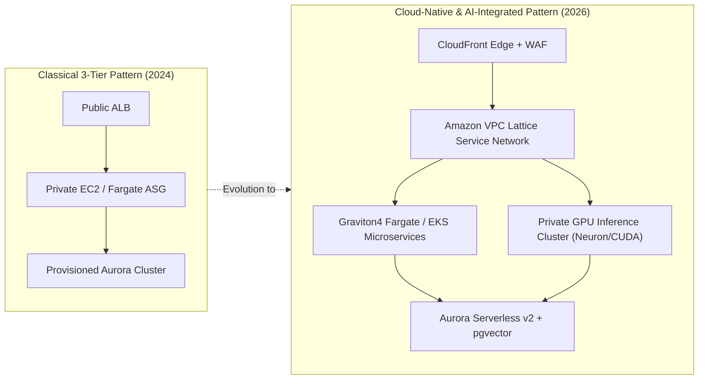

## Why Does Multi-Tier Segmentation Dictate Cloud System Resilience?

In modern cloud systems engineering, the classic three-tier architecture—comprising a public presentation tier, an internal application logic tier, and a private data tier—remains the baseline foundation for fault-tolerant enterprise software. While modern microservices and serverless paradigms have altered compute deployment models, the foundational discipline of segmenting network boundaries, isolating blast radiuses, and separating compute lifecycles from persistent storage state remains essential for running reliable workloads at scale.

Deploying monolithic software into unpartitioned subnets exposes systems to severe availability and security risks. A vulnerability in the public web presentation layer can directly expose database connection strings or root network credentials. Similarly, an unconstrained surge in client request traffic can monopolize compute cycles and exhaust database connection pools, bringing down the entire operational footprint. 

By enforcing rigorous physical and logical boundaries across Availability Zones (AZs), engineering organizations decouple system responsibilities:

1. **Blast Radius Minimization**: Network failures, compute crashes, or application runtime panics in the web ingress layer are quarantined before propagating to backend state stores.
2. **Independent Elastic Scaling**: Stateless presentation components and memory-heavy application compute scale along independent metrics—such as request count per target or CPU utilization—without resizing the persistent database tier.
3. **Defense-in-Depth Security**: Database clusters reside in isolated subnets with zero direct route to the public internet, accessible only through chained security groups that authorize explicit microservice identities.

Modern cloud backends, including scalable machine learning inference endpoints and agent coordination services detailed in our [AWS infrastructure optimizations](/posts/huggingface-aws/) and [enterprise LLM production pipelines](/posts/llm-build-tools-cookbook/), rely heavily on this segmented network pattern to isolate persistent data models from internet-facing gateways.

```mermaid
flowchart TD
    subgraph InternetZone ["Public Internet"]
        Client["Client Traffic (HTTPS)"]
    end

    subgraph AWSCloud ["AWS Cloud / Custom VPC (10.0.0.0/16)"]
        subgraph PublicSubnets ["Public Subnet Tier (Multi-AZ)"]
            ALB["Application Load Balancer (ALB)"]
            NAT["NAT Gateways (AZ-a / AZ-b)"]
        end

        subgraph PrivateAppSubnets ["Private Application Tier (Multi-AZ)"]
            App1["ECS Fargate / EC2 Instance (AZ-a)"]
            App2["ECS Fargate / EC2 Instance (AZ-b)"]
        end

        subgraph IsolatedDBSubnets ["Isolated Database Tier (Multi-AZ)"]
            AuroraPrimary["Amazon Aurora Writer (AZ-a)"]
            AuroraReplica["Amazon Aurora Reader (AZ-b)"]
            SharedStorage[("Distributed Aurora Storage<br/>6-Way Replicated across 3 AZs")]
        end
    end

    Client -->|Port 443| ALB
    ALB -->|Port 8080 (Security Group Chained)| App1
    ALB -->|Port 8080 (Security Group Chained)| App2
    App1 -->|Port 5432| AuroraPrimary
    App2 -->|Port 5432| AuroraReplica
    App1 -.->|Outbound Egress| NAT
    App2 -.->|Outbound Egress| NAT
    AuroraPrimary -.-> SharedStorage
    AuroraReplica -.-> SharedStorage
```

---

## Network Isolation and Least-Privilege Security Group Topology

The core integrity of a resilient AWS architecture depends on strict Virtual Private Cloud (VPC) subnet topology. An optimal enterprise VPC allocation uses a `/16` IPv4 CIDR block (providing 65,536 private IP addresses) partitioned across at least two—and ideally three—Availability Zones. Within each zone, subnets are segregated into three distinct operational tiers:

### 1. Public Ingress Subnets
- **Route Table Association**: Directly mapped to an Internet Gateway (`igw-id`).
- **Hosted Resources**: Public-facing Application Load Balancers (ALBs) and redundant NAT Gateways. Compute application instances must never be placed inside public subnets.
- **Security Posture**: Ingress is restricted to TCP port 443 from `0.0.0.0/0`, with automated AWS WAF rules mitigating DDoS and application-layer exploits.

### 2. Private Application Subnets
- **Route Table Association**: Outbound routes point strictly to the NAT Gateway located within the same Availability Zone (preventing cross-AZ data transfer fees during standard egress), with zero inbound route from the Internet Gateway.
- **Hosted Resources**: ECS Fargate container tasks or EC2 Auto Scaling Groups executing application business logic.
- **Security Posture**: Ingress traffic is governed by security groups referencing the ALB's security group identifier rather than broad IP ranges.

### 3. Isolated Database Subnets
- **Route Table Association**: Zero internet routing—no Internet Gateway and no NAT Gateway associations. Communication is confined entirely within the local VPC.
- **Hosted Resources**: Amazon Aurora database clusters, Amazon ElastiCache instances, and private storage endpoints.
- **Security Posture**: Inbound connections are restricted strictly to port 5432 (PostgreSQL) or 3306 (MySQL) originating from the Application Tier security group.

```
+----------------------------------------------------------------------------------------------------+
|                                    Least-Privilege Security Chain                                  |
+----------------------------------------------------------------------------------------------------+
| Tier                 | Security Group ID | Inbound Rule                  | Outbound Rule           |
+----------------------+-------------------+-------------------------------+-------------------------+
| Public ALB           | sg-web-alb        | TCP 443 from 0.0.0.0/0        | TCP 8080 to sg-app-tier |
| Private Application  | sg-app-tier       | TCP 8080 from sg-web-alb      | TCP 5432 to sg-db-tier  |
|                      |                   |                               | HTTPS 443 to NAT GW     |
| Isolated Database    | sg-db-tier        | TCP 5432 from sg-app-tier     | Deny All                |
+----------------------------------------------------------------------------------------------------+
```

Chaining security groups by source ID rather than CIDR blocks provides dynamic security: when Auto Scaling instances are spun up or replaced during rolling deployments, they inherit the designated security group policy immediately without requiring manual IP whitelisting or subnet reconfiguration.

---

## Compute Orchestration, Health Checking, and Resilient Failover Mechanics

Building high availability requires continuous automated validation of compute health and self-healing infrastructure primitives:

### Application Load Balancer Health Verification
The public ALB serves as the first line of operational resilience. Target groups must be configured with precise HTTP health checks that probe dedicated `/healthz` or `/readyz` endpoints:
- **Interval and Thresholds**: 10-second intervals with a healthy threshold of 2 consecutive successes and an unhealthy threshold of 3 consecutive failures ensure failing container tasks are deregistered within 30 seconds.
- **Connection Draining (Deregistration Delay)**: When terminating an instance or replacing a container during rolling blue-green deployments, a 30-to-60 second deregistration delay allows active inflight transactions to terminate cleanly while halting new connection routing.

### Stateless Compute Elasticity
Application logic hosted on AWS ECS Fargate or EC2 Auto Scaling Groups (ASG) should adhere strictly to the twelve-factor methodology:
- Compute nodes must maintain zero local state; session state is offloaded to managed Redis (Amazon ElastiCache) clusters or signed client tokens.
- Task placement strategies must enforce `spread` across `attribute:ecs.availability-zone` to guarantee equal capacity distribution across all designated AZs.
- Graceful termination handlers capture `SIGTERM` signals emitted by the container runtime, completing active I/O cycles and closing database connection pools before the subsequent `SIGKILL` executes.

### Storage Decoupling and Aurora Multi-AZ Failover
Traditional relational database replication suffered from replication lag, single-point-of-failure write masters, and prolonged failover periods often exceeding several minutes. Amazon Aurora overcomes this by disaggregating database compute from the underlying storage layer:
- **Quorum Storage Architecture**: Aurora replicates write operations across six storage nodes distributed across three separate Availability Zones. A write is acknowledged as durable as soon as 4 of the 6 nodes complete disk write, eliminating the performance penalty of slow disk I/O in any single zone.
- **Automated CNAME Failover**: When the primary writer instance experiences a hardware crash or network partition, Aurora promotes an existing read replica in an alternate AZ to primary writer status. The cluster endpoint DNS CNAME automatically updates within 30 seconds, restoring complete write availability without requiring application reconfiguration or manual administrator intervention.

---

## How 3-Tier Cloud Architectures Evolved Across 2026

Over recent engineering cycles, the traditional 3-tier topology has undergone substantial architectural modernization driven by high-density container platforms, specialized AI microservices, and managed serverless networking:



1. **VPC Lattice Replacing Complex Ingress Chains**: Historically, routing traffic securely between presentation containers and backend internal microservices required cascading internal Application Load Balancers, complex VPC peering meshes, and private DNS zones. In 2026, **Amazon VPC Lattice** provides a consistent application-layer service network that automates service discovery, traffic shaping, and granular authentication via AWS IAM and Cedar policy frameworks directly at the VPC boundary.
2. **Dynamic Elasticity via Aurora Serverless v2**: Rigidly provisioned database instances have largely been replaced by Aurora Serverless v2, which scales capacity in fine-grained increments of fractional Aurora Capacity Units (ACUs) in fractions of a second. This enables organizations to absorb massive database write bursts without paying for idle capacity during troughs.
3. **Hardware Efficiency via Graviton4**: Transitioning application logic tiers from legacy x86 architectures to AWS Graviton4 (Neoverse V2 core) compute instances provides up to 30% higher compute performance and 20% lower carbon footprint, drastically reducing the baseline run rate of multi-AZ deployments.
4. **Co-locating Vector Search and Transactional State**: Rather than maintaining separate vector database infrastructure alongside transactional databases, modern 3-tier patterns leverage Aurora PostgreSQL with optimized `pgvector` extensions and HNSW indexing, collapsing data tier complexity for retrieval-augmented generation architectures.

---

## Key Takeaways

- **Strict Multi-AZ Network Isolation**: Implement dedicated public, private application, and isolated database subnets across at least two Availability Zones, with compute instances quarantined strictly in private subnets.
- **Security Group Chaining**: Eliminate broad IP or CIDR whitelisting between application tiers by referencing parent security group identifiers, establishing dynamic zero-trust boundaries.
- **Decoupled Compute and Storage**: Offload compute state to stateless container pools while relying on distributed storage backends like Amazon Aurora with 6-way Multi-AZ storage replication.
- **Modernized Service Meshes**: Adopt managed primitives like VPC Lattice and Aurora Serverless v2 to minimize operational friction while supporting bursty, hybrid AI-native microservices.

---

## New Questions

- How do zero-trust service meshes like VPC Lattice compare against ambient Istio architectures when balancing inter-AZ data egress charges against latency overheads?
- What are the operational trade-offs of embedding hybrid vector search inside transactional Aurora storage versus routing similarity queries to dedicated vector engines?
- How should multi-region active-active database replication topologies evolve to satisfy sub-second recovery time objectives (RTO) without incurring split-brain consistency hazards?

---

## References

- Amazon Web Services. *AWS Well-Architected Framework: Reliability Pillar Whitepaper*. AWS Documentation, 2024. [https://docs.aws.amazon.com/wellarchitected/latest/reliability-pillar/](https://docs.aws.amazon.com/wellarchitected/latest/reliability-pillar/) (accessed 2026-10-18).
- Amazon Web Services. *Amazon Aurora Under the Hood: Disaggregating Compute and Storage in Multi-AZ Deployments*. AWS Architecture Center, 2024. [https://docs.aws.amazon.com/AmazonRDS/latest/AuroraUserGuide/Aurora.Overview.html](https://docs.aws.amazon.com/AmazonRDS/latest/AuroraUserGuide/Aurora.Overview.html) (accessed 2026-10-18).
- Amazon Web Services. *VPC Lattice User Guide: Connecting, Securing, and Monitoring Service-to-Service Communication*. AWS Documentation, 2025. [https://docs.aws.amazon.com/vpc-lattice/latest/ug/what-is-vpc-lattice.html](https://docs.aws.amazon.com/vpc-lattice/latest/ug/what-is-vpc-lattice.html) (accessed 2026-10-18).
