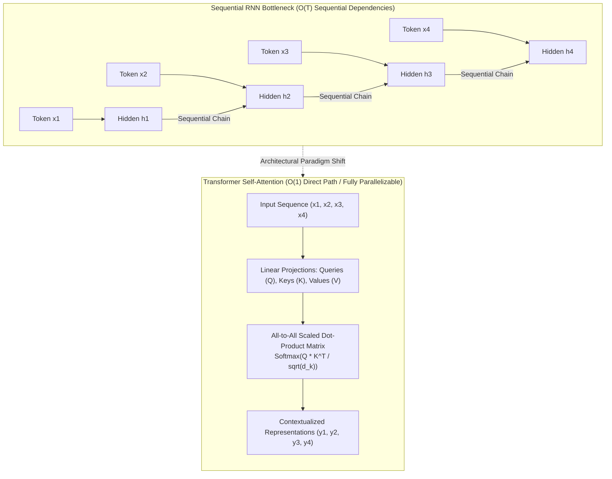

## Why Did Recurrent Architectures Fail to Scale for Long-Range Sequence Modeling?

Before the publication of *Attention Is All You Need* (Vaswani et al., 2017), the dominant paradigm for natural language processing and sequence transduction was rooted in recurrent neural architectures: Recurrent Neural Networks (RNNs), Long Short-Term Memory networks (LSTMs), and Gated Recurrent Units (GRUs). These models process sequence inputs sequentially along the temporal axis, generating a hidden state vector $h_t$ at time step $t$ as a function of the current input $x_t$ and the previous hidden state $h_{t-1}$:

$$h_t = \tanh(W_{hh} h_{t-1} + W_{xh} x_t + b)$$

While mathematically elegant, recurrent modeling suffers from two fundamental architectural bottlenecks that strictly constrained the scaling of deep language models:

1. **The Sequential Execution Bottleneck**: Because $h_t$ depends directly on $h_{t-1}$, training cannot be parallelized across the time dimension. For a sequence of length $T$, forward and backward passes require $O(T)$ sequential operations. Modern high-throughput accelerators (GPUs and TPUs) are designed to execute massive matrix-matrix multiplications in parallel across thousands of tensor cores. Recurrent dependencies forced hardware execution to serialize, leaving high-bandwidth memory (HBM) and compute execution units severely underutilized.
2. **Vanishing Gradients and Information Bottlenecks**: During backpropagation through time (BPTT), the gradient of the loss with respect to an early hidden state $h_k$ involves a product of Jacobian matrices:

$$\frac{\partial h_t}{\partial h_k} = \prod_{j=k+1}^t \frac{\partial h_j}{\partial h_{j-1}} = \prod_{j=k+1}^t \text{diag}(1 - h_j^2) W_{hh}^T$$

If the eigenvalues of $W_{hh}$ are smaller than 1, the gradient decays exponentially as the distance $t - k$ increases; if they exceed 1, gradients explode. Although gating mechanisms in LSTMs and GRUs introduced additive cell state highways that alleviated vanishing gradients over moderate distances (dozens of steps), they still forced the entire semantics of an arbitrarily long input sequence into a fixed-size vector $h_t$. When sequence lengths expanded past hundreds of tokens, early context was inexorably diluted or overwritten.

As explored in our technical deep dives on [State Space Models versus Transformers](/posts/ssm-transformer/) and the [pure NumPy mechanics of autoregressive inference](/posts/llama-pure-numpy/), overcoming this information bottleneck demanded an architecture that eliminated temporal recurrence entirely.



---

## Scaled Dot-Product and Multi-Head Attention Formulations

The core innovation of the Transformer is replacing recurrent temporal transitions with self-attention. Rather than compressing past state sequentially, self-attention grants every token in a sequence direct $O(1)$ routing access to every other token, computing pairwise interaction weights dynamically based on token content.

### Mathematical Derivation of Scaled Dot-Product Attention
Given an input sequence packed into a matrix $X \in \mathbb{R}^{T \times d_{\text{model}}}$, linear transformations project $X$ into three distinct spaces: Queries ($Q$), Keys ($K$), and Values ($V$):

$$Q = X W^Q, \quad K = X W^K, \quad V = X W^V$$

where $W^Q, W^K \in \mathbb{R}^{d_{\text{model}} \times d_k}$ and $W^V \in \mathbb{R}^{d_{\text{model}} \times d_v}$.

The scaled dot-product attention mapping is computed as:

$$\text{Attention}(Q, K, V) = \text{softmax}\left(\frac{Q K^T}{\sqrt{d_k}}\right) V$$

The scaling factor $\frac{1}{\sqrt{d_k}}$ is mathematically crucial. Assume that the components of $q \in \mathbb{R}^{d_k}$ and $k \in \mathbb{R}^{d_k}$ are independent random variables with zero mean and unit variance ($\mathbb{E}[q_i] = 0, \text{Var}(q_i) = 1$). The dot product is:

$$q \cdot k = \sum_{i=1}^{d_k} q_i k_i$$

The expectation of the sum is $\mathbb{E}[q \cdot k] = 0$, and the variance is:

$$\text{Var}(q \cdot k) = \sum_{i=1}^{d_k} \text{Var}(q_i k_i) = \sum_{i=1}^{d_k} \text{Var}(q_i)\text{Var}(k_i) = d_k$$

As the key dimension $d_k$ grows large, the variance of the raw dot product grows proportionally with $d_k$, pushing the inputs of the softmax function into regions with extremely small gradients ($\approx 0$), leading to vanishing gradients during backpropagation. Dividing by $\sqrt{d_k}$ rescales the variance back to 1, preserving healthy gradient flow across deep networks.

### Multi-Head Attention Dynamics
Rather than computing a single broad attention distribution, Multi-Head Attention projects queries, keys, and values $h$ times with distinct, learnable linear projections:

$$\text{MultiHead}(Q, K, V) = \text{Concat}(\text{head}_1, \text{head}_2, \dots, \text{head}_h) W^O$$

$$\text{where} \quad \text{head}_i = \text{Attention}(Q W_i^Q, K W_i^K, V W_i^V)$$

With $W_i^Q, W_i^K \in \mathbb{R}^{d_{\text{model}} \times d_k}$, $W_i^V \in \mathbb{R}^{d_{\text{model}} \times d_v}$, and $W^O \in \mathbb{R}^{h d_v \times d_{\text{model}}}$.

Multi-head projection permits the model to jointly attend to information from different representation subspaces at different positions. For instance, in syntactic parsing, one head may track syntactic subject-verb dependencies across long distances, while another head isolates local prepositional modifiers.

---

## Positional Encodings, Pre-LN vs. Post-LN, and Feed-Forward Networks

Because self-attention operates entirely via pairwise inner products without recurrent recurrence or convolutions, the operation is completely **permutation invariant**. Swapping the positions of two words in an input sentence yields identical attention scores (merely permuting rows and columns). To restore sequence ordering, positional encodings must be injected.

### Sinusoidal Positional Encodings
The original Transformer architecture injected deterministic sinusoidal functions of varying frequencies into the input embeddings:

$$PE_{(pos, 2i)} = \sin\left(\frac{pos}{10000^{2i / d_{\text{model}}}}\right)$$

$$PE_{(pos, 2i+1)} = \cos\left(\frac{pos}{10000^{2i / d_{\text{model}}}}\right)$$

where $pos$ is the token position and $i$ is the dimension index. This formulation allows the network to learn relative positional relationships easily, because for any fixed offset $k$, $PE_{pos + k}$ can be expressed as a linear function of $PE_{pos}$ via trigonometric angle-addition identities:

$$\sin(\alpha + \beta) = \sin \alpha \cos \beta + \cos \alpha \sin \beta$$

$$\cos(\alpha + \beta) = \cos \alpha \cos \beta - \sin \alpha \sin \beta$$

### Normalization Placement: Post-LN versus Pre-LN
The original architecture placed Layer Normalization *after* the residual addition (**Post-LN**):

$$x_{l+1} = \text{LayerNorm}(x_l + \text{SubLayer}(x_l))$$

In Post-LN configurations, gradients passing through the residual highway are scaled by the derivative of Layer Normalization at each layer. In deep networks ($L > 20$), gradients at early layers vanish without extensive learning rate warm-up schedules.

Modern architectures universally adopt **Pre-LN** (or RMSNorm):

$$x_{l+1} = x_l + \text{SubLayer}(\text{LayerNorm}(x_l))$$

In Pre-LN, the identity path $x_l \to x_{l+1}$ remains an unobstructed gradient highway, enabling stable training of 100+ layer foundation models without fragile learning rate warmups.

```
Post-LN Architecture (Vaswani et al. 2017):
Input ---> [ SubLayer ] ---> (+) ---> [ LayerNorm ] ---> Output
  |                            ^
  +----------------------------+

Pre-LN Architecture (Modern Foundation Models):
Input ---> [ LayerNorm ] ---> [ SubLayer ] ---> (+) ---> Output
  |                                              ^
  +----------------------------------------------+
```

---

## How Sequence Architectures Evolved Across 2026

By 2026, the theoretical landscape of sequence modeling has evolved beyond fixed sinusoidal encodings and naive full attention matrices:

1. **Rotary Position Embeddings (RoPE) and YaRN**: Fixed sinusoidal positional vectors added to input embeddings have been replaced by RoPE, which applies rotation matrices directly to Query and Key projections in the 2D plane:
   $$\mathbf{R}_{\Theta, m}^d = \text{diag}(R_{\theta_1, m}, R_{\theta_2, m}, \dots, R_{\theta_{d/2}, m})$$
   Combined with Yet another RoPE extensioN (YaRN) and NTK-aware scaling, contemporary architectures extrapolate context windows reliably from 4,096 tokens to over 1,000,000 tokens without fine-tuning from scratch.
2. **FlashAttention-3 Hardware Kernel Fusion**: Naive attention materializes the intermediate $T \times T$ attention matrix into GPU High Bandwidth Memory (HBM), incurring $O(T^2)$ memory reads and writes. FlashAttention-2 and FlashAttention-3 re-architect attention computation into GPU SRAM tiles using online softmax algorithms, reducing HBM memory traffic by over $5\times$ and allowing attention execution to run near the theoretical FLOPS limits of modern hardware.
3. **Hybrid Attention-SSM Convergences**: The quadratic computational complexity $O(T^2)$ of self-attention remains challenging for infinite-horizon streaming workloads. Modern architectures (such as Jamba and Mamba-2 hybrid models) interleave selective State Space Model (SSM) layers with dense self-attention layers, achieving the constant inference memory overhead of recurrent models alongside the high-capacity associative recall of full multi-head attention.

---

## Key Takeaways

- **Recurrence vs. Attention**: RNNs and LSTMs forced sequential $O(T)$ execution dependencies and compressed long-range history into fixed-size hidden vectors, causing vanishing gradients and severe memory bottlenecks.
- **Self-Attention Mechanics**: Scaled Dot-Product Attention allows all tokens to communicate in $O(1)$ operations; dividing by $\sqrt{d_k}$ preserves variance stability and prevents softmax saturation.
- **Permutation Invariance**: Attention treats inputs as unordered bags of tokens; positional awareness requires explicit injection via sinusoidal vectors, learnable offsets, or Rotary Position Embeddings.
- **Architectural Stabilization**: Pre-LN and RMSNorm structures preserve clean residual identity highways, preventing gradient extinction and enabling stable scaling to hundreds of layers.

---

## New Questions

- Under what sequence length regimes do hybrid SSM-Transformer layers outperform pure multi-head attention when evaluated on associative in-context retrieval benchmarks?
- How does KV-cache compression (e.g., Cross-Layer Attention and Grouped-Query Attention) impact the geometric representation capacity of multi-head attention heads?
- Can sub-quadratic linear attention variants maintain full expressive equivalence to softmax attention across complex multi-step reasoning tasks?

---

## References

- Vaswani, Ashish, Noam Shazeer, Niki Parmar, Jakob Uszkoreit, Llion Jones, Aidan N. Gomez, Łukasz Kaiser, and Illia Polosukhin. *Attention Is All You Need*. Advances in Neural Information Processing Systems (NeurIPS), 2017. [https://arxiv.org/abs/1706.03762](https://arxiv.org/abs/1706.03762) (accessed 2026-10-18).
- Hochreiter, Sepp, and Jürgen Schmidhuber. *Long Short-Term Memory*. Neural Computation 9, no. 8 (1997): 1735–1780. [https://doi.org/10.1162/neco.1997.9.8.1735](https://doi.org/10.1162/neco.1997.9.8.1735) (accessed 2026-10-18).
- Dao, Tri. *FlashAttention-2: Faster Attention with Better Parallelism and Work Partitioning*. International Conference on Learning Representations (ICLR), 2024. [https://arxiv.org/abs/2307.08691](https://arxiv.org/abs/2307.08691) (accessed 2026-10-18).
- Su, Jianlin, Murtadha Ahmed, Yu Lu, Shengfeng Pan, Wen Bo, and Yunfeng Liu. *RoFormer: Enhanced Transformer with Rotary Position Embedding*. Neurocomputing 568 (2024): 127063. [https://arxiv.org/abs/2104.09864](https://arxiv.org/abs/2104.09864) (accessed 2026-10-18).
