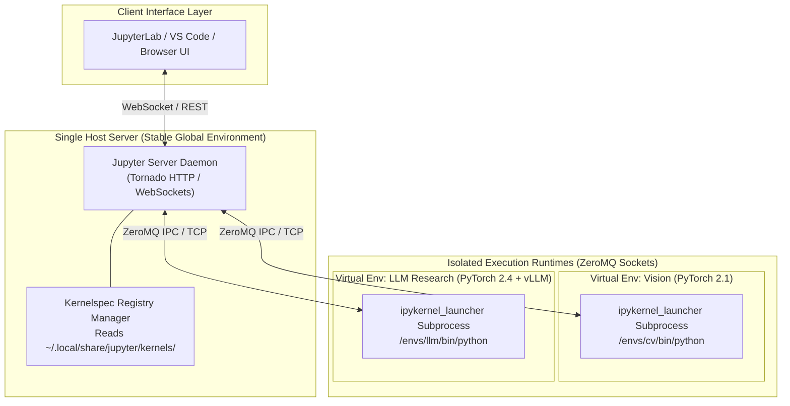
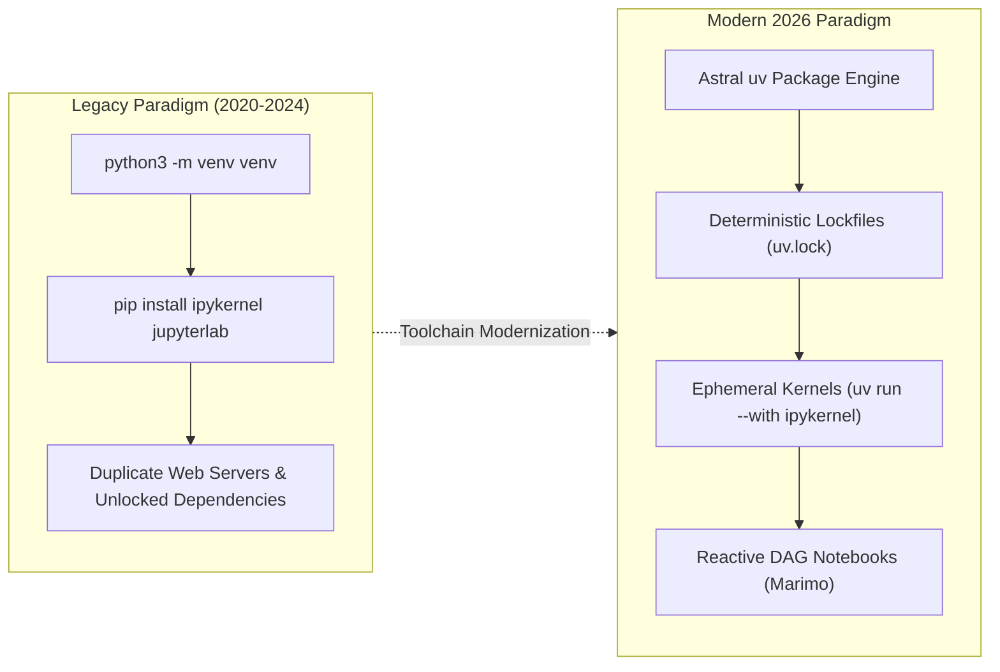

## Why Do Global Python Environments Corrupt Interactive Notebook Workflows?

In interactive scientific computing and artificial intelligence engineering, developer productivity relies heavily on Jupyter notebooks for exploratory data analysis, rapid prototyping, and model evaluation. However, novice and intermediate practitioners frequently fall into a destructive environment anti-pattern: launching Jupyter directly within a global Python installation and installing project dependencies indiscriminately into a single monolithic `site-packages` directory.

This approach quickly produces severe architectural and dependency failures:

1. **Dependency Hell and Transitive Clashes**: Distinct machine learning projects frequently require mutually incompatible library versions. For instance, evaluating an experimental research checkpoint may depend on PyTorch 2.1 with specific CUDA 11.8 binaries, while another project requires PyTorch 2.4 compiled against CUDA 12.4. In a shared environment, installing one package silently upgrades or uninstalls underlying compiled C/C++ extensions, breaking existing notebooks without warning.
2. **Hidden State and Non-Reproducible Execution**: When notebooks run in an untracked global runtime, dependencies used during interactive execution are never recorded into declarative manifests (`requirements.txt`, `pyproject.toml`, or lockfiles). Code that executed flawlessly during an interactive session fails when transferred to continuous integration (CI) or automated evaluation pipelines.
3. **Storage Bloat via Duplicate Server Installations**: Naive troubleshooting often leads engineers to install `jupyter`, `jupyterlab`, and the full Tornado web server stack inside every newly created virtual environment. This consumes gigabytes of redundant disk space and fragments server configurations across dozens of local paths.

As highlighted in our practical roadmaps on [fundamental LLM engineering curricula](/posts/llm-course/) and [bare-metal NumPy model implementations](/posts/llama-pure-numpy/), maintaining pristine, reproducible compute boundaries is essential for reliable machine learning research. The architectural solution lies in decoupling the **Jupyter Server** (the web UI and file manager) from the **Jupyter Kernel** (the isolated execution runtime).



---

## Jupyter Client-Server Architecture and the ZeroMQ Messaging Contract

The fundamental brilliance of the Project Jupyter architecture is its strict protocol separation between client interfaces and execution kernels. A single JupyterLab server daemon can discover and spawn dozens of independent execution engines, spanning completely different Python virtual environments, system paths, or even alternative programming languages (such as Julia, R, or C++).

Communication between the Jupyter Server and an active kernel subprocess is mediated exclusively over five asynchronous **ZeroMQ (ZMQ)** communication sockets, coordinated via an ephemeral JSON connection file:

```
+----------------------------------------------------------------------------------------------------+
|                                  Jupyter ZeroMQ Channel Topology                                   |
+----------------------------------------------------------------------------------------------------+
| Channel Socket       | ZeroMQ Pattern    | Directional Role and Operational Contract               |
+----------------------+-------------------+---------------------------------------------------------+
| Shell                | ROUTER / DEALER   | Synchronous code execution requests, object inspection, |
|                      |                   | and execution counter increments                        |
| IOPub                | PUB / SUB         | One-to-many broadcast of stdout, stderr, display data   |
|                      |                   | (plots, images, HTML tables), and execution status      |
| Stdin                | ROUTER / DEALER   | Bi-directional interactive prompt requests (input())    |
| Control              | ROUTER / DEALER   | High-priority operational interrupts (SIGINT), kernel   |
|                      |                   | shutdown, and debugging breakpoints                     |
| Heartbeat            | REQ / REP         | Ultra-low-overhead ping/pong liveness monitoring to      |
|                      |                   | detect sudden subprocess crashes or out-of-memory events|
+----------------------------------------------------------------------------------------------------+
```

When a notebook is opened, the Jupyter Server reads the selected kernel's declarative specification, creates an ephemeral connection file detailing dynamic port assignments and cryptographic HMAC signing keys, and launches the kernel binary as an independent child process. Because execution occurs entirely inside this child process, memory leaks, C-level segmentation faults, or GPU CUDA out-of-memory (OOM) panics in user code never crash the host Jupyter Server.

---

## Kernelspec Anatomy and Deterministic Environment Registration

A Jupyter kernel is registered on the host system through a lightweight directory containing a standardized descriptor: `kernel.json`. 

### Descriptor Schema and Path Resolution
When the Jupyter Server boots or receives a refresh signal, it scans well-defined directory hierarchies across the operating system:
- **User-Specific**: `~/.local/share/jupyter/kernels/` (Linux) or `~/Library/Jupyter/kernels/` (macOS)
- **System-Wide**: `/usr/local/share/jupyter/kernels/` or `/usr/share/jupyter/kernels/`
- **Environment-Specific**: `<sys.prefix>/share/jupyter/kernels/`

Inside a given kernel directory (e.g., `~/.local/share/jupyter/kernels/llm-research/kernel.json`), the file contains a declarative JSON payload:

```json
{
  "argv": [
    "/Users/developer/.virtualenvs/llm-research/bin/python",
    "-m",
    "ipykernel_launcher",
    "-f",
    "{connection_file}"
  ],
  "display_name": "Python 3.11 (LLM Research)",
  "language": "python",
  "metadata": {
    "debugger": true
  },
  "env": {
    "CUDA_VISIBLE_DEVICES": "0",
    "HF_HOME": "/Volumes/FastStorage/huggingface_cache"
  }
}
```

The key fields govern execution:
- **`argv`**: The exact command-line invocation used to launch the subprocess. Specifying the absolute path to `/bin/python` within the target virtual environment guarantees that the kernel boots with the target environment's isolated `site-packages`, regardless of how the user's shell environment or `PATH` variable is currently configured.
- **`{connection_file}`**: A runtime placeholder substituted dynamically by the Jupyter Server with the path to the ephemeral ZeroMQ configuration JSON.
- **`env`**: Optional environment variables injected exclusively into the kernel process space upon launch, enabling per-kernel GPU allocation or cache directory routing.

### Step-by-Step Production Registration Workflow
To bind a fresh virtual environment to your central Jupyter Server without polluting global packages:

```bash
# 1. Create a dedicated virtual environment using standard tooling
python3 -m venv ~/.virtualenvs/nlp-pipeline

# 2. Activate the environment and install only execution dependencies
source ~/.virtualenvs/nlp-pipeline/bin/activate
pip install --upgrade pip
pip install ipykernel torch transformers

# 3. Register the virtual environment as an isolated user-level kernel
python -m ipykernel install \
  --user \
  --name "nlp-pipeline" \
  --display-name "Python (NLP Pipeline)"

# 4. Verify discovery on the host system
jupyter kernelspec list
```

To decommission a retired environment and prevent stale UI options:

```bash
jupyter kernelspec uninstall nlp-pipeline -f
```

---

## How Python Runtime Management for Notebooks Evolved Across 2026

By 2026, the developer experience and performance characteristics of Python environment management have transitioned fundamentally away from legacy `pip` and slow virtualenv wrappers toward high-speed, deterministic toolchains:



1. **The Dominance of `uv` and Fast Packaging**: Written in Rust by Astral, `uv` has replaced standard `pip`, `venv`, and `virtualenv`. Environment creation takes milliseconds via hard-linking rather than copying, and dependency resolution is backed by universal, cross-platform `uv.lock` files. Developers can launch an ad-hoc notebook bound to an ephemeral environment in a single command without persistent installation overhead:
   ```bash
   uv run --with ipykernel --with torch jupyter lab
   ```
2. **Containerized Dev Containers and Remote Kernel Multiplexing**: Modern production teams avoid running local GPU compute altogether. Through the Jupyter Server REST API and SSH/TLS port forwarding, local VS Code and JupyterLab frontends connect to remote kernels orchestrated within isolated Kubernetes pods or Slurm clusters. The local machine acts purely as a thin presentation client, with heavy model weights and CUDA contexts contained entirely inside remote containers.
3. **The Rise of Reactive Notebook Paradigms (Marimo)**: Traditional Jupyter notebooks retain hidden temporal state because cells can be executed out of order, leading to reproducibility failures. Contemporary environments like Marimo introduce a directed acyclic graph (DAG) reactive execution model: updating a variable in an upstream cell automatically re-computes dependent downstream cells deterministically, eliminating silent state divergence while retaining the familiar interactive feedback loop.

---

## Key Takeaways

- **Decoupled Architecture**: Separate the Jupyter Server (Tornado HTTP/WebSocket host) from the Jupyter Kernel (ZeroMQ-isolated subprocess execution environment).
- **Five-Socket ZeroMQ Contract**: Kernel communication is partitioned into Shell, IOPub, Stdin, Control, and Heartbeat channels, ensuring UI responsiveness and crash isolation.
- **Explicit `kernel.json` Resolution**: Kernelspecs bind directly to the absolute Python interpreter path of the virtual environment, guaranteeing consistent package resolution regardless of active shell state.
- **Modern Packaging Primitives**: Adopting modern toolchains like `uv` provides sub-second virtual environment bootstrapping and deterministic reproducibility across interactive and production pipelines.

---

## New Questions

- How do reactive DAG notebook execution models handle memory management when intermediate cells cache multi-gigabyte foundation model weights?
- What are the network latency overheads and security considerations of exposing Jupyter ZeroMQ sockets over multi-tenant WireGuard mesh networks?
- How can automated CI systems validate notebook execution determinism without re-running long-horizon stochastic inference steps?

---

## References

- Project Jupyter. *Jupyter Client Documentation: Messaging Protocol and Kernel Lifecycle*. Jupyter Team, 2024. [https://jupyter-client.readthedocs.io/en/stable/messaging.html](https://jupyter-client.readthedocs.io/en/stable/messaging.html) (accessed 2026-10-18).
- Project Jupyter. *Making Kernels for Jupyter: Kernelspec Directory Specifications*. Jupyter Team, 2024. [https://jupyter-client.readthedocs.io/en/stable/kernels.html](https://jupyter-client.readthedocs.io/en/stable/kernels.html) (accessed 2026-10-18).
- Astral Software. *uv: An Extremely Fast Python Package and Project Manager Written in Rust*. Astral Documentation, 2025. [https://docs.astral.sh/uv/](https://docs.astral.sh/uv/) (accessed 2026-10-18).
