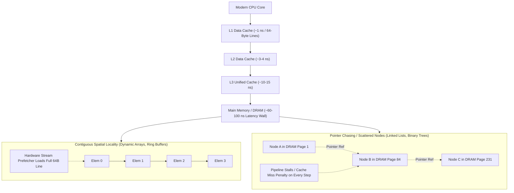
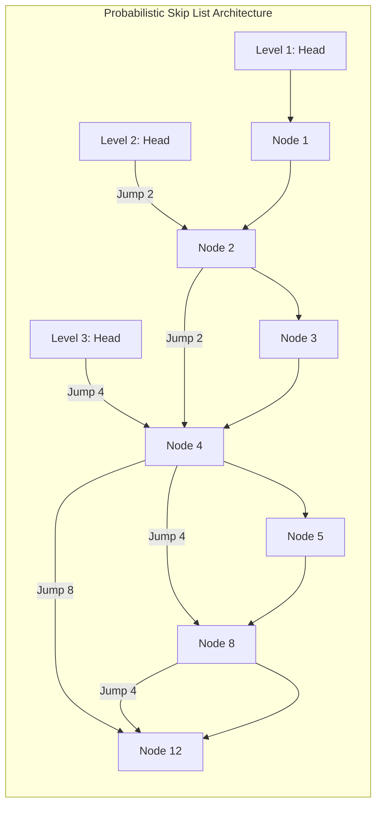

## Why Does Hardware Cache Locality Overrule Pure Asymptotic $O(1)$ Complexity?

In academic computer science, data structures are conventionally introduced through Big-$O$ asymptotic analysis. Under the theoretical Random Access Machine (RAM) model, accessing any arbitrary memory address carries a uniform unit cost $O(1)$. However, modern CPU architectures operate under severe hardware constraints where physical silicon realities directly contradict pure mathematical abstraction.

Fetching a cache line from L1 CPU cache requires approximately $1 \text{ ns}$ ($4 \text{ to } 5$ clock cycles), while fetching an un-cached random address from main memory (DRAM) requires $60 \text{ to } 100 \text{ ns}$ (hundreds of cycles). Consequently, a theoretically suboptimal $O(N)$ algorithm operating over contiguous memory buffers (e.g., dynamic arrays) routinely outperforms an asymptotically superior $O(1)$ or $O(\log N)$ structure (e.g., node-based linked lists or balance binary search trees) due to CPU cache misses and pointer-chasing overhead. 

---

## Architectural Taxonomy of Twelve Foundational Data Structures

To engineer high-throughput systems, software architects must categorize data structures not merely by their high-level interface, but by their physical memory topologies and cache interaction profiles:

### 1. Contiguous Sequential Buffers

- **Dynamic Array (Vector)**: Stores elements in contiguous heap allocations. Indexing evaluates instantaneously via base-offset arithmetic ($\text{addr}(i) = \text{base} + i \times \text{size}$). Dynamic resizing uses geometric expansion (typically factor $1.5\times$ or $2\times$), ensuring amortized $O(1)$ appends:
  $$\sum_{i=0}^k 2^i = 2^{k+1} - 1 < 2 \cdot 2^k \implies O(N) \text{ total copies for } N \text{ inserts}$$
- **Circular Ring Buffer**: Maintains a fixed-size contiguous array with wrap-around head and tail indices modulo capacity ($i = \text{idx} \pmod C$). Critical for lock-free single-producer single-consumer (SPSC) queues in low-latency trading and audio processing.
- **Bitset (Bit Array)**: Packs boolean flags into contiguous 64-bit integers. Enables bitwise SIMD parallelization (e.g., popcount, bitwise AND/OR masks), executing 64 boolean evaluations per CPU instruction.

### 2. Pointer-Linked Dynamic Chains

- **Singly & Doubly Linked Lists**: Chains isolated heap nodes containing value payloads and 8-byte pointer addresses (`*next`, `*prev`). While offering $O(1)$ splice operations when a pointer is already held, sequential traversal causes severe CPU cache thrashing due to scattered pointer dereferencing.
- **Skip List**: Augments a sorted linked list with probabilistic multi-level forward pointers ($p = 1/2$ promotion probability). Provides $O(\log N)$ search, insertion, and deletion while enabling simpler lock-free concurrent implementations than balanced trees (widely deployed in Redis and LevelDB).

### 3. Hash-Indexed Associative Tables

- **Open Addressing with Robin Hood Hashing**: Eliminates pointer chaining by storing key-value pairs directly in a single contiguous array. Collisions are resolved by probing forward. If an inserted key has probed further from its ideal hash bucket than the incumbent occupant ("rich" vs "poor"), the incumbent is evicted, strictly bounding maximum probe sequence lengths (PSL).
- **SIMD Control-Byte Hash Tables (Swiss Tables)**: Groups 16 entries into blocks prefixed by an 8-bit hash fingerprint array. Modern CPUs use SSE2/AVX2 vectorized instructions (`_mm_cmpeq_epi8`) to inspect 16 hash buckets in a single instruction, minimizing collision latency.

### 4. Hierarchical and Logarithmic Search Structures

- **B+ Tree**: Multi-way balanced search tree where all data resides in leaves, and internal nodes store routing keys. Nodes are calibrated to match hardware page boundaries ($4 \text{ KB}$ or CPU cache lines), achieving massive fanout ($B \approx 100\text{--}500$) and bounding tree depth to $3\text{--}4$ disk seeks across billions of records. Forms the backbone of relational database engines, as explored in our guide to [database scaling architectures](/posts/strategies-to-scale-database/).
- **Log-Structured Merge-Tree (LSM Tree)**: Decouples writes from reads. Appends incoming writes to an in-memory sorted MemTable (Skip List or Red-Black Tree) and an append-only Write-Ahead Log (WAL). When full, the MemTable flushes to immutable disk-bound SSTables, resolved periodically through multi-way merge-sort compactions.
- **Binary Heap (Priority Queue)**: Complete binary tree stored implicitly in a contiguous array without explicit pointers. Parent and child coordinates resolve via arithmetic shifts:
  $$\text{parent}(i) = \left\lfloor \frac{i-1}{2} \right\rfloor, \quad \text{left}(i) = 2i + 1, \quad \text{right}(i) = 2i + 2$$

### 5. Persistent and Graph Structures

- **Disjoint Set Union (DSU / Union-Find)**: Tracks partitioned equivalence classes. By combining union-by-rank with path compression, finding the representative root of a set evaluates in near-linear time:
  $$O(\alpha(N))$$
  where $\alpha$ is the extremely slow-growing Inverse Ackermann function ($\alpha(10^{80}) \le 4$).
- **Directed Acyclic Graph (DAG)**: Represents dependency topologies via adjacency lists. Traversed via Kahn's algorithm or Depth-First Search (DFS) for topological sorting, forming the foundation of task orchestration engines, compiler build systems, and distributed state machines.

---

## Comparative Performance and Memory Profile

The table below contrasts time complexities and hardware locality factors across the twelve data structures:

| Data Structure | Lookup (Avg) | Insert / Append | Delete | Cache Locality | Memory Overhead |
| :--- | :--- | :--- | :--- | :--- | :--- |
| **Dynamic Array** | $O(1)$ Index | $O(1)$ Amortized | $O(N)$ Arbitrary | Outstanding (Contiguous) | Minimal (Geometric slack) |
| **Ring Buffer** | $O(1)$ Index | $O(1)$ FIFO | $O(1)$ FIFO | Outstanding (Contiguous) | Zero pointer overhead |
| **Bitset** | $O(1)$ Bit | $O(1)$ Bit | $O(1)$ Bit | Outstanding (Contiguous) | Maximum density (1 bit/item) |
| **Linked List** | $O(N)$ Search | $O(1)$ Known Node | $O(1)$ Known Node | Very Poor (Pointer hopping) | High ($8\text{--}16$ bytes/node) |
| **Skip List** | $O(\log N)$ | $O(\log N)$ | $O(\log N)$ | Poor to Moderate | High ($p/(1-p)$ pointers) |
| **Robin Hood Hash** | $O(1)$ | $O(1)$ Amortized | $O(1)$ Back-shift | High (Contiguous array) | Moderate (Load factor $< 0.9$) |
| **Swiss Table** | $O(1)$ SIMD | $O(1)$ Amortized | $O(1)$ Tombstone | Excellent (Block SIMD) | Moderate ($1$ byte control tag) |
| **B+ Tree** | $O(\log_B N)$ | $O(\log_B N)$ | $O(\log_B N)$ | High (Block page aligned) | Low to Moderate |
| **LSM Tree** | $O(\log N)$ Disk | $O(1)$ Append | $O(1)$ Tombstone | Sequential I/O optimized | Amplification trade-offs |
| **Binary Heap** | $O(1)$ Peek Min | $O(\log N)$ | $O(\log N)$ Extract | High (Array packed) | Zero pointer overhead |
| **DSU** | $O(\alpha(N))$ | $O(\alpha(N))$ | N/A | High (Contiguous vector) | 8 bytes per item |
| **Graph (Adj List)**| $O(\text{deg}(V))$ | $O(1)$ Edge | $O(\text{deg}(V))$ | Mixed | Array + edge pointer chain |

---

## Systems Engineering Applications: Networking and Reliability

Selecting the appropriate data structure directly determines system throughput in production infrastructure:

- In high-throughput network transport stacks (such as [UDP packet multiplexing and QUIC](/posts/the-most-popular-use-cases-for-udp/)), circular ring buffers and memory-mapped bitsets prevent garbage collection pauses and bufferbloat under high ingress pressure.
- In distributed web service architectures, maintaining bounded latencies across the [ten production reliability layers](/posts/web-application-10-essential/) depends on using Robin Hood or Swiss table hash maps for in-memory token caches to avoid latency spikes during high-load hash collision events.

---

## 2026 Technological Evolution: Cache-Oblivious and GPU-Coalesced Structures

In modern 2026 high-performance computing, data structure design has adapted to massive parallel SIMD hardware and heterogeneous memory tiers:

1. **Cache-Oblivious van Emde Boas Layouts**: By laying out binary trees recursively in memory using the van Emde Boas layout, search trees achieve optimal cache transfer complexity across *all* levels of the memory hierarchy without tuning parameters to specific L1/L2/L3 cache line sizes.
2. **GPU Memory Coalescing**: On massively parallel accelerators (NVIDIA Hopper and Blackwell GPUs), threads within a 32-thread warp executing memory loads must access adjacent 32-byte segments simultaneously. Data structures in GPU databases (such as cuDF) convert traditional Array-of-Structures (AoS) into Structure-of-Arrays (SoA) to guarantee memory coalescing.
3. **Lock-Free Concurrent Skip Lists in Multi-Core Runtimes**: Modern asynchronous runtimes avoid global mutexes by deploying hazard pointers and epoch-based memory reclamation (EBR) over lock-free skip lists and queues, scaling linearly across 128-core server sockets.

---

## Key Takeaways

- **Cache Locality Dominates Asymptotics**: In real hardware, contiguous array iteration regularly outperforms pointer-based linked lists and trees due to 64-byte CPU cache line prefetching.
- **Swiss Tables Represent Modern Hash State**: SIMD-vectorized control bytes minimize collision resolution overhead, replacing legacy linked-list separate chaining.
- **B+ Trees Maximize Storage Block Efficiency**: High fanout ($B \gg 2$) keeps tree depth shallow, optimizing block retrieval from disk and NVMe storage.
- **Amortized Analysis Guarantees Stability**: Dynamic array doubling and DSU path compression demonstrate that multi-step operations can achieve bounded linear overall performance.

---

## New Questions

- **Will CXL Memory Pools Disrupt Traditional Cache-Oblivious Algorithms?**: As Compute Express Link (CXL) introduces multi-tiered coherent memory with variable non-uniform latency, how will tree layouts adapt to remote memory NUMA domains?
- **Can GPU-Native Hash Tables Achieve Constant Insertion Latency Under Warp Divergence?**: How can concurrent open-addressing hash algorithms prevent thread divergence when multiple threads in a warp collide simultaneously?

---

## References

- Knuth, D. E. (1998). The Art of Computer Programming: Volume 3: Sorting and Searching. *Addison-Wesley Professional*. [https://www-cs-faculty.stanford.edu/~knuth/taocp.html](https://www-cs-faculty.stanford.edu/~knuth/taocp.html) (accessed 2026-10-18)
- Pugh, W. (1990). Skip Lists: A Probabilistic Alternative to Balanced Trees. *Communications of the ACM*, 33(6), 668-676. [https://dl.acm.org/doi/10.1145/78973.78977](https://dl.acm.org/doi/10.1145/78973.78977) (accessed 2026-10-18)
- Cormen, T. H., Leiserson, C. E., Rivest, R. L., & Stein, C. (2022). Introduction to Algorithms (4th ed.). *MIT Press*. [https://mitpress.mit.edu/9780262046305/introduction-to-algorithms/](https://mitpress.mit.edu/9780262046305/introduction-to-algorithms/) (accessed 2026-10-18)
- Frigo, M., Leiserson, C. E., Prokop, H., & Ramachandran, S. (2012). Cache-Oblivious Algorithms. *ACM Transactions on Algorithms*, 8(1), 1-22. [https://dl.acm.org/doi/10.1145/2071379.2071383](https://dl.acm.org/doi/10.1145/2071379.2071383) (accessed 2026-10-18)
