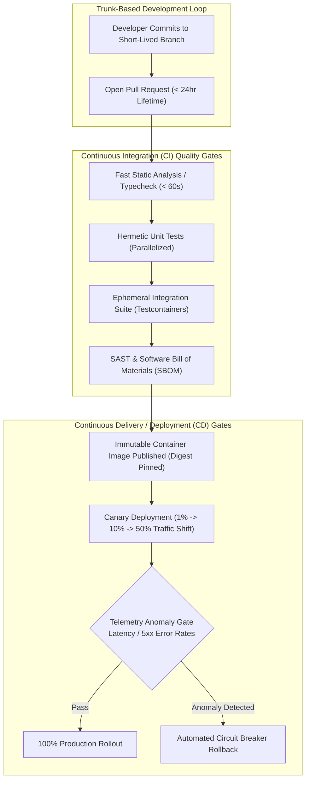
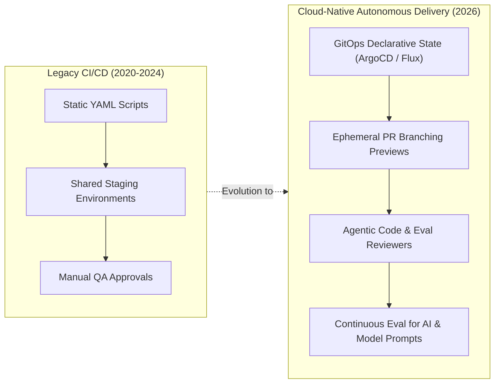

## Why Do Traditional Release Cycles Fail to Sustain Modern Engineering Velocity?

In legacy software engineering organizations, deploying software to production was treated as an infrequent, high-stress event. Teams accumulated weeks or months of unintegrated feature code across divergent Git branches before initiating monolithic "code freezes," manual regression testing phases, and nocturnal release deployments. This cadence inevitably triggered widespread integration failures ("merge hell"), delayed bug discovery until late in the lifecycle, and inflated Mean Time to Recovery (MTTR) when broken builds inevitably slipped into production.

The DevOps research initiative known as **DORA** (DevOps Research and Assessment) conclusively demonstrated that high-performing engineering teams do not sacrifice stability for velocity. Instead, the highest-performing organizations ship changes orders of magnitude faster while simultaneously experiencing drastically lower change failure rates.

This capability is enabled by **Continuous Integration (CI)** and **Continuous Delivery / Deployment (CD)**:

1. **Continuous Integration (CI)**: The engineering practice where developers merge code into a shared mainline trunk multiple times per day. Every merge is verified by an automated, hermetic build and test pipeline, exposing defects and regressions within minutes rather than weeks.
2. **Continuous Delivery (CD)**: An operational discipline ensuring that the mainline codebase is continuously in a releasable state. Every passing build produces a production-ready artifact that can be deployed to any target environment on demand with push-button simplicity.
3. **Continuous Deployment**: The advanced evolution of continuous delivery where every change that successfully navigates the automated test harness is deployed directly into production without manual human intervention.

As explored in our analyses of [resilient cloud infrastructure patterns on AWS](/posts/visualization-of-architecture-on-aws/) and [enterprise LLM production pipelines](/posts/llm-build-tools-cookbook/), rigorous continuous delivery automation is the non-negotiable prerequisite for maintaining uptime across complex distributed systems.



---

## Anatomy of an Enterprise Pipeline: Hermetic Builds and Multi-Tier Quality Gates

A naive CI pipeline that runs unconstrained shell scripts across heterogeneous host machines quickly succumbs to flaky tests, unpredictable execution times, and non-deterministic build artifacts. Engineering a resilient enterprise CI pipeline requires enforcing three foundational principles:

### 1. Hermetic and Reproducible Build Execution
A build is *hermetic* when its execution depends strictly on declared inputs and tools, with zero reliance on ambient host system state or external network calls during compilation:
- **Containerized Runners**: Every step executes inside pinned, minimal container images (such as Wolfi or Alpine Linux) running on ephemeral virtual machines.
- **Content-Addressable Caching**: Build tools (e.g., Bazel, Turborepo, or Nix) compute cryptographic hashes over source file trees and configuration inputs. When inputs remain unchanged, cached build artifacts are retrieved instantaneously from remote object storage, reducing pipeline runtimes from thirty minutes to under two minutes.
- **Immutable Artifact Signing**: Artifacts produced by passing builds—typically Open Container Initiative (OCI) images—are pinned by cryptographic SHA-256 digest rather than mutable tags (`:latest`) and cryptographically signed using Sigstore (Cosign) to guarantee supply chain integrity.

### 2. The Four-Tier Testing Pyramid
To balance rapid developer feedback against comprehensive risk mitigation, testing suites must be partitioned into strict execution tiers:

```
+----------------------------------------------------------------------------------------------------+
|                                    Automated CI/CD Quality Tiers                                   |
+----------------------------------------------------------------------------------------------------+
| Tier                 | Scope and Mechanism                           | Maximum Execution SLA       |
+----------------------+-----------------------------------------------+-----------------------------+
| Tier 1: Static Gates | AST linting, strict type checking (mypy/tsc),  | < 60 seconds                |
|                      | secret scanning (TruffleHog), syntax checks   |                             |
| Tier 2: Unit Testing | In-memory component tests with mocked I/O     | < 3 minutes (parallelized)  |
|                      | dependencies and strict code coverage thresholds|                            |
| Tier 3: Integration  | Real database and service interactions spun   | < 8 minutes                 |
|                      | up via ephemeral Docker containers            |                             |
| Tier 4: Security DAST| Dynamic vulnerability probing, license audits,| Asynchronous post-merge     |
|                      | and dependency supply chain analysis (SBOM)   |                             |
+----------------------------------------------------------------------------------------------------+
```

Enforcing strict SLA boundaries on Tier 1 and Tier 2 ensures that developers receive immediate feedback while code context remains fresh, minimizing cognitive task-switching.

---

## Continuous Delivery versus Deployment: Progressive Rollouts and Blast Radius Control

The ultimate objective of continuous delivery is mitigating the blast radius of production deployments. Pushing updates directly to 100% of production traffic invites catastrophic outages when edge-case regressions bypass synthetic test suites. Modern deployment architectures employ progressive delivery strategies:

### Blue-Green Deployment Topologies
In a Blue-Green deployment model, two identical production environments exist concurrently:
- **Environment Blue**: The active environment currently serving live customer traffic.
- **Environment Green**: The idle staging environment where the newly minted release artifact is deployed and subjected to automated synthetic smoke tests.
- **Cutover**: Once validation succeeds, the edge router or load balancer atomically redirects 100% of inbound traffic to Green. If unexpected latency spikes occur within the initial observation window, traffic is immediately redirected back to Blue with zero downtime.

### Automated Canary Traffic Shifting
Canary deployments provide significantly more granular blast radius containment. Rather than an all-or-nothing cutover, traffic is shifted incrementally while telemetry is evaluated in real time:

$$\text{Traffic Distribution}: \quad 1\% \longrightarrow 5\% \longrightarrow 25\% \longrightarrow 100\%$$

1. **Routing Control**: Ingress controllers (such as Envoy, Istio, or AWS Application Load Balancers) route a minute percentage of live requests to the canary pod deployment.
2. **Statistical Telemetry Comparison**: Automated observability agents query Prometheus or Datadog metrics, comparing the canary group against the baseline control group across golden signals: P99 latency, HTTP 5xx error rates, CPU/memory saturation, and business metrics.
3. **Circuit Breaker Rollback**: If the error rate on the canary tier deviates beyond a predefined threshold (e.g., $> 0.1\%$ delta over baseline for 3 consecutive minutes), the orchestration controller immediately terminates the canary instances and reverts routing to 100% baseline without requiring human pager intervention.

---

## How CI/CD Workflows Evolved Across 2026

By 2026, software delivery pipelines have advanced significantly beyond traditional static YAML workflow scripts, integrating AI-driven verification, ephemeral cloud resources, and declarative GitOps:



1. **Declarative GitOps Delivery**: Imperative push-based deployments executed from CI runners have been widely superseded by declarative GitOps operators (such as ArgoCD and Flux). The deployment cluster runs an in-cluster agent that continuously reconciles live infrastructure state against Git source repositories, eliminating the need to store long-lived production cloud credentials inside CI runners.
2. **Ephemeral Pull Request Preview Environments**: Monolithic, shared staging environments—historically notorious for state contamination, configuration drift, and contention bottlenecks—have been replaced by on-demand ephemeral preview environments. For every pull request, serverless compute containers and copy-on-write branching databases (such as Neon or PlanetScale) spin up an isolated, full-stack preview URL in seconds, automatically tearing down upon PR closure.
3. **Agentic Code Quality and Synthesis Gates**: Modern pipelines incorporate autonomous coding agents directly into CI checks. Rather than merely flagging style violations, agentic evaluators verify business logic against OpenAPI specifications, generate targeted property-based fuzz tests to probe newly exposed edge cases, and evaluate semantic diff impact before human engineers review the code.
4. **Continuous Evaluation (Continuous Eval) for AI Systems**: For applications integrating large language models, traditional unit tests are insufficient to catch prompt drift and hallucination regressions. Modern 2026 pipelines embed Continuous Eval stages that run deterministic golden datasets through automated LLM judges (measuring grounding, factual consistency, and latency) before approving production releases.

---

## Key Takeaways

- **Trunk-Based Discipline**: Maximize delivery velocity and eliminate merge debt by integrating small, short-lived branch changes into mainline trunk at least once daily.
- **Hermetic Build Isolation**: Eliminate flaky builds through containerized runners, pinned toolchains, and content-addressable remote caching.
- **Tiered Quality Gates**: Enforce sub-minute static analysis and parallelized unit testing before gating merges behind ephemeral integration test suites.
- **Progressive Canary Delivery**: Minimize production blast radiuses by shifting live traffic incrementally, backed by automated circuit-breaker rollbacks tied to telemetry error budgets.

---

## New Questions

- How do automated canary analysis algorithms distinguish between transient infrastructure network blips and true application-level regressions in high-noise environments?
- What are the performance and cost trade-offs of embedding synthetic continuous evaluation LLM judges directly into high-frequency continuous deployment pipelines?
- How can zero-trust supply chain frameworks (e.g., SLSA Level 4) be enforced seamlessly across multi-cloud hybrid deployment targets without degrading build velocity?

---

## References

- Humble, Jez, and David Farley. *Continuous Delivery: Reliable Software Releases through Build, Test, and Deployment Automation*. Addison-Wesley Professional, 2010. [https://continuousdelivery.com/](https://continuousdelivery.com/) (accessed 2026-10-18).
- Forsgren, Nicole, Jez Humble, and Gene Kim. *Accelerate: The Science of Lean Software and DevOps: Building and Scaling High Performing Technology Organizations*. IT Revolution Press, 2018. [https://itrevolution.com/book/accelerate/](https://itrevolution.com/book/accelerate/) (accessed 2026-10-18).
- DORA. *2024 State of DevOps Report: Continuous Delivery, Culture, and Platform Engineering*. Google Cloud DORA Research Program, 2024. [https://dora.dev/publications/](https://dora.dev/publications/) (accessed 2026-10-18).
- Fowler, Martin. *Continuous Integration: A Theoretical and Practical Overview*. MartinFowler.com, 2024. [https://martinfowler.com/articles/continuousIntegration.html](https://martinfowler.com/articles/continuousIntegration.html) (accessed 2026-10-18).
