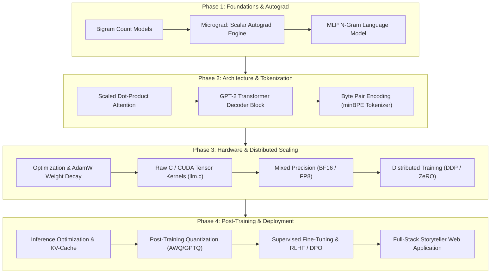
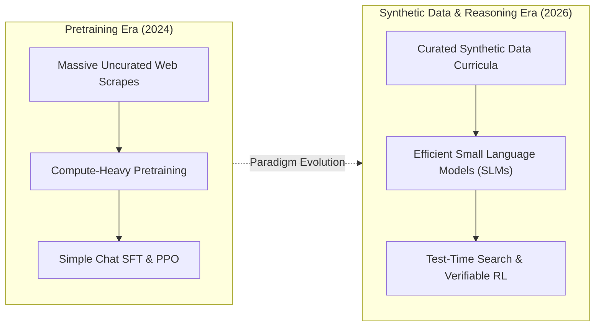

## Why Does First-Principles LLM Implementation Outperform High-Level Framework Abstractions?

In the current ecosystem of generative artificial intelligence, the overwhelming majority of software engineers interact with Large Language Models (LLMs) through high-level abstractions: REST APIs, wrapper frameworks like LangChain, or declarative model hubs such as Hugging Face `transformers`. While these abstractions accelerate application prototyping, they obscure the underlying mathematical, algorithmic, and mechanical realities of deep learning systems.

When production systems encounter throughput bottlenecks, out-of-memory (OOM) faults during distributed training, or subtle tokenization discrepancies, developers relying purely on high-level libraries find themselves powerless to diagnose root causes. Understanding modern neural language models requires understanding how tensor strides map to GPU memory hierarchies, how backpropagation traverses an autograd graph, how tokenizers carve UTF-8 byte streams into integer vocabularies, and how matrix multiplication kernels maximize compute intensity across CUDA warps.

To bridge this fundamental knowledge gap, renowned AI researcher **Andrej Karpathy** (former Director of AI at Tesla and OpenAI founding member) introduced **LLM101n: Let's build a Storyteller**. Rather than treating the language model as a black box, LLM101n guides engineers through constructing an entire, ChatGPT-like storytelling web application from absolute scratch—progressing from basic scalar autograd engines in pure Python to high-performance neural kernels in raw C and CUDA.

As explored in our technical audits on [curated LLM engineering curricula](/posts/llm-course/), [bare-metal NumPy model implementations](/posts/llama-pure-numpy/), and the [mathematical foundations of self-attention](/posts/study-transformer/), first-principles mastery transforms practitioners from passive consumers of AI APIs into capable systems engineers.



---

## Deconstructing the 17-Chapter System Architecture of LLM101n

The curriculum of LLM101n is organized into four distinct architectural phases spanning seventeen exhaustive chapters, systematically unwrapping the full lifecycle of modern autoregressive foundation models:

### 1. Foundational Language Modeling and Reverse-Mode Automatic Differentiation
- **Chapter 01 (Bigram Model)**: Introduces the statistical definition of language modeling: estimating conditional probability distributions $P(w_t \mid w_{t-1})$. Explores count-based transition matrices and maximum likelihood estimation (MLE).
- **Chapter 02 (Micrograd)**: Constructs a dynamic reverse-mode automatic differentiation engine from scratch in pure Python. Demonstrates how computation graphs dynamically track topological ordering and propagate analytical gradients via the multivariable chain rule.
- **Chapter 03 (MLP N-gram Model)**: Transitions from lookup counts to parametric neural networks based on Bengio et al. (2003), introducing dense matrix multiplications, bias vectors, and nonlinear activation functions (GELU, ReLU).

### 2. Attention Mechanics, Tokenization, and Transformer Blocks
- **Chapter 04 (Attention Mechanics)**: Implements scaled dot-product self-attention from mathematical definitions. Explores softmax normalization, temperature scaling, and causality masks to prevent future token leakage during autoregressive training.
- **Chapter 05 (Transformer Architecture)**: Assembles full GPT-2 architecture decoder blocks, integrating multi-head attention, Pre-Layer Normalization (RMSNorm/LayerNorm), and residual skip connections that prevent gradient extinction across deep stacks.
- **Chapter 06 (Tokenization via minBPE)**: Builds a complete Byte Pair Encoding (BPE) engine from scratch, handling raw UTF-8 byte conversions, merge tables, regex pattern splits (GPT-4 style), and vocabulary serialization.

### 3. Systems Optimization, CUDA Acceleration, and Distributed Training
- **Chapter 07 (Optimization and Dynamics)**: Analyzes optimization landscapes, learning rate warmup/decay schedules, gradient clipping, and the mathematical mechanics of the AdamW optimizer.
- **Chapter 08 & 09 (Hardware Profiles and Precision)**: Profiles memory bandwidth versus arithmetic throughput (roofline models). Explores mixed-precision representations—transitioning from FP32 to BF16 and microscopic FP8 formats to double compute throughput and halve memory footprints.
- **Chapter 10 (Distributed Scaling)**: Scales training across multi-GPU clusters, contrasting Distributed Data Parallel (DDP) all-reduce gradient synchronization with ZeRO memory-partitioning strategies.
- **Chapter 11 (Dataset Engineering)**: Explores data curation, synthetic data generation, token packing, and high-throughput memory-mapped data loaders.

### 4. Inference Acceleration, Post-Training Alignment, and Multimodal Frontiers
- **Chapter 12 & 13 (Inference Engineering)**: Implements static Key-Value (KV) caching to eliminate redundant attention computations during autoregressive generation, and applies weight quantization (INT8/INT4) for resource-constrained edge execution.
- **Chapter 14 & 15 (Alignment, SFT, and RL)**: Transforms raw base pretrained models into instruction-following assistants using Supervised Fine-Tuning (SFT), Parameter-Efficient Fine-Tuning (LoRA), and preference optimization via Reinforcement Learning from Human Feedback (RLHF) and Direct Preference Optimization (DPO).
- **Chapter 16 & 17 (Full-Stack Deployment and Multimodality)**: Wraps the trained model in a high-concurrency API and interactive web interface, culminating in multimodal extensions spanning Vector Quantized Variational Autoencoders (VQ-VAE) and Diffusion Transformers (DiT).

---

## From Byte-Pair Encoding to Raw C and CUDA Kernel Acceleration

Two components in Karpathy's pedagogical design uniquely separate LLM101n from conventional university courses: **minBPE** and **llm.c**.

### Demystifying Tokenization Through minBPE
A disproportionate share of anomalous LLM behaviors—such as arithmetic calculation failures, case-sensitivity regressions, and trailing space errors—are not neural network failures, but tokenization artifacts. 

The `minBPE` library strips away the black-box opacity of tokenizers by implementing the BPE algorithm in minimal, clean Python:
1. Every input string is encoded into raw UTF-8 bytes (integers $0 \dots 255$).
2. The tokenizer scans the corpus iteratively, counting the most frequent contiguous byte pairs.
3. The most frequent pair is assigned a new token integer ID (starting at 256), and all occurrences in the corpus are merged.
4. This merge loop repeats until reaching the target vocabulary size (e.g., 50,257 for GPT-2 or 128,256 for Llama 3).

By directly inspecting vocabulary tables, developers observe firsthand why tokens like `" 123"` and `"123"` represent completely distinct vector representations in the embedding matrix.

### High-Efficiency Kernel Execution in Raw C and CUDA (`llm.c`)
Most modern PyTorch code executes dozens of framework abstraction layers before emitting hardware instructions. In contrast, Karpathy's open-source companion project, `llm.c`, demonstrates that a complete GPT-2 training loop can be implemented in roughly 1,000 lines of clean C and CUDA code without PyTorch or Python dependencies:

```
+----------------------------------------------------------------------------------------------------+
|                                    PyTorch vs. llm.c Execution Stack                               |
+----------------------------------------------------------------------------------------------------+
| Layer                | Standard PyTorch Stack                | llm.c Native Architecture           |
+----------------------+---------------------------------------+-------------------------------------+
| Runtime Language     | Python Interpreter + CPython C-API    | Pure Compiled C (GCC / Clang)       |
| Autograd Mechanism   | Dynamic C++ Graph Allocation          | Explicit Static Forward/Backward    |
| Memory Management    | PyTorch Caching Allocator (High Peak) | Deterministic Static Arena Memory   |
| Hardware Interface   | ATen Library / cuBLAS / CUTLASS       | Direct CUDA Driver & cuBLAS Calls   |
| Binary Footprint     | > 2.5 GB Docker Image                 | Single < 50 MB Compiled Executable  |
+----------------------------------------------------------------------------------------------------+
```

By working directly in CUDA C, engineers learn to manage shared memory (`__shared__`), optimize thread block dimensions ($32 \times 32$ warps), fuse elementwise operations (such as bias addition and GELU activation) into single memory passes, and avoid catastrophic memory bandwidth stalls.

---

## How First-Principles AI Education Evolved Across 2026

Between 2024 and 2026, the methodologies for developing and training foundation models evolved dramatically, transforming the focus of systems-level AI education:



1. **Curated Synthetic Data Over Raw Scraping**: In early 2024, training a competent model required scraping trillions of uncurated web tokens. In 2026, high-quality synthetic data generated by frontier reasoning models (such as filtered textbook corpora and multi-turn educational dialogues) allows compact 1B to 3B parameter models to exceed the reasoning capabilities of older 70B parameter models, democratizing pretraining on single-node hardware.
2. **Shift toward Test-Time Compute and Reasoning Chains**: Modern model training focuses heavily on post-training reasoning. Rather than training models purely to predict the next token greedily, contemporary architectures are trained using reinforcement learning over verifiable domains (mathematics, formal code execution, and algorithmic logic) to generate internal deliberation traces, expanding test-time compute to solve complex reasoning problems.
3. **Pervasive Kernel Fusion via Triton and Cutlass**: While raw CUDA C remains the gold standard for foundational education, production kernel development has increasingly adopted OpenAI Triton. Triton allows developers to author hardware-optimized block-level kernels in Python syntax, automatically generating PTX code that rivals handcrafted CUDA assembly while drastically reducing maintenance overhead.

---

## Key Takeaways

- **First-Principles Mastery**: Deconstructing LLMs down to scalar autograd engines and raw tensor strides provides the foundational intuition required to debug distributed training failures and optimize latency bottlenecks.
- **The Centrality of Tokenization**: Understanding Byte Pair Encoding (BPE) clarifies pervasive edge-case behaviors, arithmetic vulnerabilities, and representation biases in modern language models.
- **Hardware-Aware Systems Engineering**: Transitioning from framework abstractions to low-level C and CUDA kernels (`llm.c`) demystifies memory hierarchies, warp execution, and kernel fusion.
- **Democratized Model Construction**: With the rise of synthetic textbook datasets and efficient architectures, training customized, highly capable storytelling models from scratch is fully feasible on accessible hardware.

---

## New Questions

- How will the pedagogical balance between pure CUDA C programming and higher-level compiler frameworks like Triton evolve for newly minted AI systems researchers?
- Can small language models trained exclusively on synthetic curricula achieve general out-of-distribution reasoning without exposure to raw, noisy human text?
- What are the architectural trade-offs of embedding test-time search mechanisms directly into small localized autoregressive models?

---

## References

- Karpathy, Andrej. *LLM101n: Let's Build a Storyteller*. GitHub Repository, 2024. [https://github.com/karpathy/LLM101n](https://github.com/karpathy/LLM101n) (accessed 2026-10-18).
- Karpathy, Andrej. *llm.c: LLM Training in Simple, Pure C/CUDA*. GitHub Repository, 2024. [https://github.com/karpathy/llm.c](https://github.com/karpathy/llm.c) (accessed 2026-10-18).
- Karpathy, Andrej. *minBPE: Minimal Byte Pair Encoding Tokenizer*. GitHub Repository, 2024. [https://github.com/karpathy/minbpe](https://github.com/karpathy/minbpe) (accessed 2026-10-18).
- Radford, Alec, Jeffrey Wu, Rewon Child, David Luan, Dario Amodei, and Ilya Sutskever. *Language Models Are Unsupervised Multitask Learners*. OpenAI Technical Report, 2019. [https://cdn.openai.com/better-language-models/language_models_are_unsupervised_multitask_learners.pdf](https://cdn.openai.com/better-language-models/language_models_are_unsupervised_multitask_learners.pdf) (accessed 2026-10-18).
