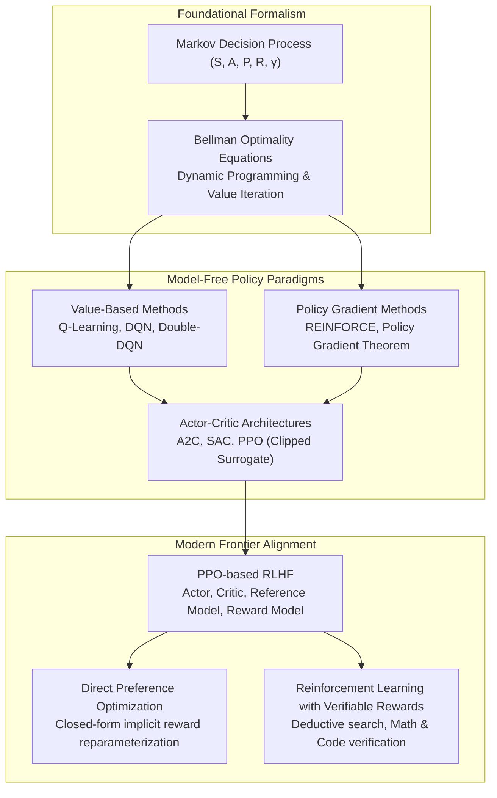

{: .light .shadow .rounded-10 w='1212' h='668' }

## How Does Reinforcement Learning Bridge Optimal Control and Frontier AI?

Reinforcement Learning (RL) occupies a distinctive position in machine learning. Unlike supervised learning, which minimizes empirical loss over static labeled datasets, or unsupervised learning, which uncovers latent geometric structure in unannotated data, reinforcement learning solves the optimal sequential decision problem. An autonomous agent navigates an unfamiliar stochastic environment by taking actions, observing state transitions, and optimizing long-term cumulative reward signals through active trial and error.

While RL was historically associated with robotics and arcade gaming, the modern explosion of generative AI transformed reinforcement learning into the definitive post-training technology. Frontier foundation models rely on reinforcement learning to align linguistic fluency with human preferences, eliminate dangerous failure modes, and expand multi-step deductive reasoning capabilities.

Understanding reinforcement learning requires examining its mathematical foundations—from Markov Decision Processes and Bellman dynamic programming to modern policy gradient methods, Proximal Policy Optimization (PPO), and Direct Preference Optimization (DPO).



---

## 1. The Markov Decision Process and Bellman Optimality

Reinforcement learning formalizes sequential decision making through the **Markov Decision Process (MDP)**, defined by the 5-tuple:

$$\mathcal{M} = \langle \mathcal{S}, \mathcal{A}, \mathcal{P}, \mathcal{R}, \gamma \rangle$$

Where:
- $\mathcal{S}$ is the state space.
- $\mathcal{A}$ is the action space.
- $\mathcal{P}(s' \mid s, a) = \mathbb{P}(S_{t+1} = s' \mid S_t = s, A_t = a)$ represents state transition probability satisfying the Markov property (the future is conditionally independent of the past given the present state).
- $\mathcal{R}(s, a) = \mathbb{E}[R_{t+1} \mid S_t = s, A_t = a]$ is the scalar reward function.
- $\gamma \in [0, 1)$ is the discount factor ensuring finite convergence over infinite horizons.

The agent interacts with the environment through a policy $\pi(a \mid s) = \mathbb{P}(A_t = a \mid S_t = s)$. The objective is to maximize the expected discounted return:

$$J(\pi) = \mathbb{E}_{\tau \sim \pi} \left[ \sum_{t=0}^\infty \gamma^t R(S_t, A_t) \right]$$

### The Bellman Equations
Richard Bellman established that value functions can be decomposed recursively into an immediate reward plus the discounted value of successor states:

$$V^\pi(s) = \sum_{a \in \mathcal{A}} \pi(a \mid s) \left[ \mathcal{R}(s, a) + \gamma \sum_{s' \in \mathcal{S}} \mathcal{P}(s' \mid s, a) V^\pi(s') \right]$$

$$Q^\pi(s, a) = \mathcal{R}(s, a) + \gamma \sum_{s' \in \mathcal{S}} \mathcal{P}(s' \mid s, a) \sum_{a' \in \mathcal{A}} \pi(a' \mid s') Q^\pi(s', a')$$

The unique optimal value functions $V^*$ and $Q^*$ satisfy the non-linear **Bellman Optimality Equations**:

$$Q^*(s, a) = \mathcal{R}(s, a) + \gamma \sum_{s' \in \mathcal{S}} \mathcal{P}(s' \mid s, a) \max_{a' \in \mathcal{A}} Q^*(s', a')$$

In discrete tabular settings with known dynamics, dynamic programming (Value Iteration, Policy Iteration) solves for $Q^*$ in polynomial time, as examined in our analysis of [foundational algorithms](/posts/10-core-algorithms/). In continuous or high-dimensional environments, however, tabular solutions collapse, necessitating deep function approximation.

---

## 2. Policy Gradients and Proximal Policy Optimization (PPO)

Rather than estimating action-values and choosing greedy actions ($\arg\max_a Q(s, a)$), policy gradient methods directly parameterize the policy $\pi_\theta(a \mid s)$ with neural network weights $\theta$.

The **Policy Gradient Theorem** (Sutton et al., 1999) enables computing the gradient of expected return without requiring an explicit model of transition dynamics $\mathcal{P}$:

$$\nabla_\theta J(\theta) = \mathbb{E}_{\tau \sim \pi_\theta} \left[ \sum_{t=0}^T \nabla_\theta \log \pi_\theta(a_t \mid s_t) A^{\pi_\theta}(s_t, a_t) \right]$$

Where $A^\pi(s, a) = Q^\pi(s, a) - V^\pi(s)$ represents the **Advantage function**, measuring how much better action $a$ performs compared to the policy's average expected performance at state $s$.

```
State (s) ────► [ Actor Network pi_theta ] ────► Action Probabilities (pi(a|s))
      │
      └───────► [ Critic Network V_phi ]   ────► State Baseline (V(s))
                                                        │
                      Reward (R) ───────────────────────┴──► Advantage (A = Q - V)
```

### The PPO Clipped Surrogate Objective
Naive policy gradient updates suffer from severe variance and instability: a single unconstrained gradient step can displace policy weights into catastrophic performance collapses. 

To prevent destructive updates, Schulman et al. (2017) introduced **Proximal Policy Optimization (PPO)**. PPO tracks the probability ratio between the current policy and the previous policy:

$$r_t(\theta) = \frac{\pi_\theta(a_t \mid s_t)}{\pi_{\theta_{\text{old}}}(a_t \mid s_t)}$$

And maximizes the clipped surrogate objective:

$$L^{\text{CLIP}}(\theta) = \hat{\mathbb{E}}_t \left[ \min\left( r_t(\theta) \hat{A}_t, \, \text{clip}(r_t(\theta), 1-\epsilon, 1+\epsilon) \hat{A}_t \right) \right]$$

By clipping $r_t(\theta)$ within $[1-\epsilon, 1+\epsilon]$ (typically $\epsilon = 0.2$), PPO penalizes excessively large policy updates, providing stable convergence across both continuous robotic simulation and large-scale language model alignment.

---

## 3. The Paradigm Shift to Direct Preference Optimization (DPO)

For several years, aligning large language models with human values required a four-network PPO loop:
1. **Actor Model** $\pi_\theta$: The generator generating tokens.
2. **Reference Model** $\pi_{\text{ref}}$: Frozen initial policy preventing catastrophic forgetting via KL penalty.
3. **Reward Model** $r_\phi$: Pre-trained scoring network evaluating completions.
4. **Critic Model** $V_\psi$: Value network estimating token-level return baselines.

As documented in our case study on [single-machine RLHF training](/posts/rlhf-summary-from-human-feedback-single-dgx-spark/), running four multi-billion-parameter models concurrently exhausts GPU high-bandwidth memory and introduces severe training instability (critic divergence, reward hacking).

Rafailov et al. (2023) bypassed this infrastructure bottleneck with **Direct Preference Optimization (DPO)**. By establishing that the ground-truth reward function can be analytically reparameterized in terms of the optimal policy and reference policy:

$$r(x, y) = \beta \log \frac{\pi^*(y \mid x)}{\pi_{\text{ref}}(y \mid x)} + \beta \log Z(x)$$

DPO substitutes this formulation directly into the Bradley-Terry preference likelihood, deriving an exact closed-form loss over paired preferences $(x, y_w, y_l)$:

$$\mathcal{L}_{\text{DPO}}(\pi_\theta; \pi_{\text{ref}}) = -\mathbb{E}_{(x, y_w, y_l)} \left[ \log \sigma \left( \beta \log \frac{\pi_\theta(y_w \mid x)}{\pi_{\text{ref}}(y_w \mid x)} - \beta \log \frac{\pi_\theta(y_l \mid x)}{\pi_{\text{ref}}(y_l \mid x)} \right) \right]$$

```
Prompt (x) 
    ├── Winner (y_w) ──► log [ pi_theta(y_w|x) / pi_ref(y_w|x) ] ──┐
    │                                                               ├──► Difference ──► [ -log sigma ] ──► Loss
    └── Loser (y_l)  ──► log [ pi_theta(y_l|x) / pi_ref(y_l|x) ] ──┘
```

DPO eliminates both the Critic and Reward networks from the active training loop, reducing memory consumption by over 50% while delivering stable, deterministic gradient updates across binary preference datasets.

---

## Algorithmic Comparison: From Classical RL to Frontier Post-Training

| Algorithm | Paradigm | Action Space | Primary Advantage | Primary Constraint | Primary Application in 2026 |
| :--- | :--- | :--- | :--- | :--- | :--- |
| **Deep Q-Network (DQN)** | Value-based, Off-policy | Discrete | Sample efficient via replay buffer | Struggles with continuous actions | Discrete game control, network packet scheduling |
| **Soft Actor-Critic (SAC)** | Actor-Critic, Off-policy | Continuous | Maximum entropy exploration | Sensitive to hyperparameter tuning | Autonomous vehicle control, robotic manipulation |
| **Proximal Policy Opt (PPO)** | Actor-Critic, On-policy | Discrete / Continuous | Exceptionally stable updates | Computationally intensive | Online game AI, complex interactive RL environments |
| **Direct Preference Opt (DPO)** | Closed-form offline alignment | Discrete (Token sequences) | No reward/critic model required | Susceptible to distribution shift outside reference data | Foundation model instruction alignment |
| **Reinforcement Learning w/ Verifiable Rewards (RLVR)** | On-policy search & rollout | Discrete (Token sequences) | Immune to reward hacking via deterministic ground-truth | Requires programmatic verifiers (code/math) | Test-time reasoning scaling (o1/o3 architectures) |

---

## Distributed RL Systems and Tooling

Scaling modern reinforcement learning requires sophisticated distributed coordination:
- **CleanRL**: High-quality, single-file implementations designed for algorithmic clarity and reproducibility in academic research.
- **Ray RLlib**: Industry-standard distributed framework decoupling environment rollout workers from centralized gradient optimizers across heterogeneous GPU clusters.
- **TRL (Transformer Reinforcement Learning)**: Hugging Face’s dedicated post-training ecosystem integrating DeepSpeed ZeRO and vLLM to co-locate rollout generation and backpropagation across unified tensor-parallel pools.

---

## How Reinforcement Learning Evolved Across 2026

Throughout 2026, the reinforcement learning landscape underwent two structural transformations:

1. **The Ascendance of Verifiable Search (RLVR)**: Subjective human feedback (RLHF) has largely plateaued for advanced technical tasks. Frontier laboratories increasingly train models using automated test harnesses—compilers, theorem provers (Lean 4), formal logic solvers, and synthetic multi-agent game equilibria. Models explore thousands of candidate reasoning paths, receiving binary ground-truth rewards upon verified execution, a paradigm examined in our audit of [frontier LLM research trends](/posts/llm-research-trend/).
2. **Online Iterative DPO / KTO / ORPO**: Pure offline DPO suffered when models generated responses diverging from the pre-collected preference dataset. Modern 2026 pipelines employ **iterative online DPO**, where the target policy periodically samples fresh outputs, an automated LLM judge or programmatic oracle scores them, and preference pairs are dynamically refreshed every epoch.

---

## Key Takeaways

- **The Markov Foundation Holds**: Despite shifting from grid worlds to billion-parameter neural networks, the core mathematical structure of states, actions, transition distributions, and Bellman optimality remains the foundation of RL.
- **PPO Solved Stability; DPO Solved Overhead**: PPO introduced safe clipped updates for on-policy learning, while DPO eliminated critic and reward network memory footprints for sequence alignment.
- **Deductive Verification Surpasses Preference**: The frontier of reinforcement learning has progressed from matching human stylistic preferences toward autonomous deductive discovery via verifiable reward environments.

---

## New Questions

- How will multi-agent self-play reinforcement learning navigate non-stationary equilibria when hundreds of autonomous agents interact in financial markets or software systems?
- Can reinforcement learning with verifiable rewards generalize beyond formal domains (mathematics, software engineering) into subjective human disciplines like legal argumentation and diplomatic strategy?

---

## References

- Bellman, R. (1957). *Dynamic Programming*. Princeton University Press. [https://press.princeton.edu/books/hardcover/9780691146683/dynamic-programming](https://press.princeton.edu/books/hardcover/9780691146683/dynamic-programming) (accessed 2026-10-18).
- Sutton, R. S., McAllester, D., Singh, S., & Mansour, Y. (1999). *Policy Gradient Methods for Reinforcement Learning with Function Approximation*. Advances in Neural Information Processing Systems, 12. [https://proceedings.neurips.cc/paper/1999/file/464d828b85b0bed98e80ade0a5c43b0f-Paper.pdf](https://proceedings.neurips.cc/paper/1999/file/464d828b85b0bed98e80ade0a5c43b0f-Paper.pdf) (accessed 2026-10-18).
- Mnih, V., Kavukcuoglu, K., Silver, D., Rusu, A. A., Veness, J., Bellemare, M. G., ... & Hassabis, D. (2015). *Human-level Control Through Deep Reinforcement Learning*. Nature, 518(7540), 529–533. [https://doi.org/10.1038/nature14236](https://doi.org/10.1038/nature14236) (accessed 2026-10-18).
- Schulman, J., Wolski, F., Dhariwal, P., Radford, A., & Klimov, O. (2017). *Proximal Policy Optimization Algorithms*. arXiv preprint arXiv:1707.06347. [https://arxiv.org/abs/1707.06347](https://arxiv.org/abs/1707.06347) (accessed 2026-10-18).
- Rafailov, R., Sharma, A., Mitchell, E., Ermon, S., Manning, C. D., & Finn, C. (2023). *Direct Preference Optimization: Your Language Model is Secretly a Reward Model*. Advances in Neural Information Processing Systems, 36. [https://arxiv.org/abs/2305.18290](https://arxiv.org/abs/2305.18290) (accessed 2026-10-18).
