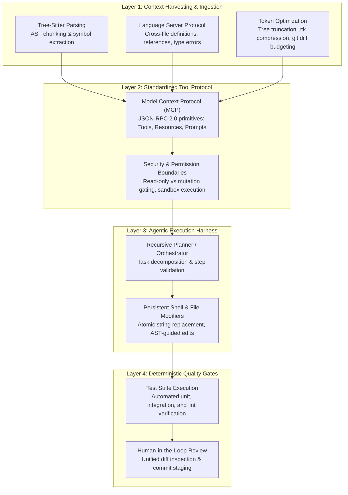

{: .light .shadow .rounded-10 w='1212' h='668' }

## Which Architectural Layers Define the Modern AI Developer Toolchain?

The discourse surrounding developer productivity tools in 2023 and 2024 was dominated by undifferentiated listicles enumerating dozens of single-purpose web wrappers. Marketing copy promised miraculous efficiency gains across image generation, generic chatbots, and paraphrasing widgets. In enterprise software engineering, however, real productivity multipliers are governed not by standalone web applications, but by tightly integrated software engineering runtimes.

Modern developer toolchains have transitioned from passive autocomplete utilities to autonomous agentic execution environments. Software engineers no longer merely prompt language models for code snippets; they orchestrate systems capable of reading repository ASTs (Abstract Syntax Trees), invoking language server protocols (LSP), executing shell diagnostics, proposing unified diffs, and self-correcting against local test suites.

Evaluating this ecosystem requires looking past superficial feature checklists to examine the technical architecture: context ingestion mechanics, tool routing protocols, execution sandboxing, and deterministic verification gates.



---

## 1. Evolution from Ghost Text to Autonomous Repository Agents

The architecture of AI developer assistance has evolved through three distinct generations:

1. **First-Generation Ghost Text (2021–2023)**: Powered by single-token autoregressive models (e.g., original GitHub Copilot), these systems operated on a narrow local context window (typically 2,000–8,000 tokens) surrounding the active editor cursor. Ingestion relied on simple heuristic prefix/suffix matching without semantic understanding of project dependencies.
2. **Second-Generation Multi-File Assistants (2023–2024)**: Introduced vector search (RAG) over codebase embeddings and basic chat sidebars. While capable of multi-file references, they lacked write-side execution primitives; developers had to manually copy, paste, and debug generated snippets.
3. **Third-Generation Agentic Runtimes (2025–2026)**: Characterized by autonomous command-line interfaces and deep IDE integrations (e.g., Aider, Claude Code, Cursor Composer, OpenClaw). As described in our blueprint for [building minimal AI assistant harnesses](/posts/build-your-own-ai-assistant-minimal-openclaw/), these systems operate in a continuous loop: inspect repository structure $\to$ plan edits $\to$ modify files $\to$ run automated test suites $\to$ interpret error traces $\to$ self-correct until the task passes all gates.

```
User Instruction ────► [ Harvest Repo Context ] ────► [ Generate Edit Diff ]
                             ▲                                    │
                             │                                    ▼
                     [ Apply Feedback ] ◄──── [ Run Test / Lint Suite ]
```

---

## 2. Context Harvesting: Tree-Sitter, LSP, and Token Economy

A persistent failure mode in early AI coding tools was context saturation. Stuffing hundreds of raw source files into an LLM's prompt window triggers severe attention dilution ("needle in a haystack" degradation) and exhausts API budgets. 

State-of-the-art developer runtimes employ structured context pruning:
- **Tree-Sitter Syntax Parsing**: Rather than passing raw text, the harness parses code into an Abstract Syntax Tree (AST), extracting function signatures, docstrings, class hierarchies, and type definitions while discarding internal method implementations until specifically required.
- **LSP-Guided Dependency Tracing**: When an agent modifies a function, it queries the local Language Server Protocol server for incoming calls and type definitions across the codebase, ensuring that breaking signature changes are propagated immediately.
- **Token Density Optimization**: Modern tools employ token compressors (such as `rtk` and AST minifiers) that compress compiler logs, test outputs, and file diffs by 60–90%, preserving context window headroom for deductive reasoning, a dynamic underpinned by the computational algorithms analyzed in our survey of [foundational algorithms](/posts/10-core-algorithms/).

---

## 3. Standardized Tool Protocols: The Model Context Protocol (MCP)

Historically, every developer tool built proprietary plugins to access databases, local file trees, and cloud consoles. Anthropic’s introduction of the **Model Context Protocol (MCP)** established an open, JSON-RPC 2.0-based standard for connecting agents to external capabilities:

$$\text{Request: } \{\text{"jsonrpc"}: \text{"2.0"}, \text{"method"}: \text{"tools/call"}, \text{"params"}: \{\text{"name"}: \text{"run_test"}, \text{"arguments"}: \{\dots\}\}\}$$

MCP establishes three uniform capability primitives:
1. **Tools**: Executable functions with JSON schema definitions that the model can invoke (e.g., executing a terminal command, querying a PostgreSQL database, or creating a git branch).
2. **Resources**: Passive contextual data streams (e.g., system logs, file contents, API schemas) that the model can inspect.
3. **Prompts**: Pre-configured prompt templates for specialized developer workflows.

By decoupling the reasoning agent from concrete environment tools, MCP enables developer tools to swap models and runtime backends without rewriting integration harnesses.

---

## 4. Verification Gates: Test-Driven Development as an Alignment Scaffold

Unconstrained LLM code generation is inherently probabilistic. When an agent attempts complex multi-file refactoring, small hallucinations in variable names, import paths, or corner-case logic can corrupt an entire repository.

The defining architectural feature of reliable agentic tools is **deterministic execution verification**:
- **Red-Green-Refactor Cycles**: The agent writes an automated test verifying the desired behavior *before* modifying production source code.
- **Compiler / Linter Feedback Loops**: Rather than presenting unverified code to the human developer, the agent executes local linters (e.g., ESLint, Ruff, cargo clippy) and compilers directly in a sandboxed bash subshell. If compilation fails, the stderr trace is fed back into the agent context for immediate self-correction.
- **Atomic Rollback Primitives**: If an edit trajectory fails to converge within a fixed token or loop budget (e.g., 5 attempts), the runtime executes an atomic `git reset --hard` to restore the repository to a pristine state, preventing broken partial implementations from contaminating the workspace.

---

## Architectural Comparison of Developer AI Paradigms

| Tooling Class | Representative Systems | Context Mechanism | Execution Boundary | Primary Failure Mode | Optimal Engineering Use Case |
| :--- | :--- | :--- | :--- | :--- | :--- |
| **Inline Autocomplete** | GitHub Copilot, Supermaven | Cursor vicinity prefix/suffix | Read-only in editor buffer | Context blindness outside active file | Repetitive boilerplate, unit test scaffolding |
| **CLI Repo Agents** | Claude Code, Aider, OpenClaw | Tree-sitter repo map + Git status | Sandboxed shell + Git diffing | Runaway loop cost on ambiguous specs | Multi-file refactoring, end-to-end bug fixing |
| **Integrated IDEs** | Cursor, Windsurf | Native editor AST + Vector RAG | Direct buffer mutation + terminal | High memory footprint, vendor lock-in | Full-stack application feature development |
| **Autonomous CI Bots** | Devin, GitHub Copilot Workspace | Ephemeral Docker container | Full container bash + PR creation | Over-engineering, hallucinated dependencies | Backlog issue triage, dependency migrations |

---

## How AI Developer Tooling Evolved Across 2026

Throughout 2026, the developer tooling landscape matured from single-agent experimentation into enterprise-grade software factory pipelines:

1. **Multi-Agent Specialized Workpools**: Rather than tasking a single generalist model with an entire software project, modern harnesses deploy orchestrated agent teams. A lead architect agent decomposes requirements into formal specifications; specialized implementation workers write unit tests and code in parallel worktrees; and an independent reviewer agent audits security vulnerabilities and performance regressions.
2. **Local Inference Co-Processors**: The rise of efficient quantized architectures (such as BitNet b1.58 and small specialized coding models like Qwen-2.5-Coder and DeepSeek-Coder) enables developers to run latency-critical autocomplete and lint-fix loops entirely offline on workstation NPUs/GPUs, reserving expensive cloud frontier models for complex multi-step reasoning, as examined in our [frontier LLM research trends review](/posts/llm-research-trend/).
3. **Deterministic CI/CD Guardrails**: Automated PR review engines in GitHub Actions and GitLab CI automatically run test suites, check license compliance, evaluate mutation test scores, and verify that LLM-authored contributions satisfy architectural boundaries prior to human sign-off.

---

## Key Takeaways

- **Architecture Trumps Raw Model Intelligence**: A smaller open-weight model equipped with an AST repository map, an LSP integration, and a test-execution loop consistently outperforms an unguided frontier model writing code in a raw chat window.
- **Verification Is Non-Negotiable**: Deterministic test runners and compiler feedback provide the objective truth signal necessary to prevent agentic hallucination drift.
- **Standardized Protocols Win**: Protocols like MCP decouple developer tools from proprietary silos, creating an open ecosystem for tool-using agents.

---

## New Questions

- How will autonomous multi-agent software teams handle merge conflict resolution and distributed race conditions when dozens of agents commit code simultaneously to a shared monorepo?
- What formal verification techniques will emerge to prove that AI-generated business logic is mathematically free of security vulnerabilities and regulatory violations before production deployment?

---

## References

- Hou, X., Zhao, Y., Liu, Y., Yang, Z., Wang, K., Li, L., ... & Lo, D. (2024). *Large Language Models for Software Engineering: A Systematic Literature Review*. ACM Transactions on Software Engineering and Methodology. [https://doi.org/10.1145/3641541](https://doi.org/10.1145/3641541) (accessed 2026-10-18).
- Anthropic. (2024). *The Model Context Protocol (MCP): Open Standards for Agentic Tool Integration*. Anthropic Engineering Blog. [https://www.anthropic.com/news/model-context-protocol](https://www.anthropic.com/news/model-context-protocol) (accessed 2026-10-18).
- Jimenez, C. E., Yang, J., Wettig, A., Yao, S., Pei, K., Press, O., & Narasimhan, K. (2024). *SWE-bench: Can Language Models Resolve Real-World GitHub Issues?*. International Conference on Learning Representations (ICLR 2024). [https://arxiv.org/abs/2310.06770](https://arxiv.org/abs/2310.06770) (accessed 2026-10-18).
- Gauthier, P. (2023). *Aider: AI Pair Programming in Your Terminal with Repository-Wide Context*. Aider Technical Documentation. [https://aider.chat/docs/repomap.html](https://aider.chat/docs/repomap.html) (accessed 2026-10-18).
- Chen, M., Tworek, J., Jun, H., Yuan, B., Pinto, H. P. d. O., Kaplan, J., ... & Zaremba, W. (2021). *Evaluating Large Language Models Trained on Code*. arXiv preprint arXiv:2107.03374. [https://arxiv.org/abs/2107.03374](https://arxiv.org/abs/2107.03374) (accessed 2026-10-18).
