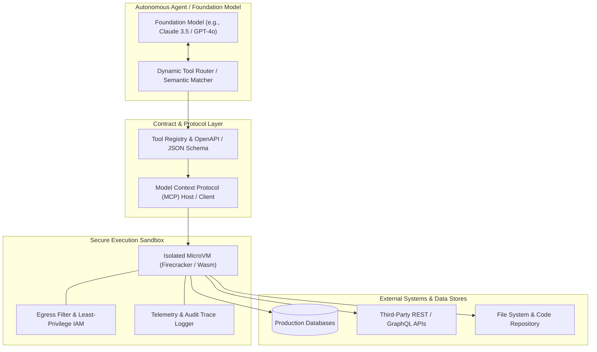
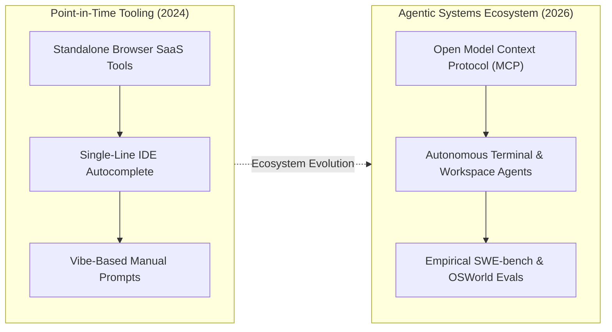

## Why Did Generic Tool Listicles Fail to Guide Production AI Architecture?

During the initial generative AI boom of 2023 and 2024, social media feeds and technology blogs were saturated with viral roundups promoting "Top 50" or "60 Must-Have AI Tools." These compilations cataloged dozens of disjointed software-as-a-service (SaaS) applications across arbitrary categories like writing assistants, social media schedulers, background noise removers, and prompt generators.

For systems architects and software engineering leaders, these consumer listicles offered virtually zero architectural value. In enterprise production environments, software tools cannot exist as unmanaged, siloed browser tabs. Real-world systems require deterministic tool invocation, verifiable authentication, strict input validation, isolated sandbox execution, and centralized observability.

Treating AI tooling as an assortment of independent chat applications created severe enterprise vulnerabilities:

1. **The Wrapper Trap and Rapid Commoditization**: The vast majority of early commercial AI tools were thin graphical wrappers around OpenAI's `gpt-3.5-turbo` or `gpt-4` completion endpoints. When foundation model providers updated baseline context windows, multi-modal capabilities, or instruction-following performance, entire categories of single-feature wrapper startups became obsolete overnight.
2. **Context Window Saturation**: Injecting dozens of custom API definitions directly into an LLM's system prompt consumes thousands of tokens per query. Unconstrained tool descriptions inflate inference latency, increase per-token operating costs, and degrade model reasoning accuracy due to attention dilution over bloated context windows.
3. **Security, Compliance, and Data Exfiltration**: Allowing unvetted external AI utilities to interact with proprietary codebases, customer data, and internal databases introduces profound supply chain risks. Without strict sandboxing and egress filtering, malicious or hallucinated tool invocations can execute destructive SQL queries, overwrite production files, or exfiltrate private credentials.

As demonstrated in our architectural blueprints on [production LLM technology stacks](/posts/llm-build-tools-cookbook/) and [empirical evaluation frameworks for language models](/posts/evaluating-llm/), transitioning from toy demos to enterprise systems requires a principled, protocol-driven approach to AI tooling.



---

## The Architectural Taxonomy of Tool-Augmented Language Models

Modern tool-augmented language systems move beyond static lists of SaaS tools, organizing capabilities into a rigorous four-layer engineering hierarchy:

### 1. Schema Definition and Contract Specifications
To invoke external functionality reliably, foundation models require strictly defined parameter contracts. Modern engines rely on **JSON Schema (Draft 7 / 2020-12)** and **OpenAPI 3.1** specifications:
- **Strict Parameter Typing**: Every function argument defines explicit types (`string`, `number`, `boolean`, `array`, `object`), enumerated allowed values, and mandatory requirements.
- **Constrained Decoding**: Inference serving engines enforce grammar-constrained decoding (e.g., via Outlines or Jsonformer). The sampler masks invalid tokens dynamically during generation, guaranteeing that the model produces syntactically valid JSON matching the exact schema on the very first forward pass.

### 2. Semantic Tool Retrieval and Dynamic Routing
When an autonomous system has access to hundreds of available tools, injecting all tool schemas into the system prompt is computationally infeasible. Instead, systems employ **Retrieval-Augmented Tool Use (RATU)**:
- Available tools are indexed in a vector database using embeddings generated over their operational docstrings and parameter descriptions.
- When a user query arrives, a dynamic router executes a similarity search, retrieving only the top-$k$ (e.g., $k=3 \dots 5$) most relevant tool definitions and binding them dynamically into the model's active inference context.

### 3. Execution Sandboxing and Blast Radius Isolation
Invoking code or shell commands requires complete physical and logical isolation from the host operating system:
- **Lightweight MicroVMs**: Frameworks like AWS Firecracker instantiate minimal Linux microVMs in under 100 milliseconds, providing hardware-level KVM isolation for arbitrary code execution.
- **WebAssembly (Wasm) Runtimes**: For language-agnostic lightweight tasks, sandboxing via Wasm runtimes (such as Wasmtime or Extism) enforces strict memory boundaries and restricts filesystem access to designated virtual mounts.
- **Network Egress Guardrails**: Sandboxes execute with default-deny outbound network policies, preventing malicious prompt injections from exfiltrating environment variables or authentication tokens to external command-and-control servers.

### 4. Structured Output Parsing and Reflexive Error Recovery
When a tool execution fails—whether due to an invalid SQL query, a network timeout, or schema mismatches—the output must not trigger a fatal system exception:
- The raw error payload (e.g., `psycopg2.errors.UndefinedColumn: column "user_id" does not exist`) is captured and injected back into the dialogue history as a tool response message.
- The model observes the stack trace, reflects on the failed assumption, self-corrects the query syntax, and re-invokes the tool within an automated retry budget.

---

## Protocol Standardization: From Custom Tool Calling to Model Context Protocol (MCP)

Historically, integrating tools into LLM workflows suffered from extreme fragmentation. OpenAI defined proprietary `tools` payloads, Anthropic utilized XML-structured tool tags, and orchestration frameworks invented custom Python wrapper abstractions. This created an $M \times N$ integration nightmare: connecting $M$ models to $N$ data sources required writing and maintaining bespoke adapter code for every single permutation.

In late 2024, the introduction of the **Model Context Protocol (MCP)** by Anthropic fundamentally restructured the AI tooling landscape into an open, vendor-neutral standard:

```
+----------------------------------------------------------------------------------------------------+
|                                    Model Context Protocol (MCP) Architecture                       |
+----------------------------------------------------------------------------------------------------+
| Component            | Protocol Role                       | Key Capabilities                      |
+----------------------+-------------------------------------+---------------------------------------+
| MCP Host             | Client runtime (Claude Desktop,     | Coordinates sessions, executes model  |
|                      | VS Code, Antigravity, OpenCode)     | requests, and displays user interfaces|
| MCP Client           | In-process protocol connector       | Maintains 1:1 stateful connections to  |
|                      |                                     | external MCP servers via JSON-RPC 2.0 |
| MCP Server           | Lightweight service exposing tools  | Exposes three standardized primitives:|
|                      | and external resources              | Prompts, Resources, and Tools         |
+----------------------------------------------------------------------------------------------------+
```

### The Three MCP Primitives
1. **Prompts**: Parameterized prompt templates and slash-commands exposed directly by servers to guide human-in-the-loop and agent workflows.
2. **Resources**: Structured, read-only data attachments (such as database schemas, local git logs, or application state) that can be inspected and attached directly to model context.
3. **Tools**: Executable functions that perform side-effect operations (e.g., executing SQL mutations, running automated test suites, or sending API payloads), complete with approval boundaries.

Communication is formalized over two primary transports: **stdio** for local sub-processes running on the user's workstation, and **Streamable HTTP with Server-Sent Events (SSE)** for remote microservices across distributed networks.

---

## How AI Developer Tooling Evolved Across 2026

By 2026, the utility of AI tools has shifted from passive autocomplete assistants and disconnected web services to deeply integrated, autonomous engineering agents:



1. **Autonomous Workspace Agents Replacing Single-Line Autocomplete**: Early developer tooling focused primarily on in-line next-token code completion (e.g., GitHub Copilot, Tabnine). In 2026, autonomous workspace agents (such as Claude Code, Codex CLI, and Antigravity) operate across entire Git repositories: reading dependency trees, executing automated test suites, diagnosing compilation errors, and submitting verified pull requests autonomously.
2. **Standardized Agent Benchmarks Over Anecdotal Reviews**: Subjective listicles describing tool features have been completely replaced by rigorous public benchmarks. Platforms are evaluated systematically against **SWE-bench Verified** (resolving real GitHub issues in major open-source repos), **WebArena** (multi-step web navigation), and **OSWorld** (operating-system-level GUI tasks), providing reproducible statistical verification of agent capabilities.
3. **Spec-Driven Dynamic Tool Synthesis**: Rather than waiting for third-party developers to author bespoke connectors, advanced 2026 agents can ingest raw OpenAPI or GraphQL endpoint definitions, synthesize typed MCP server modules, author companion unit tests, and register the tools into their active execution registries on the fly.
4. **Token-Budgeted Tool Proxies and Response Filtering**: Massive tool responses (such as dumping a 10,000-line JSON payload or full shell logs) previously exhausted model context windows. Modern enterprise tooling integrates intelligent proxy filters (such as `rtk` and semantic extractors) that strip noise, truncate redundant tabular outputs, and compress raw tool responses by 60% to 90% before returning tokens to the LLM.

---

## Key Takeaways

- **Beyond the Wrapper Trap**: Ad-hoc SaaS listicles promote commoditized, single-feature wrappers; enterprise architectures require protocol-standardized, secure, and observable tool execution.
- **The Four-Tier Architecture**: Reliable tool integration demands strict schema validation (JSON Schema/OpenAPI), dynamic semantic routing, isolated microVM sandboxing, and structured error recovery.
- **Model Context Protocol (MCP)**: The open MCP standard eliminates $M \times N$ adapter complexity by establishing a unified JSON-RPC protocol across host clients and external tool servers.
- **Benchmark-Driven Tooling**: In 2026, developer tooling is defined by autonomous agentic loops evaluated against rigorous empirical benchmarks like SWE-bench rather than superficial feature lists.

---

## New Questions

- How do multi-tenant agent execution platforms manage the cold-start latency of MicroVM sandboxes when handling interactive, sub-second API requests?
- What are the optimal token-compression strategies for streaming massive tabular database payloads into an agent's reasoning loop without loss of semantic precision?
- How should permission delegation and cryptographic signing be structured when autonomous agents chain multiple third-party MCP servers across untrusted networks?

---

## References

- Schick, Timo, Jane Dwivedi-Yu, Roberto Dessì, Roberta Raileanu, Maria Lomeli, Luke Zettlemoyer, Nicola Cancedda, and Thomas Scialom. *Toolformer: Language Models Can Teach Themselves to Use Tools*. Advances in Neural Information Processing Systems (NeurIPS), 2023. [https://arxiv.org/abs/2302.04761](https://arxiv.org/abs/2302.04761) (accessed 2026-10-18).
- Anthropic. *Model Context Protocol: An Open Standard for Connecting AI Models to Tools and Context*. Anthropic Engineering Documentation, 2024. [https://modelcontextprotocol.io/introduction](https://modelcontextprotocol.io/introduction) (accessed 2026-10-18).
- Jimenez, Carlos E., John Yang, Alexander Wettig, Shunyu Yao, Kexin Pei, Ofir Press, and Karthik Narasimhan. *SWE-bench: Can Language Models Resolve Real-World GitHub Issues?* International Conference on Learning Representations (ICLR), 2024. [https://arxiv.org/abs/2310.06770](https://arxiv.org/abs/2310.06770) (accessed 2026-10-18).
- Patil, Shishir G., Tianjun Zhang, Xin Wang, and Joseph E. Gonzalez. *Gorilla: Large Language Model Connected with Massive APIs*. arXiv preprint arXiv:2305.15334, 2023. [https://arxiv.org/abs/2305.15334](https://arxiv.org/abs/2305.15334) (accessed 2026-10-18).
