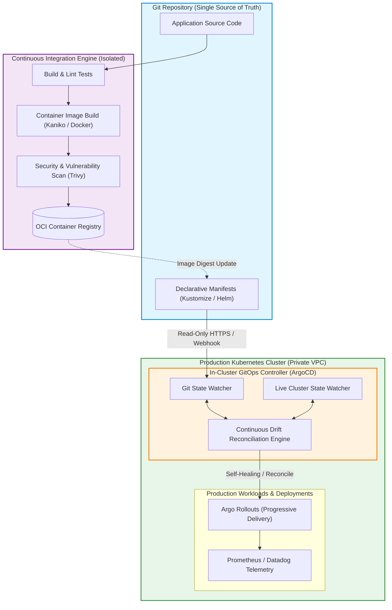

The discipline of DevOps originated to bridge the structural divide between software development and IT operations. Historically, engineers wrote code in isolation and tossed binaries over the wall to system administrators, who manually executed deployments via imperative shell scripts, SSH sessions, and hand-crafted server configurations. This manual paradigm created chronic production instability: environment configuration drift, snowflake servers that could never be reproduced, and catastrophic deployment outages.

Over the past decade, empirical research—culminating in the DORA metrics formalized by Forsgren, Humble, & Kim (2018)—proved that high-performing engineering organizations achieve both rapid delivery velocity and elite system stability by automating the entire software delivery lifecycle.

However, the proliferation of cloud-native infrastructure, microservices, and distributed Kubernetes clusters introduced overwhelming tooling fragmentation. Modern DevOps is no longer just about running Jenkins jobs; it represents a unified, declarative control loop spanning Infrastructure as Code (IaC), GitOps reconciliation, distributed observability, and automated canary promotions.

This source audit analyzes why declarative GitOps replaced imperative CI/CD pipelines, examines the architectural mechanics of in-cluster reconciliation with ArgoCD and Terraform, and traces how site reliability engineering evolved toward autonomous agentic remediation across 2026.


## Why Did Declarative GitOps Replace Imperative Scripted Deployments?

In traditional "push-based" CI/CD pipelines, a central CI server (such as Jenkins or GitHub Actions) builds a container image and directly invokes administrative CLI commands (`kubectl apply`, `helm upgrade`, or cloud provider APIs) to push changes to live production environments.

In enterprise production, this push model introduces three severe architectural failure modes:
1. **The Credential Blast Radius**: The central CI server must hold long-lived, high-privilege cluster administrator credentials. If the CI runner is compromised via an unpinned third-party dependency, the entire production fleet is exposed.
2. **Configuration Drift and Opaque State**: If an on-call engineer makes an emergency hotfix directly on the production cluster via `kubectl edit`, the live cluster state drifts from the git repository. When the next CI pipeline runs, it either overwrites the hotfix or fails catastrophically.
3. **No Auditable Rollback State**: Reverting an imperative script requires writing an inverse imperative script. In complex multi-service rollouts, partial failures leave clusters in undefined, corrupted intermediate states.

The **GitOps** paradigm—formalized by OpenGitOps—resolves this by reversing the control flow from an imperative push to an in-cluster **declarative pull**:



Under GitOps:
- **Declarative Truth**: The entire target state of the system—from replica counts to network policies and ingress routes—is declared in Git.
- **Zero Ingress Credentials**: The cluster pulls configurations from Git. Firewalls can block all incoming administrative ports; no external server needs administrative access into the production VPC.
- **Continuous Drift Detection**: If a manual mutation occurs in the cluster, the in-cluster controller immediately flags the drift and automatically self-heals back to the committed Git commit.

## Technical Mechanics: Declarative GitOps Application Configuration

Implementing robust GitOps requires defining strict synchronization policies and progressive delivery pipelines.

The following manifest demonstrates a production ArgoCD `Application` configuration managing a microservice deployment with automated self-healing, resource pruning, and progressive rollouts:

```yaml
# Production ArgoCD Application Manifest
apiVersion: argoproj.io/v1alpha1
kind: Application
metadata:
  name: payments-service-prod
  namespace: argocd
  labels:
    tier: core-banking
    environment: production
  finalizers:
    - resources-finalizer.argocd.argoproj.io
spec:
  project: default
  source:
    repoURL: 'https://github.com/enterprise/infrastructure-manifests.git'
    targetRevision: main
    path: overlays/production/payments
    kustomize:
      images:
        - 'ghcr.io/enterprise/payments-service:v2.4.1'
  destination:
    server: 'https://kubernetes.default.svc'
    namespace: payments-prod
  syncPolicy:
    automated:
      prune: true        # Automatically delete resources removed from Git
      selfHeal: true     # Automatically revert manual modifications made directly in cluster
      allowEmpty: false
    syncOptions:
      - CreateNamespace=true
      - PrunePropagationPolicy=foreground
      - PruneLast=true
    retry:
      limit: 5
      backoff:
        duration: 5s
        factor: 2
        maxDuration: 3m
```

When coupled with progressive delivery controllers like Argo Rollouts, canary releases automatically shift 5% of production traffic to the new revision, query Prometheus for HTTP error spikes (HTTP 5xx rate > 0.1%), and automatically abort if anomalies appear.

For practical guidance on automating reproducible developer machines and container toolchains, refer to our guide on [agent-native CLI workflows](/posts/cli-anything-agent-native-interfaces/). For managing the underlying GPU cluster infrastructure and serving endpoints that run on top of these pipelines, see our audits of [hybrid MLOps infrastructure](/posts/hybrid-mlops-using-mlflow/) and [NVIDIA NIM containerized serving](/posts/nvidia-hugginface-endpoint-release/).

## How DevOps and Autonomous Site Reliability Evolved Across 2026

Between 2024 and 2026, the DevOps ecosystem shifted from static, human-triggered pipelines toward autonomous, closed-loop reliability platforms:

1. **Autonomous Incident Triage and Agentic Self-Healing**: In 2026, when an alert fires in production, an on-call AI agent does not just post a Slack alert. The agent ingests distributed OpenTelemetry traces, correlates database latency spikes with recent Git commits, inspects container logs via eBPF probes, and drafts a proposed pull request with a rollback or hotfix ready for human approval.
2. **Ephemeral Pull Request Sandboxes with Zero Trust**: High-performing teams no longer share a static "staging" cluster. Every pull request automatically spins up an isolated, ephemeral preview environment with synthetic seed data, executes automated end-to-end integration suites, and tears down the infrastructure as soon as the PR merges.
3. **eBPF-Powered Observability and Kernel-Level Security**: Rather than injecting intrusive sidecars into every Kubernetes pod (which consumes massive CPU overhead), 2026 monitoring utilizes eBPF (extended Berkeley Packet Filter) programs running directly inside the Linux kernel. This provides zero-overhead network tracing, automatic service dependency graph generation, and real-time security anomaly detection.
4. **Policy-as-Code Enforced at Build Time**: Security checks shifted left into CI pre-commit hooks and admission controllers. Open Policy Agent (OPA) and Kyverno policies prevent misconfigured manifests (such as running containers as root or exposing insecure ingress endpoints) from ever being committed to Git.

## Key Takeaways

- **Declarative Beats Imperative**: Declaring system target state in Git and letting in-cluster controllers reconcile discrepancies eliminates configuration drift and snowflake environments.
- **Pull-Based Deployments Minimize Attack Surfaces**: Eliminating external administrative cluster credentials radically hardens Kubernetes security boundaries.
- **Progressive Delivery Safeguards Availability**: Automated canary rollouts governed by real-time metric analysis turn rollouts into low-risk, continuous events.
- **Traceability and Lineage are Non-Negotiable**: Every running container in production must have an unbroken cryptographic provenance trail linking it to a verified Git commit and signed image digest.

## New Questions

- **How Will Autonomous AI Remediation Agents Maintain Blast-Radius Safety?** If an autonomous agent has permission to execute pod restarts or database failovers during an incident, what mathematical safeguards prevent it from triggering cascading failures?
- **What is the True Total Cost of Ownership for Microservice Toolchains?** As engineering teams stitch together dozens of cloud-native tools (Terraform, ArgoCD, Helm, Prometheus, OpenTelemetry, Kyverno), does the cognitive tax of toolchain maintenance outweigh the benefits for small teams?
- **Will Ephemeral Serverless Platforms Render Kubernetes Management Obsolete?** For standard web workloads, will developers abandon custom Kubernetes cluster management in favor of specialized zero-management edge runtimes?

## References

- Kim, G., Humble, J., Debois, P., Willis, J., & Forsgren, N. (2021). *The DevOps Handbook: How to Create World-Class Agility, Reliability, & Security in Technology Organizations* (2nd ed.). IT Revolution Press. Available at: [https://itrevolution.com/product/the-devops-handbook-second-edition/](https://itrevolution.com/product/the-devops-handbook-second-edition/) (accessed 2026-10-18).
- OpenGitOps (2024). *OpenGitOps Principles: Declarative, Versioned, Pulled Automatically, and Continuously Reconciled*. CNCF Standards. Available at: [https://opengitops.dev/](https://opengitops.dev/) (accessed 2026-10-18).
- Forsgren, N., Humble, J., & Kim, G. (2018). *Accelerate: The Science of Lean Software and DevOps: Building and Scaling High Performing Technology Organizations*. IT Revolution Press. Available at: [https://itrevolution.com/product/accelerate/](https://itrevolution.com/product/accelerate/) (accessed 2026-10-18).
- Beyer, B., Jones, C., Petoff, J., & Murphy, N. R. (2016). *Site Reliability Engineering: How Google Runs Production Systems*. O'Reilly Media. Available at: [https://sre.google/sre-book/table-of-contents/](https://sre.google/sre-book/table-of-contents/) (accessed 2026-10-18).
