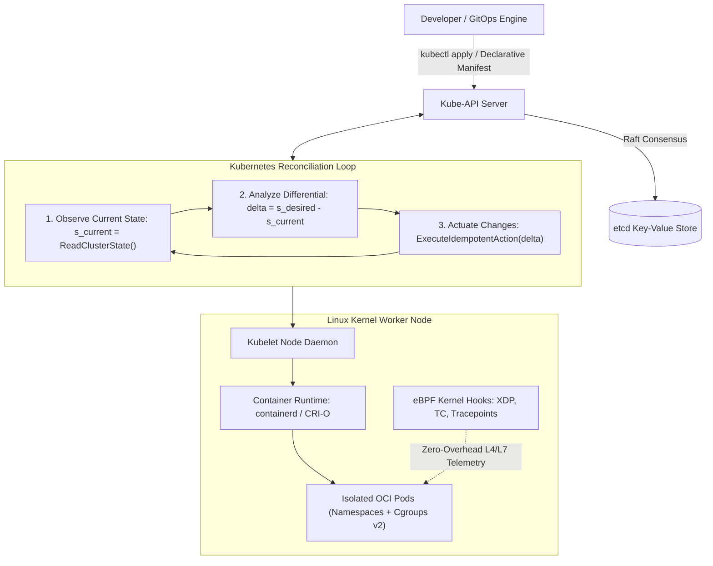
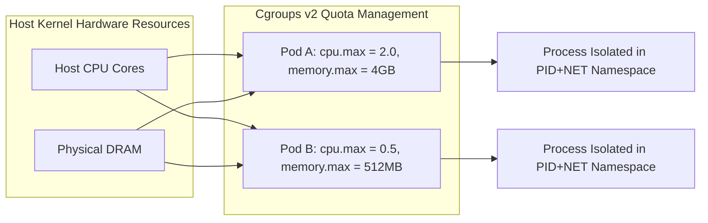
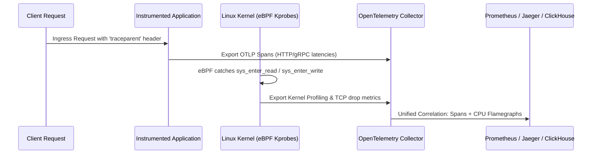

## How Does the Declarative Reconciliation Loop Enforce Distributed System Convergence?

Traditional infrastructure management relied on imperative scripts: operators executed sequential commands (`create_vm`, `mount_disk`, `start_service`), which were inherently brittle. If an intermediate step failed or an unexpected network partition occurred, the infrastructure drifted into an indeterminate, broken state requiring manual intervention.

Cloud-native systems inverted this operational model by establishing **declarative control planes**. Rather than specifying *how* to transition states, operators declare the *desired state* ($\mathcal{S}_{\text{desired}}$) of the system via immutable manifests stored in a distributed consensus store (`etcd`). Continuous, asynchronous control loops observe the current physical state ($\mathcal{S}_{\text{current}}$), compute the differential error vector:

$$\Delta = \mathcal{S}_{\text{desired}} - \mathcal{S}_{\text{current}}$$

and invoke idempotently compensating actuation routines until convergence is attained:

$$\lim_{t \to \infty} \|\mathcal{S}_{\text{desired}} - \mathcal{S}_{\text{current}}(t)\| = 0$$

This reconciliation paradigm—formalized in Kubernetes operators—forms the foundational bedrock of modern scalable infrastructure.

---

## Operating System Internals: Namespaces and Cgroups v2

A common misconception among early practitioners is that a "container" exists as a concrete physical entity within the operating system. In reality, a container is simply a standard Linux process isolated through two core kernel primitives:

### 1. Linux Kernel Namespaces

Namespaces restrict what a process can *see*, partitioning global system resources into virtualized environments:

- **PID Namespace**: Isolates the process ID space. The primary container process runs as PID 1 within its namespace while mapping to an arbitrary high-numbered PID on the host.
- **NET Namespace**: Provides independent virtual network stacks, including loopback interfaces, routing tables, iptables rules, and virtual ethernet pairs (`veth`).
- **MNT Namespace**: Isolates filesystem mount points. Combined with `pivot_root` and layered union filesystems (OverlayFS), the process perceives an isolated root file tree (`/`).
- **IPC / UTS / USER Namespaces**: Segregate System V IPC message queues, hostnames, and user/group ID mappings, allowing unprivileged host users to execute as root inside the container boundary.

### 2. Control Groups (Cgroups v2)

While namespaces govern visibility, cgroups v2 restrict what a process can *consume*, enforcing strict resource bounds:

- **CPU Bandwidth (`cpu.max`)**: Configures Completely Fair Scheduler (CFS) quota allocations. A specification of `50000 100000` grants the process 50ms of CPU execution time per 100ms CFS period ($0.5$ CPU cores). Exceeding this quota results in CPU throttling rather than termination.
- **Memory Limits (`memory.max` and `memory.high`)**: Enforces hard and soft memory boundaries. If container memory consumption breaches `memory.high`, the kernel throttles allocations and initiates aggressive page cache reclaim. If consumption exceeds `memory.max`, the kernel Out-Of-Memory (OOM) killer immediately dispatches `SIGKILL` to terminate the process.

---

## The Network Data Plane: From Sidecars to Ambient eBPF Meshes

As distributed microservices scale, managing cross-service communication requires mutual TLS (mTLS), layer-7 traffic routing, canary rollouts, and distributed tracing. The implementation of this data plane has undergone dramatic architectural evolution:

### 1. The Sidecar Model (Envoy)

In traditional service meshes (e.g., classical Istio, Linkerd), every application pod is injected with a sidecar proxy container. Traffic entering or exiting the application is redirected into the sidecar proxy via local `iptables` NAT PREROUTING rules. 

While functionally comprehensive, the sidecar pattern introduces substantial operational overhead:
- **Memory Bloat**: Each proxy allocates $50\text{--}100\text{ MB}$ of memory for control plane routing tables, multiplying linearly across thousands of pods.
- **Latency Penalties**: Every packet traverses the Linux TCP/IP network stack four distinct times (App $\to$ Loopback $\to$ Sidecar $\to$ Host `veth` $\to$ Physical Interface), injecting multiple context switches and socket buffer copies.

### 2. Sidecarless eBPF Architecture (Cilium)

Modern cloud-native networking leverages **Extended Berkeley Packet Filter (eBPF)** programs loaded directly into the Linux kernel. By attaching eBPF byte-code to eXpress Data Path (XDP) and Traffic Control (TC) kernel hooks, packets are inspected and redirected at the socket layer (`sock_ops`). 

When two pods on the same host communicate, eBPF intercepts the socket write and copies payloads directly between socket buffers, entirely bypassing the host TCP/IP stack. This reduces network transit latency by up to $60\%$ while consolidating mTLS encryption and layer-7 policy enforcement into a single shared node daemon. These low-latency socket optimizations directly mirror the principles of [UDP multiplexing in real-time systems](/posts/the-most-popular-use-cases-for-udp/) and [production web system reliability](/posts/web-application-10-essential/).

| Dimension | Legacy Sidecar Mesh (Envoy) | Ambient eBPF Mesh (Cilium / Ambient) |
| :--- | :--- | :--- |
| **Proxy Topology** | 1 Proxy per Application Pod | 1 Shared Daemon per Node (or sidecarless) |
| **Kernel Interception** | `iptables` packet redirection | Native socket-level eBPF program hooks |
| **Context Switching** | High (4 userspace/kernel transitions) | Minimal (Direct kernel socket bypass) |
| **Memory Footprint** | $O(N)$ linear scaling with pod count | $O(1)$ constant overhead per physical host |
| **Protocol Support** | HTTP/1.1, HTTP/2, gRPC | L3/L4 wire-speed + ambient L7 envoy filter |

---

## Observability at Scale: The OpenTelemetry and eBPF Convergence

Achieving system reliability requires unifying metrics, logs, and distributed traces. The golden standard for cloud-native telemetry is governed by the OpenTelemetry (OTel) specification:

1. **W3C Trace Context Propagation**: Distributed requests maintain end-to-end lineage across microservice boundaries by injecting standardized HTTP headers:
   `traceparent: 00-4bf92f3577b34da6a3ce929d0e0e4736-00f067aa0ba902b7-01`
   enabling exact DAG reconstruction of request cascades across hundreds of independent services.
2. **Continuous Kernel Profiling**: eBPF programs sample kernel instruction pointers across all CPU cores at high frequency ($99\text{ Hz}$). This produces continuous production flamegraphs without requiring manual code instrumentation, recompilation, or runtime restarts.
3. **Automated CI/CD Integration**: GitOps controllers (ArgoCD, Flux) synchronize declarative Git repositories with live cluster state, ensuring immutable deployment auditability as established in [modern software development lifecycles](/posts/software-development-cycle/).

---

## 2026 Technological Evolution: Autonomous Agentic Operators and WebAssembly

In 2026 production cloud environments, cloud-native orchestration has expanded into autonomous systems:

1. **Agentic Kubernetes Operators**: Classical operators execute deterministic Go code. Modern 2026 operators incorporate local reasoning models via MCP tooling to diagnose failing pods, analyze OOM crashes, inspect eBPF trace dumps, and propose automated remediation patches directly into GitOps repositories.
2. **WebAssembly (Wasm) Micro-Sandboxes**: Alongside OCI container images, runtimes like WasmEdge and Spin execute lightweight WebAssembly binaries within Kubernetes pods. Wasm modules cold-start in sub-millisecond timeframes ($< 5 \text{ ms}$) and consume fractions of the memory footprint of standard Linux container images, making them ideal for high-density serverless workloads.
3. **AI Hardware Topology-Aware Scheduling**: Kubernetes schedulers evaluate NUMA nodes, PCIe switch affinities, and NVLink interconnect topologies to co-locate distributed LLM inference and training pods, maximizing multi-GPU tensor bandwidth.

---

## Key Takeaways

- **Reconciliation Loops Enforce Stability**: The declarative controller pattern continuously reconciles physical state against desired specifications, guaranteeing autonomous recovery from hardware failures.
- **Containers Are Kernel Primitives**: Namespaces isolate visibility while cgroups v2 enforce CPU, memory, and I/O quotas without VM hypervisor virtualization overhead.
- **eBPF Streamlines the Data Plane**: Kernel-level socket hooking bypasses legacy `iptables` routing, dramatically reducing service mesh latency and memory consumption.
- **Continuous Profiling Completes Observability**: Combining W3C distributed tracing with eBPF kernel profiling provides comprehensive visibility from application logic down to physical silicon.

---

## New Questions

- **Can WebAssembly Sandboxes Fully Replace Linux Containers for System-Level Workloads?**: While Wasm excels at isolated stateless computation, can it cleanly interface with host kernel network stacks and POSIX filesystem contracts?
- **How Will Operator Safety Be Verified When LLMs Actuate Live Infrastructure?**: What formal verification layers must constrain autonomous agentic operators before permitting them to resize clusters or alter production networking routing rules?

---

## References

- Burns, B., Grant, B., Oppenheimer, D., Brewer, E., & Wilkes, J. (2016). Borg, Omega, and Kubernetes: Lessons learned from three container management systems over a decade. *Communications of the ACM*, 59(5), 50-57. [https://dl.acm.org/doi/10.1145/2890784](https://dl.acm.org/doi/10.1145/2890784) (accessed 2026-10-18)
- Rice, L. (2023). Learning eBPF: Programming the Linux Kernel for Enhanced Observability, Networking, and Security. *O'Reilly Media*. [https://www.oreilly.com/library/view/learning-ebpf/9781098135119/](https://www.oreilly.com/library/view/learning-ebpf/9781098135119/) (accessed 2026-10-18)
- Linux Kernel Organization. (2024). Control Group v2 Documentation. *The Linux Kernel Archives*. [https://www.kernel.org/doc/html/latest/admin-guide/cgroup-v2.html](https://www.kernel.org/doc/html/latest/admin-guide/cgroup-v2.html) (accessed 2026-10-18)
- Cloud Native Computing Foundation (CNCF). (2024). Cloud Native Definition v1.1. *CNCF GitHub Repository*. [https://github.com/cncf/toc/blob/main/DEFINITION.md](https://github.com/cncf/toc/blob/main/DEFINITION.md) (accessed 2026-10-18)
