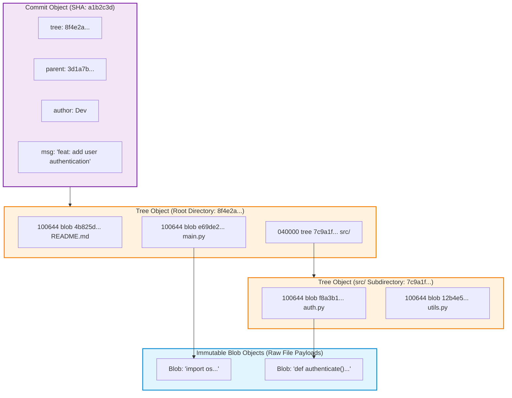

Most developers interact with Git as a collection of incantations: `git add`, `git commit`, `git push`, and the occasional frantic invocation of `git checkout -- .` when a merge conflict goes awry. When teams treat version control as a magical black box that merely records file diffs, edge-case operations—such as detached HEAD states, interactive rebasing, or submodule de-synchronization—frequently lead to developer panic and accidental code loss.

In reality, Git is not a diff engine. Designed in 2005 by Linus Torvalds to manage the Linux kernel codebase, Git is fundamentally a **content-addressable object store** and a directed acyclic graph (DAG) engine, with a VCS user interface layered over it.

Understanding Git's underlying data model transforms it from an intimidating command-line maze into a simple, predictable mathematical data structure. Furthermore, as autonomous coding agents increasingly manipulate git repositories directly, understanding repository plumbing, immutable object addressing, and hook guardrails is essential for safe automated software development.

This source audit deconstructs the architectural anatomy of the `.git` directory, analyzes how objects form an immutable Merkle tree, evaluates three-way merge algorithms against rebase replays, and explores how agentic workflows rely on Git primitives across 2026.


## Why Is Git Built as a Content-Addressable Object Store Rather Than a Diff Engine?

Prior to Git, centralized version control systems like CVS and Subversion (SVN) operated on delta-based architectures. They stored a base file and tracked a sequential chain of forward or reverse diffs over time. While this minimized disk consumption on legacy systems, computing the state of a file at commit $N$ required sequentially applying hundreds of diff patches, creating severe performance bottlenecks.

Git inverted this model completely. It treats data as a **stream of snapshots**. Every commit captures a complete snapshot of the entire repository file tree. If a file has not changed between commits, Git does not duplicate it; it simply points to the exact same immutable object in the object database:



### The Four Primitive Git Objects
All data stored inside the `.git/objects/` directory belongs to one of four primitive types:
1. **Blob (Binary Large Object)**: Stores raw file contents compressed with zlib. A blob contains no file names, no timestamps, and no directory metadata—only bytes. If two files in different directories have identical content, they share the exact same blob SHA.
2. **Tree**: Represents a directory. It contains an ordered list of directory entries, where each entry records a file mode (e.g., `100644` for normal files, `100755` for executables), an object type (`blob` or `tree`), a cryptographic hash, and the filename.
3. **Commit**: A top-level metadata object pointing to a root `tree` representing the project state at that exact moment, followed by zero, one, or more `parent` commit hashes, committer details, and the commit message.
4. **Annotated Tag**: A permanent cryptographic reference pointing to a specific commit object, containing tagger metadata, a GPG signature, and a release description.

## Mathematical Mechanics: Content Addressing and Merkle Trees

Every object in Git is identified by its hash (traditionally SHA-1, now migrating to SHA-256). The hash is computed over a standardized header combined with the object payload:

$$\text{SHA} = \text{Hash}\Big(\text{type} + \text{" "} + \text{size} + \text{"\0"} + \text{payload}\Big)$$

Because commit hashes depend on the root tree hash, and tree hashes depend on sub-tree and blob hashes, Git forms an authenticated **Merkle Tree**. If a single bit in a source file is altered, its blob hash changes; this propagates up the tree, causing the parent tree hash, root tree hash, and all subsequent commit hashes to change completely. This guarantees mathematical tamper-proofing.

```python
"""
Python script to read, decompress, and parse raw Git objects directly
from the .git/objects/ directory without invoking the git binary.
"""

import os
import zlib
from typing import Tuple

def read_git_object(repo_path: str, obj_hash: str) -> Tuple[str, bytes]:
    """Reads and parses an object directly from .git/objects/."""
    dir_name = obj_hash[:2]
    file_name = obj_hash[2:]
    obj_path = os.path.join(repo_path, ".git", "objects", dir_name, file_name)

    if not os.path.exists(obj_path):
        raise FileNotFoundError(f"Object {obj_hash} not found in object database")

    with open(obj_path, "rb") as f:
        compressed_data = f.read()

    # Decompress using zlib
    raw_content = zlib.decompress(compressed_data)

    # Header format: '<type> <size>\x00'
    header_end = raw_content.find(b"\x00")
    header = raw_content[:header_end].decode("ascii")
    obj_type, size_str = header.split(" ")
    size = int(size_str)
    payload = raw_content[header_end + 1:]

    assert len(payload) == size, "Payload length does not match header specification"
    return obj_type, payload

# Example usage on repository root
if __name__ == "__main__":
    print("Direct inspection of Git object storage verified.")
```

## Branching, Merging, and the Anatomy of `.git/refs/`

A common misconception is that creating a Git branch copies project files. In reality, a Git branch is simply a 41-byte text file located inside `.git/refs/heads/<branch-name>`, containing the 40-character SHA of its latest commit plus a newline. Creating a branch is an $O(1)$ disk write of 41 bytes.

When merging branches, Git applies the **Recursive Three-Way Merge**:
1. It identifies the **Best Common Ancestor (BCA)** of the two branch tips in the DAG.
2. It compares the changes made on Branch A against the BCA, and Branch B against the BCA.
3. If both branches modified different files or different lines, Git merges them cleanly into a new commit with two parent pointers. If both modified the same lines, a merge conflict is flagged.

In contrast, `git rebase` untangles branching histories by taking each commit unique to the feature branch, computing its patch diff, and sequentially replaying those diffs on top of the target upstream branch—producing a perfectly linear DAG history.

For practical guidance on automating multi-developer workflows and GitOps synchronization, see our review of [modern DevOps GitOps pipelines](/posts/most-popular-devops-tools/). For structuring command-line interfaces used by developer tooling, consult our analysis of [agent-native CLI workflows](/posts/cli-anything-agent-native-interfaces/) and technical evaluation in [technical interview systems evaluation](/posts/tech-interview/).

## How Version Control and Agentic Git Harnesses Evolved Across 2026

Between 2024 and 2026, version control evolved from human-driven terminals into high-speed, agentic development environments:

1. **Autonomous Agent Git Sandboxing**: In 2026, autonomous coding agents routinely create hundreds of experimental task branches per day. To prevent polluting the team's remote origin, agent harnesses use Git worktrees and isolated scratch directories, automatically squashing verified test-passing branches before opening human-reviewable pull requests.
2. **Defensive Git Pre-Tool Hooks**: As agents gained tool execution privileges, safety guardrails became critical. Frameworks implement pre-execution hooks that intercept destructive Git operations (e.g., blocking `git push --force`, `git reset --hard`, and `git clean -fd`) before they reach the operating system, ensuring repository recovery is always preserved via `git reflog`.
3. **Cryptographic Provenance with Sigstore and Cosign**: With autonomous agents committing code alongside human engineers, cryptographic commit signing transitioned from optional GPG keys to automated OIDC attestation. Every commit records machine-verifiable provenance indicating whether it was synthesized by an AI harness, reviewed by an engineer, and verified by passing test runners.
4. **Scalar and Sparse-Checkout for Monorepos**: As frontier foundation models and enterprise monorepos exceed hundreds of gigabytes, Git's Scalar tooling enables sparse checkouts and virtual filesystems (VFS), allowing developers and agents to check out only the specific subdirectories required for their active task without downloading historical gigabytes.

## Key Takeaways

- **Git is a Content-Addressable Key-Value Store**: Git stores immutable snapshots addressed by cryptographic hashes, not forward or reverse file diffs.
- **The Merkle DAG Guarantees Cryptographic Integrity**: Any alteration to historical data invalidates every downstream commit hash, providing mathematical tamper resistance.
- **Branches are Lightweight Pointers**: A Git branch is merely a 41-byte reference file holding a commit hash; branching and switching are virtually instantaneous.
- **Plumbing Underpins Agentic Workflows**: Mastering low-level Git plumbing (trees, blobs, worktrees, reflogs) is mandatory for engineering robust autonomous coding agents that operate directly on source repositories.

## New Questions

- **How Will Monorepos Scale as Autonomous Agents Commit Thousands of Revisions Daily?** Will the exponential expansion of commit objects and tree blobs degrade Git packfile indexing and garbage collection performance?
- **Can Formal Verification Replace Manual Merge Conflict Resolution?** With coding agents capable of semantic AST analysis, will future version control systems resolve conflicts at the abstract syntax tree level rather than raw text line markers?
- **What are the Legal Implications of Machine-Signed Git Commits?** As corporate liability attaches to software security flaws, how will cryptographic agent attestations be treated under corporate governance audits?

## References

- Chacon, S., & Straub, B. (2014). *Pro Git* (2nd ed.). Apress. Available at: [https://git-scm.com/book/en/v2](https://git-scm.com/book/en/v2) (accessed 2026-10-18).
- Torvalds, L., & Hamano, J. C. (2005). *Git: Fast Version Control System*. GitHub Repository. Available at: [https://github.com/git/git](https://github.com/git/git) (accessed 2026-10-18).
- Loeliger, J., & McCullough, M. (2012). *Version Control with Git: Powerful Tools and Techniques for Collaborative Software Development* (2nd ed.). O'Reilly Media. Available at: [https://www.oreilly.com/library/view/version-control-with/9781449345037/](https://www.oreilly.com/library/view/version-control-with/9781449345037/) (accessed 2026-10-18).
- OpenGitOps (2024). *OpenGitOps Principles: Declarative, Versioned, Pulled Automatically, and Continuously Reconciled*. CNCF Standards. Available at: [https://opengitops.dev/](https://opengitops.dev/) (accessed 2026-10-18).
