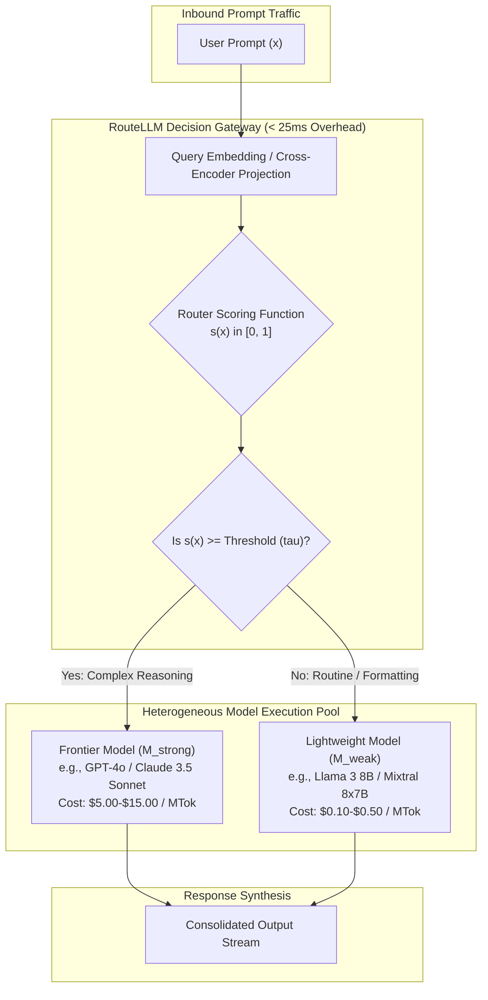
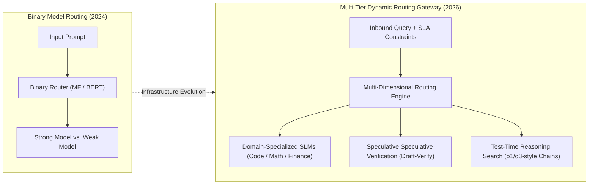

## Why Does Uniform Frontier Model Dispatch Incur Severe Economic and Latency Inefficiencies?

In early 2024, the conventional approach to deploying generative artificial intelligence applications was monolithic: route every inbound prompt to the most powerful frontier model available—typically OpenAI's GPT-4 or Anthropic's Claude 3 Opus. While this brute-force strategy guarantees peak reasoning quality, it imposes an unsustainable financial and computational penalty at production scale.

Frontier foundation models command pricing structures between $15.00 and $60.00 per million generated tokens. In sharp contrast, compact open-weights architectures—such as Meta's Llama 3 8B, Mistral 7B, or Google's Gemma 2 9B—cost less than $0.20 per million tokens when served via optimized vLLM or TensorRT-LLM clusters, representing a **50x to 100x cost disparity**.

Crucially, empirical traffic analyses across millions of user interactions on platforms like the LMSYS Chatbot Arena reveal that the majority of real-world user queries do not require frontier reasoning capabilities:

1. **Uneven Query Complexity Distributions**: Between 50% and 75% of production queries consist of straightforward information retrieval, syntactic code formatting, entity extraction, text summarization, or conversational chit-chat. On these low-complexity tasks, lightweight 8-billion parameter models achieve near-perfect human preference parity with frontier models.
2. **GPU Capacity and Queue Latencies**: Frontier models require massive tensor-parallel GPU clusters across high-bandwidth NVLink interconnects. Subjecting simple queries to massive 70B+ or mixture-of-experts (MoE) parameter graphs exacerbates Time-to-First-Token (TTFT) and inflates tail p99 queue latency for high-value enterprise users.
3. **The Diminishing Returns of Monolithic Scaling**: Indiscriminately upgrading to slightly larger models delivers marginal gains on benchmark leaderboards while exponentially compounding compute bills.

The primary competitive battleground in enterprise LLM deployment is therefore not merely picking a single "winning" foundation model, but architecting an **intelligent dynamic routing layer** that evaluates query difficulty in real time, dispatching each request to the most cost-effective model that satisfies the task's capability threshold.

As explored in our technical deep dives on [empirical LLM evaluation metrics](/posts/evaluating-llm/) and [enterprise LLM production architectures](/posts/llm-build-tools-cookbook/), UC Berkeley's open-source **RouteLLM** framework establishes the definitive mathematical foundation for model routing.



---

## The RouteLLM Framework: Routing Architectures and Mathematical Formulations

The core premise of RouteLLM (Ong et al., UC Berkeley / LMSYS / Anyscale) is to formalize query routing as a binary or multi-class decision boundary between a strong, expensive model $M_{\text{strong}}$ and a weak, cost-effective model $M_{\text{weak}}$.

### Mathematical Problem Formulation
Let $x \in \mathcal{X}$ denote the user prompt. We define the human preference probability:

$$P(M_{\text{strong}} \succ M_{\text{weak}} \mid x)$$

representing the probability that a human evaluator (or calibrated judge) prefers the response generated by $M_{\text{strong}}$ over $M_{\text{weak}}$ on query $x$. 

The router's objective is to compute a scalar score $s(x) \in [0, 1]$ approximating this preference gap. The routing policy $\pi_\tau(x)$ is parameterized by an operational threshold $\tau \in [0, 1]$:

$$\pi_\tau(x) = \begin{cases} M_{\text{strong}}, & \text{if } s(x) \ge \tau \\ M_{\text{weak}}, & \text{if } s(x) < \tau \end{cases}$$

By sweeping the decision threshold $\tau$ from $1.0$ down to $0.0$, engineering teams trace out a continuous **Cost-Quality Pareto Frontier**:
- At $\tau = 0.0$, 100% of queries are routed to $M_{\text{strong}}$ (maximum quality, maximum cost).
- At $\tau = 1.0$, 100% of queries are routed to $M_{\text{weak}}$ (minimum cost, reduced quality on complex tasks).
- At intermediate values (e.g., $\tau \approx 0.35$), the router dynamically captures high-complexity queries while shedding the vast bulk of routine traffic.

### The Four Router Architectures
RouteLLM systematically evaluated four distinct routing paradigms trained on human preference battle logs from LMSYS Chatbot Arena:

```
+----------------------------------------------------------------------------------------------------+
|                                    RouteLLM Routing Architectures                                  |
+----------------------------------------------------------------------------------------------------+
| Router Type          | Implementation Mechanism            | Latency Overhead | Computational Cost |
+----------------------+-------------------------------------+------------------+--------------------+
| 1. Similarity Router | Cosine similarity over dense vector | ~5 ms            | Low (Vector DB     |
|                      | embeddings (k-NN Arena matches)     |                  | Index Search)      |
| 2. Matrix            | Bilinear latent query projection:   | ~10 ms           | Minimal (Dot       |
|    Factorization (MF)| s(x) = sigma(u_x^T v_m)             |                  | Products)          |
| 3. BERT Classifier   | Bidirectional cross-encoder         | ~25 ms           | Moderate (Local    |
|                      | fine-tuned on preference labels     |                  | GPU / CPU forward) |
| 4. Causal LLM Judge  | Prompted compact LLM (8B) scoring   | ~300 ms          | High (Autoregres-  |
|                      | query complexity directly           |                  | sive generation)   |
+----------------------------------------------------------------------------------------------------+
```

Among these approaches, the **BERT Classifier** and **Matrix Factorization (MF)** routers proved exceptionally effective. The BERT classifier processes the raw prompt tokens through a lightweight bidirectional Transformer encoder, outputting a calibrated sigmoid probability. Because the classifier operates strictly in an encoder configuration without autoregressive decoding, it executes in under 25 milliseconds on commodity hardware, introducing negligible overhead into the user experience.

---

## Empirical Pareto Frontiers: Evaluating PGC and Cost Reduction Across Benchmarks

To quantify the efficiency of routing algorithms objectively, RouteLLM introduced two standardized evaluation metrics:

### 1. Call Fraction ($CF$) and Cost Reduction
The Call Fraction denotes the percentage of overall production requests routed to the expensive model:

$$CF = \frac{N_{\text{strong}}}{N_{\text{total}}}$$

If $C_{\text{strong}}$ is $\$10.00 / \text{MTok}$ and $C_{\text{weak}}$ is $\$0.20 / \text{MTok}$, achieving a Call Fraction of $0.15$ ($15\%$) slashes the blended token cost by over **85%**.

### 2. Preference-Guided Cost ($PGC$) and Benchmark Performance
RouteLLM benchmarked routing policies across diverse academic and conversational datasets: **MT-Bench** (multi-turn conversation), **MMLU** (knowledge and academic subjects), and **GSM8K** (mathematical multi-step reasoning).

```
Quality (% of GPT-4 Performance)
 100% |                                      * (All GPT-4, 100% Cost)
      |                              * RouteLLM (85% Cost Reduction, 95% Quality)
  90% |                     *
      |              *
  80% |       *
      |  * (All Mixtral 8x7B, 4% Cost)
   0% +------------------------------------------------------------>
      0%            20%           40%           60%          100%
                               Cost Fraction (% of Full GPT-4 Cost)
```

The empirical results revealed dramatic cost-quality efficiency:
- **85%+ Cost Reductions**: On MT-Bench and Chatbot Arena benchmarks, RouteLLM preserved **95% of GPT-4's quality** while routing over **82% of all queries to Mixtral-8x7B or Llama 3 8B**.
- **Outperforming Prompt-Based Routing**: Learned cross-encoders and matrix factorization models consistently outperformed few-shot prompt-based routers, which frequently hallucinated query complexity or suffered from high token latency overheads.
- **Dynamic Threshold Adaptation**: In production environments, the decision threshold $\tau$ can be dynamically linked to backend metrics: if GPU cluster queue depth exceeds safe SLA thresholds, the system raises $\tau$, shedding compute load to lightweight endpoints without human intervention.

---

## How Dynamic LLM Routing Evolved Across 2026

Between 2024 and 2026, model routing matured from standalone academic prototypes into mission-critical cloud infrastructure deployed across enterprise AI gateways:



1. **Multi-Model Expert Cascades**: Early routing was restricted to binary pairs (e.g., GPT-4 vs. Mixtral). In 2026, enterprise gateways route across vast pools of specialized domain models: dispatching Python code tasks to Qwen2.5-Coder, medical questions to Med-PaLM, mathematical reasoning to DeepSeek-Math, and routine document parsing to lightweight edge models.
2. **Speculative Decoding and Speculative Cascading**: Rather than committing irrevocably to a single model at the gateway boundary, modern architectures employ speculative cascading. The small model begins generating tokens immediately; simultaneously, an asynchronous verifier evaluates early confidence logits. If the small model exhibits low token entropy or uncertainty, the request is transparently promoted to the frontier model with zero wasted user wait time.
3. **Test-Time Compute Routing**: The routing decision in 2026 has expanded beyond *which* weights to invoke to encompass *how much test-time compute* to allocate. Simple queries receive fast greedy decoding; intermediate queries receive chain-of-thought prompting; highly challenging logical or algorithmic proofs trigger tree-search rollouts (o1/o3 reasoning chains) with self-verification loops.
4. **Resilience and Spot Price Arbitrage**: Production AI gateways (such as Portkey, Cloudflare AI Gateway, and LiteLLM) embed routing intelligence directly into edge proxies, routing dynamically across cloud providers based on live p99 latency spikes, rate-limit 429 status codes, and spot-market GPU auction pricing.

---

## Key Takeaways

- **The Economic Imperative**: Unconditionally sending every production query to frontier models incurs unsustainable compute expenses and tail latencies; real-world query distributions are heavily skewed toward routine tasks.
- **Empirical Pareto Frontiers**: RouteLLM demonstrates that learning preference boundaries via Matrix Factorization or BERT cross-encoders slashes token costs by over 85% while retaining 95%+ of frontier model output quality.
- **Low-Latency Architecture**: Cross-encoder and matrix factorization routers execute in under 25 milliseconds, allowing routing decisions to complete without degrading interactive user experience.
- **Beyond Binary Selection**: Modern 2026 gateways orchestrate multi-model domain cascades, speculative decoding handoffs, and dynamic test-time compute allocation.

---

## New Questions

- How do dynamic routing thresholds adapt when user queries contain adversarial prompt injections specifically crafted to mislead complexity scoring models?
- What are the trade-offs between centralized gateway routing versus decentralized speculative verification embedded directly inside model serving engines?
- Can multi-agent orchestration frameworks dynamically route intermediate reasoning steps across distinct model families without losing conversational state coherence?

---

## References

- Ong, Isaac, Amjad Almahairi, Vincent Wu, Wei-Lin Chiang, Tianle Li, Joseph E. Gonzalez, Mian Mian, and Ion Stoica. *RouteLLM: Learning to Route LLMs with Preference Data*. arXiv preprint arXiv:2406.18665, 2024. [https://arxiv.org/abs/2406.18665](https://arxiv.org/abs/2406.18665) (accessed 2026-10-18).
- Zheng, Lianmin, Wei-Lin Chiang, Hao Zhang, Siyuan Zhuang, Yonghao Zhuang, Lingchen Mao, Zhuohan Li, Dacheng Li, Eric P. Xing, Hao Zhang, Joseph E. Gonzalez, and Ion Stoica. *Judging LLM-as-a-Judge with MT-Bench and Chatbot Arena*. Advances in Neural Information Processing Systems (NeurIPS), 2023. [https://arxiv.org/abs/2306.05685](https://arxiv.org/abs/2306.05685) (accessed 2026-10-18).
- Leviathan, Yaniv, Matan Kalman, and Yossi Matias. *Fast Inference from Transformers via Speculative Decoding*. International Conference on Machine Learning (ICML), 2023. [https://arxiv.org/abs/2211.17192](https://arxiv.org/abs/2211.17192) (accessed 2026-10-18).
- Chen, Lingjiao, Matei Zaharia, and James Zou. *FrugalGPT: How to Use Large Language Models While Reducing Cost and Improving Performance*. arXiv preprint arXiv:2305.05176, 2023. [https://arxiv.org/abs/2305.05176](https://arxiv.org/abs/2305.05176) (accessed 2026-10-18).
