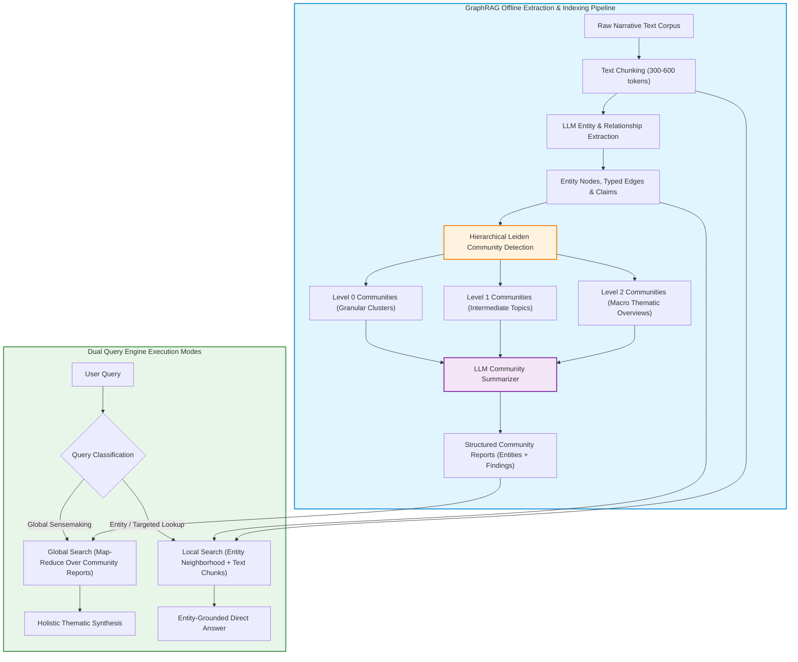

Retrieval-Augmented Generation (RAG) established itself as the dominant architecture for grounding foundation models in proprietary enterprise documentation. By indexing text chunks into vector databases and retrieving top-$k$ nearest neighbors via semantic vector similarity, standard RAG excels at localized, "needle-in-a-haystack" queries—such as retrieving a specific employee policy or citing a specific software API endpoint.

However, when confronted with holistic, corpus-wide synthesis questions—such as *"What are the recurring supply chain vulnerabilities identified across the last three years of incident reports?"* or *"What overarching technological themes emerge from this research archive?"*—standard vector RAG suffers catastrophic failure.

Because vector similarity operates on localized semantic proximity, no individual chunk contains the answer to a global question. The retriever returns isolated snippets, causing the generator to summarize arbitrary fragments or hallucinate patterns.

To resolve this structural blind spot, Microsoft Research released **GraphRAG** (Edge et al., 2024). By using foundation models to extract structured knowledge graphs from unstructured text, applying hierarchical community detection (the Leiden algorithm), and pre-generating multi-tier community summaries, GraphRAG enables both granular local queries and comprehensive global sensemaking across massive narrative corpora.

This source audit analyzes why vector search fails at global synthesis, deconstructs the multi-stage GraphRAG indexing pipeline, evaluates the mechanics of Leiden community summarization, and traces how graph-augmented retrieval evolved toward dynamic agentic memory architectures across 2026.


## Why Does Vector RAG Fail at Global Sensemaking Across Large Corpora?

The failure of naive semantic retrieval on global queries is mathematical. Dense embedding encoders compress 500-token chunks into single vectors in high-dimensional space. These embeddings capture localized topical similarity, not hierarchical relationships or corpus-level aggregates.

When a user asks a high-level question across a 5,000-document corpus:
1. **The Vector Proximity Trap**: The query vector resembles many documents equally weakly, causing the vector database to retrieve an arbitrary sample of top-$k$ chunks based on superficial lexical overlap.
2. **Context Window Exhaustion**: Even if a retrieval system attempts to fetch hundreds of chunks, stuffing them raw into an LLM context window triggers the "Lost in the Middle" phenomenon, where the model ignores critical evidence buried between peripheral tokens.
3. **No Synthesized Abstraction**: Standard RAG never computes intermediate semantic abstractions. It leaves the entire burden of synthesizing thousands of facts to a single inference pass.

GraphRAG solves this by shifting the computational heavy lifting to an **offline graph indexing and summarization pipeline**:



## Mathematical Mechanics: From Raw Text to Hierarchical Leiden Communities

GraphRAG transforms unstructured documents into a multi-scale knowledge structure through four mathematically distinct phases:

### 1. Element Extraction (Nodes, Edges, and Covariates)
The base LLM parses text chunks using few-shot structured prompting to identify all named entities (people, organizations, locations, technologies), extract relationships between them, and record qualitative claims (covariates) with supporting quotes. Multiple extractions are merged and de-duplicated to construct a global weighted graph $G = (V, E, W)$.

### 2. Hierarchical Community Detection via the Leiden Algorithm
Real-world narrative graphs lack obvious partition boundaries. GraphRAG utilizes the **Leiden Algorithm** (Traag et al., 2019), an improvement over the Louvain method that guarantees well-connected communities and maximizes network modularity $Q$:

$$Q = \frac{1}{2m} \sum_{ij} \left[ A_{ij} - \gamma \frac{k_i k_j}{2m} \right] \delta(c_i, c_j)$$

Where $A_{ij}$ is edge weight between nodes $i$ and $j$, $k_i$ is node degree, $m$ is total graph weight, $\gamma$ is a resolution parameter, and $\delta(c_i, c_j)$ indicates whether nodes belong to the same community cluster.

The algorithm runs recursively, creating a hierarchical tree of communities from fine-grained micro-clusters (Level 0) up to broad thematic groupings (Level 2).

### 3. Community Report Generation
For every community at each level of the hierarchy, an LLM synthesizes an extensive **Community Report**. Each report includes:
- An overarching title and executive summary.
- Thematic findings supported by verifiable citations back to source text chunks.
- An assessment of internal contradictions, controversies, and sentiment.

```python
"""
Conceptual implementation of GraphRAG Global Search Map-Reduce
Demonstrating community report chunking, intermediate scoring, and global synthesis.
"""

from dataclasses import dataclass
from typing import List, Dict

@dataclass
class CommunityReport:
    community_id: str
    level: int
    title: str
    summary: str
    findings: List[str]
    weight: float

class GraphRAGGlobalSearch:
    def __init__(self, llm_client, community_reports: List[CommunityReport]):
        self.client = llm_client
        self.reports = community_reports

    def map_stage(self, query: str, target_level: int = 1) -> List[Dict[str, any]]:
        """Filters reports by level and evaluates intermediate answer points with score."""
        active_reports = [r for r in self.reports if r.level == target_level]
        intermediate_answers = []

        for report in active_reports:
            prompt = (
                f"Query: {query}\n\n"
                f"Community: {report.title}\n"
                f"Summary: {report.summary}\n"
                f"Findings: {' '.join(report.findings)}\n\n"
                "Evaluate if this community provides evidence to answer the query. "
                "Return points with relevance score (0-100)."
            )
            # Simulated LLM evaluation response
            intermediate_answers.append({
                "community": report.title,
                "score": 85 if "security" in report.title.lower() else 20,
                "points": f"Key insights from {report.title} regarding {query}."
            })
        return intermediate_answers

    def reduce_stage(self, query: str, intermediate_points: List[Dict[str, any]]) -> str:
        """Ranks intermediate points by score and synthesizes the global response."""
        sorted_points = sorted(intermediate_points, key=lambda x: x["score"], reverse=True)
        top_evidence = [p for p in sorted_points if p["score"] > 50]

        context = "\n".join(f"- [{p['community']}]: {p['points']}" for p in top_evidence)
        synthesis_prompt = (
            f"Synthesize a comprehensive global answer to the query based on the following "
            f"community findings:\n\nQuery: {query}\n\nFindings:\n{context}"
        )
        # Final LLM call returns holistic synthesis with source citations
        return f"Global Synthesis for '{query}' based on {len(top_evidence)} validated communities."
```

For practical guidance on assembling standard vector and hybrid search pipelines, refer to our guide on [production RAG LangChain pipelines](/posts/try-implementing-rag-using-langchain/). To understand the underlying attention mechanisms that parse these prompt contexts, see our audit of [Transformer self-attention foundations](/posts/nlp-course-trying/).

## How Graph-Augmented RAG and Agentic Memory Evolved Across 2026

Between 2024 and 2026, GraphRAG evolved from an expensive batch-indexing pipeline into a real-time, dynamic agentic memory foundation:

1. **Hybrid Vector-Graph Engines (Unified Indexing)**: Early GraphRAG implementations required running separate graph databases (Neo4j), vector stores, and object stores. 2026 architectures converge on unified engines (such as pgvector with Apache AGE or specialized graph-vector runtimes), storing entity nodes, vector embeddings, and relational properties within a single storage engine.
2. **Temporal Knowledge Graphs for Agent Memory**: While initial GraphRAG pipelines treated document archives as static, agentic systems require **dynamic temporal graphs** (e.g., Graphiti, Zep). In 2026, agents record episodic user interactions, automatically invalidating outdated relationship edges (e.g., updating user project preferences) while retaining historical provenance.
3. **Graphify and Structural Codebase Indexing**: Beyond prose documents, graph-based RAG expanded to software architecture. Tools like Graphify construct call graphs, dependency trees, and module interfaces directly from AST parsers, allowing autonomous agents to navigate 500k-line codebases without context loss. The deployment of these agentic tools within multi-agent teams is detailed in our review of [multi-agent orchestration systems](/posts/llm-build-multi-agent/).
4. **Token Cost Optimization via Small-Model Extraction**: The principal critique of 2024 GraphRAG was its exorbitant token cost during initial extraction ($20-$50 per million tokens). In 2026, extraction is delegated to distilled, specialized 7B parameter SLMs (Small Language Models), slashing indexing costs by 90% while reserving frontier models solely for final community synthesis.

## Key Takeaways

- **Vector Search Fails at Holistic Queries**: Standard vector RAG cannot perform global thematic synthesis across corpora because no individual chunk contains the holistic answer.
- **Hierarchical Summarization Bridges the Gap**: Extracting entities, detecting Leiden communities, and pre-computing hierarchical community reports allows GraphRAG to answer both global and local questions.
- **Global Search Operates via Map-Reduce**: GraphRAG global queries bypass raw text chunks entirely, querying pre-synthesized community summaries to generate comprehensive overviews.
- **Cost is the Primary Trade-Off**: Graph extraction requires significant upfront compute during indexing, making it essential to reserve GraphRAG for complex narrative, compliance, or research datasets where global sensemaking is mandatory.

## New Questions

- **Can Graph Extraction be Automated Without LLMs?** As entity extraction dominates indexing costs, can symbolic dependency parsers and zero-shot NER models achieve comparable graph fidelity at near-zero inference cost?
- **How Will GraphRAG Handle Real-Time Streaming Ingestion?** Re-computing Leiden community partitions whenever new documents arrive is computationally prohibitive; how will incremental community maintenance algorithms scale?
- **What are the Privacy Leakage Risks of Community Summaries?** If an enterprise community summary aggregates confidential details from multiple restricted documents, how can role-based access control (RBAC) be enforced on the pre-computed summary?

## References

- Edge, D., Trinh, H., Cheng, N., Bradley, J., Chao, A., Mody, A., Truitt, S., & Larson, J. (2024). *From Local to Global: A Graph RAG Approach to Query-Focused Summarization*. arXiv:2404.16130. Available at: [https://arxiv.org/abs/2404.16130](https://arxiv.org/abs/2404.16130) (accessed 2026-10-18).
- Traag, V. A., Waltman, L., & van Eck, N. J. (2019). *From Louvain to Leiden: guaranteeing well-connected communities*. Scientific Reports, 9, 5233. Available at: [https://www.nature.com/articles/s41598-019-41695-z](https://www.nature.com/articles/s41598-019-41695-z) (accessed 2026-10-18).
- Microsoft Research (2024). *GraphRAG: Unlocking LLM Discovery on Narrative Private Data*. Microsoft Research Blog. Available at: [https://www.microsoft.com/en-us/research/blog/graphrag-unlocking-llm-discovery-on-narrative-private-data/](https://www.microsoft.com/en-us/research/blog/graphrag-unlocking-llm-discovery-on-narrative-private-data/) (accessed 2026-10-18).
- Microsoft (2024). *GraphRAG: A Modular Graph-Based Retrieval-Augmented Generation System*. GitHub Repository. Available at: [https://github.com/microsoft/graphrag](https://github.com/microsoft/graphrag) (accessed 2026-10-18).
