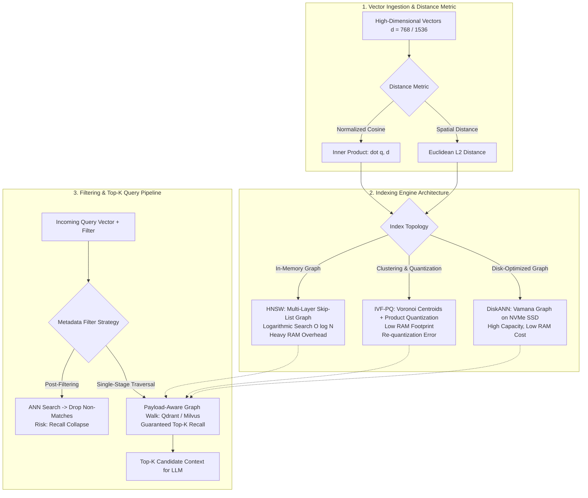

{: .light .w-75 .shadow .rounded-10 }

## How Do Vector Database Topologies Dictate the Latency and Recall of Production RAG?

In enterprise Retrieval-Augmented Generation (RAG) and generative search systems, vector databases function as the high-throughput retrieval substrate. While machine learning literature frequently focuses on embedding model quality or generation prompting, the physical storage, indexing topology, and querying behavior of the vector database impose hard ceilings on end-to-end application latency, precision, and operational expense.

In small prototype applications with fewer than 50,000 vectors, almost any vector store—ranging from in-memory NumPy arrays to local SQLite extensions—delivers sub-10ms response times. However, as corpora scale to millions of high-dimensional vectors (e.g., 1536-dimensional OpenAI embeddings or 1024-dimensional open embeddings) accompanied by multi-tenant security filters and dynamic real-time insertions, naive vector systems experience catastrophic performance degradation. Unindexed searches devolve into $O(N)$ linear scans, memory footprints exceed available GPU and host RAM, and queries with restrictive metadata filters suffer severe recall collapse.

Selecting and configuring a vector database is not a cosmetic plumbing decision; it is a fundamental systems trade-off between **recall accuracy**, **query latency (QPS)**, **memory footprint**, and **operational complexity**. This source audit provides an architectural comparison of modern vector storage systems, deconstructing Hierarchical Navigable Small World (HNSW) graphs, Inverted File with Product Quantization (IVF-PQ), metadata filtering topologies, and the trade-offs between dedicated vector engines and relational database extensions.



---

## The Core Indexing Dilemma: Graph-Based HNSW vs. Cluster-Based IVF

Approximate Nearest Neighbor (ANN) search trades a small fraction of mathematical precision (typically 1% to 3% recall loss) for multiple orders of magnitude acceleration in query throughput compared to brute-force $k$-Nearest Neighbors ($k$-NN). The vector database ecosystem is dominated by two primary indexing paradigms:

### 1. Hierarchical Navigable Small World (HNSW)
Introduced by Malkov and Yashunin (IEEE TPAMI 2020), HNSW structures high-dimensional vectors as a multi-layer graph inspired by probabilistic skip-lists. The bottom layer ($\text{layer}_0$) contains all database vectors linked by short, local proximity edges. Higher layers contain exponentially fewer vectors connected by long-range highway edges.

During a query:
1. Search begins at the top sparse layer with greedy routing, taking large steps across the vector space.
2. Upon reaching a local minimum in the current layer, the search steps down to the next denser layer.
3. In $\text{layer}_0$, the algorithm explores the local neighborhood to return the top-$k$ candidates.

```
HNSW Multi-Layer Skip Graph:
Layer 2 (Highway):   [Node A] ───────────────────────────> [Node Z]
                        │                                     │
Layer 1 (Medium):    [Node A] ────────> [Node M] ────────> [Node Z]
                        │                  │                  │
Layer 0 (Dense):     [Node A] ─> [B] ─> [Node M] ─> [P] ─> [Node Z]
```

- **Strengths:** Industry-leading query latency and superior recall ($\ge 98\%$) even under high concurrency. Unlike tree-based indices, HNSW does not suffer from dimensionality curse breakdowns in 1536-dimensional spaces.
- **Trade-Offs:** Massive memory consumption. HNSW requires holding the entire graph structure—including bidirectional adjacency lists for each node—in RAM. For 10 million 1536-dimensional vectors, HNSW index metadata alone can require over 80 GB to 120 GB of host RAM, driving substantial hosting expenses.

### 2. Inverted File with Product Quantization (IVF-PQ)
Introduced by Jégou, Douze, and Schmid (IEEE TPAMI 2011), IVF-PQ combines Voronoi space partitioning with lossy vector compression:
1. **Inverted File (IVF):** The vector space is partitioned into $C$ clusters using $k$-means. Vectors are assigned to their nearest centroid. During search, only vectors within the top-$n_{\text{probe}}$ closest centroids are evaluated, pruning 95% of the database from inspection.
2. **Product Quantization (PQ):** A $d$-dimensional vector is split into $m$ low-dimensional sub-vectors ($d/m$). Each sub-vector is quantized to the nearest centroid in a small codebook (typically 256 centroids, represented by an 8-bit byte):
   
   $$
   \mathbf{x} = [\mathbf{x}_1, \mathbf{x}_2, \dots, \mathbf{x}_m] \mapsto [c_1, c_2, \dots, c_m] \in \{0, \dots, 255\}^m
   $$

- **Strengths:** Extreme memory compression. A 1536-dimensional FP32 vector (6,144 bytes) is compressed to 64 or 96 bytes (a $60\times$ to $90\times$ memory reduction), allowing billions of vectors to reside on budget instances.
- **Trade-Offs:** Reduced recall accuracy due to quantization distortion, slower query speeds than in-memory HNSW, and slow index build times caused by $k$-means clustering.

---

## Dedicated Vector Engines vs. General-Purpose Database Extensions

When deploying vector retrieval in an enterprise stack, engineering teams face an architectural crossroads: deploy a purpose-built, specialized vector database, or activate vector extensions inside an existing relational engine?

| Architectural Dimension | Dedicated Vector DBs (Milvus, Qdrant, Pinecone) | Relational Extensions (PostgreSQL + pgvector) |
|:---|:---|:---|
| **Primary Index Design** | Custom C++/Rust native HNSW, DiskANN, and GPU acceleration. | In-process HNSW and IVFFlat index builds inside PostgreSQL storage pages. |
| **Throughput & QPS** | Highly optimized for 10,000+ QPS with distributed horizontal sharding. | Moderate throughput (500–2,000 QPS); bound by single-node Postgres worker threads. |
| **Data Integrity & ACID** | Eventual consistency; limited distributed transactional rollback support. | Full ACID guarantees, transactional commits, and foreign key integrity. |
| **Operational Overhead** | Requires managing, monitoring, and backing up an independent distributed cluster. | Zero additional infrastructure; leverages existing Postgres backup, replication, and CDC. |
| **Payload Filtering** | Native execution engines designed for high-cardinality metadata filtering. | Expressive SQL `WHERE` clauses combining relational joins and vector distance operators. |

### The Production Selection Heuristic:
- **Default to Relational Extensions (pgvector):** If the corpus is under 1 million vectors, query throughput is under 1,000 QPS, and vector data is tightly coupled to relational entities (users, orders, permissions), adopting `pgvector` avoids distributed synchronization friction and preserves transactional guarantees.
- **Adopt Dedicated Engines (Qdrant / Milvus):** If vector scale exceeds 5 million vectors, real-time multi-tenant filtering is required, or query throughput demands dedicated GPU/SIMD-accelerated nodes, dedicated distributed engines are mathematically necessary to prevent database connection pool exhaustion.

---

## The Metadata Filtering Bottleneck: Pre-Filtering, Post-Filtering, and Single-Stage Graphs

In real-world enterprise applications, queries rarely execute across an entire database in isolation. Multi-tenant security boundaries require enforcing tenant isolation (e.g., `tenant_id = 'org_402'` AND `department = 'legal'`).

How a vector database implements metadata filtering dictates whether the system maintains high recall or suffers complete failure:

### 1. Naive Post-Filtering (The Recall Collapse Trap)
In post-filtering architectures, the engine performs a standard top-$k$ ANN vector search first, and then applies the metadata filter to the returned list. 
- *The Failure Mode:* If a tenant's documents represent only 1% of the database, requesting top-10 candidates via post-filtering causes the ANN search to return 10 globally similar vectors that belong to other tenants. The post-filter discards all 10 non-matching candidates, returning an empty result set to the user despite thousands of valid matching documents existing in the database.

### 2. Naive Pre-Filtering (The Scan Bottleneck)
In pre-filtering, the engine executes the SQL/metadata filter first to extract matching vector IDs, followed by an exact $k$-NN search over the subset. 
- *The Failure Mode:* If the filter is loose (matching 80% of the database), performing brute-force distance calculations over 800,000 vectors eliminates the performance benefits of ANN indexing, spiking query latency to multiple seconds.

### 3. Modern Single-Stage Payload-Aware Graph Traversal
Modern systems (such as Qdrant's payload index and ACORN-style graph traversals) resolve this dilemma through **single-stage filtered graph walks**:
- Metadata attributes are indexed via inverted posting lists.
- During the HNSW graph traversal, the algorithm dynamically checks the metadata filter *before* evaluating edge distance. If a neighboring node fails the filter, the graph walk bypasses that node while continuing to traverse through valid paths in the graph, guaranteeing that exactly $k$ valid matching candidates are returned without latency spikes.

---

## How Vector Database Architectures Evolved Across 2026: Disk-Native and Graph RAG Hybridization

Throughout 2026, vector database infrastructure matured from volatile in-memory index stores into integrated multi-model storage platforms:

1. **NVMe-Native Graph Storage (DiskANN):** As corpus sizes expanded into the tens of millions, holding entire HNSW graphs in RAM became economically unsustainable. Production engines adopted SSD-optimized graph topologies (such as Microsoft DiskANN and Qdrant's mmap indices). By compressing vectors in memory using Product Quantization while storing full-precision graphs on high-speed NVMe SSDs, systems slashed RAM requirements by 80% with minimal latency penalties.
2. **Unified Graph and Vector RAG Hybridization:** Simple vector proximity proved incapable of answering complex multi-hop relationship queries. Modern database engines—such as the high-performance Rust implementation analyzed in [EdgeQuake: High-Performance Graph RAG in Rust](/posts/edgequake-graph-rag-rust/)—unify Apache AGE graph topologies with pgvector similarity indices, allowing systems to traverse entity graphs and vector spaces in a single relational transaction.
3. **Integration with Structured Reasoning Pipelines:** In advanced multi-hop QA systems—such as the graph neural retrieval audited in [GNN-RAG: Bridging Graph Neural Reasoning and Large Language Model Synthesis](/posts/gnn-rag-paper/)—vector databases no longer operate as flat retrieval sinks. Instead, they serve as initial subgraph extractors feeding GNN message-passing networks.
4. **Extreme Low-Bit Quantization (1-Bit and Ternary Vectors):** Inspired by extreme model weight quantization—such as the architectures analyzed in [PrismML 1-bit Bonsai: Extreme Low-Bit Quantization for Practical On-Device AI](/posts/prismml-1-bit-bonsai-on-device-ai/)—next-generation vector indices explore 1-bit binary and ternary embeddings, replacing floating-point dot products with hardware-level POPCNT (population count) bitwise operations to achieve microsecond-scale retrieval.

---

## Key Takeaways

- **Vector DB Choice Governs RAG Performance:** Vector databases enforce the physical latency and recall boundaries of generative AI systems; selecting an index topology requires balancing recall against RAM expenditure.
- **HNSW vs. IVF-PQ Trade-Off:** HNSW delivers superior recall ($\ge 98\%$) and low latency at the expense of massive host RAM consumption; IVF-PQ provides up to $90\times$ memory compression through lossy product quantization.
- **Avoid Post-Filtering in Multi-Tenant Environments:** Post-filtering causes catastrophic recall collapse when filtering by sparse attributes; production systems require single-stage payload-aware graph traversals.
- **Pragmatic Engine Selection:** Teams managing corpora under 1 million vectors benefit from the ACID compliance and operational simplicity of relational extensions (`pgvector`), reserving dedicated distributed engines (Qdrant, Milvus) for high-scale, high-concurrency environments.
- **The Shift to NVMe-Native and Multi-Model Databases:** 2026 architectures combine NVMe-backed graph indexing (DiskANN) with hybrid knowledge-graph and vector storage to support enterprise multi-hop reasoning.

---

## New Questions

1. **Dynamic HNSW Graph Degradation Under High Deletion Rates:** How severely do frequent vector deletions and updates degrade HNSW graph connectivity (creating disconnected sub-islands) without continuous background re-indexing?
2. **Binary Embedding Distortion on Complex Tasks:** What is the exact benchmark loss in answer precision when quantizing 1536-dimensional FP32 embeddings into 1-bit binary vectors for large-scale enterprise documentation?
3. **Federated Vector Search Across Sharded Boundaries:** What is the optimal network protocol for merging top-$k$ candidate distributions across distributed vector shards without triggering tail-latency network bottlenecks?

---

## References

- [Malkov & Yashunin: Efficient and Robust Approximate Nearest Neighbor Search Using Hierarchical Navigable Small World Graphs (IEEE TPAMI 2020 / arXiv:1603.09320)](https://arxiv.org/abs/1603.09320) (accessed 2026-10-18)
- [Jégou, Douze & Schmid: Product Quantization for Nearest Neighbor Search (IEEE TPAMI 2011)](https://ieeexplore.ieee.org/document/5432202) (accessed 2026-10-18)
- [Pan et al.: A Survey on Vector Database Management Systems (arXiv:2402.01763)](https://arxiv.org/abs/2402.01763) (accessed 2026-10-18)
- [Subramanya et al.: DiskANN - Fast Accurate Billion-Point Nearest Neighbor Search on a Single Node (NeurIPS 2019)](https://proceedings.neurips.cc/paper/2019/hash/09853c7fb1d15cee7c932cf9f7b68000-Abstract.html) (accessed 2026-10-18)
- [Qdrant Documentation: Vector Search Engine Filtering and Indexing Architecture](https://qdrant.tech/documentation/) (accessed 2026-10-18)
