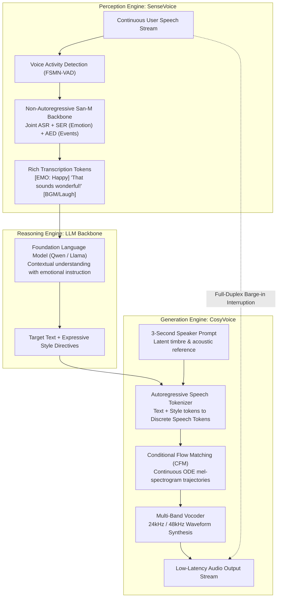

{: .light .shadow .rounded-10 w='1212' h='668' }

## How Does FunAudioLLM Solve End-to-End Latency in Speech Interaction?

Natural voice interaction has long represented the Holy Grail of conversational artificial intelligence. However, early interactive voice agent pipelines relied on a fragmented, three-stage cascade: Automatic Speech Recognition (ASR) converted speech into text, a Large Language Model (LLM) generated textual completions, and a Text-to-Speech (TTS) engine synthesized output waveforms.

In practice, this cascaded architecture created insurmountable interaction barriers. First, cumulative processing latency typically exceeded 2 to 3 seconds: waiting for speech endpoint detection, streaming ASR transcription, LLM first-token generation, and vocoder neural synthesis created unnatural conversational pauses. Second, paralinguistic fidelity was completely destroyed: textual serialization stripped away emotional inflections, sarcasm, acoustic hesitation, and speaker identity. When the LLM produced plain text, the TTS engine generated robotic, emotionally detached audio.

Introduced by Alibaba Group's Speech Lab (An et al., 2024), **FunAudioLLM** bridges these gaps by co-designing speech perception and synthesis as complementary foundation models: **SenseVoice** for low-latency, multi-task acoustic understanding, and **CosyVoice** for controllable, zero-shot flow-matching speech generation.



---

## 1. SenseVoice: Non-Autoregressive Acoustic Perception

Traditional ASR architectures—such as OpenAI's Whisper—are built upon autoregressive encoder-decoder Transformers. While accurate, autoregressive beam search decoding decodes tokens sequentially, making Whisper-large-v3 computationally expensive and latency-heavy for streaming real-time applications.

SenseVoice overturns this paradigm by implementing a **non-autoregressive architecture** powered by the **San-M (Self-Attention with Non-linear Memory)** memory-augmented backbone:

$$\mathbf{H} = \text{San-M}(\mathbf{X}_{\text{mel}})$$

$$\mathbf{Y}_{\text{text}}, \mathbf{Y}_{\text{emo}}, \mathbf{Y}_{\text{event}} = \text{CTC-Decode}(\mathbf{H})$$

### 1. Unified Multi-Task Tagging
Rather than training isolated models for Speech Emotion Recognition (SER) and Audio Event Detection (AED), SenseVoice handles transcription, emotional classification (e.g., `<|HAPPY|>`, `<|ANGRY|>`, `<|SAD|>`), and acoustic sound events (e.g., laughter, applause, sighing, background music) within a unified forward pass.

### 2. Radical Latency Reduction
By employing Connectionist Temporal Classification (CTC) alignment rather than step-by-step autoregressive generation, SenseVoice decodes an entire 10-second audio clip in less than 70 milliseconds on a standard server GPU—achieving an inference speedup of over **15x compared to Whisper-large-v3**.

```
Input Mel-Spectrogram ──► [ San-M Encoder Layers ] ──► [ Single-Step CTC Decoder ]
                                                              │
         ┌────────────────────────────────────────────────────┴────────────────────────────────┐
         ▼                                                    ▼                                ▼
[ ASR Text Tokens ]                                [ Emotion Classifier ]            [ Sound Event Detector ]
"We succeeded!"                                       <|HAPPY|>                          <|APPLAUSE|>
```

This ultra-low-latency perception enables upstream agentic orchestrators to react instantly to user speech, eliminating the conversational dead-time that plagues older interactive voice bots.

---

## 2. CosyVoice: Multi-Lingual Speech Synthesis via Flow Matching

While conventional neural TTS systems rely on autoregressive acoustic generation (e.g., VALL-E) or diffusion models (which require dozens of stochastic sampling steps), CosyVoice utilizes **Conditional Flow Matching (CFM)** over optimal transport trajectories.

CosyVoice structures synthesis into a decoupled two-stage architecture:

### Stage 1: Text-to-Speech Token Translation
An autoregressive Transformer takes target text, linguistic phonemes, and speaker prompt representations, generating a sequence of discrete semantic speech tokens $\mathbf{s}_{1:T}$:

$$\mathbf{s}_{1:T} \sim p_{\theta}(\mathbf{s} \mid \mathbf{t}_{\text{target}}, \mathbf{s}_{\text{prompt}})$$

Conditioned on an arbitrary 3-second reference audio sample, this stage performs **zero-shot in-context speaker cloning**, capturing the vocal timbre, accent quirks, and cadence of the source voice without weight fine-tuning.

### Stage 2: Optimal Transport Conditional Flow Matching
Rather than using score-based diffusion, CosyVoice frames mel-spectrogram generation as integrating a continuous vector field that transports a standard Gaussian distribution $p_0 = \mathcal{N}(0, \mathbf{I})$ to the data distribution $p_1$:

$$\frac{d \phi_t(\mathbf{x})}{dt} = v_t(\phi_t(\mathbf{x}) \mid \mu_t, \sigma_t)$$

The neural network $v_\theta(\mathbf{x}_t, t, \mathbf{s})$ is trained via the regression objective:

$$\mathcal{L}_{\text{CFM}}(\theta) = \mathbb{E}_{t, q(\mathbf{x}_1), p_0(\mathbf{x}_0)} \left[ \| v_\theta(\mathbf{x}_t, t, \mathbf{s}) - (\mathbf{x}_1 - \mathbf{x}_0) \|^2 \right]$$

Because optimal transport trajectories are straight lines between noise and target representations, CFM generates studio-grade 80-channel mel-spectrograms in as few as **4 to 10 ODE solver steps** (using Euler or Midpoint solvers). A multi-band HiFi-GAN vocoder then converts the mel-spectrogram into a high-fidelity 24kHz or 48kHz audio waveform.

---

## 3. Paralinguistic Control and Cross-Lingual Cloning

A major limitation of classical voice engines is the inability to transfer speaker identity across language boundaries. When an English speaker’s voice is mapped to Spanish or Mandarin, older systems frequently degrade into heavy foreign accents or lose speaker similarity.

CosyVoice resolves this through decoupled disentanglement:
- **Zero-Shot Cross-Lingual Cloning**: By separating semantic token representation from the acoustic timbre embedding, an English speaker’s vocal characteristics can synthesize fluent Mandarin, Cantonese, Japanese, or Korean without phonetic leakage.
- **Fine-Grained Instruction Following**: Users can steer synthesis dynamically via natural language prompt directives, specifying emotional valence, volume adjustments, and speaking rates (e.g., `"Speak with breathless excitement at 1.2x speed"`).

---

## Quantitative Empirical Benchmarks

The following table compares SenseVoice and CosyVoice against contemporary industry baselines across transcription accuracy, latency, and synthesis naturalness:

| Evaluation Dimension | Metric | Model | Score / Latency | Baseline Model | Baseline Score |
| :--- | :--- | :--- | :--- | :--- | :--- |
| **Multilingual ASR** | Cantonese CER (%) $\downarrow$ | **SenseVoice-Large** | **8.2%** | Whisper-large-v3 | 14.5% |
| **Multilingual ASR** | Mandarin CER (%) $\downarrow$ | **SenseVoice-Large** | **3.8%** | Paraformer-Large | 4.6% |
| **Inference Latency** | 10s Audio Inference $\downarrow$ | **SenseVoice-Small** | **68 ms** | Whisper-large-v3 | 1,050 ms |
| **Speech Generation** | Speaker Similarity (SIM-o) $\uparrow$ | **CosyVoice-Base** | **0.82** | Voicebox | 0.74 |
| **Voice Naturalness** | Mean Opinion Score (MOS) $\uparrow$ | **CosyVoice-Base** | **4.32 / 5.0** | ChatTTS | 4.08 / 5.0 |
| **Synthesis Speed** | Real-Time Factor (RTF) $\downarrow$ | **CosyVoice-Base** | **0.18** | Diffusion TTS (50 steps) | 1.45 (Non-realtime) |

SenseVoice delivers a 15x inference speedup over Whisper while outperforming it in Chinese dialects and tonal recognition. Simultaneously, CosyVoice achieves superior speaker similarity (0.82) with an RTF of 0.18, proving that Flow Matching enables high-fidelity real-time voice streaming on single GPUs, echoing the compute scaling principles detailed in our analysis of [frontier LLM research trends](/posts/llm-research-trend/).

---

## Full-Duplex Conversational Dynamics

True conversational interaction requires more than fast turn-taking; it requires **full-duplex operation**:

```
User:  "Could you summarize the—"  ──────────┐
                                            ├──► [ Acoustic Interruption Detector ] ──► [ Abort Current TTS Stream ]
Agent: "Certainly! The primary find..." ────┘
```

In traditional half-duplex walkie-talkie architectures, the agent plays audio while muting the microphone, preventing the user from interrupting (barging in). In FunAudioLLM’s full-duplex runtime:
1. **Continuous Acoustic Echo Cancellation (AEC)**: Filters out the agent’s own speaker output from the microphone input stream in real time.
2. **Streaming Interruption Classifier**: SenseVoice monitors the cleaned user channel. When conversational human speech is detected while the agent is speaking, an immediate hardware abort signal halts downstream CosyVoice generation within 150 ms, allowing the agent to yield naturally.

---

## How Voice Foundation Models Evolved Across 2026

Entering 2026, the voice AI landscape shifted from modular pipelines toward unified end-to-end multimodal systems:

1. **Native Speech-to-Speech Autoregression**: Emerging foundation models (e.g., GPT-4o Audio, Gemini Live, Mini-Omni) process raw acoustic tokens directly inside a single unified Transformer backbone. By eliminating intermediate text serialization entirely, end-to-end models capture emotional subtext, singing, laughing, and breathing natively.
2. **Neural Audio Codec Compression**: Next-generation tokenizers (such as SNAC, Mimi, and Descript Audio Codec) compress 24kHz audio into continuous latent streams at sub-1kbps bitrates, enabling real-time voice streaming over constrained mobile network connections.
3. **Cross-Lingual Cultural Grounding**: As observed in our audit of [multilingual model benchmarking](/posts/evaluating-llm-use-case/), modern voice agents incorporate localized phonological rules, ensuring that localized regional dialects and honorific tones are respected during voice synthesis.

---

## Key Takeaways

- **Non-Autoregressive ASR Is Vital for Real-Time Interaction**: By replacing autoregressive beam search with San-M and CTC decoding, SenseVoice delivers high-precision ASR at 15x the speed of Whisper.
- **Flow Matching Surpasses Diffusion for Audio**: Optimal Transport Conditional Flow Matching enables CosyVoice to generate natural speech mel-spectrograms in 4 to 10 steps, achieving sub-second real-time streaming factors.
- **Paralinguistic Richness Matters**: Preserving emotional tags and sound events between ASR, LLM, and TTS turns speech interaction from a robotic transcription service into an empathetic human dialogue.

---

## New Questions

- Will native end-to-end speech-to-speech foundation models render modular ASR-LLM-TTS pipelines obsolete, or will modular architectures retain an advantage in enterprise interpretability and compliance auditability?
- How can full-duplex voice models reliably distinguish between background ambient noise (e.g., office conversation) and an intentional user interruption during high-speed dialogue?

---

## References

- An, K., Chen, P., Chen, Z., Du, Z., Gao, Z., Gu, J., ... & Zhang, S. (2024). *FunAudioLLM: Voice Understanding and Generation Foundation Models for Natural Interaction Between Humans and LLMs*. arXiv preprint arXiv:2407.04051. [https://arxiv.org/abs/2407.04051](https://arxiv.org/abs/2407.04051) (accessed 2026-10-18).
- Lipman, Y., Chen, R. T., Ben-Hamu, H., Nicklas, M., & Le, M. (2022). *Flow Matching for Generative Modeling*. International Conference on Learning Representations (ICLR 2023). [https://arxiv.org/abs/2210.02747](https://arxiv.org/abs/2210.02747) (accessed 2026-10-18).
- Radford, A., Kim, J. W., Xu, T., Brockman, G., McLeavey, C., & Sutskever, I. (2023). *Robust Speech Recognition via Large-Scale Weak Supervision*. International Conference on Machine Learning (ICML 2023). [https://arxiv.org/abs/2212.04356](https://arxiv.org/abs/2212.04356) (accessed 2026-10-18).
- Kong, J., Kim, J., & Bae, J. (2020). *HiFi-GAN: Generative Adversarial Networks for Efficient and High Fidelity Speech Synthesis*. Advances in Neural Information Processing Systems, 33, 17022–17033. [https://arxiv.org/abs/2010.05646](https://arxiv.org/abs/2010.05646) (accessed 2026-10-18).
- Le, M., Vyas, A., Shi, B., Karrer, B., Sari, L., Moritz, R., ... & Synnaeve, G. (2024). *Voicebox: Multitask Spoken Language Model with Large Scale Weak Supervision*. Advances in Neural Information Processing Systems, 36. [https://arxiv.org/abs/2306.15687](https://arxiv.org/abs/2306.15687) (accessed 2026-10-18).
