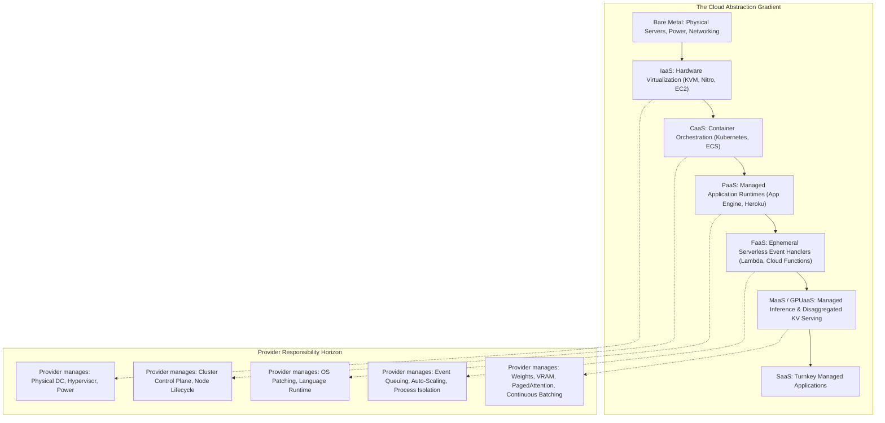

{: .light .shadow .rounded-10 w='1212' h='668' }

## How Does the Cloud Abstraction Gradient Shift Failure Domains Across XaaS?

In enterprise infrastructure engineering, cloud computing is frequently described through the lens of operational convenience and capital expenditure reduction. Business summaries routinely enumerate acronyms—SaaS, PaaS, IaaS, FaaS—as interchangeable flavors of subscription hosting.

Technically, however, **Anything as a Service (XaaS)** represents a continuous spectrum of abstraction over physical computation, memory, networking, and state persistence. Every step up the abstraction ladder trades direct hardware control for automated operational elasticity. As cloud providers assume responsibility for lower infrastructure layers (physical facilities, kernel hypervisors, runtime schedulers, and memory allocations), the failure domain shifts: hardware faults are replaced by distributed system race conditions, multi-tenant resource contention, and opaque API quotas.

Understanding this continuum requires evaluating the mechanics of shared responsibility, the queuing theory behind serverless cold starts, and the emerging economics of Model-as-a-Service (MaaS) and GPU-as-a-Service (GPUaaS).



---

## 1. The Shared Responsibility Boundary

The foundational operating model of all cloud architecture is the **Shared Responsibility Model**. Security, reliability, and regulatory compliance are partitioned dynamically depending on where an organization anchors its deployment on the XaaS gradient:

| Architectural Tier | Physical Facilities & Network | Virtualization & Hypervisor | Operating System & Kernel | Runtime & Middleware | Application Logic & Code | Data & Identity Governance |
| :--- | :--- | :--- | :--- | :--- | :--- | :--- |
| **On-Premises** | Customer | Customer | Customer | Customer | Customer | Customer |
| **IaaS (e.g., EC2)** | **Provider** | **Provider** | Customer | Customer | Customer | Customer |
| **CaaS (e.g., EKS)** | **Provider** | **Provider** | Shared | Shared | Customer | Customer |
| **PaaS (e.g., Elastic Beanstalk)** | **Provider** | **Provider** | **Provider** | **Provider** | Customer | Customer |
| **FaaS (e.g., AWS Lambda)** | **Provider** | **Provider** | **Provider** | **Provider** | Customer (Functions) | Customer |
| **MaaS (e.g., Together/Bedrock)**| **Provider** | **Provider** | **Provider** | **Provider** | Shared (Prompts/Weights)| Customer |
| **SaaS (e.g., Workday)** | **Provider** | **Provider** | **Provider** | **Provider** | **Provider** | Customer |

When deploying within IaaS, the customer retains root access to virtual machine kernels, bearing responsibility for security patch management, network firewall policies, and operating system zero-day vulnerabilities. In contrast, moving to CaaS delegates node control plane consensus to managed services, as analyzed in our review of [distributed consensus and Kubernetes architecture](/posts/what-is-kubernetes/).

---

## 2. Serverless (FaaS): Queuing Theory and Micro-VM Isolation

Functions-as-a-Service (FaaS) represents the culmination of compute disaggregation: rather than paying for idle CPU cycles, users execute stateless, event-driven functions billed down to the millisecond.

### Queuing Theory of Serverless Elasticity
Serverless scaling dynamics are governed by the **Erlang C model** and $M/M/c$ queuing theory. When a burst of $N$ concurrent HTTP requests arrives at a serverless endpoint, the system must provision $c$ execution workers:

$$P(\text{Wait} > 0) = \frac{\frac{(\lambda / \mu)^c}{c!} \frac{c}{c - (\lambda / \mu)}}{\sum_{k=0}^{c-1} \frac{(\lambda / \mu)^k}{k!} + \frac{(\lambda / \mu)^c}{c!} \frac{c}{c - (\lambda / \mu)}}$$

Where $\lambda$ is request arrival rate and $\mu$ is service rate. If arrival rate exceeds warm container capacity ($c$), the scheduler triggers a **cold start**: allocating a new execution sandbox, pulling container image layers, initializing the language runtime, and executing user initialization code.

```
Incoming Request ──► [ Warm Sandbox Available? ]
                            │
               ┌────────────┴────────────┐
               ▼ (Yes: 5 ms)             ▼ (No: Cold Start)
       [ Execute Function ]      [ Spawn Micro-VM (Firecracker: ~120 ms) ]
               │                         │
               │                         ▼
               │                 [ Load Runtime & App Logic: ~500 ms ]
               │                         │
               └─────────────────────────┘
```

### Micro-VM Isolation: Firecracker vs. Containers
Traditional Linux containers (cgroups and namespaces) share the host kernel, creating cross-tenant side-channel risks (e.g., Spectre, Meltdown) that prevent cloud providers from co-locating untrusted customer functions on identical kernels. Standard virtual machines (QEMU/KVM), conversely, take seconds to boot and consume hundreds of megabytes of memory.

Modern serverless platforms resolved this trade-off using **Micro-VMs** (such as AWS Firecracker). Written in Rust, Firecracker strips out legacy BIOS, PCI buses, and unnecessary device drivers, launching a secure, isolated micro-virtual machine with a dedicated guest kernel in under **120 milliseconds** with less than 5 MB of memory overhead.

---

## 3. The New Frontier: Model-as-a-Service and GPUaaS

Between 2023 and 2026, the explosive compute demands of generative AI exposed the limits of standard IaaS. Renting monolithic virtual GPU instances (e.g., 8x NVIDIA H100 nodes at tens of thousands of dollars per month) resulted in catastrophic capital inefficiency for enterprises experiencing variable inference traffic:
- **GPU Under-Utilization**: Serving sporadic user traffic left expensive High-Bandwidth Memory (HBM) idle 80% of the time.
- **Memory Fragmentation**: Inability to share GPU memory across distinct models and users without full model weight re-loading.

This bottleneck gave rise to two specialized layers: **GPU-as-a-Service (GPUaaS)** and **Model-as-a-Service (MaaS)**.

```
                    [ Model-as-a-Service (MaaS) Client ]
                                    │
                         (API: Tokens In / Out)
                                    │
                                    ▼
       ┌─────────────────────────────────────────────────────────┐
       │   Disaggregated Serving Engine (vLLM / TensorRT-LLM)     │
       │                                                         │
       │  [ Prefill Cluster ] ────► PagedAttention KV Transfer   │
       │  (Compute-Bound)                   │                     │
       │                                    ▼                     │
       │                         [ Decode Cluster ]              │
       │                         (Memory-Bound)                  │
       └─────────────────────────────────────────────────────────┘
```

### Architectural Mechanics of MaaS
MaaS abstracts away hardware entirely, exposing models through standardized inference APIs billed purely per generated token. Under the hood, providers implement advanced serving optimizations:
- **PagedAttention and Continuous Batching**: Eliminates internal and external KV-cache fragmentation by treating GPU VRAM like virtual memory pages, dynamically inserting incoming queries into running forward passes without waiting for active generations to finish.
- **Prefill-Decode Disaggregation**: Separates the compute-bound prompt evaluation phase (prefill) from the memory-bandwidth-bound token generation phase (decode), running them on specialized compute pools to maximize hardware efficiency, governed by the mathematical foundations reviewed in our [10 foundational algorithms audit](/posts/10-core-algorithms/).

---

## Comparative Matrix of Modern XaaS Paradigms

| Service Paradigm | Unit of Abstraction | Provisioning Latency | Billing Granularity | State Management | Primary Architectural Risk |
| :--- | :--- | :--- | :--- | :--- | :--- |
| **IaaS (Compute)** | Virtual Machine | 30 s – 2 min | Per-second / Hourly | Persistent disk (EBS) | Manual patching, idle resource waste |
| **CaaS (K8s)** | Container Pod | 2 s – 10 s | Node-level allocation | Persistent Volume Claim | Ingress routing and mesh complexity |
| **PaaS** | Application Service | 10 s – 60 s | Continuous monthly | Ephemeral / Managed DB | Rigid buildpacks, vendor lock-in |
| **FaaS** | Ephemeral Function | 5 ms (Warm) / 200 ms (Cold) | Millisecond | Strictly Stateless | Cold-start latency, connection pooling |
| **GPUaaS** | Raw Accelerated Node | Minutes (Reservations) | Hourly / Per-minute | Host ephemeral VRAM | Supply shortages, network fabric limits |
| **MaaS** | Model Inference API | 50 ms – 150 ms TTFT | Per 1K Tokens | Stateless (Client manages KV) | Rate limits, provider telemetry exposure |

---

## How XaaS Infrastructure Evolved Across 2026

Entering 2026, the XaaS paradigm evolved from passive hosting services into dynamic, agent-orchestrated environments:

1. **Heterogeneous Compute Pooling**: Next-generation cloud runtimes transparently schedule workloads across mixed hardware fabrics (NVIDIA GPUs, Google TPUs, and specialized NPU silicon) using compiler frameworks like MLIR and Triton, completely decoupling application code from underlying hardware ISAs.
2. **Autonomous Micro-Billing and Dynamic Spot Arbitrage**: Autonomous software agents provision, utilize, and decommission ephemeral compute resources across multi-cloud spot markets dynamically, negotiating bandwidth and compute rates in real time via automated cryptographic payment rails.
3. **Data Sovereign Localized XaaS**: In response to regulatory mandates (e.g., European AI Act and national data protection statutes), providers deploy micro-region edge appliances that execute local inference and data processing within domestic enterprise boundaries while retaining centralized cloud control planes, a deployment model examined in our [open-source data engineering stack review](/posts/explore-the-landscape-of-open-source-data-engineering/).

---

## Key Takeaways

- **Abstraction Inverts Operational Risks**: Ascending the XaaS gradient eliminates operating system maintenance but increases exposure to vendor platform lock-in and multi-tenant resource contention.
- **Micro-VMs Saved Serverless**: Ephemeral execution requires hardware-level isolation without virtualization bloat; architectures like Firecracker made secure, low-latency FaaS technically viable.
- **The Shift from Instances to Tokens**: AI workloads made instance-based compute economics obsolete; modern cloud billing is increasingly denominated in token throughput and memory bandwidth.

---

## New Questions

- How will multi-cloud agentic systems ensure data consistency and low latency when orchestrating workloads distributed across geographically fragmented FaaS and MaaS providers?
- Will the emergence of decentralized edge compute networks challenge the hyperscaler monopoly on GPU-as-a-Service infrastructure?

---

## References

- Armbrust, M., Fox, A., Griffith, R., Joseph, A. D., Katz, R., Konwinski, A., ... & Zaharia, M. (2010). *A View of Cloud Computing*. Communications of the ACM, 53(4), 50–58. [https://doi.org/10.1145/1721654.1721672](https://doi.org/10.1145/1721654.1721672) (accessed 2026-10-18).
- Agache, A., Deaconescu, M., Marica, V., Nitu, R., Popa, R. S., & Stoenescu, R. (2020). *Firecracker: Lightweight Virtualization for Serverless Applications*. 17th USENIX Symposium on Networked Systems Design and Implementation (NSDI 20). [https://www.usenix.org/conference/nsdi20/presentation/agache](https://www.usenix.org/conference/nsdi20/presentation/agache) (accessed 2026-10-18).
- Kwon, W., Li, Z., Zhuang, S., Sheng, Y., Zheng, L., Yu, C. H., ... & Stoica, I. (2023). *Efficient Memory Management for Large Language Model Serving with PagedAttention*. Proceedings of the 29th ACM Symposium on Operating Systems Principles (SOSP 2023). [https://doi.org/10.1145/3600006.3613165](https://doi.org/10.1145/3600006.3613165) (accessed 2026-10-18).
- Mell, P., & Grance, T. (2011). *The NIST Definition of Cloud Computing*. National Institute of Standards and Technology (NIST) Special Publication 800-145. [https://csrc.nist.gov/publications/detail/sp/800-145/final](https://csrc.nist.gov/publications/detail/sp/800-145/final) (accessed 2026-10-18).
- Jonas, E., Schleier-Smith, J., Sreekanti, V., Tsai, C. C., Khandelwal, A., Pu, Q., ... & Patterson, D. A. (2019). *Cloud Programming Simplified: A Berkeley View on Serverless Computing*. arXiv preprint arXiv:1902.03383. [https://arxiv.org/abs/1902.03383](https://arxiv.org/abs/1902.03383) (accessed 2026-10-18).
