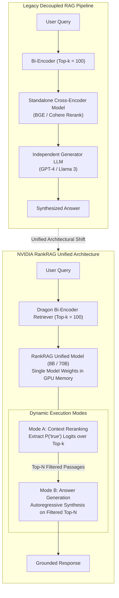
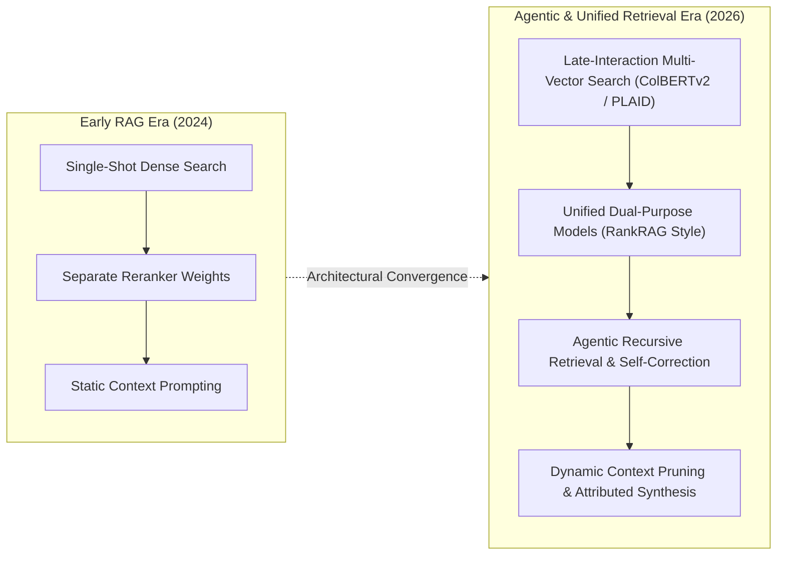

## Why Did Two-Stage Decoupled RAG Pipelines Create Retrieval-Generation Bottlenecks?

Retrieval-Augmented Generation (RAG) is the foundational architecture for grounding Large Language Models (LLMs) in external knowledge, mitigating factual hallucinations, and incorporating proprietary enterprise context. Traditionally, enterprise RAG systems operate as a disjointed multi-stage pipeline:

1. **Stage 1 (Dense Bi-Encoder Retrieval)**: An embedding model (such as Contriever, BGE, or Dragon) projects the user query and database passages into a shared vector space, retrieving a large candidate pool of top-$k$ documents (typically $k = 50 \dots 100$) using Approximate Nearest Neighbor (ANN) search. Because bi-encoders map queries and documents into independent single-vector embeddings without cross-attention interactions, initial retrieval frequently returns semantically similar but factually unhelpful distractors.
2. **Stage 2 (Cross-Encoder Reranking)**: A dedicated cross-encoder model (such as Cohere Rerank or BGE-Reranker) concatenates the query with each retrieved document candidate, executing full all-to-all cross-attention to score document relevance and filter the pool down to a compact subset of top-$N$ passages (typically $N = 3 \dots 5$).
3. **Stage 3 (Autoregressive Generation)**: The filtered passages are injected into the system prompt of a separate, general-purpose generative LLM (such as GPT-4 or Llama 3) to synthesize the final answer.

While functional, this decoupled three-stage topology imposes severe systemic inefficiencies:

- **The "Lost in the Middle" Dilemma**: Decoupled generators remain vulnerable to position biases. When cross-encoders make ranking mistakes or when noisy passages slip into context windows, generator models suffer from attention dilution, often ignoring key evidence buried in the middle of long prompts.
- **Representation Mismatch and Domain Drift**: The scoring objective of an independent cross-encoder does not necessarily align with the generator's internal attention mechanisms. A passage assigned a high relevance score by a standalone BERT-based reranker may lack the specific factual predicates needed by the generative model to resolve a nuanced query.
- **Inference Latency and Infrastructure Complexity**: Serving separate bi-encoders, cross-encoder rerankers, and generative foundation models requires managing disparate model weights across multiple GPU instances, duplicating tokenization overheads and multiplying pipeline failure modes.

As explored in our technical audits on [enterprise production LLM pipelines](/posts/llm-build-tools-cookbook/) and [intelligent query routing with RouteLLM](/posts/routellm-shows-the-real-battle/), overcoming these constraints requires unifying ranking capability and generation capability into a single, cohesive neural foundation. NVIDIA solved this architectural dilemma with **RankRAG** (Yu et al., 2024).



---

## The RankRAG Framework: Unified Instruction Tuning and Ranking Logit Formulations

The core breakthrough of NVIDIA's RankRAG is instruction-tuning a single foundation model (built on Llama 3 8B and 70B) to simultaneously master two fundamentally different operational tasks: **relevance classification** and **grounded text generation**.

### The Two-Stage Instruction Tuning Recipe
To instill dual-purpose capabilities without triggering catastrophic forgetting, RankRAG uses a structured training curriculum:

1. **Stage 1 (Supervised Instruction Tuning)**: The base Llama 3 model is first instruction-tuned on high-quality conversational datasets (following NVIDIA's ChatQA 1.5 recipe), establishing baseline reasoning, dialogue management, and instruction-following proficiency.
2. **Stage 2 (Blended Multi-Task Fine-Tuning)**: The model is then fine-tuned on a balanced mixture of four specialized data distributions:
   - *General Instruction Following*: Preserving general conversational capabilities (Alpaca, Dolly, Flan).
   - *Direct Question Answering*: Retaining internalized parametric knowledge (NQ, TriviaQA).
   - *RAG-Conditioned QA*: Synthesizing answers strictly grounded in provided gold reference contexts.
   - *Context Ranking Data*: Discriminating between relevant and irrelevant contexts for a given query.

Remarkably, NVIDIA's empirical ablation studies demonstrated that allocating **as little as 1% to 5% of training tokens to context ranking data** is sufficient to transform a standard generative model into a world-class reranker, without degrading its generative fluencies.

### Ranking Mechanics at Inference Time
During the reranking phase, RankRAG evaluates the relevance of each candidate passage $c_i \in \{c_1, \dots, c_k\}$ retrieved by the dense Dragon retriever. The model is presented with the prompt:

```text
Query: {query}
Context: {context_c_i}
Is this context relevant to answer the query? Answer true or false.
```

Instead of sampling variable-length text autoregressively, RankRAG inspects the output logits for the immediate next token position, comparing the unnormalized logits corresponding to the tokens `"true"` ($z_{\text{"true"}}$) and `"false"` ($z_{\text{"false"}}$). The relevance score $s(q, c_i)$ is computed via binary softmax:

$$s(q, c_i) = P(\text{"true"} \mid q, c_i) = \frac{\exp(z_{\text{"true"}})}{\exp(z_{\text{"true"}}) + \exp(z_{\text{"false"}})}$$

Because this scoring requires only a single forward pass over each (query, passage) pair without autoregressive token generation, scoring $k = 100$ passages can be batched efficiently on GPU hardware. The candidate passages are sorted by $s(q, c_i)$, and the top-$N$ highest-scoring passages are directly fed back into the exact same model instance—now operating in Generation Mode—to synthesize the final response.

```
+----------------------------------------------------------------------------------------------------+
|                                    RankRAG Dual-Execution Modes                                    |
+----------------------------------------------------------------------------------------------------+
| Feature              | Mode A: Reranking Execution           | Mode B: Generation Execution        |
+----------------------+---------------------------------------+-------------------------------------+
| Input Prompt         | Query + Candidate Passage + Bool Q    | System Prompt + Query + Top-N Chunks|
| Execution Type       | Single forward pass (Logit readout)   | Autoregressive token generation     |
| Target Metric        | Softmax P("true") probability         | Cross-entropy token likelihood      |
| Output Payload       | Float relevance score                 | Markdown response with citations    |
| Hardware Footprint   | Reuses same model weights in memory   | Reuses same model weights in memory |
+----------------------------------------------------------------------------------------------------+
```

---

## Empirical Benchmark Evaluation: Outperforming GPT-4 Across 9 RAG Benchmarks

NVIDIA evaluated RankRAG across nine diverse question-answering, fact verification, and conversational retrieval benchmarks, including Natural Questions (NQ), TriviaQA, WebQuestions, FEVER, and CoQA.

```
Benchmark Accuracy Comparison (Average Across 9 RAG Benchmarks)
  60% |                                      * RankRAG 70B (56.1)
      |                             * RankRAG 8B (52.6)
  50% |                    * ChatQA 1.5 (48.3)
      |           * GPT-4 (43.5)
  40% |  * Baseline Llama 3 (38.2)
   0% +-------------------------------------------------------->
```

The benchmark results highlighted three critical findings:

1. **Surpassing Frontier Models**: Both **RankRAG 8B (52.6)** and **RankRAG 70B (56.1)** significantly outperformed **GPT-4 (43.5)** paired with the standard top-5 retrieved passages, demonstrating a **+9.1 to +12.6 point accuracy advantage**.
2. **Robustness to Large Retrieval Pools**: Conventional RAG models degrade severely when the initial retrieval pool $k$ is expanded from 5 to 100, because the generator's context window becomes polluted with distractor passages. RankRAG, by contrast, steadily improves as $k$ expands from 5 to 100; its internal ranking mechanism reliably isolates the needles in the haystack.
3. **Zero-Shot Out-of-Domain Generalization**: When tested on five specialized biomedical QA benchmarks (such as BioASQ and PubMedQA) without any domain-specific fine-tuning, RankRAG matched or exceeded GPT-4's performance, proving that the learned ranking-generation duality transfers seamlessly across specialized technical vocabularies.

---

## How Retrieval-Augmented Generation Evolved Across 2026

By 2026, the architectural paradigms underpinning enterprise retrieval-augmented generation have evolved significantly:



1. **Sub-Millisecond Late-Interaction Retrieval**: While bi-encoders compress passages into single vectors, late-interaction architectures like ColBERTv2 and PLAID maintain token-level representations, computing MaxSim inner products at query time. In 2026, late-interaction indexes provide cross-encoder-quality candidate pools in under 10 milliseconds, providing unified models like RankRAG with exceptionally high-recall candidate sets.
2. **The Persistent Necessity of Reranking in Long-Context Regimes**: Despite the advent of foundation models supporting 1M+ token context windows, enterprise architectures avoid dumping unranked text directly into prompt context. Dense reranking remains essential to reduce token costs, lower Time-to-First-Token (TTFT) latencies, and eliminate attentional dilution on needle-in-a-haystack tasks.
3. **Agentic Recursive Retrieval (Agentic RAG)**: Modern RAG has shifted from passive, single-shot retrieval to active, multi-hop investigation. Autonomous retrieval agents decompose complex user inquiries into sub-hypotheses, formulate targeted search queries, evaluate document relevance dynamically, and iteratively re-query until information thresholds are satisfied.
4. **Self-Reflective and Corrective RAG (CRAG)**: Contemporary systems integrate automated confidence calibration. If retrieved documents are scored as low-relevance by the ranking head, the model automatically halts generation and falls back to live web search or asks clarifying questions rather than generating grounded hallucinations.

---

## Key Takeaways

- **Decoupled Architecture Fragility**: Operating separate models for bi-encoder retrieval, cross-encoder reranking, and text generation incurs high latency, duplicate GPU memory overheads, and domain misalignment.
- **Dual-Purpose Instruction Tuning**: NVIDIA RankRAG proves that training a single LLM on a blend of instruction-following, RAG QA, and context ranking enables the model to excel at both relevance ranking and answer generation.
- **Logit-Based Reranking**: Extracting $P(\text{"true"})$ logits allows models to score candidate passages in single forward passes without autoregressive generation latency.
- **High Recall Scalability**: RankRAG scales effectively with larger retrieval pools ($k=100$), actively filtering noise to outperform standalone GPT-4 across diverse academic and biomedical benchmarks.

---

## New Questions

- How do unified ranking-generation models behave when fine-tuned on multilingual corpora with extreme tokenization length asymmetries?
- Can logit-based relevance scoring be extended to multi-vector token interactions without incurring the quadratic latency of full cross-encoders?
- What are the optimal GPU batching strategies for co-locating batched forward-pass reranking and streaming autoregressive generation within a single inference worker?

---

## References

- Yu, Yue, Chenyan Xiong, Si Sun, Chao Zhang, and Arnold Overwijk. *RankRAG: Unifying Context Ranking and Answer Generation in Large Language Models*. arXiv preprint arXiv:2407.02485, 2024. [https://arxiv.org/abs/2407.02485](https://arxiv.org/abs/2407.02485) (accessed 2026-10-18).
- Lin, Sheng-Chieh, Jheng-Hong Yang, and Jimmy Lin. *In-Batch Negatives for Knowledge Distillation with TCT-ColBERT for Dense Retrieval*. arXiv preprint arXiv:2104.08376, 2021. [https://arxiv.org/abs/2104.08376](https://arxiv.org/abs/2104.08376) (accessed 2026-10-18).
- Lewis, Patrick, Ethan Perez, Aleksandra Piktus, Fabio Petroni, Vladimir Karpukhin, Naman Goyal, Heinrich Küttler, Mike Lewis, Wen-tau Yih, Tim Rocktäschel, Sebastian Riedel, and Douwe Kiela. *Retrieval-Augmented Generation for Knowledge-Intensive NLP Tasks*. Advances in Neural Information Processing Systems (NeurIPS), 2020. [https://arxiv.org/abs/2005.11401](https://arxiv.org/abs/2005.11401) (accessed 2026-10-18).
- Liu, Nelson F., Kevin Lin, John Hewitt, Ashwin Paranjape, Michele Bevilacqua, Fabio Petroni, and Percy Liang. *Lost in the Middle: How Language Models Use Long Contexts*. Transactions of the Association for Computational Linguistics (TACL), 2024. [https://arxiv.org/abs/2307.03172](https://arxiv.org/abs/2307.03172) (accessed 2026-10-18).
