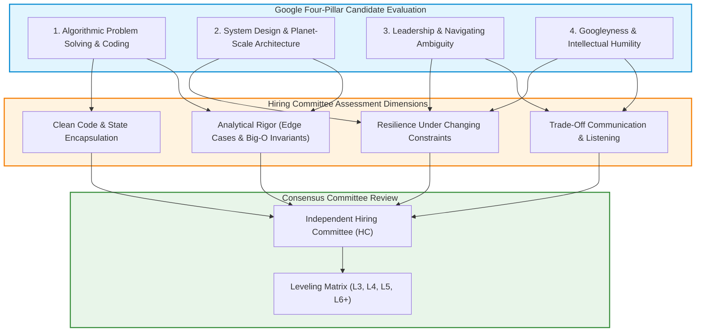

Preparing for technical evaluations at frontier technology firms—most notably Google—is frequently portrayed as a brute-force memorization exercise: grinding hundreds of LeetCode problems and memorizing textbook graph traversals. Candidates who approach the process as pure rote memorization often experience unexpected rejection, even after writing syntactically correct code.

Google's engineering interview process was explicitly designed to test something deeper: **how an engineer reasons through ambiguity, evaluates trade-offs under computational constraints, and collaborates on distributed systems designed to survive decades of continuous operation**.

As formalized in *Software Engineering at Google* (Winters et al., 2020), Google differentiates between "programming" (producing code that runs today) and "software engineering" (managing code, dependencies, and infrastructure over time across thousands of engineers). The interview loops reflect this philosophy.

This source audit deconstructs the four core evaluation pillars of the Google interview loop, details the analytical rubrics used by hiring committees, examines planet-scale system design architectures (Spanner, Borg, Chubby), and analyzes how candidate evaluation evolved in response to generative AI across 2026.


## What Differentiates Google Technical Interviews from Standard Algorithmic Screens?

Standard technical screens at many companies evaluate binary correctness: did the candidate produce code that passes unit tests on an automated platform?

Google interviews differ fundamentally because the interviewer acts as an interactive collaborator evaluating four standardized, rubric-driven pillars:



### The Four Pillars Decoded
1. **Algorithmic Problem Solving (CS Fundamentals)**: Evaluates whether the candidate can model an abstract problem into appropriate data structures (hash tables, heaps, balanced trees, tries, union-find, graphs) and implement an optimal $O(N \log N)$ or $O(N)$ algorithm without relying on IDE autocompletion or compiler feedback.
2. **System Design (L5+ Senior Roles)**: Tests the candidate's ability to architect distributed systems that handle billions of daily active users, petabytes of storage, and unpredictable network partitions.
3. **Leadership & Ownership**: Evaluates how the candidate drives technical consensus, mentors junior colleagues, and leads post-mortems after production outages without assigning blame.
4. **Googleyness**: Contrary to common myths, Googleyness is not a culture-fit screen for social conformity. Google explicitly defines it as: intellectual humility (e.g., admitting when you do not know something), doing the right thing for the user, thriving in ambiguous problem spaces, and valuing collaborative diversity.

## Planet-Scale System Design: The Google Architectural Blueprint

When designing systems at Google scale, standard single-datacenter assumptions break down. Memory fails, disks corrupt, and network links between continents experience periodic partitions. Candidates must design around canonical Google distributed primitives:

### 1. External Consistency and Spanner's TrueTime
Traditional relational databases rely on synchronized NTP clocks, which suffer from clock skew (up to 100-200ms across datacenters). Google Spanner (Corbett et al., 2013) solved global distributed transactions by introducing the **TrueTime API**, which bounds clock uncertainty ($\epsilon \approx 1-7\text{ms}$) using GPS receivers and atomic clocks. By waiting out the uncertainty window ($2\epsilon$) before committing, Spanner guarantees external consistency (linearizability) across global clusters without central locking.

### 2. Container Orchestration and Cluster Scheduling (Borg)
Google Borg (Verma et al., 2015)—the architectural predecessor to Kubernetes—established modern container cluster management. Candidates must understand workload bin-packing, priority tiers (production latency-sensitive services vs. batch processing), admission control, and declarative health reconciliation.

### 3. Distributed Coordination and Lock Services (Chubby)
High-availability systems require distributed consensus. Chubby implements Paxos over a simple distributed filesystem interface, providing coarse-grained distributed locks and reliable leader election for primary storage services like Bigtable and Colossus.

```python
"""
Production LRU Cache Implementation:
Demonstrating O(1) time complexity for get and put operations
using a Doubly-Linked List and Hash Map, adhering to Google interview coding standards.
"""

from typing import Optional, Dict

class Node:
    def __init__(self, key: int = 0, val: int = 0):
        self.key = key
        self.val = val
        self.prev: Optional['Node'] = None
        self.next: Optional['Node'] = None

class LRUCache:
    def __init__(self, capacity: int):
        if capacity <= 0:
            raise ValueError("Capacity must be positive")
        self.capacity = capacity
        self.cache: Dict[int, Node] = {}
        # Sentinel dummy nodes to eliminate boundary edge-case checks
        self.head = Node()
        self.tail = Node()
        self.head.next = self.tail
        self.tail.prev = self.head

    def _remove(self, node: Node) -> None:
        """Detaches an existing node from the doubly linked list."""
        node.prev.next = node.next
        node.next.prev = node.prev

    def _add_to_front(self, node: Node) -> None:
        """Inserts a node immediately after the dummy head."""
        node.next = self.head.next
        node.prev = self.head
        self.head.next.prev = node
        self.head.next = node

    def get(self, key: int) -> int:
        if key not in self.cache:
            return -1
        node = self.cache[key]
        # Move accessed node to head (most recently used)
        self._remove(node)
        self._add_to_front(node)
        return node.val

    def put(self, key: int, value: int) -> None:
        if key in self.cache:
            node = self.cache[key]
            node.val = value
            self._remove(node)
            self._add_to_front(node)
            return

        if len(self.cache) >= self.capacity:
            # Evict least recently used (node before tail)
            lru_node = self.tail.prev
            self._remove(lru_node)
            del self.cache[lru_node.key]

        new_node = Node(key, value)
        self._add_to_front(new_node)
        self.cache[key] = new_node
```

For broader industry context on how tech hiring evaluates candidates across practical codebase navigation and systems design, see our audit on [technical interviews in the AI era](/posts/tech-interview/). For understanding declarative infrastructure and deployment practices, review our analyses of [modern DevOps and GitOps architectures](/posts/most-popular-devops-tools/) and [Git internal DAG mechanics](/posts/git-in-a-Nutshell/).

## How Google Engineering Evaluation and Hiring Evolved Across 2026

Between 2024 and 2026, the arrival of reasoning models and autonomous coding assistants forced Google to transform its technical interview process:

1. **Shift to Interactive Agentic Pair Programming**: Because foundation models can solve LeetCode Hard problems in seconds, Google interviewers increasingly permit or mandate the use of internal AI coding assistants. Candidates are evaluated on their ability to decompose large-scale problems, steer the AI assistant with precise architectural prompts, inspect generated code for subtle concurrency bugs, and defend edge-case constraints.
2. **SWE-bench Style Repository Triage**: For senior roles, 45-minute whiteboards are frequently replaced by practical repo-debugging sessions. Candidates are provided with an unfamiliar Google-scale open-source repo (e.g., Abseil or gRPC), a failing integration test, and a task description, and are evaluated on their ability to locate the bug and submit a clean, tested patch.
3. **Deep Focus on Verification and Failure Blast Radiuses**: As code generation becomes cheap, system resilience becomes the primary differentiator. Interviewers test candidates on how they design circuit breakers, partition keys, canary rollouts, and disaster-recovery runbooks when downstream cloud dependencies fail.
4. **Verbal Architectural Defense Over Syntax**: Interview rounds focus heavily on the reasoning behind decisions: defending why eventual consistency was chosen over strong consistency, quantifying network latency bounds across undersea fiber routes, and calculating the exact hardware cost of multi-region replication.

## Key Takeaways

- **Communication and Trade-Offs Trumps Pure Syntax**: Google interviews assess the candidate's structured problem-solving thought process, clarification of ambiguous requirements, and explicit trade-off analysis before writing any code.
- **Sentinel Nodes Eliminate Edge-Case Complexity**: In data structure implementations, utilizing sentinel dummy nodes (as demonstrated in the LRU cache) eliminates null-pointer checks and prevents off-by-one errors.
- **Planet-Scale Primitives Require Consistency Awareness**: Senior system design requires understanding TrueTime external consistency, Borg cluster scheduling, and Paxos consensus rather than relying on textbook single-database abstractions.
- **AI Literacy is the Modern Benchmark**: In 2026, engineering excellence is measured by the ability to direct, verify, and govern autonomous AI coding agents rather than manual code typing speed.

## New Questions

- **Will Standardized Whiteboarding Disappear Entirely from Big Tech?** As automated benchmark environments achieve higher predictive correlation with on-the-job success than 45-minute whiteboard chats, will remote live interviews be replaced by audited asynchronous challenges?
- **How Will Compensation Bands Adjust to Autonomous Tooling?** If AI agents amplify senior engineer productivity by $5\times$, will organizations hire fewer developers at higher compensation tiers while shrinking entry-level hiring?
- **Can Cultural and Behavioral Alignment be Objectively Evaluated in Distributed Remote Loops?** As hiring processes become increasingly asynchronous and agent-mediated, how will organizations preserve collaborative cohesion and psychological safety?

## References

- Winters, T., Manshreck, T., & Wright, H. (2020). *Software Engineering at Google: Lessons Learned from Programming Over Time*. O'Reilly Media. Available at: [https://abseil.io/resources/swe-book](https://abseil.io/resources/swe-book) (accessed 2026-10-18).
- Corbett, J. C., Dean, J., Epstein, M., Fikes, A., Frost, C., Furman, J. J., Ghemawat, S., Gubarev, A., Heiser, C., Hochschild, P., Hsieh, W., Kanthak, S., Kogan, E., Li, H., Lloyd, A., Melnik, S., Mwaura, D., Nagle, D., Quinlan, S., ... & Woodbridge, D. (2013). *Spanner: Google’s Globally Distributed Database*. ACM Transactions on Computer Systems (TOCS), 31(3), 1–22. Available at: [https://research.google/pubs/spanner-googles-globally-distributed-database/](https://research.google/pubs/spanner-googles-globally-distributed-database/) (accessed 2026-10-18).
- Verma, A., Pedrosa, L., Korupolu, M., Oppenheimer, D., Tune, E., & Wilkes, J. (2015). *Large-scale cluster management at Google with Borg*. Proceedings of the Tenth European Conference on Computer Systems (EuroSys 2015). Available at: [https://research.google/pubs/large-scale-cluster-management-at-google-with-borg/](https://research.google/pubs/large-scale-cluster-management-at-google-with-borg/) (accessed 2026-10-18).
- McDowell, G. L. (2015). *Cracking the Coding Interview: 189 Programming Questions and Solutions* (6th ed.). CareerCup. Available at: [https://www.crackingthecodinginterview.com/](https://www.crackingthecodinginterview.com/) (accessed 2026-10-18).
