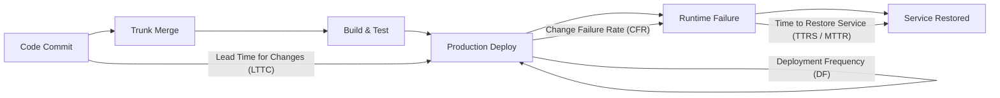
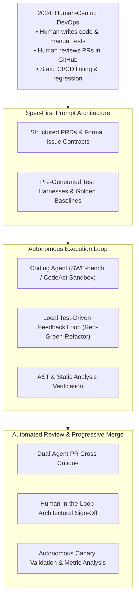

## Why Did Classical Linear SDLC Models Collapse in Modern Engineering?

The traditional Software Development Life Cycle (SDLC)—first codified in Winston Royce's 1970 paper on the Waterfall model and subsequently institutionalized in corporate standard operating procedures—depicted software creation as a unidirectional, sequential progression: Requirements $\to$ Design $\to$ Implementation $\to$ Verification $\to$ Maintenance. In this classical framing, each phase represented an isolated departmental silo guarded by formal sign-off gates.

In modern distributed software systems, this linear framing fails systematically due to three structural flaws:
1. **The Batch Size Trap**: Accumulating requirements and code over weeks or months inflates deployment batch sizes. As demonstrated by Donald Reinertsen in *The Principles of Product Development Flow*, large batch sizes dramatically increase variability, amplify merge conflict complexity, and delay feedback loops until defects become exponentially expensive to rectify.
2. **Phase Boundary Latency**: Isolating testing into a post-implementation gate ("throwing code over the wall to QA") disconnects developers from runtime operational reality. By the time a bug is caught in staging, the engineering context that created it has evaporated from human memory.
3. **The Static Assumption Fallacy**: Waterfall assumes requirements remain immutable while development proceeds. In competitive markets and rapidly evolving cloud ecosystems, market dynamics and technological dependencies shift faster than multi-month release cycles can accommodate.

The transition from linear Waterfall to Agile, DevOps, Continuous Delivery (Humble & Farley), and contemporary **Agentic Continuous Engineering** reflects an uncompromising imperative: **shrinking feedback loops to near-zero latency**. Rather than treating the SDLC as a calendar-driven checklist, elite engineering organizations treat it as a continuous, automated control loop measured by empirical DORA (DevOps Research and Assessment) metrics.

This evolution directly connects to the automated deployment pipelines examined in [CI/CD Software Development Processes](/posts/ci-cd-the-software-development-process/), the autonomous coding feedback loops in [CLI Harnesses for Coding Agents](/posts/cli-harness-coding-agents/), and modern developer environments analyzed in [AI Developer Productivity Tooling](/posts/21-top-ai-tools/).

---

## The Paradigm Shift: Comparing SDLC Topologies

The structural evolution of the software life cycle can be visualized across three generational paradigms:

```mermaid
flowchart TD
    subgraph Waterfall["1. Linear Waterfall (High Latency, Large Batches)"]
        W1["Requirements Freeze"] --> W2["Architectural Blueprint"]
        W2 --> W3["Implementation Sprint"]
        W3 --> W4["Manual QA & Regression Testing"]
        W4 --> W5["Scheduled Release (Quarterly)"]
    end

    subgraph DevOps["2. Trunk-Based Continuous Delivery (Low Latency, Micro Batches)"]
        D1["User Story / Feature Spec"] --> D2["Small Local Branch (<24h)"]
        D2 --> D3["Automated Shift-Left CI (Tests, Lints, SAST)"]
        D3 --> D4["Peer Review & Merge to Trunk"]
        D4 --> D5["Canary Deployment to Production"]
        D5 --> D6["Telemetry & Telemetry Feedback"]
        D6 -.-> D1
    end

    subgraph Agentic["3. Autonomous Agentic SDLC (Deterministic Harnesses)"]
        A1["Structured Spec & Contract"] --> A2["Coding Agent TDD Loop (CodeAct / Sandbox)"]
        A2 --> A3["Deterministic Verification Harness"]
        A3 --> A4["Automated Bot Review & Human Approval"]
        A4 --> A5["Progressive Continuous Deployment"]
        A5 --> A6["Synthetic Anomaly Detection & Self-Healing"]
        A6 -.-> A1
    end
```

---

## The Five Modern SDLC Continuous Delivery Stages

In elite continuous delivery environments, the five historical stages have been reinvented from calendar-driven gates into automated, self-service infrastructure phases:

### 1. Specification and Architectural Design (Continuous Discovery)
Rather than producing 100-page specification documents that become obsolete immediately, modern engineering emphasizes **Spec-Driven Development** and Architecture Decision Records (ADRs):
- **Executable Specifications**: Requirements are expressed as testable domain contracts, OpenAPI specifications, or Behavioral-Driven Development (BDD) scenarios before implementation begins.
- **Micro-Decisions over Big Design Up Front**: Teams maintain ADRs within the code repository alongside source files, documenting architectural trade-offs, constraints, and reversibility.

### 2. Implementation and Trunk-Based Development
Long-lived feature branches that persist for weeks create catastrophic merge conflicts and integration delays:
- **Trunk-Based Development**: Developers integrate code into the `main`/`trunk` branch at least once per day. Branches exist for hours rather than days.
- **Feature Flags (Branch by Abstraction)**: Instead of hiding uncompleted features on disconnected git branches, code is merged directly into production behind dynamic feature toggles (LaunchDarkly, Unleash). This separates deployment (releasing bits to production servers) from release (enabling user visibility).

### 3. Shift-Left Verification and Automated Testing
Quality assurance is no longer a downstream department; it is embedded directly into local pre-commit hooks and pull-request CI workflows:
- **The Testing Pyramid**: Heavy investment in thousands of fast, deterministic unit tests (sub-second execution), complemented by service integration tests and minimal, high-value end-to-end user journeys.
- **Shift-Left Security (DevSecOps)**: Static Application Security Testing (SAST), Software Bill of Materials (SBOM) dependency vulnerability scans (Dependabot, Snyk), and secret leak detection execute automatically on every git push.

### 4. Build, Packaging, and Immutable Artifacts
Modern deployments reject the practice of building artifacts in production or modifying running server files:
- **Hermetic, Reproducible Builds**: Container images (OCI standard) or binary packages are compiled in strictly isolated environments with pinned dependency hashes.
- **Immutable Infrastructure**: Once an artifact is built and signed via cryptographic signatures (Cosign, Sigstore), it is never altered. Promotions from staging to production deploy the identical bit-for-bit container image, swapping only runtime configuration parameters injected via environment secrets.

### 5. Progressive Delivery and SRE Operational Feedback
Deployments are decoupled from instantaneous user exposure using automated routing strategies:
- **Canary Deployments and Blue/Green Swaps**: New releases route to a fraction of live traffic (e.g., 2% of requests) while automated analyzers monitor error rates, p99 latency, and saturation.
- **Automated Rollbacks**: If canary anomalies violate pre-defined Service Level Objectives (SLOs), traffic rolls back immediately to the previous healthy replica set without human triage.

---

## The Mathematical Science of SDLC: DORA Metrics and Flow Dynamics

To scientifically evaluate the health and velocity of a software delivery organization, Google's DevOps Research and Assessment (DORA) team established four foundational quantitative metrics:

### 1. Lead Time for Changes (LTTC)
Lead time measures the elapsed time from a developer making a code commit to that commit running successfully in production:

$$T_{\text{lead}} = T_{\text{authoring}} + T_{\text{review}} + T_{\text{ci\_cd}} + T_{\text{deployment}}$$

In high-performing teams, $T_{\text{lead}} < 1\text{ hour}$, whereas low-performing waterfall teams exhibit $T_{\text{lead}} > 1\text{ month}$.

### 2. Deployment Frequency (DF)
Measures how often code successfully deploys to production:
- **Elite**: Multiple deploys per day on demand.
- **Low**: Once per month or once per quarter.

### 3. Change Failure Rate (CFR)
The percentage of production deployments that result in degraded service, emergency hotfixes, or service rollbacks:

$$\text{CFR} = \frac{N_{\text{failed\_deployments}}}{N_{\text{total\_deployments}}} \times 100\%$$

In elite teams, CFR remains strictly below $5\%$, debunking the traditional myth that moving fast degrades quality.

### 4. Time to Restore Service (TTRS / MTTR)
The elapsed time required to mitigate a production-impacting outage:

$$\text{MTTR} = \frac{1}{K} \sum_{k=1}^K \left( t_{\text{resolved}}^{(k)} - t_{\text{incident}}^{(k)} \right)$$

Elite teams achieve $\text{MTTR} < 1\text{ hour}$ through automated canary rollbacks, feature flag disabling, and immutable infrastructure redeployment.

---

## Empirical Comparison: Engineering Archetypes

The DORA research surveys spanning thousands of global engineering teams establish stark quantitative performance differences across delivery paradigms:

| Metric / Dimension | Traditional Waterfall | Scrums with Two-Week Sprints | Elite Continuous Delivery |
| :--- | :--- | :--- | :--- |
| **Release Frequency** | Quarterly or Bi-annual | Bi-weekly (end of sprint) | Multiple times per day |
| **Lead Time for Changes** | 1 to 6 months | 1 to 4 weeks | Less than 1 hour |
| **Deployment Batch Size** | Massive (hundreds of PRs) | Moderate (sprint backlog) | Micro (single isolated PR) |
| **Change Failure Rate** | 30% – 50% | 15% – 25% | 0% – 5% |
| **Time to Restore (MTTR)** | Days to weeks | Hours to days | Minutes (automated rollback) |
| **Testing Ownership** | Dedicated QA department | Developers + QA engineers | Developers (automated CI) |
| **Branching Strategy** | Long-lived GitFlow branches | Feature branches (1–2 weeks)| Trunk-based (<24h lifetime)|

---

## How the SDLC Evolved Across 2024–2026 Agentic Engineering Workflows

Between 2024 and 2026, the integration of autonomous coding agents (such as Claude Code, Codex, Antigravity, and SWE-bench harness systems) introduced a fundamental transformation into the traditional SDLC:

### 1. The Reversal of Implementation Bottlenecks
Historically, writing implementation code was the most labor-intensive phase of the SDLC. In 2026, coding agents synthesize thousands of lines of functional code in minutes. As a result, the primary bottleneck shifted upstream to **specification precision** and downstream to **verification determinism**:
- If a specification is ambiguous, an autonomous agent synthesizes an incorrect solution at blistering speed.
- Engineering discipline shifted toward writing exhaustive, executable contracts and boundary test cases *before* delegating synthesis to agentic loops.

### 2. Autonomous Test-Driven Development (TDD) Sandboxes
Modern coding agents operate within sandboxed terminal environments (as explored in [CLI Harnesses for Coding Agents](/posts/cli-harness-coding-agents/)). Rather than asking humans for continuous code review:
- The agent inspects existing test suites, formulates a failing test for the new requirement, verifies the test failure (Red), implements the minimal code required to pass (Green), and executes refactoring.
- The human reviewer inspects the resulting pull request not for syntax or boilerplate correctness, but for architectural cohesion and boundary compliance.

### 3. Agentic SRE and Self-Healing Deployments
In 2026 production environments, operational feedback loops have become semi-autonomous:
- When a canary deployment violates an SLO, observability systems trigger automated rollback protocols while simultaneously launching a diagnostic triage agent.
- The agent ingests OpenTelemetry distributed traces and stack traces, isolates the offending git commit, identifies the root-cause regression, generates a reproducing test case, and opens a draft pull request containing the fix—all before on-call human engineers finish logging into the incident dashboard.

---

## Key Takeaways

- **Batch Size Governs Velocity and Stability**: Large release batches create exponential variability, complex merge conflicts, and delayed defect discovery; small, trunk-based micro-batches minimize risk.
- **Trunk-Based Integration**: Merging code into the main trunk at least daily eliminates long-lived branch divergence and forces continuous validation.
- **Separating Deployment from Release**: Utilizing runtime feature flags allows code to be deployed continuously to production servers while decoupling the business activation of features from deployment schedules.
- **DORA Metrics as Scientific Telemetry**: Lead Time for Changes, Deployment Frequency, Change Failure Rate, and Time to Restore Service provide empirical proof that delivery speed and operational reliability are mutually reinforcing, not mutually exclusive.
- **The Agentic SDLC Frontier**: In 2026, implementation is commoditized by coding agents; elite engineering focus centers on specification authoring, deterministic verification harnesses, and autonomous canary safety nets.

---

## New Questions

1. **Agentic Pull Request Saturation**: As autonomous coding agents increase pull request volume by orders of magnitude, how can engineering organizations prevent human review burnout without compromising architectural standards?
2. **Formal Verification in CI Pipelines**: Can lightweight formal methods (e.g., TLA+ or Alloy specifications) be integrated into standard CI/CD workflows to mathematically verify concurrent state transitions before code reaches production?
3. **Synthetic Data Drift in Shift-Left Testing**: As applications integrate stochastic LLM components, how can shift-left testing harnesses reliably detect non-deterministic hallucinations and prompt regression without requiring thousands of costly live API evaluations?

---

## References

- Forsgren, N., Humble, J., & Kim, G. (2018). *Accelerate: The Science of Lean Software and DevOps*. IT Revolution Press. [https://itrevolution.com/book/accelerate/](https://itrevolution.com/book/accelerate/). (accessed 2026-10-18).
- Humble, J., & Farley, D. (2010). *Continuous Delivery: Reliable Software Releases through Build, Test, and Deployment Automation*. Addison-Wesley. [https://continuousdelivery.com/](https://continuousdelivery.com/). (accessed 2026-10-18).
- Reinertsen, D. G. (2009). *The Principles of Product Development Flow*. Celeritas Publishing. [https://www.reinertsenassociates.com/](https://www.reinertsenassociates.com/). (accessed 2026-10-18).
- Google Cloud DevOps Research and Assessment (DORA). *DORA State of DevOps Report*. [https://dora.dev/research/](https://dora.dev/research/). (accessed 2026-10-18).
- Beck, K. (2000). *Extreme Programming Explained: Embrace Change*. Addison-Wesley. [https://www.oreilly.com/library/view/extreme-programming-explained/0201616416/](https://www.oreilly.com/library/view/extreme-programming-explained/0201616416/). (accessed 2026-10-18).

