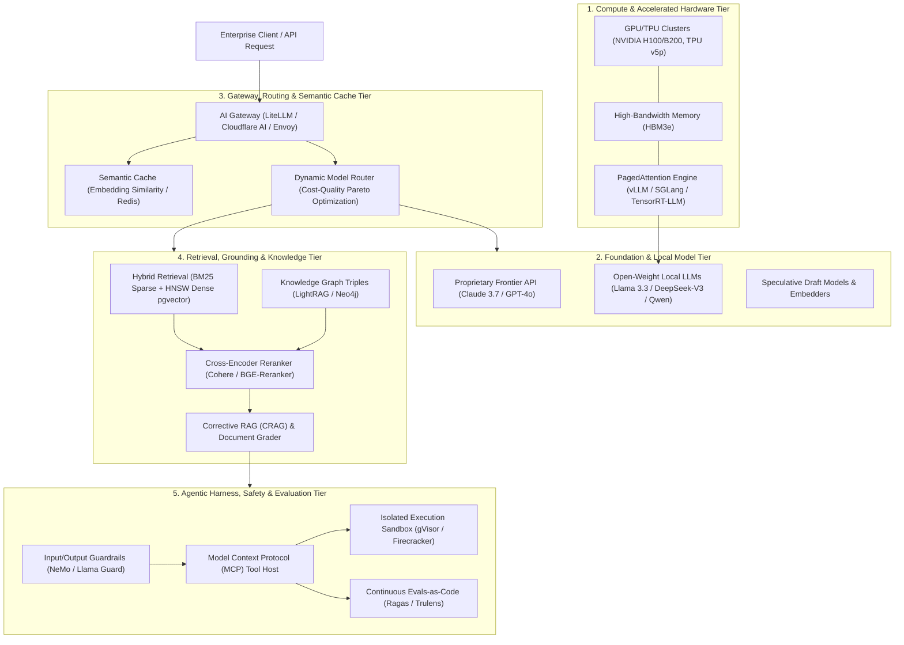
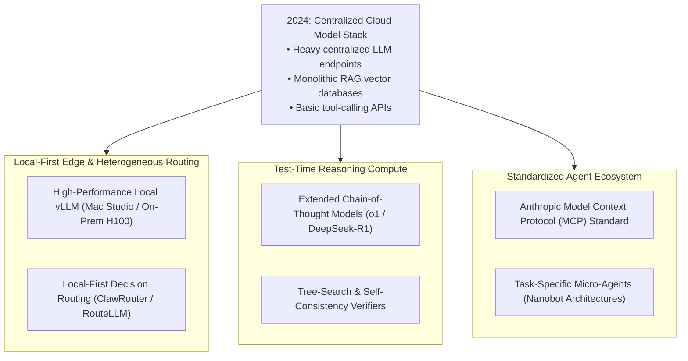

## How Did the Enterprise Generative AI Stack Decouple Across Five Tiers?

In the initial wave of enterprise generative AI adoption following the emergence of ChatGPT, organizations attempted to build production applications through direct, monolithic API calls to proprietary frontier models. Software engineers embedded raw HTTP requests inside web server endpoints, passing unvalidated user prompts directly to remote endpoints and rendering unformatted completions back to users.

This naive prototype pattern collapsed under enterprise operational realities:
1. **Unbounded Operational Expenditures**: Direct invocation of top-tier frontier models (e.g., GPT-4) for repetitive, low-complexity tasks (e.g., classification, entity extraction, SQL formatting) inflated cloud bills by orders of magnitude without proportional quality improvements.
2. **Memory and Latency Bottlenecks**: Serving large language models locally or within private VPCs suffered from catastrophic throughput degradation due to KV cache memory fragmentation and unoptimized batch scheduling.
3. **Hallucination and Context Staleness**: LLMs trained on historical cutoffs lacked proprietary corporate knowledge, while naive vector similarity search (RAG) retrieved semantically close but factually irrelevant documents.
4. **Security and Tool-Misuse Vulnerabilities**: Exposing raw model completions to database execution tools created severe prompt-injection, data exfiltration, and unauthorized privilege escalation risks.

Between 2023 and 2026, the enterprise generative AI stack underwent a profound decoupling into a disciplined, **five-tier layered systems architecture**. Similar to how modern distributed web systems isolate presentation from persistence, the mature generative AI stack isolates hardware acceleration, foundation inference, semantic traffic routing, context grounding, and autonomous agent orchestration.

This layered decoupling directly connects to autonomous model routing in [ClawRouter Local-First Routing](/posts/clawrouter-local-routing/), advanced retrieval workflows in [Agentic RAG Architectures](/posts/agentic-rag-cookbook/), and minimal agent design in [Nanobot Ultralight Agents](/posts/nanobot-ultralight-agent/).

---

## Architectural Topology: The Five-Tier Enterprise GenAI Stack

A production-grade generative AI system routes user requests through five specialized infrastructural tiers:

---

## Deconstructing the Five Enterprise Tiers

### Tier 1: Hardware Acceleration and High-Throughput Serving
At the hardware layer, the fundamental constraint of transformer inference is **memory bandwidth rather than raw compute FLOPS**. During autoregressive token generation, weights must be transferred from High-Bandwidth Memory (HBM) to SRAM on every forward pass.
- **PagedAttention and vLLM**: Classical inference runtimes pre-allocated contiguous memory blocks for the Key-Value (KV) cache based on maximum sequence length, wasting $60\%–80\%$ of GPU VRAM due to internal and external fragmentation. Systems like vLLM partition the KV cache into non-contiguous virtual pages, multiplying concurrent serving throughput by $3\times$ to $5\times$.
- **Continuous Batching**: Rather than waiting for an entire batch of requests to finish generating before admitting new requests, iteration-level continuous batching schedules new queries at every token decoding step.
- **Quantization Schemes**: Modern inference serves models using FP8, INT4, or 1.58-bit ternary formats (AWQ, GPTQ) to double effective memory bandwidth without degrading generative perplexity.

### Tier 2: Foundation and Local Model Selection
Enterprise architectures reject the single-model monopoly, combining complementary model classes across a heterogeneous fleet:
- **Frontier Reasoning Models**: High-parameter models (e.g., Claude 3.7 Sonnet, OpenAI o1, DeepSeek-R1) reserved strictly for complex architectural design, ambiguous legal analysis, multi-step debugging, and mathematical synthesis.
- **Task-Specialized Open-Weight Models**: 8B-to-70B models (e.g., Llama 3.3, Qwen 2.5) self-hosted on private infrastructure to handle confidential PII data, high-volume classification, and real-time structured extraction.
- **Speculative Decoding Engines**: Small draft models (e.g., 1B–3B parameters) emit speculative candidate tokens verified in parallel by the target model in a single forward pass, slashing per-token generation latency by $40\%$.

### Tier 3: Semantic Gateway, Routing, and Cost Optimization
An AI Gateway serves as the centralized reverse proxy and policy control plane:
- **Semantic Caching**: Before dispatching a prompt to an LLM, the gateway computes the prompt's vector embedding. If an existing prompt in the semantic cache exhibits cosine similarity exceeding a strict threshold ($\cos(\theta) > 0.96$) with valid TTL, the cached response returns in sub-10ms at zero LLM cost.
- **Dynamic Cost-Quality Routing**: A lightweight classifier evaluates query complexity. Simple queries (e.g., "translate to French", "extract order ID") route to fast, inexpensive 8B models, while multi-hop reasoning queries route to frontier APIs.
- **Resilience and Circuit Breaking**: Manages rate limits (TPM/RPM), implements exponential backoff, and automatically falls back to secondary cloud providers during outages.

### Tier 4: Knowledge Grounding and Hybrid RAG
To overcome hallucinations and integrate dynamic private corporate data, enterprises build multi-stage retrieval pipelines:
- **Hybrid Sparse/Dense Retrieval**: Dense embeddings (e.g., OpenAI text-embedding-3, BGE) capture semantic concepts but frequently fail on exact serial numbers, product codes, or rare acronyms. Modern stacks query BM25 sparse indices and dense HNSW vector indices simultaneously, merging results via Reciprocal Rank Fusion (RRF).
- **Knowledge Graph Integration (GraphRAG)**: Relational knowledge graphs link entities and hierarchical organizational relationships, enabling multi-hop associative queries across disjoint corporate documents.
- **Cross-Encoder Reranking**: A dense reranker evaluates the full cross-attention score between the query and the top-50 candidate passages, pruning irrelevancies down to the top-5 high-signal context chunks.
- **Self-RAG and Corrective Reflection**: An auxiliary evaluator checks whether retrieved documents actually answer the query; if relevance is insufficient, the system triggers web fallback or query reformulation before generating a response.

### Tier 5: Agentic Execution, Tool Protocols, and Guardrails
The top tier converts static text completions into autonomous, deterministic real-world actions:
- **Model Context Protocol (MCP)**: Standardized open protocol by Anthropic that decouples LLMs from custom tool implementations, allowing models to query SQL databases, git repositories, and external APIs via uniform RPC schemas.
- **Sandboxed Execution**: Any agent capable of generating and running code executes inside strictly isolated ephemeral micro-VMs (e.g., Firecracker or gVisor), with hard quotas on CPU, memory, and network egress.
- **Bidirectional Guardrails**: NeMo Guardrails or Llama Guard inspect prompts before LLM ingestion (blocking jailbreaks, prompt injection, and PII exfiltration) and inspect model outputs before client delivery (filtering toxic text, copyright violations, and hallucinations).
- **Continuous Evals-as-Code**: Automated evaluation harnesses run nightly test suites across golden benchmarks, measuring Answer Relevance, Faithfulness, and Tool Execution Accuracy.

---

## Core Systems Formulations

Enterprise generative AI systems are constrained by precise mathematical formulations governing memory, cost, and routing efficiency:

### 1. KV Cache Memory Consumption Footprint
In standard transformer architectures, the memory consumed by the Key-Value cache during autoregressive generation scales linearly with sequence length, batch size, and layer count:

$$M_{\text{KV}} = 2 \times n_{\text{layers}} \times n_{\text{heads}} \times d_{\text{head}} \times b \times s \times \text{bytes\_per\_element}$$

where $n_{\text{layers}}$ is the number of transformer blocks, $n_{\text{heads}}$ is the number of key/value heads, $d_{\text{head}}$ is head dimension, $b$ is concurrent batch size, and $s$ is total context length (prompt + completion).

For a 70B parameter model ($n_{\text{layers}} = 80$, Grouped-Query Attention with $n_{\text{kv\_heads}} = 8$, $d_{\text{head}} = 128$) using FP16 (2 bytes) with batch size $b = 32$ and sequence length $s = 8192$:

$$M_{\text{KV}} = 2 \times 80 \times 8 \times 128 \times 32 \times 8192 \times 2 = 85.899\text{ GB}$$

This calculation proves why continuous paged memory allocation (PagedAttention) and multi-query / grouped-query attention (GQA) are foundational to enterprise multi-tenant economics.

### 2. Multi-Objective Router Optimization
Let $\mathcal{M} = \{m_1, m_2, \dots, m_K\}$ be the available model fleet. For input query $x$, the router selects model $m^* \in \mathcal{M}$ to maximize expected output quality $Q(m, x)$ subject to a cost penalty $\lambda$ and latency budget $L_{\max}$:

$$m^* = \arg\max_{m \in \mathcal{M}} \left[ \mathbb{E}\left[ Q(m, x) \right] - \lambda \cdot C(m, x) \right] \quad \text{s.t.} \quad \mathbb{E}\left[ \text{Latency}(m, x) \right] \le L_{\max}$$

where $C(m, x) = N_{\text{prompt}}(x) \cdot c_{\text{in}}^{(m)} + \mathbb{E}[N_{\text{comp}}] \cdot c_{\text{out}}^{(m)}$ represents monetary token cost.

### 3. Reciprocal Rank Fusion (RRF) for Hybrid Grounding
When combining sparse BM25 retrieval rankings with dense vector similarity rankings, RRF scores each document $d \in \mathcal{D}$ without requiring arbitrary score normalization:

$$\text{RRF}(d) = \sum_{m \in \{\text{dense}, \text{sparse}\}} \frac{1}{k + r_m(d)}$$

where $r_m(d)$ is the 1-indexed rank of document $d$ within modality $m$, and $k$ is a smoothing constant (typically $k = 60$).

---

## Empirical Comparison: Evolution of Enterprise AI Paradigms

| Dimension / Metric | 2023 Prototype Era | 2024 Transition Era | 2025–2026 Enterprise Maturity |
| :--- | :--- | :--- | :--- |
| **Model Invocations** | Direct hardcoded API keys | LiteLLM gateway wrappers | Autonomous multi-model routers |
| **Serving Architecture** | Hugging Face Transformers | Naive vLLM / TextGen WebUI | PagedAttention + FP8 TensorRT-LLM |
| **Context Strategy** | Naive top-3 vector cosine | Hybrid RAG (Dense + BM25) | GraphRAG + Cross-Encoder Rerankers |
| **Agent Execution** | LangChain ReAct loops | Python script wrappers | Sandboxed MCP Micro-VM containers |
| **Safety Enforcement** | System prompt instructions | Regex & Keyword blacklists | NeMo Guardrails + Llama Guard 3 |
| **Evaluation Method** | Subjective human "vibes" | Static LLM-as-a-judge | Automated Evals-as-Code in CI/CD |
| **Blended Token Cost** | High ($100\%$ frontier models) | Moderate ($30\%$ cost reduction) | Minimal ($85\%$ reduction via routing) |

---

## How Enterprise GenAI Architecture Evolved Across 2024–2026 Workloads

The maturation of generative AI between 2024 and 2026 transformed enterprise technology roadmaps through three structural shifts:

### 1. Rise of Local-First Heterogeneous Routing
Enterprise privacy regulations (GDPR, HIPAA, SOC 2) and escalating API expenses forced an architectural shift away from pure cloud reliance. Modern systems deploy local-first inference clusters on-premise or on edge hardware (e.g., Apple Silicon M-series clusters or private H100 nodes). As demonstrated in [ClawRouter](/posts/clawrouter-local-routing/), incoming queries are evaluated locally: sensitive queries and routine transformations remain strictly on internal hardware, while complex non-confidential queries burst to frontier cloud endpoints.

### 2. Transition from Prompting to Test-Time Reasoning Compute
Prior to 2025, systems attempted to improve quality by expanding prompt instructions and few-shot examples. The emergence of test-time compute reasoning models (e.g., OpenAI o1, DeepSeek-R1) inverted this paradigm:
- Rather than packing all knowledge into pre-training weights, models dedicate variable test-time compute to iterative chain-of-thought exploration, self-correction, and backtracking before emitting final answers.
- Enterprise gateways now manage dynamic reasoning tokens, optimizing the balance between computation latency and mathematical accuracy.

### 3. Protocol Standardization via MCP and Ultralight Micro-Agents
The explosion of custom, brittle agent frameworks (AutoGPT, early BabyAGI) created massive maintenance debt. In 2025–2026, the industry consolidated around Anthropic's **Model Context Protocol (MCP)**:
- Tools, data sources, and prompt templates expose standardized JSON-RPC endpoints.
- Monolithic agent frameworks were replaced by composable, lightweight micro-agents (exemplified by [Nanobot Ultralight Agents](/posts/nanobot-ultralight-agent/)), where minimalist execution harnesses run small, verified tools with near-zero runtime overhead.

---

## Key Takeaways

- **Decoupled Enterprise Tiering**: The generative AI stack has matured from monolithic API calls into five isolated layers: hardware acceleration, foundation inference, semantic routing, knowledge grounding, and agent safety harnesses.
- **Memory Bandwidth Bottleneck**: Inference efficiency is governed by memory throughput; PagedAttention, KV cache quantization, and continuous batching are essential for multi-tenant scalability.
- **Hybrid Grounding Over Naive RAG**: Combining BM25 sparse search, HNSW dense vector indexing, knowledge graphs, and cross-encoder rerankers is required to eliminate enterprise hallucination risks.
- **Model Context Protocol (MCP) Standardization**: Standardized tool interfaces decouple models from custom integration code, transforming LLMs into universal compute co-processors.
- **Economic Invariance via Routing**: Deploying intelligent gateways with semantic caching and cost-quality routers reduces blended enterprise token expenditures by over 80%.

---

## New Questions

1. **KV Cache State Synchronization Across Distributed Clusters**: In multi-region deployments with continuous user migration, how can massive KV cache states be transferred or reconstructed across data centers without introducing long prefill latency?
2. **Deterministic Evaluation of Non-Deterministic Multi-Agent Systems**: As complex workflows involve multiple interacting autonomous agents, how can regression test suites deterministically detect degradation when outputs are fundamentally stochastic?
3. **Formal Verification of Dynamic Agent Permissions**: How can enterprise policy engines mathematically prove that an autonomous agent armed with MCP tools cannot execute unauthorized side effects under adversarial prompt-injection payloads?

---

## References

- Bornstein, M., & Radovanovic, R. (2023). *Emerging Architectures for LLM Applications*. Andreessen Horowitz (a16z). [https://a16z.com/emerging-architectures-for-llm-applications/](https://a16z.com/emerging-architectures-for-llm-applications/). (accessed 2026-10-18).
- Kwon, W., Li, Z., Zhuang, S., Sheng, Y., Zheng, L., Yu, C. H., Gonzalez, J. E., Zhang, H., & Stoica, I. (2023). *Efficient Memory Management for Large Language Model Serving with PagedAttention*. Proceedings of the ACM SIGOPS 29th Symposium on Operating Systems Principles (SOSP 2023). [arXiv:2309.06180](https://arxiv.org/abs/2309.06180). (accessed 2026-10-18).
- Ong, D. S., et al. (2024). *RouteLLM: Learning to Route LLMs with Preference Data*. LMSYS Organization. [arXiv:2406.18665](https://arxiv.org/abs/2406.18665). (accessed 2026-10-18).
- Anthropic. (2024). *Model Context Protocol (MCP) Specification and Architectural Overview*. [https://modelcontextprotocol.io/](https://modelcontextprotocol.io/). (accessed 2026-10-18).
- Shinn, N., Cassano, F., Gopinath, A., Narasimhan, K., & Yao, S. (2023). *Reflexion: Language Agents with Verbal Reinforcement Learning*. Advances in Neural Information Processing Systems (NeurIPS 2023). [arXiv:2303.11366](https://arxiv.org/abs/2303.11366). (accessed 2026-10-18).
