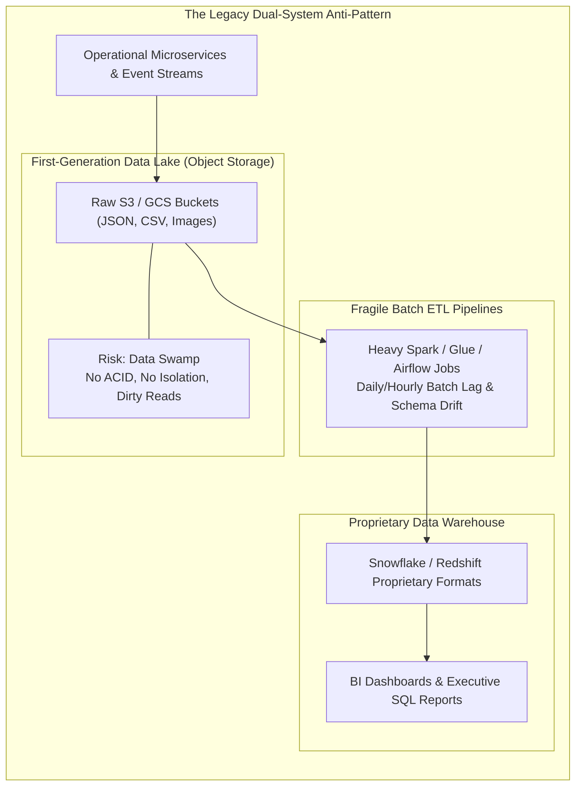
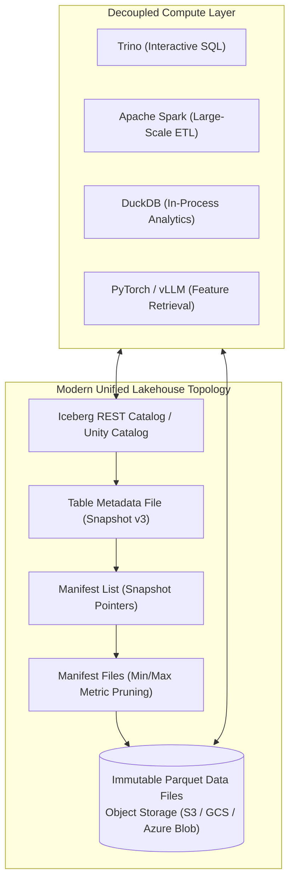
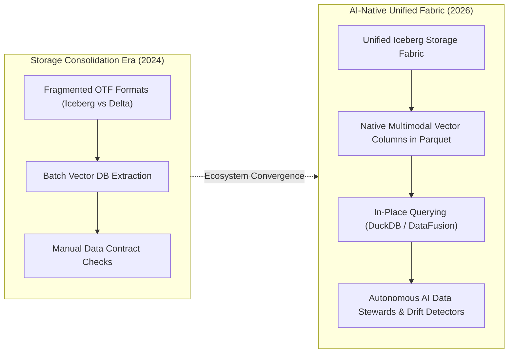

## Why Did Traditional Data Warehouses and Raw Lakes Diverge into Architectural Silos?

Over the past three decades, enterprise data engineering has grappled with a persistent trade-off between structural governance and storage flexibility. To serve analytical business intelligence (BI) alongside predictive machine learning, organizations built complex data estates that historically diverged into two fundamentally incompatible architectural silos:

1. **Enterprise Data Warehouses (EDWs)**: Pioneered by relational database vendors and popularized in the cloud by platforms like Snowflake and Amazon Redshift, data warehouses emphasize structured tabular data, strict schema-on-write policies, and robust ACID (Atomicity, Consistency, Isolation, Durability) transactions. However, warehouses rely on proprietary columnar storage formats, tightly coupled compute-storage costs, and are incapable of natively storing or processing unstructured multimedia assets—such as raw video, audio, PDFs, and high-dimensional vector embeddings essential for generative artificial intelligence.
2. **Raw Data Lakes**: Built atop commodity object storage systems like Amazon S3 and Google Cloud Storage (originally originating from the Apache Hadoop HDFS ecosystem), data lakes decouple compute from storage and ingest raw structured, semi-structured (JSON/Parquet), and unstructured data at petabyte scale. However, first-generation data lakes lacked a transactional metadata layer. They enforced schema-on-read, possessed zero write isolation, and could not handle concurrent writes or point updates (mutations/deletions). 

Without transactional governance, lakes rapidly degraded into unmanageable, corrupted **"data swamps"**:



This dual-system architecture incurred severe operational overhead: organizations spent millions maintaining fragile extraction, transformation, and loading (ETL) pipelines simply to duplicate data between lakes and warehouses. Analysts queried stale data that lagged production systems by days, while machine learning practitioners struggled to access fresh warehouse features due to proprietary serialization barriers.

As detailed in our infrastructure analyses of [resilient 3-tier AWS cloud architectures](/posts/visualization-of-architecture-on-aws/) and [enterprise LLM production pipelines](/posts/llm-build-tools-cookbook/), unifying transactional consistency with raw object storage flexibility became an urgent architectural mandate.

---

## The Lakehouse Revolution: Open Table Formats and Transactional Storage Layers

The resolution to the dual-system dilemma arrived with the **Lakehouse** architectural pattern (Armbrust et al., UC Berkeley / Databricks, 2021). A Lakehouse combines the cost-effective scalability of cloud object storage with the transactional reliability, indexing, and governance of an enterprise data warehouse.

The technical foundation enabling the Lakehouse is the **Open Table Format (OTF)**: an abstraction layer positioned between raw columnar data files (typically Apache Parquet) and distributed compute query engines (such as Apache Spark, Trino, DuckDB, or ClickHouse).

```
+----------------------------------------------------------------------------------------------------+
|                               Modern Open Table Format (OTF) Comparison                            |
+----------------------------------------------------------------------------------------------------+
| Table Format         | Metadata Architecture               | Key Strengths                         |
+----------------------+-------------------------------------+---------------------------------------+
| Apache Iceberg       | Hierarchical metadata tree:         | Engine-agnostic; hidden partitioning; |
|                      | Iceberg Catalog -> Metadata File -> | high-concurrency snapshot isolation;  |
|                      | Manifest List -> Manifests -> Files | strict schema evolution guarantees    |
| Delta Lake           | Write-Ahead Transaction Log:        | Native Apache Spark optimization;     |
|                      | _delta_log/*.json commits with      | blazing time-travel queries;          |
|                      | periodic Parquet checkpoint files   | Liquid Clustering dynamic partitioning|
| Apache Hudi          | Timeline-based state transitions:   | Ultra-fast streaming CDC upserts;     |
|                      | Copy-on-Write (COW) and             | incremental pull queries;             |
|                      | Merge-on-Read (MOR) data files      | optimized for near-real-time updates  |
+----------------------------------------------------------------------------------------------------+
```

### Anatomy of Apache Iceberg Snapshot Isolation
Among modern table formats, **Apache Iceberg** has emerged as the de-facto industry standard due to its true engine independence. Iceberg completely abandons directory-based partitioning (e.g., `/year=2024/month=07/`), which historically caused slow $O(N)$ object storage file listings:

1. **Iceberg Catalog**: Stores the current pointer to the latest metadata JSON file (backed by DynamoDB, PostgreSQL, or REST Catalog).
2. **Metadata File**: Captures the complete schema definition, partition specification, and an immutable snapshot log tracking state changes over time.
3. **Manifest List**: Enumerates all manifest files that compose a specific snapshot, recording partition boundary summaries to enable query engines to prune irrelevant files before reading storage.
4. **Manifest Files**: Index the actual Parquet data files, tracking record counts, null counts, and lower/upper metric bounds for every columnar chunk.

By manipulating immutable metadata files via atomic compare-and-swap (CAS) operations, Lakehouse engines achieve full **Serializable Snapshot Isolation**: multiple writers can execute concurrent transactions without locking reads, and historical table snapshots can be queried instantaneously for regulatory audits or model training rollbacks (**Time Travel**).



---

## From Centralized Bottlenecks to Decentralized Data Meshes and Data Contracts

While the Lakehouse solved the mechanical and transactional storage challenge, enterprise organizations encountered an equally severe organizational failure: the **centralized data team bottleneck**.

In a traditional enterprise structure, a central data engineering team is tasked with consuming tables from dozens of upstream software engineering squads, writing custom transformation scripts, and delivering dashboards to downstream business stakeholders. This structure inevitably collapses because the centralized engineers lack deep domain understanding of upstream operational software schemas, while upstream microservice developers alter operational database columns without notifying downstream consumers.

### The Four Pillars of the Data Mesh
To overcome this organizational gridlock, Zhamak Dehghani introduced the **Data Mesh** paradigm—shifting data architecture from centralized monolithic data lakes to a socio-technical decentralized model based on modern product thinking:

1. **Domain-Oriented Decentralized Data Ownership**: The teams producing data (e.g., Checkout, Inventory, User Profile) retain end-to-end responsibility for modeling, cleansing, and serving their domain data analytically, rather than dumping raw logs onto a central team.
2. **Data as a Product (DaaP)**: Analytical datasets are treated as externally consumable products with clear Service Level Objectives (SLOs), comprehensive documentation, and discoverable interfaces.
3. **Self-Serve Data Infrastructure Platform**: A dedicated platform team provides domain squads with automated tools—such as one-click Lakehouse provisioning, automated CI/CD pipelines, and catalog integration—abstracting away the underlying infrastructure complexity.
4. **Federated Computational Governance**: Security policies, data retention regulations, access control, and compliance audits are defined globally by a federated council but evaluated and enforced automatically across all domain nodes through code.

### Enforcing Trust via Data Contracts
A critical operational mechanism enabling the Data Mesh is the **Data Contract**. Just as microservices rely on OpenAPI or Protocol Buffers to negotiate synchronous network contracts, modern data pipelines use declarative Data Contracts (authored in YAML or JSON Schema) to define explicit semantic boundaries between operational microservices and analytical consumers:

```yaml
# Example Data Contract: checkout.orders.completed
version: 2.1.0
domain: checkout
dataset: completed_orders
owner: squad-checkout-payments@enterprise.internal
physical_format: iceberg
sla:
  freshness_latency: 15m
  availability: 99.9%
schema:
  - column: order_id
    type: string
    nullable: false
    unique: true
  - column: customer_id
    type: string
    nullable: false
  - column: transaction_amount_cents
    type: long
    nullable: false
    constraints:
      min: 0
  - column: currency_code
    type: string
    nullable: false
    allowed_values: [USD, EUR, GBP, JPY]
quality_checks:
  - row_count_anomaly_threshold: 0.15
  - null_percentage: 0.0%
```

Data contracts are integrated directly into continuous integration (CI) pipelines: if an upstream microservice changes an operational database column or violates an agreed-upon nullability constraint, the deployment pipeline fails immediately before corrupted records can contaminate downstream Lakehouse tables.

---

## How Enterprise Data Platforms Evolved Across 2026

By 2026, the convergence of open table formats, Lakehouse storage, and generative AI transformed data platform engineering:



1. **Universal Consolidation around Apache Iceberg**: The battle between competing table formats largely resolved in favor of Apache Iceberg. Major cloud hyperscalers and data platforms (including Snowflake, Databricks via UniForm, Google Cloud BigQuery, and AWS S3 Tables) standardized on Iceberg as the universal open table interface, allowing disparate compute engines to query the same physical Parquet files without ETL serialization.
2. **Native Vector and Tensor Columns within Open Table Formats**: Rather than maintaining disconnected standalone vector databases alongside analytical data, modern Lakehouses store dense vector embeddings directly inside Parquet files alongside transactional business data. Open formats utilize specialized HNSW and IVF indexing extensions directly inside Lakehouse catalogs, executing hybrid SQL-and-vector similarity searches in a single query plan.
3. **In-Process and Edge Analytical Engines (DuckDB & DataFusion)**: For intermediate and ad-hoc analytical queries, running heavy distributed Spark clusters has been superseded by blazingly fast in-process columnar SQL engines like DuckDB and Apache Arrow DataFusion. Engineers can query remote Iceberg tables on S3 directly from local Python notebooks or serverless microVMs in milliseconds, completely bypassing centralized database gateways.
4. **Autonomous AI Data Stewards**: Operational data governance has become autonomous. Rather than relying on human engineers to triage pipeline schema alerts, AI data steward agents monitor upstream change data capture (CDC) streams, automatically resolve minor schema migrations, detect subtle data distribution drift, and dynamically generate bidirectional lineage graphs across complex data meshes.

---

## Key Takeaways

- **The Failure of the Dual-System Architecture**: Maintaining separate proprietary warehouses for SQL analytics and raw object lakes for machine learning creates data duplication, high ETL latency, and unmanageable data swamps.
- **Lakehouse Unification**: Modern Open Table Formats—predominantly Apache Iceberg—introduce transactional ACID guarantees, snapshot isolation, and metadata-driven partition pruning directly atop cost-effective cloud object storage.
- **Decentralized Data Mesh**: Moving beyond the centralized data team bottleneck requires domain-oriented data ownership, treating data as a product, self-serve platform tooling, and federated computational governance.
- **Declarative Data Contracts**: Establishing explicit schema specifications and SLA commitments at the operational-analytical boundary prevents silent pipeline failures and protects downstream analytics.

---

## New Questions

- How do Open Table Formats handle write amplification and file compaction overheads when ingesting streaming change data capture (CDC) updates with high update-frequency keys?
- What are the performance trade-offs of embedding dense vector indices directly into Parquet files compared to specialized, memory-resident vector search databases?
- How can federated computational governance dynamically enforce zero-trust privacy policies (such as differential privacy or row-level tokenization) across heterogeneous compute engines?

---

## References

- Armbrust, Michael, Ali Ghodsi, Reynold Xin, and Matei Zaharia. *Lakehouse: A New Generation of Open Platforms that Unify Data Warehousing and Advanced Analytics*. Proceedings of CIDR, 2021. [https://www.cidrdb.org/cidr2021/papers/cidr2021_paper17.pdf](https://www.cidrdb.org/cidr2021/papers/cidr2021_paper17.pdf) (accessed 2026-10-18).
- Dehghani, Zhamak. *Data Mesh: Delivering Data-Driven Value at Scale*. O'Reilly Media, 2022. [https://www.oreilly.com/library/view/data-mesh/9781492092384/](https://www.oreilly.com/library/view/data-mesh/9781492092384/) (accessed 2026-10-18).
- Apache Software Foundation. *Apache Iceberg: An Open Table Format for Huge Analytic Datasets*. Apache Documentation, 2024. [https://iceberg.apache.org/spec/](https://iceberg.apache.org/spec/) (accessed 2026-10-18).
- Databricks. *Delta Lake: The Open Storage Protocol for Secure, Scalable Lakehouses*. Delta Lake Community Documentation, 2024. [https://delta.io/](https://delta.io/) (accessed 2026-10-18).
