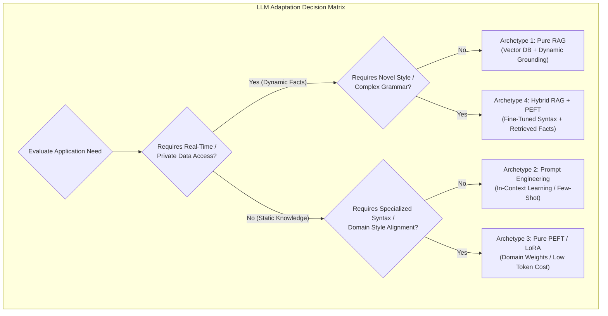
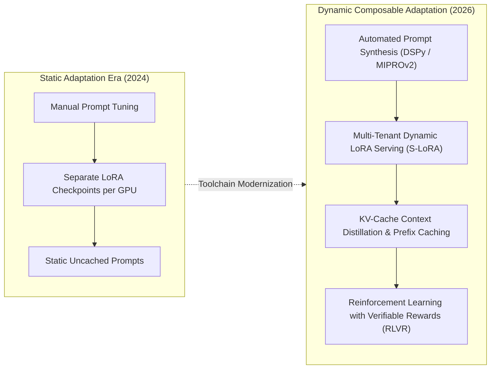

## Why Does No Single LLM Adaptation Technique Satisfy Every Production Constraint?

When engineering enterprise applications powered by foundation language models, teams inevitably confront the limitations of off-the-shelf base models. Out of the box, base models lack access to private organizational databases, hallucinate on niche technical domains, struggle with proprietary output schemas, and drift out of date as real-world facts change.

To close this performance gap, machine learning practitioners rely on three foundational adaptation techniques:

1. **Prompt Engineering & In-Context Learning (ICL)**: Guiding model behavior at inference time through structured instructions, few-shot demonstration exemplars, and chain-of-thought scratchpads.
2. **Retrieval-Augmented Generation (RAG)**: Dynamically querying external document stores or vector databases to ground model generation in authoritative, real-time context.
3. **Parameter-Efficient Fine-Tuning (PEFT)**: Adapting model weights to specialized tasks by training lightweight adapter matrices—such as Low-Rank Adaptation (LoRA)—while freezing the underlying base parameters.

A frequent architectural anti-pattern in early enterprise adoption is the misapplication of these techniques: attempting to update rapidly changing factual data by constantly fine-tuning model weights (which leads to catastrophic forgetting and high training costs), or trying to enforce complex, multi-table SQL syntax purely through bloated few-shot prompts (which burns thousands of tokens per request and inflates latency).

Optimizing system performance requires balancing four orthogonal operational constraints:

- **Knowledge Dynamism**: How rapidly do underlying facts change? (Static concepts vs. real-time inventory).
- **Task Specificity and Formatting**: Does the task require deep reasoning across general knowledge, or rigid adherence to a specialized syntax (e.g., proprietary API contracts)?
- **Inference Latency and Cost Budget**: Can the application tolerate multi-second Time-to-First-Token (TTFT) and high token bills, or does it demand sub-100ms response times?
- **Engineering Complexity and Maintenance**: Does the team have the infrastructure to curate training datasets, execute training runs, and evaluate regression checkpoints?

As demonstrated in our audits on [unified retrieval-generation architectures](/posts/rankrag-nvidia-introduce/) and [enterprise LLM technology stacks](/posts/llm-build-tools-cookbook/), choosing the correct adaptation layer—or combination of layers—is a core architectural decision.



---

## Architectural Comparison: Prompt Engineering, RAG, and PEFT

Each adaptation strategy operates at a fundamentally different layer of the system stack, presenting distinct mechanical trade-offs:

```
+----------------------------------------------------------------------------------------------------+
|                                    LLM Adaptation Strategy Trade-Offs                              |
+----------------------------------------------------------------------------------------------------+
| Metric / Dimension   | Prompt Engineering (ICL)     | Retrieval-Augmented (RAG) | Fine-Tuning (PEFT/LoRA)  |
+----------------------+------------------------------+---------------------------+--------------------------+
| Mechanism            | Dynamic context injection    | Non-parametric retrieval  | Parametric weight updates|
| Data Freshness       | Real-time (in prompt)        | Real-time (at query time) | Static (until retrained) |
| Training Overhead    | Zero (No GPUs needed)        | Low (Index construction)  | Moderate (GPU training)  |
| Serving Cost / Token | High (Large prompt payload)  | High (Retrieved passages) | Lowest (Minimal prompts) |
| Latency Impact       | Increased TTFT on long inputs| Retreival + TTFT overhead | Blazing (Short prompts)  |
| Hallucination Risk   | Moderate                     | Lowest (Verifiable sources| Low (within domain)      |
| Catastrophic Forget  | Zero                         | Zero                      | Potential risk           |
+----------------------------------------------------------------------------------------------------+
```

### 1. In-Context Prompt Engineering: The Rapid Prototyping Baseline
Prompt engineering modifies the prompt text without altering model weights. By supplying clear instructions, output schemas, and few-shot input-output exemplars, engineers leverage the model's pretrained associative memory:
- **Strengths**: Zero upfront capital expenditure, zero GPU training infrastructure, instantaneous iteration cycles.
- **Limitations**: Context windows are bounded. Repeating dozens of examples on every request incurs high recurring token costs and exacerbates latency. Furthermore, complex multi-step reasoning often breaks under long prompts due to attentional drift.

### 2. Retrieval-Augmented Generation (RAG): Non-Parametric Factual Precision
RAG separates **factual memory** from **reasoning capability**. Instead of forcing model weights to memorize millions of enterprise documents, documents are chunked, embedded, and stored in a vector index:
- **Strengths**: Real-time factual updates (updating a database record takes effect instantly without retraining), auditable citations with exact source attribution, strict privacy partitioning (document-level access control via metadata filtering).
- **Limitations**: Pipeline complexity. RAG introduces failure modes across chunking, retrieval recall, and reranking. Irrelevant context chunks can mislead the generator or dilute key facts.

### 3. Parameter-Efficient Fine-Tuning (PEFT): Parametric Specialization
When an application requires consistent formatting (e.g., generating JSON with 50 specific keys) or domain-specific language (e.g., medical pathology reports or specialized SQL dialects), prompt engineering becomes inefficient. 

**Low-Rank Adaptation (LoRA)** (Hu et al., 2021) freezes the base model weights $W_0 \in \mathbb{R}^{d \times k}$ and injects trainable rank-decomposition matrices:

$$W = W_0 + \Delta W = W_0 + B \cdot A$$

where $B \in \mathbb{R}^{d \times r}$ and $A \in \mathbb{R}^{r \times k}$, with rank $r \ll \min(d, k)$. Typically, $r \in \{8, 16, 32\}$, training less than 0.1% of the original model parameters while matching full-parameter fine-tuning quality:
- **Strengths**: Eliminates prompt bloat (the model internalizes the required style and syntax, reducing prompt tokens to bare minimums), reduces serving latency, and enforces strict syntactic consistency.
- **Limitations**: High data curation requirements (requires hundreds or thousands of high-quality input-output pairs), inability to update dynamic factual knowledge, and risk of degrading general reasoning capabilities on out-of-domain tasks.

---

## The Unified Decision Matrix: When to Combine Adaptation Strategies

Rather than viewing Prompting, RAG, and PEFT as mutually exclusive choices, mature production systems combine them synergistically based on operational quadrants:

```
                       High |-----------------------------------------|
                            |  Quadrant II:           Quadrant IV:    |
                            |  Pure RAG               Hybrid RAG+PEFT |
                            |  (Dynamic Enterprise    (Domain Syntax  |
       Knowledge Dynamism   |   Search & Docs)         + Fresh Facts) |
                            |-----------------------------------------|
                            |  Quadrant I:            Quadrant III:   |
                            |  Prompt Engineering     Pure PEFT/LoRA  |
                            |  (Zero-Shot / CoT       (Custom Code /  |
                            |   Rapid Prototyping)     Strict Formats)|
                        Low |-----------------------------------------|
                            Low --------------------------------- High
                                     Domain / Style Specificity
```

- **Quadrant I (Low Dynamism, Low Specificity)**: Standard interactive chatbots and summarization tasks. Solved entirely via optimized system prompts and zero-shot instructions.
- **Quadrant II (High Dynamism, Low Specificity)**: Customer support agents answering questions over evolving company documentation. Solved via standard RAG pipelines with semantic vector search and rerankers.
- **Quadrant III (Low Dynamism, High Specificity)**: Code generation assistants translating user requests into internal microservice RPC calls or domain-specific languages (DSLs). Solved via LoRA fine-tuning to bake the DSL grammar directly into model weights.
- **Quadrant IV (High Dynamism, High Specificity)**: Financial analysts querying real-time market feeds to produce formal compliance filings. Solved via a **Hybrid RAG + PEFT architecture**: a LoRA adapter teaches the model the strict regulatory terminology and formatting structure, while a RAG pipeline dynamically injects real-time price feeds and news transcripts at inference time.

---

## How Model Adaptation Evolved Across 2026

Between 2024 and 2026, the technical landscape for adapting language models underwent fundamental architectural consolidation:



1. **Multi-Tenant Dynamic Adapter Serving (S-LoRA & Punica)**: In early 2024, deploying fine-tuned models required dedicating separate GPU memory allocations for every customer's fine-tuned model checkpoint. In 2026, frameworks like S-LoRA allow a single shared base model in GPU memory to dynamically swap thousands of tenant-specific rank-16 LoRA adapters in microseconds on a per-request basis, collapsing serving infrastructure costs by 90%.
2. **Algorithmic Prompt Optimization via DSPy**: Manual "prompt engineering" by trial-and-error has been replaced by algorithmic prompt compilers. Frameworks like DSPy compile high-level declarative program specifications into optimal prompts and few-shot exemplars using automated optimizers (such as MIPROv2), treating prompt optimization as a mathematical gradient-free search over validation sets.
3. **KV-Cache Prefix Caching and Context Distillation**: Major inference engines (such as vLLM, TensorRT-LLM, and cloud API providers) support automated prefix caching. Long system prompts, enterprise context documents, and multi-shot exemplars have their Key-Value (KV) attention states cached in GPU memory across requests, reducing TTFT latencies for long-context prompts from seconds to milliseconds and slashing prompt token costs by up to 80%.
4. **Post-Training Alignment via Verifiable RL (RLVR)**: Where supervised fine-tuning (SFT) often led to superficial token memorization, 2026 model adaptation increasingly relies on reinforcement learning with verifiable reward signals (such as unit test execution, formal theorem provers, and execution sandboxes). Models learn robust problem-solving behaviors through trial, exploration, and automated self-correction.

---

## Key Takeaways

- **No Universal Silver Bullet**: Prompt engineering, RAG, and fine-tuning address fundamentally different failure modes; effective system design begins with mapping requirements across knowledge dynamism and task specificity.
- **RAG for Factual Memory, PEFT for Form and Style**: Use RAG to ground models in real-time, auditable, and access-controlled factual data; use LoRA to bake specialized vocabulary, tone, and strict output syntax into model weights.
- **Token Cost and Latency Economics**: Prompt engineering incurs zero training cost but burns recurring tokens on every inference call; LoRA incurs upfront GPU training costs but yields minimal inference latency and lower token operating expenses.
- **Modern Convergence**: Advanced 2026 systems combine prefix-cached prompts, dynamic multi-LoRA serving, and automated prompt synthesis (DSPy) to achieve peak domain accuracy at minimal infrastructure cost.

---

## New Questions

- How do dynamic multi-LoRA serving architectures manage memory fragmentation when concurrent requests invoke hundreds of disparate adapter ranks?
- Under what conditions does extensive in-context learning with 1M+ token context windows eliminate the need for offline PEFT fine-tuning?
- What are the empirical bounds on knowledge conflict when dynamically retrieved RAG facts contradict parametric knowledge embedded directly in fine-tuned model weights?

---

## References

- Hu, Edward J., Yelong Shen, Phillip Wallis, Zeyuan Allen-Zhu, Yuanzhi Li, Shean Wang, Lu Wang, and Weizhu Chen. *LoRA: Low-Rank Adaptation of Large Language Models*. International Conference on Learning Representations (ICLR), 2022. [https://arxiv.org/abs/2106.09685](https://arxiv.org/abs/2106.09685) (accessed 2026-10-18).
- Lewis, Patrick, Ethan Perez, Aleksandra Piktus, Fabio Petroni, Vladimir Karpukhin, Naman Goyal, Heinrich Küttler, Mike Lewis, Wen-tau Yih, Tim Rocktäschel, Sebastian Riedel, and Douwe Kiela. *Retrieval-Augmented Generation for Knowledge-Intensive NLP Tasks*. Advances in Neural Information Processing Systems (NeurIPS), 2020. [https://arxiv.org/abs/2005.11401](https://arxiv.org/abs/2005.11401) (accessed 2026-10-18).
- Brown, Tom, Benjamin Mann, Nick Ryder, Melanie Subbiah, Jared D. Kaplan, Prafulla Dhariwal, Arvind Neelakantan, et al. *Language Models Are Few-Shot Learners*. Advances in Neural Information Processing Systems (NeurIPS), 2020. [https://arxiv.org/abs/2005.14165](https://arxiv.org/abs/2005.14165) (accessed 2026-10-18).
- Khattab, Omar, Arnav Singhvi, Paridhi Maheshwari, Zhiyuan Zhang, Keshav Santhanam, Sri Vardhamanan, Saiful Haq, et al. *DSPy: Compiling Declarative Language Model Calls into Self-Improving Pipelines*. International Conference on Learning Representations (ICLR), 2024. [https://arxiv.org/abs/2310.03714](https://arxiv.org/abs/2310.03714) (accessed 2026-10-18).
